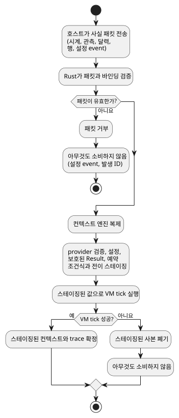
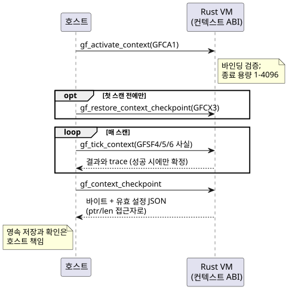

<!-- translation-source: docs/CONTEXT-EXECUTION-ABI.md -->
[영문 원문](CONTEXT-EXECUTION-ABI.md)

# 컨텍스트 실행 ABI

이 문서는 *컨텍스트 기반* 예약과 Result를 위해 호스트와 이식 가능한 Rust VM 사이에
맺는 바이너리 계약을 정의합니다. GFB10(`control-v9`)은 다음 형식을 Rust VM에서
실행합니다.

- Periodic 예약
- Cron 예약
- WorkCalendar Daily 예약
- Tide Run 예약
- 설정 기반 DailySlots
- natural Result와 accounting Result

이후 프로필은 같은 ABI에 달력 경계(GFB18), Holiday Daily(GFB15), 공유 설정
Solar(GFB16)를 추가합니다.

공개 소스는 여전히 완전한 `.ghost.md` 문서 하나입니다. 아래의 바이너리 형식과 내부
lowering 형식은 전송 계약입니다. 제품 소스를 대신하는 또 다른 형식이 아닙니다.

이 문서에서 다루는 내용:

- 어떤 결정을 누가 소유하는지, tick이 언제 확정(commit)되는지
- 컴파일된 프로그램 안의 descriptor(prelude 태그) 레이아웃
- 활성화 패킷(GFCA1)과 tick마다 보내는 사실 패킷(GFSF4)
- 영속 컨텍스트 checkpoint(GFCX3)
- 공유 Solar 확장(GFB16, GFSF6)
- 테스트 증거와 임시 설정 복귀 origin

모든 정수는 리틀 엔디안입니다. `u64 a/b/c`와 같은 필드 표기는 `a`, `b`, `c`라는
이름의 연속된 `u64` 필드 세 개를 뜻합니다.

## 소유권과 확정 경계

호스트는 원시 사실만 제공합니다.

- 시계 snapshot
- provider 관측
- 달력 snapshot
- 해석이 끝난 민간 시각(civil) 발생 행
- 명시적인 설정 event

Rust는 바인딩을 검증하고 모든 결정을 내립니다.

- 발생 identity
- due, missed, active
- natural Result
- 설정 수락
- 종료 상태
- Run 지속 시간

호스트가 제공하는 projection은 금지됩니다. natural 입력은 보호된 입력
`__gf_natural_SITE_ok/value/fault`를 사용합니다. accounting은
`__gf_accounting_SITE_ok/value/fault`를 사용합니다.

컨텍스트 tick은 사본 위에서 동작합니다. 컨텍스트 엔진을 복제한 뒤 provider 검증,
설정 변경, 보호된 Result, 예약 조건식과 전이를 *스테이징*합니다. VM tick이 성공한
경우에만 스테이징된 컨텍스트와 추적(trace)을 확정합니다. 거부된 패킷이나 VM 오류는
설정 event도, 발생 identity도 소비하지 않습니다.

다음 다이어그램은 이 "스테이징 후 확정" 경계를 보여 줍니다.



accounting ledger(원장)에는 예외가 하나 있습니다. accounting 관측은 별도의 Rust
ledger에 저장됩니다. 그 ledger에 이미 영속적으로 확정된 관측은 이후 스캔이 실패해도
확정 상태를 유지합니다. accounting ABI는 그 ledger에서 Result 값을 만듭니다. GFSF4는
accounting projection을 담을 수 없습니다.

**Provider 바인딩.** provider 바인딩은 다음 필드를 고정합니다. 논리 provider, 종류,
namespace, 관측소, 바인딩 revision, 위치, 시간대, 분류 기준, 불확실성 임계값입니다.
한 tick 안에서 같은 provider를 보는 모든 뷰는 revision, coverage, 만료, 불확실성,
fault가 같아야 합니다.

**라벨과 행.** 분류 라벨과 발생 행은 별개의 페이로드입니다. 빈 라벨은 어느 쪽인지에
따라 의미가 다릅니다.

- 발생 쪽 관측에서 라벨이 비어 있으면 라벨 페이로드를 생략한 것입니다.
- natural 관측에서 라벨이 비어 있으면 빈 집합임을 인증한 것입니다.

두 뷰가 모두 라벨을 제공하면 두 라벨 집합이 일치해야 합니다.

**Revision.** 세 종류의 revision은 서로 다른 대상을 식별합니다.

- 봉투(envelope)의 provider revision은 전체 snapshot을 식별합니다.
- 각 Tide 행의 provider revision은 해당 event 예측을 식별합니다. 봉투 revision과
  다를 수 있습니다.
- 행의 context revision은 그 행을 해석한 컨텍스트를 식별합니다.

admission(수용)된 Run은 완료될 때까지 원래의 계획 시각과 행 revision을 유지합니다.

**시간 구간.** coverage는 반열린 구간 `[start,end)`입니다. `now >= expiry`이면 관측이
만료되어 무효가 됩니다. 불확실성은 인증 임계값입니다. admission 구간에 대한 산술이
아닙니다. 관측이 없으면 꾸며낸 증거가 아니라 타입이 있는 Unknown이 만들어집니다.

## 실행 descriptor

컴파일된 프로그램의 각 예약이나 Result는 GFB 헤더 안의 *태그가 붙은 전략 prelude*로
기술됩니다. GFB10은 GFB 시간 헤더와 태그가 붙은 전략 prelude를 유지합니다.

- 기존 태그 0–4는 레이아웃을 그대로 유지합니다.
- 태그 5–9는 공통 접두부 `u32 site, string name, u64 gapMs`로 시작하고 Bool 식
  blob `when, cancel`로 끝납니다.
- 태그 10과 11은 Result를 기술합니다. 이 두 행은 `u32 site`부터 필드를 나열합니다.

| Tag | 공통 접두부와 식 사이의 본문 |
| --- | --- |
| 5 Periodic | string epochId, u64 anchorMs, string setting, u8 operatorEditable, u64 initialMs/minMs/maxMs/stepMs |
| 6 Cron | string timezone, u8 dstMissing/dstRepeated, u8 count 뒤에 u8 필드 값이 오는 목록 5개 |
| 7 Calendar Daily | string timezone, u64 atMs, string calendar, u8 offday/dstMissing/dstRepeated |
| 8 Tide Run | string timezone/provider, u8 high, i64 offsetMs, u64 runMs/withinMs |
| 9 Config DailySlots | string timezone/setting, u8 operatorEditable, u64 gridMs, u16 capacity, u16 initialCount, u16 minutes, u8 dstMissing/dstRepeated |
| 10 Natural Result | u32 site, string name, u8 kind, string provider/classification, u16 ok/value/fault 입력 인덱스 |
| 11 Accounting Result | u32 site, string name/account/event/timezone, u16 ok/value/fault 입력 인덱스 |

Result projection의 타입은 다음과 같습니다.

- natural: Bool/Bool/Number
- accounting: Bool/Int/Number

fault Number에는 유한한 enum 코드가 들어갑니다. Opcode 58은 예약 필드 0/1/2, 즉
due/missed/active를 읽습니다.

설정은 운영자 편집이 비활성화되어 있어도 소스 identity를 유지합니다. 접근 권한
부여가 생략되었다고 해서 편집이 허용되지는 않습니다.

**인코딩 규칙:**

- 모든 정수는 리틀 엔디안입니다.
- 문자열은 u16 바이트 길이 뒤에 UTF-8 바이트가 옵니다.
- 식 blob은 u32 바이트 길이를 사용합니다.
- provider identity 문자열은 비어 있지 않아야 하며 최대 128바이트입니다.
- 정확한 수치 전송 값은 최대 9007199254740991입니다.
- Program 지문은 64비트를 모두 담습니다.

### GFB18 달력 경계

`GhostFlow/control-v18`은 두 가지 달력 형식에 GFB18을 사용합니다. 일반 달력 Result와,
불변 UTC Daily 업무일/휴무일 Range입니다. GFB18은 다음 prelude 태그를 추가합니다.

| Tag | 본문 |
| --- | --- |
| 17 Calendar Range | u32 site, string name, u64 gapMs, string timezone (`UTC`), u64 durationMs, u16 startCount 뒤에 u64 startsMs, string calendar, u8 selector, Bool 식 blob when/cancel |
| 18 Calendar Result | u32 site, string name/calendar, u8 selector, string timezone (`UTC`), u16 ok/value/fault 보호 입력 인덱스 |

Selector:

| Selector | Range | Result |
| --- | --- | --- |
| 0 workday | 허용 | 허용 |
| 1 offday | 허용 | 허용 |
| 2 holiday | 허용 안 함 | 허용 |

Range 규칙:

- 소스 Range 구간은 불변 UTC Daily입니다.
- 반열린 구간은 자정 또는 그 이전에 끝나야 합니다.
- 자정을 넘는 업무 구간은 거부됩니다. 대신 별도의 명시적 선언으로 나누어 표현해야
  합니다.
- 일반 UTC Range는 기존 의미를 유지합니다.
- 새 admission 전에 달력 적격성을 검사합니다. 이미 admission된 Range는 단조 시간
  기한(deadline)을 유지합니다.

두 descriptor 모두 site를 키로 하는 기존 GFSF5 `schedule` 사실을 소비합니다. 이 사실은
선택적인 달력 snapshot을 담습니다. Result와 Range에는 provider 관측도, 민간 시각 발생
행도 필요하지 않습니다.

Rust는 신뢰할 수 있는 시계 증거에서 UTC 날짜를 도출하고 달력을 평가합니다. missing,
coverage 밖, 만료 fault를 보존합니다. Result projection은 Bool/Bool/Number이며 유한한
CalendarFault 코드를 사용합니다. 이 입력들은 보호되어 있으므로 호스트가 적격성
projection을 제공할 수 없습니다.

활성화에는 명시적이고 일치하는 UTC 달력 바인딩이 필요합니다. Result, Range, Daily
pulse 소비자가 바인딩을 공유하면 그 전체에 다음 보장이 적용됩니다.

- snapshot 동일성
- revision 이력
- 유한한 보관 상한
- 거부된 스캔의 원자성

기존 사실 형식과 checkpoint 형식은 바뀌지 않습니다. 이전 로더는 새 GFB 헤더를
거부합니다.

## 활성화와 사실

호스트는 두 진입점을 호출합니다. 컨텍스트를 한 번 활성화한 다음, tick마다 사실
패킷을 보냅니다. checkpoint 복원은 활성화와 첫 스캔 사이에서만 할 수 있습니다
([영속 컨텍스트](#영속-컨텍스트) 참조).



`gf_activate_context(handle, ptr, len)`은 GFCA1을 소비합니다.

```text
"GFCA", u16 1, u64 bootEpoch, u32 terminalCapacity,
u16 bindingCount, binding[]
binding := u8 kind, string provider/namespace/station/bindingRevision/
           location/timezone/criteria, u64 maxUncertaintyMs
```

활성화 규칙:

- 바인딩 종류는 Tide 0, Moon 1, Calendar 2입니다.
- 종료 용량(terminal capacity)은 1–4096입니다.
- 활성화 바인딩은 최대 128개까지 허용됩니다.
- 사용되지 않거나, 중복되거나, 일치하지 않는 바인딩이 있으면 활성화가 거부됩니다.
- 설정 용량과 패킷 행 용량은 종료 ledger 용량과 별개입니다.

`gf_tick_context(handle, ptr, len)`은 GFSF4를 소비합니다.

```text
"GFSF", u16 4,
u64 monotonicMs/bootEpoch, optional wallMs/uncertaintyMs,
u8 trusted, string reason/sourceRevision,
u16 naturalCount, observation[], u16 scheduleCount, schedule[],
u8 settingsPresent, [settings]

observation := binding, string providerRevision,
               u64 coverageStartMs/coverageEndMs/expiresAtMs/uncertaintyMs,
               u8 fault, u8 classificationCount, string classifications[]
schedule := u32 site, u64 coverageStartMs/coverageEndMs,
            u8 providerPresent, [observation], u8 calendarPresent, [calendar],
            u16 rowCount, row[]
row := u32 sourceDay, u64 slotKey, u16 minuteOfDay, u8 fold,
       string eventId, u8 eventKind, optional instantMs, u8 withdrawn,
       string providerRevision/contextRevision
calendar := string id/revision/timezone, u32 fromDate/toDateExclusive,
            u64 expiresAtMs, u8 weeklyWorkMask/holidayWork,
            u16 holidayCount, u32 holidays[],
            u16 exceptionCount, (u32 date, u8 work) exceptions[]
settings := u64 programFingerprint, string eventId,
            u64 baseRevision/position, u16 changeCount, change[]
change := u32 site, u8 kind,
          (u64 durationMs | u16 slotCount, (u64 key, u16 minuteOfDay) slots[])
```

필드 값:

| 필드 | 인코딩 |
| --- | --- |
| optional 시각 | `u8 present, u64 value`; 부재 시 값은 0 |
| `eventKind` | civil 0, high 1, low 2 |
| provider `fault` | 255는 부재; 0–5는 유한한 natural fault enum에 대응 |
| 설정 `kind` | 0 Duration, 1 TimeSlots |
| 슬롯 `key` | 0이면 할당 요청; 0이 아닌 키는 이미 해당 설정에 속해 있어야 함 |

설정 규칙:

- 키가 지정된 완전한 값이 이전 값을 대체합니다.
- event 위치는 다음에 성공할 스캔의 번호입니다.
- base revision은 현재 설정 revision과 같아야 합니다.
- 설정과 그 스캔은 원자적으로 확정됩니다.

상한:

- 활성화 패킷과 사실 패킷은 최대 65536바이트입니다.
- 섹션 개수는 최대 128개입니다.
- 발생 행은 최대 4096개입니다.
- 디코더는 후행 바이트와 잘못된 태그를 거부합니다.
- native 진입점도 페이로드 상한과 descriptor 호환성을 검증합니다.

## 영속 컨텍스트

`gf_context_checkpoint`는 checkpoint 바이트와 유효 설정 JSON을 캡처합니다. 호스트는
`gf_context_checkpoint_ptr/len`과 `gf_context_state_ptr/len`으로 이를 읽습니다.

`gf_restore_context_checkpoint(handle, ptr, len)`은 활성화된 실행의 첫 스캔 전에만
허용됩니다. 영속 저장과 확인(acknowledgement)은 호스트의 책임입니다.

GFCX3 checkpoint에는 다음이 들어 있습니다.

- magic과 version
- 정확한 Program 지문
- 정규화된 바인딩 바이트
- 설정 revision
- 수락된 event identity
- site를 키로 하는 엔진 snapshot
- 수락된 달력의 전체 내용(ID와 revision을 키로 함)
- CRC32

상한과 거부 규칙:

- 저장되는 달력은 `min(terminalCapacity, 128)`개 snapshot과 8192개의
  holiday/exception 날짜 셀로 제한됩니다.
- 복원은 내용이 바뀐 revision과 모든 상한 위반을 거부합니다.
- GFCX1과 GFCX2는 명시적으로 거부됩니다.
- 래퍼는 최대 4 MiB이고, 엔진 snapshot 하나는 최대 1 MiB입니다.
- identity 불일치, 손상, 유효하지 않은 복원 설정, 용량 초과가 있으면 복원 전체가
  거부됩니다.

CRC32는 우발적 손상을 감지합니다. 인증 수단은 아닙니다.

재시작 후 유지되는 것:

| 유지됨 | 유지되지 않음 |
| --- | --- |
| 유효 Periodic 위상과 간격 | 시계 관측 |
| 키가 지정된 슬롯과 슬롯 할당기 | 활성 Run |
| 종료된 발생 identity | |

복원된 실행은 새 기준선을 세우며 과거 발생을 재생할 수 없습니다. 이것은 컨텍스트
checkpoint입니다. accounting ledger도, 일반 VM 상태 이미지도 아닙니다.

## 공유 Solar 컨텍스트 확장

위 레이아웃은 원래의 컨텍스트 프로필을 설명합니다. 이후 두 가지가 그 위에
추가되었습니다.

- 타입이 있는 설정은 [설정 스트림](OPERATOR-SETTINGS-STREAM.ko.md)에서 설명하는
  GFSF5 봉투를 사용합니다.
- Calendar Holiday Daily는 GFB15 tag15를 추가합니다.

공유 설정을 쓰는 Solar는 GFB16/control-v15를 사용합니다. 기존 GFCA1 활성화와 GFB11
공유 설정 descriptor를 유지합니다. Tag16은 공통 접두부
`u32 site, string name, u64 gapMs` 뒤에 다음이 옵니다.

```text
string timezone, f64 latitude, f64 longitude, u8 event,
i64 offsetMs, u64 fallbackAtMs,
u16 configDependencyCount, u32 configIds[],
expression when, expression cancel, u64 holdMs
```

Tag16 규칙:

- `event`는 rise 0 또는 set 1입니다.
- `fallbackAtMs` 86400000은 부재를 뜻하고, `holdMs` 0은 부재를 뜻합니다.
- 설정 ID는 정렬되어 있고 중복이 없습니다.
- Rust는 보호된 `when` 읽기에서 정확한 의존성을 검증합니다. 참조된 설정 중 하나라도
  현재 fault가 있으면 admission이 막힙니다.
- 바인딩 필드는 불변이며 사실과 정확히 일치해야 합니다.

GFSF6은 선택적 설정 섹션까지는 GFSF5를 그대로 유지하고, 그 뒤에 다음을 덧붙입니다.

```text
u16 solarCount, solar[]
solar := u32 site, string timezone, f64 latitude, f64 longitude,
         u8 event, i64 offsetMs, u64 coverageStartMs/coverageEndMs,
         u16 rowCount, solarRow[]
solarRow := u32 sourceDay, u8 availability,
            optional scheduledWallMs, optional fallbackWallMs,
            u8 unavailableReason, string providerRevision/contextRevision
```

GFSF6 규칙:

- `availability`는 available 0 또는 unavailable 1입니다.
- `unavailableReason` 255는 부재를 뜻하고, 0–5는 타입이 있는 natural fault 코드입니다.
- optional 시각은 `u8 present, u64 value` 형식을 유지하며 부재 시 값은 0입니다.
- Solar 행은 민간 시각의 slot/fold 필드를 받지 않습니다. Rust가 해당 identity 구성
  요소를 0으로 고정합니다.
- `runtimes/wasm/context-abi.mjs`의
  `solarContextEvidence(descriptor, providerSchedule)`는 provider 사실을 이 패킷으로
  투영합니다. admission을 계산하지는 않습니다.
- Solar 컨텍스트에는 GFSF6이 필요합니다. 기존의 Solar가 아닌 프로필은 명시적인 호환성
  결정에 따라 GFSF5를 유지합니다.

확정과 복구:

- Solar, 공유 설정 벡터, VM은 함께 확정됩니다.
- 평가가 실패하면 event도, 발생도 소비되지 않습니다.
- 복구에 성공하면 과거 발생을 따라잡지 않고(catch-up 없음) 기준선을 세웁니다.
- GFCX3는 GFES subtype3 Solar 엔진 상태를 포함합니다. 정확히 같은 Program/바인딩
  아래에서 source-day 종료 identity와 현재 설정 Result를 보존합니다. 복원된 실행이
  새 기준선에서 시작하도록 시계 관측은 버립니다.
- 이전 GFB 로더는 format16을 거부합니다.
- 독립형 Solar 소비자는 기존 프로필을 유지합니다. 두 프로필 사이에 암묵적인
  fallback은 없습니다.

범위와 재현 절차는 [실행 안내](SOLAR-CONFIG-EXECUTION.ko.md)를 참조하십시오.

## 증거

**native 테스트 프로필.** 테스트 전용 native `context_tape` 프로필
`context-tide-v1`은 유한한 Tide 바인딩과, high/low event ID가 명시된 유한한 provider
관측을 받습니다. 다른 프로필의 가드는 분리된 채로 유지됩니다. 이 프로필은
Moon/달력 바인딩도, natural provider 레일도 받지 않습니다. admission은 공유 core가
담당합니다. native 기록은 전체 결과(outcome), 소스/설정 상태, 컨텍스트 checkpoint를
노출합니다. 사실이 거부된 뒤에는 재시도를 위해 기존 journal/checkpoint 증거를
보존합니다.

**REF-03-029.** 이 사례는 같은 두 site Tide 소스를 컴파일하여 native 실행과 framed
WASM 실행을 비교합니다.

1. event E가 1000ms에 admission됩니다.
2. provider/context revision이 정정되고 E의 계획 시각이 2000ms로 옮겨집니다. 기존
   단조 시간 Run이 Active인 동안에는 실제로 admission된 발생 ID, 원래 revision,
   1000ms 계획 시각을 유지합니다. 두 예약 모두 Due를 추가로 내보내지 않습니다.
3. 그 Run이 끝난 뒤 2500ms에 정정된 E를 스캔해도 두 run 카운터는 모두 1로
   유지됩니다. 현재 core는 종료된 Tide ID를 이후 컨텍스트 관측에서 생략합니다. 이
   증거는 `AlreadyAdmitted`나 `AlreadyTerminal` 같은 처분(disposition)을 문자 그대로
   만들어 내지 않습니다.
4. 3000ms의 새 E2는 서로 다른 두 소스 예약 site에서 각각 독립적으로 admission됩니다.

이 테스트는 전체 outcome/상태와 checkpoint parity(동등성), 같은 프로그램에서의
checkpoint 재생, 위조된 바인딩 거부, 유효한 재시도도 검사합니다.

이 증거의 한계:

- 컨텍스트 복원은 일반 VM 상태나 활성 Run을 복원하지 않습니다.
- provider 사실은 호출자가 제공합니다.
- provider 진위, 물리 출력, 운영 환경 전송, 새로운 일반 Run 정책에 대해서는 아무것도
  주장하지 않습니다.

**테스트 모음.**

| 모음 | 다루는 범위 |
| --- | --- |
| `context_runtime_tests` | 보호된 입력, 공유 provider 일관성, VM 실패 롤백, 설정 재시도, identity로 보호되는 영속 복원 |
| `context_abi` | 패킷 거부 |
| `context_schedule`, `natural_context`, `work_calendar`, `cron_schedule` | 종류별 경계 |

종단 간 Reference fixture는 정본 컴파일과 같은 WASM 런타임을 실행합니다. 호스트 쪽
예약 구현을 실행하는 것이 아닙니다.

## 임시 설정 복귀 origin

GFSF5/GFSF6의 타입이 있는 설정에서 origin 태그 2는 `temporaryReturn`입니다. Host가
검증하고 기록한 임시 설정 복귀에 사용합니다.

- 운영자 편집 가능 대상 검사와, 타입별 범위·격자·용량 검사를 유지합니다.
- 추가로, 스트림 할당기 상한보다 작은, 이전에 할당된 TimeSlots 행 키를 허용합니다.
- 일반 origin 0과 producer origin 1은 기존 규칙을 유지합니다.
- 이전 런타임은 추가된 origin을 거부합니다.
- origin은 인증 토큰이 아닙니다.

소스에 결합된 provenance(출처)와 신뢰하는 Host 입력은
[임시 설정 호스트](TEMPORARY-SETTINGS-HOST.ko.md)를 참조하십시오.
