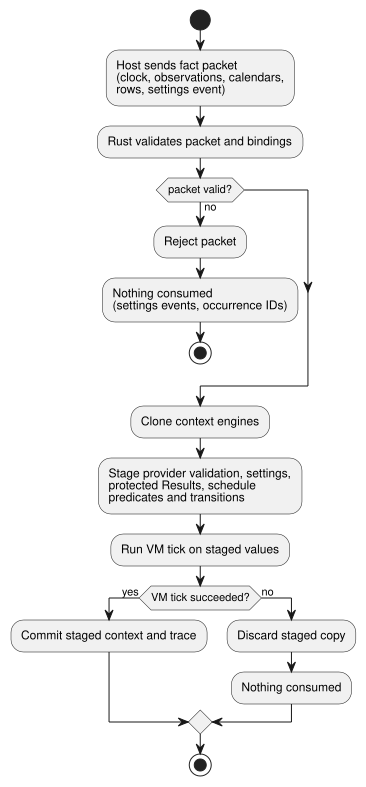
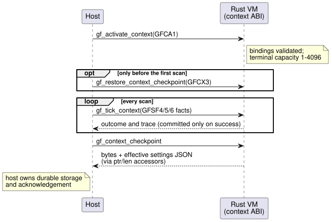

# Context execution ABI

This document defines the binary contract between a host and the portable Rust
VM for *context-driven* schedules and Results. GFB10 (`control-v9`) executes
these forms in the Rust VM:

- Periodic schedules
- Cron schedules
- WorkCalendar Daily schedules
- Tide Run schedules
- config-backed DailySlots
- natural and accounting Results

Later profiles extend the same ABI with calendar boundaries (GFB18), Holiday
Daily (GFB15) and shared-config Solar (GFB16).

The public source is still one complete `.ghost.md` document. The binary and
internal lowering forms below are transport contracts. They are not an
alternative product source.

In this document:

- who owns which decision, and when a tick commits;
- the descriptor (prelude tag) layouts in the compiled program;
- the activation packet (GFCA1) and the per-tick fact packet (GFSF4);
- durable context checkpoints (GFCX3);
- the shared Solar extension (GFB16, GFSF6);
- the test evidence and the temporary settings return origin.

All integers are little endian. Field notation such as `u64 a/b/c` means three
consecutive `u64` fields named `a`, `b` and `c`.

## Ownership and commit boundary

The host supplies only raw facts:

- clock snapshots;
- provider observations;
- calendar snapshots;
- resolved civil occurrence rows;
- explicit settings events.

Rust validates the bindings and makes every decision:

- occurrence identity;
- due, missed and active;
- the natural Result;
- settings acceptance;
- terminal state;
- Run duration.

Host-provided projections are forbidden. Natural inputs use the protected
inputs `__gf_natural_SITE_ok/value/fault`. Accounting uses
`__gf_accounting_SITE_ok/value/fault`.

A context tick works on a copy. It clones the context engines and *stages*
provider validation, settings changes, protected Results, schedule predicates
and transitions. Only a successful VM tick commits the staged context and the
trace. A rejected packet or a VM error consumes neither settings events nor
occurrence identities.

The following diagram shows this stage-then-commit boundary.



One exception concerns the accounting ledger. Accounting observations live in a
separate Rust ledger. Observations that are already durably committed there stay
committed even if a later scan fails. The accounting ABI builds Result values
from that ledger. GFSF4 cannot carry accounting projections.

**Provider bindings.** A provider binding pins these fields: logical provider,
kind, namespace, station, binding revision, location, timezone, classification
criteria and uncertainty threshold. Within one tick, all views of one provider
must share the same revision, coverage, expiry, uncertainty and fault.

**Labels and rows.** Classification labels and occurrence rows are separate
payloads. Empty labels mean different things depending on the side:

- On an occurrence-side observation, empty labels omit the label payload.
- On a natural observation, empty labels certify an empty set.

If both views supply labels, their label sets must agree.

**Revisions.** Three kinds of revision identify different things:

- The envelope provider revision identifies the complete snapshot.
- Each Tide row's provider revision identifies that event prediction. It may
  differ from the envelope revision.
- A row's context revision identifies the context that resolved it.

An admitted Run keeps its original planned time and row revisions until it
completes.

**Time windows.** Coverage is the half-open interval `[start,end)`. An
observation is expired, and therefore invalid, when `now >= expiry`.
Uncertainty is a certification threshold. It is not arithmetic on admission
intervals. A missing observation produces a typed Unknown, never fabricated
evidence.

## Executable descriptors

Each schedule or Result in a compiled program is described by a *tagged
strategy prelude* in the GFB header. GFB10 keeps the GFB temporal header and the
tagged strategy preludes:

- Existing tags 0–4 keep their layouts.
- Tags 5–9 begin with the common prefix `u32 site, string name, u64 gapMs` and
  end with the Bool expression blobs `when, cancel`.
- Tags 10 and 11 describe Results. Their rows list the fields starting from
  `u32 site`.

| Tag | Body between common prefix and expressions |
| --- | --- |
| 5 Periodic | string epochId, u64 anchorMs, string setting, u8 operatorEditable, u64 initialMs/minMs/maxMs/stepMs |
| 6 Cron | string timezone, u8 dstMissing/dstRepeated, five lists of u8 count followed by u8 field values |
| 7 Calendar Daily | string timezone, u64 atMs, string calendar, u8 offday/dstMissing/dstRepeated |
| 8 Tide Run | string timezone/provider, u8 high, i64 offsetMs, u64 runMs/withinMs |
| 9 Config DailySlots | string timezone/setting, u8 operatorEditable, u64 gridMs, u16 capacity, u16 initialCount, u16 minutes, u8 dstMissing/dstRepeated |
| 10 Natural Result | u32 site, string name, u8 kind, string provider/classification, u16 ok/value/fault input indices |
| 11 Accounting Result | u32 site, string name/account/event/timezone, u16 ok/value/fault input indices |

Result projections have these types:

- natural: Bool/Bool/Number;
- accounting: Bool/Int/Number.

A fault Number carries a finite enum code. Opcode 58 reads schedule fields
0/1/2, which are due/missed/active.

Settings keep their source identities even when operator edits are disabled. An
omitted access grant does not authorize edits.

**Encoding rules:**

- All integers are little endian.
- Strings use a u16 byte length followed by UTF-8 bytes.
- Expression blobs use a u32 byte length.
- Provider identity strings are nonempty and at most 128 bytes.
- Exact numerical transport values are at most 9007199254740991.
- Program fingerprints carry all 64 bits.

### GFB18 calendar boundaries

`GhostFlow/control-v18` uses GFB18 for two calendar forms: ordinary calendar
Results, and immutable UTC Daily work-day/off-day ranges. GFB18 adds these
prelude tags:

| Tag | Body |
| --- | --- |
| 17 Calendar Range | u32 site, string name, u64 gapMs, string timezone (`UTC`), u64 durationMs, u16 startCount followed by u64 startsMs, string calendar, u8 selector, Bool expression blobs when/cancel |
| 18 Calendar Result | u32 site, string name/calendar, u8 selector, string timezone (`UTC`), u16 ok/value/fault protected input indices |

Selectors:

| Selector | Range | Result |
| --- | --- | --- |
| 0 workday | allowed | allowed |
| 1 offday | allowed | allowed |
| 2 holiday | not allowed | allowed |

Range rules:

- The source Range slice is an immutable UTC Daily.
- Its half-open interval must end at or before midnight.
- A work interval that crosses midnight is rejected. Represent it as separate,
  explicit declarations instead.
- An ordinary UTC Range keeps its existing semantics.
- Calendar eligibility is checked before a new admission. A Range that is
  already admitted keeps its monotonic deadline.

Both descriptors consume the existing GFSF5 `schedule` facts, keyed by site.
Those facts carry the optional calendar snapshot. Result and Range need no
provider observation and no civil occurrence rows.

Rust derives the UTC date from trusted clock evidence and evaluates the
calendar. It preserves the missing, out-of-coverage and expired faults. The
Result projection is Bool/Bool/Number, with a finite CalendarFault code. These
inputs are protected, so the host cannot supply eligibility projections.

Activation requires an explicit, matching UTC calendar binding. When Result,
Range and Daily pulse consumers share a binding, these guarantees apply across
all of them:

- snapshot equality;
- revision history;
- bounded retention;
- atomicity of a rejected scan.

Existing facts and checkpoint formats are unchanged. Older loaders reject the
new GFB header.

## Activation and facts

The host calls two entry points. It activates the context once, then sends a
fact packet on every tick. A checkpoint may be restored only between activation
and the first scan (see [Durable context](#durable-context)).



`gf_activate_context(handle, ptr, len)` consumes GFCA1:

```text
"GFCA", u16 1, u64 bootEpoch, u32 terminalCapacity,
u16 bindingCount, binding[]
binding := u8 kind, string provider/namespace/station/bindingRevision/
           location/timezone/criteria, u64 maxUncertaintyMs
```

Activation rules:

- Binding kinds are Tide 0, Moon 1 and Calendar 2.
- Terminal capacity is 1–4096.
- At most 128 activation bindings are allowed.
- An unused, duplicate or mismatched binding rejects activation.
- Settings capacity and packet row capacity are separate from the terminal
  ledger capacity.

`gf_tick_context(handle, ptr, len)` consumes GFSF4:

```text
"GFSF", u16 4,
u64 monotonicMs/bootEpoch, optional wallMs/uncertaintyMs,
u8 trusted, string reason/sourceRevision,
u16 naturalCount, observation[], u16 scheduleCount, schedule[],
u8 settingsPresent, [settings]

observation := binding, string providerRevision,
               u64 coverageStartMs/coverageEndMs/expiresAtMs/uncertaintyMs,
               u8 fault, u8 classificationCount, string classifications[]
schedule := u32 site, u64 coverageStartMs/coverageEndMs,
            u8 providerPresent, [observation], u8 calendarPresent, [calendar],
            u16 rowCount, row[]
row := u32 sourceDay, u64 slotKey, u16 minuteOfDay, u8 fold,
       string eventId, u8 eventKind, optional instantMs, u8 withdrawn,
       string providerRevision/contextRevision
calendar := string id/revision/timezone, u32 fromDate/toDateExclusive,
            u64 expiresAtMs, u8 weeklyWorkMask/holidayWork,
            u16 holidayCount, u32 holidays[],
            u16 exceptionCount, (u32 date, u8 work) exceptions[]
settings := u64 programFingerprint, string eventId,
            u64 baseRevision/position, u16 changeCount, change[]
change := u32 site, u8 kind,
          (u64 durationMs | u16 slotCount, (u64 key, u16 minuteOfDay) slots[])
```

Field values:

| Field | Encoding |
| --- | --- |
| optional time | `u8 present, u64 value`; the value is zero when absent |
| `eventKind` | civil 0, high 1, low 2 |
| provider `fault` | 255 means absent; 0–5 map to the finite natural fault enum |
| settings `kind` | 0 Duration, 1 TimeSlots |
| slot `key` | 0 requests allocation; a nonzero key must already belong to the setting |

Settings rules:

- The complete keyed value replaces the old value.
- The event position is the number of the next successful scan.
- The base revision must equal the current settings revision.
- Settings and their scan commit atomically.

Bounds:

- Activation and fact packets are at most 65536 bytes.
- Section counts are at most 128.
- Occurrence rows are at most 4096.
- Decoders reject trailing bytes and malformed tags.
- Native entry points also validate payload bounds and descriptor compatibility.

## Durable context

`gf_context_checkpoint` captures the checkpoint bytes and the effective settings
JSON. The host reads them through `gf_context_checkpoint_ptr/len` and
`gf_context_state_ptr/len`.

`gf_restore_context_checkpoint(handle, ptr, len)` is permitted only before the
first scan of an activated run. The host owns durable storage and
acknowledgement.

A GFCX3 checkpoint contains:

- magic and version;
- the exact Program fingerprint;
- the canonical binding bytes;
- the settings revision;
- accepted event identities;
- site-keyed engine snapshots;
- the full contents of accepted calendars, keyed by ID and revision;
- a CRC32.

Limits and rejection rules:

- Stored calendars are bounded to `min(terminalCapacity, 128)` snapshots and
  8192 holiday/exception date cells.
- Restore rejects a revision whose contents changed, and any bound violation.
- GFCX1 and GFCX2 are rejected explicitly.
- The wrapper is at most 4 MiB; each engine snapshot is at most 1 MiB.
- An identity mismatch, corruption, invalid restored settings or a capacity
  overflow rejects the whole restore.

CRC32 detects accidental corruption. It is not an authentication mechanism.

What survives a restart:

| Survives | Does not survive |
| --- | --- |
| effective Periodic phase and interval | clock observations |
| keyed slots and the slot allocator | active Runs |
| terminal occurrence identities | |

A restored run establishes a fresh baseline and cannot replay past occurrences.
This is a context checkpoint. It is neither an accounting ledger nor a general
VM-state image.

## Shared Solar context extension

The layouts above describe the original context profile. Two later additions
build on it:

- Typed settings use the GFSF5 envelope described in
  [configuration streams](OPERATOR-SETTINGS-STREAM.md).
- Calendar Holiday Daily adds GFB15 tag15.

Solar with shared config uses GFB16/control-v15. It keeps the existing GFCA1
activation and the GFB11 shared config descriptors. Tag16 has the common
`u32 site, string name, u64 gapMs` prefix, followed by:

```text
string timezone, f64 latitude, f64 longitude, u8 event,
i64 offsetMs, u64 fallbackAtMs,
u16 configDependencyCount, u32 configIds[],
expression when, expression cancel, u64 holdMs
```

Tag16 rules:

- `event` is rise 0 or set 1.
- `fallbackAtMs` 86400000 means absent; `holdMs` 0 means absent.
- Config IDs are sorted and unique.
- Rust verifies the exact dependencies from protected `when` reads. Any
  referenced config with a current fault prevents admission.
- Binding fields are immutable and must match the facts exactly.

GFSF6 keeps GFSF5 up to and including its optional settings section, then
appends:

```text
u16 solarCount, solar[]
solar := u32 site, string timezone, f64 latitude, f64 longitude,
         u8 event, i64 offsetMs, u64 coverageStartMs/coverageEndMs,
         u16 rowCount, solarRow[]
solarRow := u32 sourceDay, u8 availability,
            optional scheduledWallMs, optional fallbackWallMs,
            u8 unavailableReason, string providerRevision/contextRevision
```

GFSF6 rules:

- `availability` is available 0 or unavailable 1.
- `unavailableReason` 255 means absent; 0–5 are typed natural fault codes.
- Optional times keep the `u8 present, u64 value` form, with zero when absent.
- Solar rows do not accept civil slot/fold fields. Rust fixes those identity
  components to zero.
- `solarContextEvidence(descriptor, providerSchedule)` in
  `runtimes/wasm/context-abi.mjs` projects provider facts into this packet. It
  does not compute admission.
- A Solar context requires GFSF6. Existing non-Solar profiles keep GFSF5 by an
  explicit compatibility decision.

Commit and recovery:

- Solar, the shared config vector and the VM commit together.
- A failed evaluation consumes neither events nor occurrences.
- A successful recovery establishes a baseline, with no catch-up of past
  occurrences.
- GFCX3 embeds GFES subtype3 Solar engine state. Under the exact
  Program/bindings, it preserves source-day terminal identities and current
  config Results. It discards clock observations so that the restored run starts
  from a fresh baseline.
- Older GFB loaders reject format16.
- Standalone Solar consumers keep their existing profile. There is no implicit
  fallback between the two.

See the [execution guide](SOLAR-CONFIG-EXECUTION.md) for scope and reproduction
steps.

## Evidence

**Native test profile.** The test-only native `context_tape` profile
`context-tide-v1` accepts bounded Tide bindings and finite provider observations
with explicit high/low event IDs. Other profile guards remain separate. This
profile accepts neither Moon/calendar bindings nor natural-provider rails. The
shared core owns admission. Native records expose complete outcomes,
source/settings state and context checkpoints. After rejected facts, they keep
the existing journal/checkpoint evidence for a retry.

**REF-03-029.** This case compiles the same two-site Tide source and compares
native and framed WASM execution:

1. Event E admits at 1000ms.
2. The provider/context revisions are corrected and E's planned time moves to
   2000ms. While the existing monotonic Run is Active, it keeps the actual
   admitted occurrence ID, the original revisions and the 1000ms planned time.
   Neither schedule emits another Due.
3. After that Run ends, a corrected E scan at 2500ms leaves both run counters
   at one. The current core omits terminal Tide IDs from later context
   observations. This evidence does not invent a literal `AlreadyAdmitted` or
   `AlreadyTerminal` disposition.
4. A fresh E2 at 3000ms admits independently at both distinct source schedule
   sites.

The test also checks full outcome/state and checkpoint parity, matching-program
checkpoint replay, forged binding rejection and a valid retry.

Limits of this evidence:

- Context restoration does not restore general VM state or active Runs.
- Provider facts are supplied by the caller.
- No claim is made about provider authenticity, physical output, production
  transport or any new generic Run policy.

**Test suites.**

| Suite | Covers |
| --- | --- |
| `context_runtime_tests` | protected inputs, shared-provider consistency, VM-failure rollback, settings retry and identity-fenced durable restore |
| `context_abi` | packet rejection |
| `context_schedule`, `natural_context`, `work_calendar`, `cron_schedule` | kind-specific boundaries |

End-to-end Reference fixtures exercise canonical compilation and the same WASM
runtime, not a host-side scheduling implementation.

## Temporary settings return origin

In GFSF5/GFSF6 typed settings, origin tag 2 is `temporaryReturn`. It is used for
a Host-validated, recorded return of a temporary setting.

- It keeps the operator-editable target checks and the typed range, grid and
  capacity checks.
- It also permits previously allocated TimeSlots row keys below the stream
  allocator bound.
- Ordinary origin 0 and producer origin 1 keep their existing rules.
- Older runtimes reject the additional origin.
- The origin is not an authentication token.

See [temporary settings host](TEMPORARY-SETTINGS-HOST.md) for the source-bound
provenance and the trusted Host inputs.
