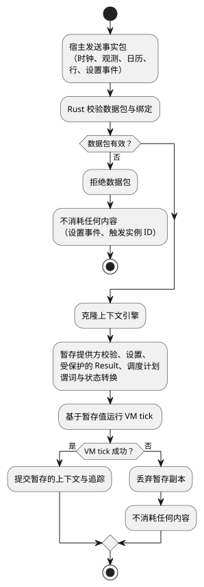
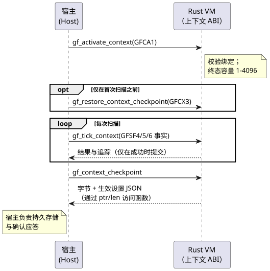

<!-- translation-source: docs/CONTEXT-EXECUTION-ABI.md -->
[英文原文](CONTEXT-EXECUTION-ABI.md)

# 上下文执行 ABI

本文档定义宿主（host）与可移植 Rust VM 之间针对*上下文驱动*的调度计划和 Result 的二进制契约。GFB11（`control-v10`）在 Rust VM 中执行以下形式：

- Periodic 调度计划
- Cron 调度计划
- WorkCalendar Daily 调度计划
- Tide Run 调度计划
- 由 config 支撑的 DailySlots
- 自然 Result 与用量核算 Result

运行时和包验证器拒绝历史 GFB10（`control-v9`）。重新编译规范源文件可生成当前格式的产物。

后续 profile 在同一 ABI 上扩展了日历边界（GFB18）、Holiday Daily（GFB15）以及共享 config 的 Solar（GFB16）。

公开的源仍然是一份完整的 `.ghost.md` 文档。下文的二进制形式和内部降级（lowering）形式都是传输契约，而不是另一种产品源。

本文档内容：

- 谁负责哪项判定，以及 tick 何时提交；
- 已编译程序中的描述符（prelude 标签）布局；
- 激活包（GFCA1）和每个 tick 的事实包（GFSF4）；
- 持久化上下文检查点（GFCX3）；
- 共享 Solar 扩展（GFB16、GFSF6）；
- 测试证据以及临时设置的恢复原值来源（origin）。

所有整数均为小端序。`u64 a/b/c` 这类字段写法表示三个连续的 `u64` 字段，分别名为 `a`、`b` 和 `c`。

## 所有权与提交边界

宿主只提供原始事实：

- 时钟快照；
- 提供方（provider）观测；
- 日历快照；
- 已解析的民用时间触发实例行；
- 显式的设置事件。

Rust 校验绑定并做出所有判定：

- 触发实例（occurrence）身份标识；
- due、missed 与 active；
- 自然 Result；
- 设置的接受；
- 终态；
- Run 持续时间。

禁止由宿主提供投影。自然输入使用受保护输入 `__gf_natural_SITE_ok/value/fault`。用量核算使用 `__gf_accounting_SITE_ok/value/fault`。

上下文 tick 在副本上工作。它克隆上下文引擎，并*暂存*提供方校验、设置变更、受保护的 Result、调度计划谓词与状态转换。只有成功的 VM tick 才会提交暂存的上下文与追踪。被拒绝的数据包或 VM 错误既不会消耗设置事件，也不会消耗触发实例身份标识。

下图展示了这种“先暂存、后提交”的边界。



用量核算账本是一个例外。用量核算观测存放在独立的 Rust 账本中。已经在该账本中持久提交的观测，即使之后某次扫描失败，也仍保持已提交状态。用量核算 ABI 根据该账本构建 Result 值。GFSF4 不能携带用量核算投影。

**提供方绑定。** 提供方绑定固定以下字段：逻辑提供方、种类、命名空间、站点、绑定修订版、位置、时区、分类准则以及不确定度阈值。在一个 tick 内，同一提供方的所有视图必须共享相同的修订版、覆盖范围、过期时间、不确定度与故障。

**标签与行。** 分类标签与触发实例行是不同的载荷。空标签在不同一侧含义不同：

- 在触发实例一侧的观测上，空标签表示省略标签载荷。
- 在自然观测上，空标签证明标签集合为空。

如果两个视图都提供了标签，它们的标签集合必须一致。

**修订版。** 有三种修订版，分别标识不同的对象：

- 信封（envelope）中的提供方修订版标识完整的快照。
- 每个 Tide 行的提供方修订版标识该事件预测。它可以与信封修订版不同。
- 行的上下文修订版标识解析该行的上下文。

已准入的 Run 在完成之前会保持其原始计划时间和行修订版。

**时间窗口。** 覆盖范围是半开区间 `[start,end)`。当 `now >= expiry` 时，观测已过期，因此无效。不确定度是一个认证阈值，而不是对准入区间进行的算术运算。缺失的观测会产生带类型的 Unknown，绝不会伪造证据。

## 可执行描述符

已编译程序中的每个调度计划或 Result 都由 GFB 头部中的一个*带标签的策略 prelude* 描述。GFB11 保留 GFB 时间头部以及带标签的策略 prelude：

- 现有标签 0–4 保持其布局不变。
- 标签 5–9 以公共前缀 `u32 site, string name, u64 gapMs` 开头，并以 Bool 表达式块 `when, cancel` 结尾。
- 标签 10 和 11 描述 Result。它们的行从 `u32 site` 开始列出字段。

| 标签 | 公共前缀与表达式之间的主体 |
| --- | --- |
| 5 Periodic | string epochId, u64 anchorMs, u32 configId (0 → u64 intervalMs) |
| 6 Cron | string timezone, u8 dstMissing/dstRepeated, 五个列表，每个为 u8 计数后接 u8 字段值 |
| 7 Calendar Daily | string timezone, u64 atMs, string calendar, u8 offday/dstMissing/dstRepeated |
| 8 Tide Run | string timezone/provider, u8 high, i64 offsetMs, u64 runMs/withinMs |
| 9 Config DailySlots | string timezone, u32 configId, u8 dstMissing/dstRepeated |
| 10 Natural Result | u32 site, string name, u8 kind, string provider/classification, u16 ok/value/fault 输入索引 |
| 11 Accounting Result | u32 site, string name/account/event/timezone, u16 ok/value/fault 输入索引 |

Result 投影具有以下类型：

- 自然：Bool/Bool/Number；
- 用量核算：Bool/Int/Number。

故障 Number 携带一个有限的枚举代码。操作码 58 读取调度计划字段 0/1/2，即 due/missed/active。

即使禁用了操作员编辑，设置也会保留其源身份标识。省略访问授权并不授权编辑。

**编码规则：**

- 所有整数均为小端序。
- 字符串使用 u16 字节长度，后接 UTF-8 字节。
- 表达式块使用 u32 字节长度。
- 提供方身份标识字符串非空，且最多 128 字节。
- 精确的数值传输值最大为 9007199254740991。
- 程序指纹携带全部 64 位。

### GFB18 日历边界

`GhostFlow/control-v18` 在两种日历形式中使用 GFB18：普通日历 Result，以及不可变的 UTC Daily 工作日/非工作日范围。GFB18 新增以下 prelude 标签：

| 标签 | 主体 |
| --- | --- |
| 17 Calendar Range | u32 site, string name, u64 gapMs, string timezone (`UTC`), u64 durationMs, u16 startCount 后接 u64 startsMs, string calendar, u8 selector, Bool 表达式块 when/cancel |
| 18 Calendar Result | u32 site, string name/calendar, u8 selector, string timezone (`UTC`), u16 ok/value/fault 受保护输入索引 |

选择器：

| 选择器 | Range | Result |
| --- | --- | --- |
| 0 workday | 允许 | 允许 |
| 1 offday | 允许 | 允许 |
| 2 holiday | 不允许 | 允许 |

Range 规则：

- 源 Range 切片是不可变的 UTC Daily。
- 其半开区间必须在午夜或午夜之前结束。
- 跨越午夜的工作区间会被拒绝。应改为用多个独立的显式声明来表示。
- 普通 UTC Range 保持其现有语义。
- 在新的准入之前检查日历资格。已经准入的 Range 保持其单调截止时间。

两种描述符都消费现有的 GFSF5 `schedule` 事实，以 site 为键。这些事实携带可选的日历快照。Result 和 Range 既不需要提供方观测，也不需要民用时间触发实例行。

Rust 根据可信的时钟证据推导 UTC 日期并评估日历。它会保留缺失、超出覆盖范围和已过期这几类故障。Result 投影为 Bool/Bool/Number，带有一个有限的 CalendarFault 代码。这些输入受保护，因此宿主无法提供资格投影。

激活要求一个显式且匹配的 UTC 日历绑定。当 Result、Range 和 Daily 脉冲消费者共享同一绑定时，以下保证在它们之间全部适用：

- 快照相等；
- 修订历史；
- 有界保留；
- 被拒绝扫描的原子性。

现有的事实格式和检查点格式保持不变。旧版加载器会拒绝新的 GFB 头部。

## 激活与事实

宿主调用两个入口点。它先激活上下文一次，然后在每个 tick 发送一个事实包。检查点只能在激活之后、首次扫描之前恢复（参见[持久化上下文](#持久化上下文)）。



`gf_activate_context(handle, ptr, len)` 消费 GFCA1：

```text
"GFCA", u16 1, u64 bootEpoch, u32 terminalCapacity,
u16 bindingCount, binding[]
binding := u8 kind, string provider/namespace/station/bindingRevision/
           location/timezone/criteria, u64 maxUncertaintyMs
```

激活规则：

- 绑定种类为 Tide 0、Moon 1 和 Calendar 2。
- 终态容量为 1–4096。
- 最多允许 128 个激活绑定。
- 未使用、重复或不匹配的绑定会导致激活被拒绝。
- 设置容量和数据包行容量与终态账本容量相互独立。

`gf_tick_context(handle, ptr, len)` 消费 GFSF4：

```text
"GFSF", u16 4,
u64 monotonicMs/bootEpoch, optional wallMs/uncertaintyMs,
u8 trusted, string reason/sourceRevision,
u16 naturalCount, observation[], u16 scheduleCount, schedule[],
u8 settingsPresent, [settings]

observation := binding, string providerRevision,
               u64 coverageStartMs/coverageEndMs/expiresAtMs/uncertaintyMs,
               u8 fault, u8 classificationCount, string classifications[]
schedule := u32 site, u64 coverageStartMs/coverageEndMs,
            u8 providerPresent, [observation], u8 calendarPresent, [calendar],
            u16 rowCount, row[]
row := u32 sourceDay, u64 slotKey, u16 minuteOfDay, u8 fold,
       string eventId, u8 eventKind, optional instantMs, u8 withdrawn,
       string providerRevision/contextRevision
calendar := string id/revision/timezone, u32 fromDate/toDateExclusive,
            u64 expiresAtMs, u8 weeklyWorkMask/holidayWork,
            u16 holidayCount, u32 holidays[],
            u16 exceptionCount, (u32 date, u8 work) exceptions[]
settings := u64 programFingerprint, string eventId,
            u64 baseRevision/position, u16 changeCount, change[]
change := u32 site, u8 kind,
          (u64 durationMs | u16 slotCount, (u64 key, u16 minuteOfDay) slots[])
```

字段取值：

| 字段 | 编码 |
| --- | --- |
| 可选时间 | `u8 present, u64 value`；缺失时值为零 |
| `eventKind` | 民用时间 0、高潮 1、低潮 2 |
| 提供方 `fault` | 255 表示缺失；0–5 映射到有限的自然故障枚举 |
| 设置 `kind` | 0 Duration、1 TimeSlots |
| 时段 `key` | 0 表示请求分配；非零键必须已属于该设置 |

设置规则：

- 完整的带键值替换旧值。
- 事件位置是下一次成功扫描的编号。
- 基准修订版必须等于当前设置修订版。
- 设置与其所在扫描原子性地一起提交。

上限：

- 激活包和事实包最多 65536 字节。
- 各节的计数最多为 128。
- 触发实例行最多 4096 个。
- 解码器拒绝尾随字节和格式错误的标签。
- 原生入口点还会校验载荷上限和描述符兼容性。

## 持久化上下文

`gf_context_checkpoint` 捕获检查点字节和生效设置 JSON。宿主通过 `gf_context_checkpoint_ptr/len` 和 `gf_context_state_ptr/len` 读取它们。

`gf_restore_context_checkpoint(handle, ptr, len)` 只允许在已激活运行（run）的首次扫描之前调用。持久存储和确认应答由宿主负责。

GFCX3 检查点包含：

- 魔数和版本；
- 精确的 Program 指纹；
- 规范的绑定字节；
- 设置修订版；
- 已接受的事件身份标识；
- 以 site 为键的引擎快照；
- 已接受日历的完整内容，以 ID 和修订版为键；
- 一个 CRC32。

上限与拒绝规则：

- 存储的日历最多为 `min(terminalCapacity, 128)` 个快照和 8192 个节假日/例外日期单元。
- 恢复时，若某个修订版的内容已改变，或违反任何上限，都会被拒绝。
- GFCX1 和 GFCX2 被显式拒绝。
- 外层封装最多 4 MiB；每个引擎快照最多 1 MiB。
- 身份标识不匹配、数据损坏、恢复出的设置无效或容量溢出，都会导致整个恢复被拒绝。

CRC32 用于检测意外损坏。它不是认证机制。

重启后保留的内容：

| 保留 | 不保留 |
| --- | --- |
| 生效的 Periodic 相位和间隔 | 时钟观测 |
| 带键时段和时段分配器 | 活动中的 Run |
| 终态触发实例身份标识 | |

恢复后的运行会建立新的基线，不能重放过去的触发实例。这是一个上下文检查点，既不是用量核算账本，也不是通用的 VM 状态镜像。

## 共享 Solar 上下文扩展

上文的布局描述的是最初的上下文 profile。后来有两项新增内容以其为基础：

- 带类型的设置使用 [配置流](OPERATOR-SETTINGS-STREAM.zh.md) 中描述的 GFSF5 信封。
- Calendar Holiday Daily 新增 GFB15 tag15。

共享 config 的 Solar 使用 GFB16/control-v15。它保留现有的 GFCA1 激活以及 GFB11 共享 config 描述符。Tag16 具有公共前缀 `u32 site, string name, u64 gapMs`，后接：

```text
string timezone, f64 latitude, f64 longitude, u8 event,
i64 offsetMs, u64 fallbackAtMs,
u16 configDependencyCount, u32 configIds[],
expression when, expression cancel, u64 holdMs
```

Tag16 规则：

- `event` 为日出 0 或日落 1。
- `fallbackAtMs` 为 86400000 表示缺失；`holdMs` 为 0 表示缺失。
- Config ID 已排序且唯一。
- Rust 根据受保护的 `when` 读取来核实精确的依赖。任何被引用的 config 只要当前存在故障，就会阻止准入。
- 绑定字段不可变，并且必须与事实完全一致。

GFSF6 保留 GFSF5 直到其可选设置节（含）为止的全部内容，然后追加：

```text
u16 solarCount, solar[]
solar := u32 site, string timezone, f64 latitude, f64 longitude,
         u8 event, i64 offsetMs, u64 coverageStartMs/coverageEndMs,
         u16 rowCount, solarRow[]
solarRow := u32 sourceDay, u8 availability,
            optional scheduledWallMs, optional fallbackWallMs,
            u8 unavailableReason, string providerRevision/contextRevision
```

GFSF6 规则：

- `availability` 为可用 0 或不可用 1。
- `unavailableReason` 为 255 表示缺失；0–5 是带类型的自然故障代码。
- 可选时间保持 `u8 present, u64 value` 形式，缺失时为零。
- Solar 行不接受民用时间的 slot/fold 字段。Rust 将这些身份标识组成部分固定为零。
- `runtimes/wasm/context-abi.mjs` 中的 `solarContextEvidence(descriptor, providerSchedule)` 将提供方事实投影到该数据包中。它不计算准入。
- Solar 上下文需要 GFSF6。现有的非 Solar profile 按照明确的兼容性决定继续使用 GFSF5。

提交与恢复：

- Solar、共享 config 向量和 VM 一起提交。
- 失败的求值既不消耗事件，也不消耗触发实例。
- 成功的恢复会建立基线，不会补执行过去的触发实例。
- GFCX3 嵌入 GFES subtype3 Solar 引擎状态。在精确的 Program/绑定下，它保留源日期的终态身份标识和当前 config Result。它丢弃时钟观测，以便恢复后的运行从新的基线开始。
- 旧版 GFB 加载器拒绝 format16。
- 独立的 Solar 消费者保持其现有 profile。两者之间不存在隐式回退。

有关适用范围和复现步骤，参见[执行指南](SOLAR-CONFIG-EXECUTION.zh.md)。

## 证据

**原生测试 profile。** 仅用于测试的原生 `context_tape` profile `context-tide-v1` 接受有界的 Tide 绑定，以及带有显式高潮/低潮事件 ID 的有限提供方观测。其他 profile 的防护保持独立。该 profile 既不接受 Moon/日历绑定，也不接受自然提供方通道。准入由共享核心负责。原生记录公开完整的结果、源/设置状态以及上下文检查点。在事实被拒绝后，它们保留现有的 journal/检查点证据，以便重试。

**REF-03-029。** 该用例编译同一个包含两个 site 的 Tide 源，并比较原生执行与分帧 WASM 执行：

1. 事件 E 在 1000ms 时准入。
2. 提供方/上下文修订版被更正，E 的计划时间移到 2000ms。当现有的单调 Run 处于 Active 时，它保持实际准入的触发实例 ID、原始修订版以及 1000ms 的计划时间。两个调度计划都不会再发出 Due。
3. 该 Run 结束后，在 2500ms 时对更正后的 E 进行扫描，两个运行计数器都保持为一。当前核心在后续上下文观测中省略终态 Tide ID。此证据并不虚构字面意义上的 `AlreadyAdmitted` 或 `AlreadyTerminal` 处置结果。
4. 3000ms 时一个新的 E2 在两个不同的源调度计划 site 上分别独立准入。

该测试还检查完整的结果/状态与检查点一致性、匹配程序的检查点重放、伪造绑定的拒绝以及有效的重试。

此证据的局限：

- 上下文恢复不会恢复通用 VM 状态或活动中的 Run。
- 提供方事实由调用方提供。
- 不对提供方真实性、物理输出、生产传输或任何新的通用 Run 策略作出任何声明。

**测试套件。**

| 套件 | 覆盖内容 |
| --- | --- |
| `context_runtime_tests` | 受保护输入、共享提供方一致性、VM 失败回滚、设置重试以及按身份标识隔离的持久恢复 |
| `context_abi` | 数据包拒绝 |
| `context_schedule`, `natural_context`, `work_calendar`, `cron_schedule` | 特定种类的边界 |

端到端的 Reference 测试夹具运行规范编译和同一个 WASM 运行时，而不是宿主侧的调度实现。

## 临时设置的恢复原值来源

在 GFSF5/GFSF6 带类型的设置中，origin 标签 2 为 `temporaryReturn`。它用于经宿主校验并已记录的临时设置恢复原值。

- 它保留可由操作员编辑的目标检查，以及带类型的范围、网格和容量检查。
- 它还允许使用低于流分配器上限、之前已分配的 TimeSlots 行键。
- 普通 origin 0 和生产者 origin 1 保持其现有规则。
- 旧版运行时会拒绝这一新增的 origin。
- 该 origin 不是认证令牌。

有关与源绑定的来源（provenance）以及可信的宿主输入，参见[临时设置宿主](TEMPORARY-SETTINGS-HOST.zh.md)。
