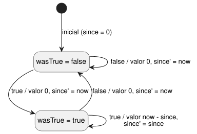
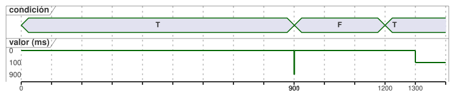

<!-- translation-source: docs/CONTINUOUS-BOOL-TIMER-CONTRACT.md -->
[Original en inglés](CONTINUOUS-BOOL-TIMER-CONTRACT.md)

# Contrato de metadatos y compatibilidad del temporizador Bool continuo

Estado: entrega de implementación de NT-T1-A revisada en Main, 2026-09-15.
Seguimiento: language #46 / TASK-85.2.1 local. La implementación del compilador
sigue siendo #47.

Este contrato cubre un único vacío concreto. Mide cuánto tiempo ha permanecido
una condición Bool continuamente en `true` y devuelve cero en cuanto la
condición es `false`.

**No** añade:

- tiempo de calendario;
- un nuevo opcode de la VM;
- acumulación con pausa/reanudación;
- una biblioteca general de flujos.

El comportamiento existente de `elapsed(state)` no cambia.

En este documento:

- en qué se diferencia el nuevo temporizador del temporizador elapsed existente;
- qué descriptores del manifiesto debe aceptar o rechazar un consumidor;
- cómo se reduce (lowering) el temporizador a dos estados privados;
- los metadatos del mapa de fuentes y de la traza;
- los vectores de conformidad T01;
- qué establece este contrato y qué no.

## Dos significados distintos de tiempo transcurrido

El descriptor de temporizador existente es heredado y sigue siendo válido:

```json
{"name":"age","state":"phase","clockInput":"__gf_now_ms"}
```

Significa «tiempo desde la última vez que cambió el estado referenciado». Por
tanto, puede informar del tiempo pasado en cualquiera de los estados, incluido
cuánto tiempo ha estado un Bool en false. Los nuevos consumidores deben seguir
aceptando exactamente este descriptor de tres campos, con su semántica actual y
sus vinculaciones de estado generadas `since` / `initialized`.

El nuevo descriptor es exacto y explícitamente distinto:

```json
{"name":"active_for","mode":"continuous-true","clockInput":"__gf_now_ms"}
```

Significa «tiempo durante el cual la condición Bool escrita por el autor ha
permanecido continuamente en true; en caso contrario, cero». La expresión de la
condición ya está compilada en GFB1. Se enlaza mediante la traza de origen de la
declaración del temporizador. El manifiesto no la duplica como una cadena de
expresión editable.

| Descriptor | Claves | Informa |
| --- | --- | --- |
| heredado | `name`, `state`, `clockInput` | tiempo desde el último cambio de `state`, en cualquier estado |
| continuo | `name`, `mode` (`"continuous-true"`), `clockInput` | tiempo que la condición lleva continuamente en true; si no, 0 |

NT-T1-A no elige intencionadamente la grafía pública en la fuente que produce
este descriptor. Esa decisión sobre la superficie del lenguaje debe revisarse
antes de que #47 acepte una nueva sintaxis de fuente. El descriptor, la
semántica de reducción, las reglas de compatibilidad y las pruebas que siguen
quedan fijados con independencia de esa grafía.

## Compatibilidad exacta del consumidor

La lista de temporizadores permanece en el manifiesto de control actual. Su
formato de nivel superior no cambia solo por añadir este descriptor.

Un consumidor nuevo acepta exactamente una de estas dos formas:

- heredada: claves `name`, `state`, `clockInput`; o
- continua: claves `name`, `mode`, `clockInput`, con
  `mode == "continuous-true"`.

Rechaza todo lo siguiente antes de instanciar la VM o de cualquier mutación de
estado:

- un descriptor mixto (`state` junto con `mode`);
- campos ausentes o adicionales;
- un modo desconocido;
- nombres no válidos;
- nombres de temporizador duplicados;
- cualquier entrada de reloj distinta de `__gf_now_ms`.

Admitir descriptores continuos no debe hacer que el consumidor rechace
manifiestos heredados.

El consumidor existente (antiguo) ya comprueba exactamente el conjunto de claves
heredado. Por tanto, rechaza un descriptor continuo antes de la ejecución,
porque `mode` es desconocida y falta `state`. Este resultado de cierre ante
fallo (fail-closed) es obligatorio y debe tener una prueba de regresión. Un
descriptor continuo rechazado nunca se degrada al significado elapsed heredado.

Los paquetes portables firmados siguen cubriendo el manifiesto exacto y el mapa
de fuentes. La verificación del paquete debe usar un perfil de consumidor que
entienda el descriptor seleccionado. Una firma válida no hace ejecutable un
descriptor no admitido.

## Reducción con dos estados privados

Cada temporizador continuo posee exactamente dos estados generados. Son
independientes de cualquier otra instancia de temporizador:

| rol | nombre generado | valor inicial | significado |
|---|---|---:|---|
| `wasTrue` | `__gf_timer_was_true_<timer>` | `false` | la condición era true en el escaneo aceptado anterior |
| `since` | `__gf_timer_since_<timer>` | `0` | instante monotónico en milisegundos en el que comenzó este intervalo true ininterrumpido |

Sea `condition` el Bool compilado del escaneo actual y `now` el tiempo
monotónico aceptado. El valor del temporizador y los estados siguientes son
equivalentes a:

```text
value      = if condition && wasTrue then now - since else 0
wasTrue'   = condition
since'     = if !condition then now
             else if !wasTrue then now
             else since
```

En palabras: en el primer escaneo true el valor es 0 y `since` se fija en
`now`. Mientras la condición sigue en true, el valor es `now - since`.
Cualquier escaneo false devuelve 0 y reinicia el intervalo.

El diagrama de estados siguiente muestra cada escaneo aceptado como una
transición, etiquetada `condition / valor, since siguiente`.



La línea de tiempo siguiente muestra el vector T01-RESET de la tabla de
conformidad. El valor solo está definido en los escaneos aceptados (0, 900,
901, 1200 y 1300 ms).



**Reglas de reloj.** El valor del temporizador es un `Duration`. Usa el límite
de reloj existente en milisegundos, exacto y no negativo. El host rechaza un
`now` inseguro, ausente, no entero o que retrocede, antes de ejecutar el
escaneo. Un escaneo rechazado no actualiza ninguno de los dos estados privados.
Tampoco devuelve una traza obsoleta como si fuera un resultado nuevo.

**Los fallos son explícitos.** La condición es una expresión Bool tipada sujeta
a las reglas normales del lenguaje sobre estado actual/anterior. NT-T1-A no
permite una conversión implícita de `Result<Bool>` a Bool. El autor debe
manejar explícitamente un fallo de sensor, por ejemplo seleccionando `false` en
la rama de fallo. Solo ese Bool resultante llega al temporizador. El compilador
no inventa «fallo significa false» como política global.

**Sin motor nuevo.** Esta reducción usa únicamente constantes, operaciones
Bool, condicionales, restas, transiciones de estado y la entrada de reloj
monotónico existentes. El formato GFB1, los opcodes y la VM de Rust/WASM no
cambian. #47 es responsable de la emisión del compilador y de la conformidad.
No añade un segundo motor de temporizadores en un adaptador del host.

## Metadatos de fuente y de traza

La declaración del temporizador escrita por el autor sigue siendo el nodo de
fuente autoritativo. Sus dos vinculaciones de estado privadas usan el registro
`generated` existente con exactamente estos roles:

- `{ declaration: <timer>, role: "wasTrue" }`
- `{ declaration: <timer>, role: "since" }`

Ambas vinculaciones apuntan al mismo nodo de declaración del temporizador y
exponen `stateBefore` / `stateAfter`. Durante la recuperación estricta del mapa
de fuentes, todo lo siguiente debe coincidir:

- el descriptor del manifiesto;
- ambos nombres de estado generados;
- el ID, el tipo y la ubicación del nodo;
- las revisiones de la fuente y del bytecode.

La recuperación rechaza roles ausentes, duplicados o intercambiados, una mezcla
de roles heredados y continuos, y un estado generado que pertenece a otro
temporizador.

La validación depende del perfil del descriptor:

| Descriptor | Roles generados requeridos (exactamente) |
| --- | --- |
| heredado | `since` / `initialized` |
| continuo | `wasTrue` / `since` |

Por tanto, la recuperación estricta recibe el manifiesto ya validado junto con
los bytes, el mapa de fuentes y los metadatos de la traza. Contrasta el nombre,
el modo y la entrada de reloj del descriptor con los roles generados. Comprobar
los metadatos de la traza sin su manifiesto no permite establecer esta
coincidencia.

**Dependencias estáticas.** Las dependencias estáticas del valor del
temporizador incluyen todas las lecturas posibles de la condición Bool
compilada. Esto sigue la regla existente de que ambas ramas de un condicional
son lecturas estáticas posibles. No afirma que cada lectura haya causado el
valor elapsed observado. El destino de dependencia aditivo es exactamente
`{ field: "timerValue", name: <timer> }`. Las lecturas conservan el vocabulario
de campos existente `inputs`, `stateBefore` y `stateAfter`. Las trazas en tiempo
de ejecución siguen distinguiendo el estado anterior del siguiente. El gráfico
de temporización de la interfaz y la navegación por intención son consumidores
independientes.

## Vectores de conformidad T01

Cada vector comienza con un runtime nuevo, salvo que sus filas continúen
explícitamente una misma instancia. `value` es el valor del temporizador visible
en ese escaneo. `T` y `F` son los valores de condición true y false.

| vector | escaneos aceptados `(now, condition → value)` | resultado requerido |
|---|---|---|
| T01-FALSE | `(0,F→0)`, `(500,F→0)` | false es cero de inmediato y de forma continua |
| T01-FIRST | `(1000,T→0)` | el primer escaneo true inicia el intervalo en cero |
| T01-SAME | `(1000,T→0)`, `(1000,T→0)`, `(1500,T→500)` | la misma marca de tiempo no avanza ni reinicia |
| T01-RESET | `(0,T→0)`, `(900,T→900)`, `(901,F→0)`, `(1200,T→0)`, `(1300,T→100)` | false reinicia; un true posterior comienza un intervalo nuevo |
| T01-ROLLBACK | aceptar `(1000,T→0)`, rechazar `(999,T)` y luego aceptar `(1500,T→500)` | el retroceso se rechaza antes de la mutación; el intervalo se conserva |
| T01-CLOCK-INVALID | tras un escaneo aceptado, probar `now` ausente, negativo, fraccionario e inseguro | cada escaneo se rechaza antes de la mutación, no devuelve ningún resultado nuevo, y el siguiente escaneo válido continúa desde el último estado aceptado |
| T01-FAULT | una rama de fallo explícita produce `F` tras un intervalo true | el valor pasa a cero; no hay coerción implícita del sensor |
| T01-RESULT-TYPE | compilar directamente un sensor/señal `Result<Bool>` como condición del temporizador | la compilación falla; se requiere un Bool explícito con `case ok(...) / fault(...)` |
| T01-INSTANCES | A true desde 0; B true por primera vez en 700 | A y B mantienen `wasTrue`/`since` y valores distintos |
| T01-SOURCE | una declaración literaria compilada y recuperada | el descriptor, los dos roles, la ubicación del nodo y ambos hashes de revisión coinciden |

Los vectores de compatibilidad demuestran además que:

1. el consumidor nuevo ejecuta un manifiesto heredado válido sin cambios y
   produce la traza elapsed existente;
2. el consumidor antiguo rechaza el descriptor continuo antes de crear la VM;
3. el consumidor nuevo rechaza descriptores mixtos, de modo desconocido, con
   campos adicionales y mal formados antes de crear la VM;
4. las trazas nativas y WASM coinciden para la misma cinta de escaneo (scan
   tape) aceptada después de #47.

## Límite de la evidencia y entrega

Completar NT-T1-A produce un contrato revisado. No es una implementación del
compilador.

- NT-T1-B/#47 solo puede avanzar después de que la revisión del lenguaje elija
  la grafía pública en la fuente.
- Aceptar #47 requiere conformidad del compilador, del consumidor del
  manifiesto, del mapa de fuentes, nativa y WASM.
- Los adaptadores de reloj del dispositivo, la carga del firmware, GPIO, los
  relés, las cargas físicas, el tiempo de calendario y la experiencia de usuario
  orientada al agricultor siguen siendo puertas independientes.
