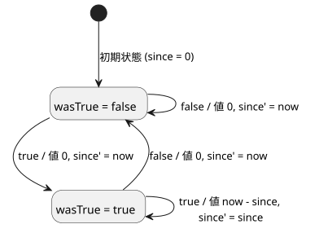
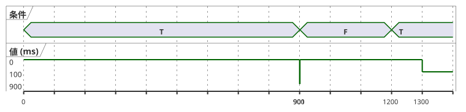

<!-- translation-source: docs/CONTINUOUS-BOOL-TIMER-CONTRACT.md -->
[英語の原文](CONTINUOUS-BOOL-TIMER-CONTRACT.md)

# 連続 Bool タイマーのメタデータと互換性の契約

ステータス: NT-T1-A についてメインレビュー済みの実装引き継ぎ、2026-09-15。
トラッキング: language #46 / ローカル TASK-85.2.1。コンパイラの実装は引き続き #47 です。

この契約は、1 つの限られた隙間を埋めます。Bool 条件が連続して `true` であり続けた時間を
測定し、条件が `false` になった時点でただちに 0 を返します。

この契約は次のものを追加**しません**。

- 暦時間
- 新しい VM オペコード
- 一時停止/再開による累積
- 汎用のストリームライブラリ

既存の `elapsed(state)` の振る舞いは変わりません。

この文書の内容:

- 新しいタイマーと既存の elapsed タイマーの違い
- 利用側が受け入れるべき、または拒否すべきマニフェストのディスクリプタ
- タイマーを 2 つのプライベートな状態へ lowering する方法
- ソースマップとトレースのメタデータ
- T01 適合性ベクトル
- この契約が確立すること、確立しないこと

## 2 つの異なる経過時間の意味

既存のタイマーディスクリプタはレガシーですが、引き続き有効です。

```json
{"name":"age","state":"phase","clockInput":"__gf_now_ms"}
```

これは「参照する状態が最後に変化してからの時間」を意味します。そのため、どちらの状態で
過ごした時間も報告でき、Bool が false であった時間も含みます。新しい利用側は、この厳密な
3 フィールドのディスクリプタを、現在のセマンティクスと生成される `since` /
`initialized` の状態バインディングとともに、引き続き受け入れなければなりません。

新しいディスクリプタは厳密であり、明示的に異なります。

```json
{"name":"active_for","mode":"continuous-true","clockInput":"__gf_now_ms"}
```

これは「記述された Bool 条件が連続して true であり続けた時間。そうでなければ 0」を
意味します。条件式はすでに GFB1 にコンパイルされています。条件式はタイマー宣言の
ソーストレースを通じて結び付けられます。マニフェストは、それを編集可能な式文字列として
重複して持つことはありません。

| ディスクリプタ | キー | 報告する値 |
| --- | --- | --- |
| レガシー | `name`、`state`、`clockInput` | `state` が最後に変化してからの時間（どの状態でも） |
| 連続 | `name`、`mode`（`"continuous-true"`）、`clockInput` | 条件が連続して true であった時間、それ以外は 0 |

NT-T1-A は、このディスクリプタを生成する公開ソースの綴りを意図的に選びません。この
言語表面の判断は、#47 が新しいソース構文を受け入れる前にレビューされなければなりません。
ディスクリプタ、lowering のセマンティクス、互換性の規則、以下のテストは、その綴りとは
独立して固定されています。

## 利用側の厳密な互換性

タイマーのリストは現在の制御マニフェストに残ります。このディスクリプタを追加するという
だけの理由で、トップレベルの形式が変わることはありません。

新しい利用側は、次の 2 つの形のうち厳密に 1 つを受け入れます。

- レガシー: キー `name`、`state`、`clockInput`
- 連続: キー `name`、`mode`、`clockInput`、ただし `mode == "continuous-true"`

VM のインスタンス化や状態の変更の前に、次のすべてを拒否します。

- 混在したディスクリプタ（`state` と `mode` の両方）
- 欠落または余分なフィールド
- 不明なモード
- 不正な名前
- 重複したタイマー名
- `__gf_now_ms` 以外のクロック入力

連続ディスクリプタをサポートすることによって、利用側がレガシーのマニフェストを拒否する
ようになってはなりません。

既存の（古い）利用側は、すでにレガシーのキー集合を厳密に確認しています。そのため、
`mode` が不明で `state` が存在しないことから、連続ディスクリプタを実行前に拒否します。
このフェイルクローズの結果は必須であり、回帰テストがなければなりません。拒否された
連続ディスクリプタが、レガシーの経過時間の意味に格下げされることは決してありません。

署名付きのポータブルパッケージは、引き続き厳密なマニフェストとソースマップを対象と
します。パッケージの検証には、選択されたディスクリプタを理解する利用側プロファイルを
使わなければなりません。有効な署名があっても、サポートされていないディスクリプタが
実行可能になるわけではありません。

## 2 つのプライベートな状態による lowering

各連続タイマーは、生成された状態をちょうど 2 つ所有します。これらは他のすべてのタイマー
インスタンスから独立しています。

| 役割 | 生成される名前 | 初期値 | 意味 |
|---|---|---:|---|
| `wasTrue` | `__gf_timer_was_true_<timer>` | `false` | 直前に受け入れられたスキャンで条件が true だった |
| `since` | `__gf_timer_since_<timer>` | `0` | この途切れない true 区間が始まった単調ミリ秒の時刻 |

`condition` を現在のスキャンのコンパイル済み Bool、`now` を受け入れられた単調時間とします。
タイマーの値と次状態は、次と等価です。

```text
value      = if condition && wasTrue then now - since else 0
wasTrue'   = condition
since'     = if !condition then now
             else if !wasTrue then now
             else since
```

言葉で言えば、最初の true のスキャンでは値は 0 で、`since` は `now` に設定されます。条件が
true であり続ける間、値は `now - since` です。false のスキャンがあると 0 を返し、区間を
リセットします。

以下の状態図は、受け入れられた各スキャンを `condition / value, next since` という
ラベル付きの遷移として示しています。



以下のタイムラインは、適合性表の T01-RESET ベクトルを示しています。値が定義されるのは、
受け入れられたスキャン（0、900、901、1200、1300 ms）だけです。



**クロックの規則。** タイマーの値は `Duration` です。既存の厳密で非負のミリ秒クロック境界を
使います。ホストは、安全でない、欠落した、整数でない、または逆行する `now` を、スキャンの
実行前に拒否します。拒否されたスキャンは、どちらのプライベートな状態も更新しません。
また、古いトレースを新しい結果として返すこともありません。

**故障は明示的です。** 条件は、言語の通常の現状態/前状態の規則に従う型付きの Bool 式です。
NT-T1-A は、`Result<Bool>` から Bool への暗黙の変換を許可しません。作成者はセンサの故障を
明示的に処理しなければなりません。たとえば、fault 分岐で `false` を選択します。タイマーに
届くのは、その結果の Bool だけです。コンパイラが「故障は false を意味する」という
グローバルなポリシーを作り出すことはありません。

**新しいエンジンはありません。** この lowering は、既存の定数、Bool 演算、条件分岐、減算、
状態遷移、単調クロック入力だけを使います。GFB1 の形式とオペコード、Rust/WASM VM は
変わりません。#47 はコンパイラの出力と適合性を所有します。ホストアダプタに 2 つ目の
タイマーエンジンを追加することはありません。

## ソースとトレースのメタデータ

記述されたタイマー宣言が、引き続き正となるソースノードです。その 2 つのプライベートな状態
バインディングは、既存の `generated` レコードを、次の厳密な役割で使います。

- `{ declaration: <timer>, role: "wasTrue" }`
- `{ declaration: <timer>, role: "since" }`

両方のバインディングは同じタイマー宣言ノードを指し、`stateBefore` / `stateAfter` を公開
します。厳密なソースマップの復元では、次のすべてが一致しなければなりません。

- マニフェストのディスクリプタ
- 生成される 2 つの状態名
- ノード ID、種類、位置
- ソースとバイトコードのリビジョン

復元は、欠落、重複、入れ替わった役割、レガシーと連続の役割の混在、別のタイマーに属する
生成状態を拒否します。

検証はディスクリプタのプロファイルに依存します。

| ディスクリプタ | 必要な生成役割（厳密に） |
| --- | --- |
| レガシー | `since` / `initialized` |
| 連続 | `wasTrue` / `since` |

したがって厳密な復元は、バイト列、ソースマップ、トレースメタデータとともに、検証済みの
マニフェストを受け取ります。ディスクリプタの名前、モード、クロック入力を、生成された役割と
照合します。マニフェストなしでトレースメタデータを確認しても、この一致は確立できません。

**静的な依存関係。** タイマー値の静的な依存関係には、コンパイル済み Bool 条件のあり得る
すべての読み取りが含まれます。これは、条件分岐の両方の分岐があり得る静的な読み取りである
という既存の規則に従っています。すべての読み取りが観測された経過時間の原因であったとは
主張しません。追加される依存関係のターゲットは、厳密に
`{ field: "timerValue", name: <timer> }` です。読み取りは、既存の `inputs`、`stateBefore`、
`stateAfter` のフィールド語彙を維持します。ランタイムのトレースは、引き続き前状態と次状態を
区別します。UI のタイミングチャートと意図のナビゲーションは、別個の利用側です。

## T01 適合性ベクトル

各ベクトルは、行が明示的に 1 つのインスタンスを継続する場合を除き、新しいランタイムから
始まります。`value` はそのスキャンで見えるタイマー値です。`T` と `F` は条件の値 true と
false です。

| ベクトル | 受け入れられたスキャン `(now, condition → value)` | 必要な結果 |
|---|---|---|
| T01-FALSE | `(0,F→0)`, `(500,F→0)` | false はただちに、かつ継続して 0 |
| T01-FIRST | `(1000,T→0)` | 最初の true のスキャンで区間が 0 から始まる |
| T01-SAME | `(1000,T→0)`, `(1000,T→0)`, `(1500,T→500)` | 同じタイムスタンプでは進みもリセットもしない |
| T01-RESET | `(0,T→0)`, `(900,T→900)`, `(901,F→0)`, `(1200,T→0)`, `(1300,T→100)` | false でリセットされ、後の true で新しい区間が始まる |
| T01-ROLLBACK | `(1000,T→0)` を受け入れ、`(999,T)` を拒否し、その後 `(1500,T→500)` を受け入れる | 巻き戻りは変更前に拒否され、区間は保持される |
| T01-CLOCK-INVALID | 1 回スキャンが受け入れられた後、欠落、負、小数、安全でない `now` を試す | すべてのスキャンが変更前に拒否され、新しい結果を返さず、次の有効なスキャンは最後に受け入れられた状態から継続する |
| T01-FAULT | true の区間の後、明示的な fault 分岐が `F` を返す | 値は 0 になる。暗黙のセンサ変換はない |
| T01-RESULT-TYPE | `Result<Bool>` のセンサ/信号をそのままタイマー条件としてコンパイルする | コンパイルは失敗する。明示的な `case ok(...) / fault(...)` による Bool が必要 |
| T01-INSTANCES | A は 0 から true、B は 700 で初めて true | A と B は別々の `wasTrue`/`since` と値を保持する |
| T01-SOURCE | 1 つの文芸的（literate）宣言をコンパイルして復元する | ディスクリプタ、2 つの役割、ノードの位置、両方のリビジョンハッシュが一致する |

互換性ベクトルは、さらに次のことを証明します。

1. 新しい利用側は、変更されていない有効なレガシーマニフェストを実行し、既存の経過時間
   トレースを生成する。
2. 古い利用側は、VM の作成前に連続ディスクリプタを拒否する。
3. 新しい利用側は、混在、不明なモード、余分なフィールド、不正な形式のディスクリプタを、
   VM の作成前に拒否する。
4. #47 の後、同じ受け入れ済みスキャンテープに対して、ネイティブと WASM のトレースが
   一致する。

## 証拠の境界と引き継ぎ

NT-T1-A を完了すると、レビュー済みの契約ができます。コンパイラの実装ではありません。

- NT-T1-B/#47 は、言語レビューが公開ソースの綴りを選んだ後にのみ進めることができます。
- #47 を受け入れるには、コンパイラ、マニフェストの利用側、ソースマップ、ネイティブ、
  WASM の適合性が必要です。
- デバイスのクロックアダプタ、ファームウェアのアップロード、GPIO、リレー、物理負荷、
  暦時間、農家向けの UX は、引き続き別個のゲートです。
