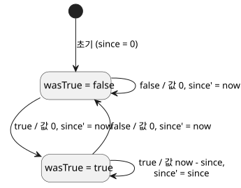
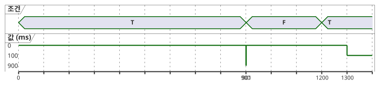

<!-- translation-source: docs/CONTINUOUS-BOOL-TIMER-CONTRACT.md -->
[영문 원문](CONTINUOUS-BOOL-TIMER-CONTRACT.md)

# 연속 Bool 타이머 메타데이터와 호환성 계약

상태: NT-T1-A의 Main 검토 완료 구현 인계 문서, 2026-09-15.
추적: language #46 / local TASK-85.2.1. 컴파일러 구현은 #47에 남아 있습니다.

이 계약은 좁은 공백 하나를 메웁니다. Bool 조건이 연속으로 `true`를 유지한 시간을
측정하고, 조건이 `false`가 되는 즉시 0을 반환합니다.

다음은 추가하지 **않습니다**.

- 달력 시간
- 새 VM opcode
- 일시정지/재개 누적
- 일반 스트림 라이브러리

기존 `elapsed(state)` 동작은 바뀌지 않습니다.

이 문서에서 다루는 내용:

- 새 타이머가 기존 elapsed 타이머와 어떻게 다른지
- 소비자가 수용하거나 거부해야 하는 manifest descriptor
- 타이머가 두 개의 비공개 상태로 lowering되는 방식
- 소스 맵과 추적(trace) 메타데이터
- T01 적합성 벡터
- 이 계약이 입증하는 것과 입증하지 않는 것

## 서로 다른 두 가지 elapsed 의미

기존 타이머 descriptor는 레거시이며 계속 유효합니다.

```json
{"name":"age","state":"phase","clockInput":"__gf_now_ms"}
```

이는 "참조한 상태가 마지막으로 바뀐 이후의 시간"을 뜻합니다. 따라서 어느 상태에
머문 시간이든 보고할 수 있으며, Bool이 false였던 시간도 포함됩니다. 새 소비자도 이
정확한 3필드 descriptor를 현재 의미, 그리고 생성되는 `since` / `initialized` 상태
바인딩과 함께 계속 수용해야 합니다.

새 descriptor는 정확하게 정의되며 명시적으로 다릅니다.

```json
{"name":"active_for","mode":"continuous-true","clockInput":"__gf_now_ms"}
```

이는 "작성된 Bool 조건이 연속으로 true를 유지한 시간, 그렇지 않으면 0"을 뜻합니다.
조건식은 이미 GFB1로 컴파일되어 있습니다. 타이머 선언의 소스 추적을 통해 연결됩니다.
manifest는 이를 편집 가능한 식 문자열로 중복해 담지 않습니다.

| Descriptor | 키 | 보고하는 값 |
| --- | --- | --- |
| 레거시 | `name`, `state`, `clockInput` | `state`가 마지막으로 바뀐 이후의 시간(어느 상태에서든) |
| 연속형 | `name`, `mode` (`"continuous-true"`), `clockInput` | 조건이 연속으로 true였던 시간, 그 외에는 0 |

NT-T1-A는 이 descriptor를 만들어 내는 공개 소스 표기를 의도적으로 정하지 않습니다.
그 언어 표면 결정은 #47이 새 소스 문법을 수용하기 전에 검토되어야 합니다. 아래의
descriptor, lowering 의미, 호환성 규칙, 테스트는 그 표기와 무관하게 고정됩니다.

## 정확한 소비자 호환성

타이머 목록은 현재의 제어 manifest에 그대로 남습니다. 이 descriptor를 추가한다는
이유만으로 최상위 형식이 바뀌지는 않습니다.

새 소비자는 다음 두 형태 중 정확히 하나만 수용합니다.

- 레거시: 키 `name`, `state`, `clockInput`
- 연속형: 키 `name`, `mode`, `clockInput`이며 `mode == "continuous-true"`

다음은 모두 VM 인스턴스 생성이나 상태 변경 전에 거부합니다.

- 혼합 descriptor(`state`와 `mode`를 함께 가짐)
- 누락되거나 추가된 필드
- 알 수 없는 mode
- 유효하지 않은 이름
- 중복된 타이머 이름
- `__gf_now_ms` 이외의 시계 입력

연속형 descriptor를 지원한다고 해서 소비자가 레거시 manifest를 거부해서는 안 됩니다.

기존(구) 소비자는 이미 레거시 키 집합을 정확하게 검사합니다. 따라서 `mode`를 알 수
없고 `state`가 없으므로 연속형 descriptor를 실행 전에 거부합니다. 이 fail-closed
결과는 필수이며 회귀 테스트가 있어야 합니다. 거부된 연속형 descriptor가 레거시
elapsed 의미로 격하되는 일은 절대 없습니다.

서명된 이식형 패키지는 계속 정확한 manifest와 소스 맵을 포함합니다. 패키지 검증은
선택된 descriptor를 이해하는 소비자 프로필을 사용해야 합니다. 서명이 유효하다고 해서
지원하지 않는 descriptor가 실행 가능해지지는 않습니다.

## 두 개의 비공개 상태로 lowering

각 연속 타이머는 생성된 상태를 정확히 두 개 소유합니다. 이 상태는 다른 모든 타이머
인스턴스와 독립적입니다.

| 역할 | 생성 이름 | 초기값 | 의미 |
|---|---|---:|---|
| `wasTrue` | `__gf_timer_was_true_<timer>` | `false` | 직전에 승인된 스캔에서 조건이 true였음 |
| `since` | `__gf_timer_since_<timer>` | `0` | 끊기지 않은 현재 true 구간이 시작된 단조 밀리초 시각 |

`condition`을 현재 스캔에서 컴파일된 Bool, `now`를 승인된 단조 시각이라고 합시다.
타이머 값과 다음 상태는 다음과 동등합니다.

```text
value      = if condition && wasTrue then now - since else 0
wasTrue'   = condition
since'     = if !condition then now
             else if !wasTrue then now
             else since
```

말로 풀면 이렇습니다. 첫 true 스캔에서 값은 0이고 `since`는 `now`로 설정됩니다.
조건이 true로 유지되는 동안 값은 `now - since`입니다. false 스캔이 한 번이라도 오면
0을 반환하고 구간을 초기화합니다.

아래 상태 다이어그램은 승인된 각 스캔을 `condition / 값, 다음 since` 라벨이 붙은
전이로 보여 줍니다.



아래 타임라인은 적합성 표의 T01-RESET 벡터를 보여 줍니다. 값은 승인된 스캔(0, 900,
901, 1200, 1300 ms)에서만 정의됩니다.



**시계 규칙.** 타이머 값은 `Duration`입니다. 기존의 정확한 비음수 밀리초 시계 경계를
사용합니다. 호스트는 안전하지 않거나, 누락되었거나, 정수가 아니거나, 뒤로 가는
`now`를 스캔 실행 전에 거부합니다. 거부된 스캔은 어느 비공개 상태도 갱신하지
않습니다. 또한 오래된 추적을 새 결과로 반환하지도 않습니다.

**fault는 명시적으로 다룹니다.** 조건은 언어의 일반적인 현재/이전 상태 규칙을 따르는
타입이 있는 Bool 식입니다. NT-T1-A는 `Result<Bool>`에서 Bool로의 암묵적 변환을
허용하지 않습니다. 작성자는 센서 fault를 명시적으로 처리해야 합니다. 예를 들어 fault
분기에서 `false`를 선택할 수 있습니다. 그렇게 만들어진 Bool만 타이머에 도달합니다.
컴파일러는 "fault는 false"라는 전역 정책을 만들어 내지 않습니다.

**새 엔진은 없습니다.** 이 lowering은 기존 상수, Bool 연산, 조건식, 뺄셈, 상태 전이,
단조 시계 입력만 사용합니다. GFB1 형식과 opcode, Rust/WASM VM은 바뀌지 않습니다.
#47은 컴파일러 출력과 적합성을 담당합니다. 호스트 어댑터 안에 두 번째 타이머 엔진을
추가하지 않습니다.

## 소스와 추적 메타데이터

작성된 타이머 선언이 권위 있는 소스 노드로 남습니다. 두 비공개 상태 바인딩은 다음의
정확한 역할을 가진 기존 `generated` 레코드를 사용합니다.

- `{ declaration: <timer>, role: "wasTrue" }`
- `{ declaration: <timer>, role: "since" }`

두 바인딩은 같은 타이머 선언 노드를 가리키며 `stateBefore` / `stateAfter`를
노출합니다. 엄격한 소스 맵 복구 중에는 다음이 모두 일치해야 합니다.

- manifest descriptor
- 생성된 두 상태 이름
- 노드 ID, 종류, 위치
- 소스 revision과 바이트코드 revision

복구는 누락되거나, 중복되거나, 뒤바뀐 역할, 레거시 역할과 연속형 역할의 혼합, 다른
타이머에 속한 생성 상태를 거부합니다.

검증은 descriptor 프로필에 따라 달라집니다.

| Descriptor | 필요한 생성 역할(정확히) |
| --- | --- |
| 레거시 | `since` / `initialized` |
| 연속형 | `wasTrue` / `since` |

따라서 엄격한 복구에는 이미 검증된 manifest가 바이트, 소스 맵, 추적 메타데이터와 함께
전달됩니다. 복구는 descriptor의 이름, mode, 시계 입력을 생성 역할과 교차 검사합니다.
manifest 없이 추적 메타데이터만 검사해서는 이 일치를 입증할 수 없습니다.

**정적 의존성.** 타이머 값의 정적 의존성에는 컴파일된 Bool 조건의 가능한 모든 읽기가
포함됩니다. 이는 조건식의 두 분기가 모두 가능한 정적 읽기라는 기존 규칙을 따릅니다.
모든 읽기가 관측된 경과 값의 원인이었다고 주장하는 것은 아닙니다. 추가되는 의존성
대상은 정확히 `{ field: "timerValue", name: <timer> }`입니다. 읽기는 기존 `inputs`,
`stateBefore`, `stateAfter` 필드 어휘를 유지합니다. 런타임 추적은 계속 이전 상태와
다음 상태를 구분합니다. UI 타이밍 차트와 의도 탐색은 별개의 소비자입니다.

## T01 적합성 벡터

각 벡터는 행이 하나의 인스턴스를 이어 간다고 명시하지 않는 한 새 런타임으로
시작합니다. `value`는 해당 스캔에서 보이는 타이머 값입니다. `T`와 `F`는 조건 값
true와 false입니다.

| 벡터 | 승인된 스캔 `(now, condition → value)` | 요구 결과 |
|---|---|---|
| T01-FALSE | `(0,F→0)`, `(500,F→0)` | false는 즉시, 그리고 계속 0 |
| T01-FIRST | `(1000,T→0)` | 첫 true 스캔은 0에서 구간을 시작 |
| T01-SAME | `(1000,T→0)`, `(1000,T→0)`, `(1500,T→500)` | 같은 타임스탬프는 진행하지도 초기화하지도 않음 |
| T01-RESET | `(0,T→0)`, `(900,T→900)`, `(901,F→0)`, `(1200,T→0)`, `(1300,T→100)` | false가 초기화하고, 이후의 true가 새 구간을 시작 |
| T01-ROLLBACK | `(1000,T→0)` 승인, `(999,T)` 거부, 그 뒤 `(1500,T→500)` 승인 | 역행은 상태 변경 전에 거부되고 구간은 보존됨 |
| T01-CLOCK-INVALID | 승인된 스캔 하나 뒤에 누락, 음수, 소수, 안전 범위를 벗어난 `now`를 시도 | 모든 스캔이 상태 변경 전에 거부되고 새 결과를 반환하지 않으며, 다음 유효 스캔은 마지막 승인 상태에서 이어짐 |
| T01-FAULT | true 구간 뒤 명시적 fault 분기가 `F`를 냄 | 값이 0이 됨; 암묵적 센서 강제 변환 없음 |
| T01-RESULT-TYPE | `Result<Bool>` sensor/signal을 타이머 조건으로 직접 컴파일 | 컴파일 실패; 명시적인 `case ok(...) / fault(...)` Bool이 필요 |
| T01-INSTANCES | A는 0부터 true; B는 700에서 처음 true | A와 B는 서로 다른 `wasTrue`/`since`와 값을 유지 |
| T01-SOURCE | 문서형 선언 하나를 컴파일하고 복구 | descriptor, 두 역할, 노드 위치, 두 revision 해시가 일치 |

호환성 벡터는 추가로 다음을 입증합니다.

1. 새 소비자가 변경되지 않은 유효한 레거시 manifest를 실행하고 기존 elapsed 추적을
   만들어 냅니다.
2. 구 소비자가 VM 생성 전에 연속형 descriptor를 거부합니다.
3. 새 소비자가 VM 생성 전에 혼합, 알 수 없는 mode, 추가 필드, 형식이 잘못된
   descriptor를 거부합니다.
4. #47 이후 native 추적과 WASM 추적이 같은 승인 스캔 테이프에 대해 일치합니다.

## 증거 경계와 인계

NT-T1-A를 완료하면 검토된 계약이 나옵니다. 컴파일러 구현은 아닙니다.

- NT-T1-B/#47은 언어 검토에서 공개 소스 표기를 정한 뒤에만 진행할 수 있습니다.
- #47을 승인하려면 컴파일러, manifest 소비자, 소스 맵, native, WASM 적합성이
  필요합니다.
- 장치 시계 어댑터, 펌웨어 업로드, GPIO, 릴레이, 물리 부하, 달력 시간, 농민 대상 UX는
  별도의 승인 단계로 남습니다.
