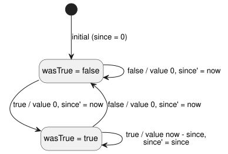
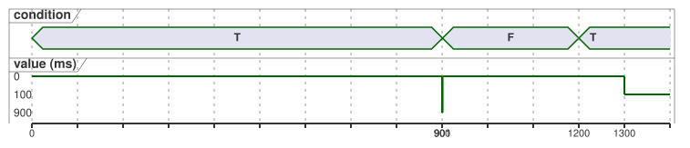

# Continuous Bool timer metadata and compatibility contract

Status: Main-reviewed implementation handoff for NT-T1-A, 2026-09-15.
Tracking: language #46 / local TASK-85.2.1. Compiler implementation remains #47.

This contract fills one narrow gap. It measures how long a Bool condition has
stayed continuously `true`, and returns zero as soon as the condition is
`false`.

It does **not** add:

- calendar time;
- a new VM opcode;
- pause/resume accumulation;
- a general stream library.

Existing `elapsed(state)` behavior is unchanged.

In this document:

- how the new timer differs from the existing elapsed timer;
- which manifest descriptors a consumer must accept or reject;
- how the timer lowers to two private states;
- the source-map and trace metadata;
- the T01 conformance vectors;
- what this contract does and does not establish.

## Two different elapsed meanings

The existing timer descriptor is legacy and remains valid:

```json
{"name":"age","state":"phase","clockInput":"__gf_now_ms"}
```

It means “time since the referenced state last changed.” It can therefore report
time spent in either state, including how long a Bool has been false. New
consumers must keep accepting this exact three-field descriptor, with its
current semantics and its generated `since` / `initialized` state bindings.

The new descriptor is exact and explicitly different:

```json
{"name":"active_for","mode":"continuous-true","clockInput":"__gf_now_ms"}
```

It means “time for which the authored Bool condition has remained continuously
true; otherwise zero.” The condition expression is already compiled into GFB1.
It is linked through the timer declaration's source trace. The manifest does not
duplicate it as an editable expression string.

| Descriptor | Keys | Reports |
| --- | --- | --- |
| legacy | `name`, `state`, `clockInput` | time since `state` last changed, in any state |
| continuous | `name`, `mode` (`"continuous-true"`), `clockInput` | time the condition has been continuously true, else 0 |

NT-T1-A intentionally does not choose the public source spelling that produces
this descriptor. That language-surface decision must be reviewed before #47
accepts new source syntax. The descriptor, the lowering semantics, the
compatibility rules and the tests below are fixed independently of that
spelling.

## Exact consumer compatibility

The timer list stays in the current control manifest. Its top-level format does
not change merely to add this descriptor.

A new consumer accepts exactly one of these two shapes:

- legacy: keys `name`, `state`, `clockInput`; or
- continuous: keys `name`, `mode`, `clockInput`, with
  `mode == "continuous-true"`.

It rejects all of the following before VM instantiation or any state mutation:

- a mixed descriptor (`state` plus `mode`);
- missing or extra fields;
- an unknown mode;
- invalid names;
- duplicate timer names;
- any clock input other than `__gf_now_ms`.

Supporting continuous descriptors must not make the consumer reject legacy
manifests.

The existing (old) consumer already checks the legacy key set exactly. It
therefore rejects a continuous descriptor before execution, because `mode` is
unknown and `state` is absent. This fail-closed result is required and must have
a regression test. A rejected continuous descriptor is never downgraded to the
legacy elapsed meaning.

Signed portable packages continue to cover the exact manifest and source map.
Package verification must use a consumer profile that understands the selected
descriptor. A valid signature does not make an unsupported descriptor
executable.

## Lowering with two private states

Each continuous timer owns exactly two generated states. They are independent of
every other timer instance:

| role | generated name | initial value | meaning |
|---|---|---:|---|
| `wasTrue` | `__gf_timer_was_true_<timer>` | `false` | condition was true on the preceding accepted scan |
| `since` | `__gf_timer_since_<timer>` | `0` | monotonic millisecond instant at which this uninterrupted true interval began |

Let `condition` be the current scan's compiled Bool and `now` the accepted
monotonic time. The timer value and the next states are equivalent to:

```text
value      = if condition && wasTrue then now - since else 0
wasTrue'   = condition
since'     = if !condition then now
             else if !wasTrue then now
             else since
```

In words: on the first true scan the value is 0 and `since` is set to `now`.
While the condition stays true, the value is `now - since`. Any false scan
returns 0 and resets the interval.

The state diagram below shows each accepted scan as a transition, labelled
`condition / value, next since`.



The timeline below shows the T01-RESET vector from the conformance table. The
value is only defined at accepted scans (0, 900, 901, 1200 and 1300 ms).



**Clock rules.** The timer value is a `Duration`. It uses the existing exact,
non-negative millisecond clock boundary. The host rejects a `now` that is
unsafe, missing, non-integer or moving backward, before executing the scan. A
rejected scan updates neither private state. It also does not return a stale
trace as a new result.

**Faults are explicit.** The condition is a typed Bool expression under the
language's normal current/previous-state rules. NT-T1-A does not permit an
implicit `Result<Bool>` to Bool conversion. The author must handle a sensor fault
explicitly, for example by selecting `false` in the fault branch. Only that
resulting Bool reaches the timer. The compiler does not invent “fault means
false” as a global policy.

**No new engine.** This lowering uses only existing constants, Bool operations,
conditionals, subtraction, state transitions and the monotonic clock input. The
GFB1 format and opcodes and the Rust/WASM VM are unchanged. #47 owns compiler
emission and conformance. It does not add a second timer engine in a host
adapter.

## Source and trace metadata

The authored timer declaration remains the authoritative source node. Its two
private state bindings use the existing `generated` record with these exact
roles:

- `{ declaration: <timer>, role: "wasTrue" }`
- `{ declaration: <timer>, role: "since" }`

Both bindings point to the same timer declaration node and expose
`stateBefore` / `stateAfter`. During strict source-map recovery, all of these
must agree:

- the manifest descriptor;
- both generated state names;
- the node ID, kind and location;
- the source and bytecode revisions.

Recovery rejects missing, duplicate or swapped roles, a mix of legacy and
continuous roles, and a generated state that belongs to another timer.

Validation depends on the descriptor profile:

| Descriptor | Required generated roles (exactly) |
| --- | --- |
| legacy | `since` / `initialized` |
| continuous | `wasTrue` / `since` |

Strict recovery therefore receives the already validated manifest together with
the bytes, source map and trace metadata. It cross-checks the descriptor's name,
mode and clock input against the generated roles. Checking trace metadata
without its manifest cannot establish this agreement.

**Static dependencies.** The timer value's static dependencies include every
possible read of the compiled Bool condition. This follows the existing rule
that both branches of a conditional are possible static reads. It does not
claim that every read caused the observed elapsed value. The additive dependency
target is exactly `{ field: "timerValue", name: <timer> }`. Reads keep the
existing `inputs`, `stateBefore` and `stateAfter` field vocabulary. Runtime
traces continue to distinguish previous and next state. The UI timing chart and
intent navigation are separate consumers.

## T01 conformance vectors

Every vector starts with a fresh runtime, unless its rows explicitly continue
one instance. `value` is the timer value visible in that scan. `T` and `F` are
the condition values true and false.

| vector | accepted scans `(now, condition → value)` | required result |
|---|---|---|
| T01-FALSE | `(0,F→0)`, `(500,F→0)` | false is immediately and continuously zero |
| T01-FIRST | `(1000,T→0)` | first true scan starts the interval at zero |
| T01-SAME | `(1000,T→0)`, `(1000,T→0)`, `(1500,T→500)` | same timestamp does not advance or reset |
| T01-RESET | `(0,T→0)`, `(900,T→900)`, `(901,F→0)`, `(1200,T→0)`, `(1300,T→100)` | false resets; a later true begins a new interval |
| T01-ROLLBACK | accept `(1000,T→0)`, reject `(999,T)`, then accept `(1500,T→500)` | rollback rejects before mutation; interval is preserved |
| T01-CLOCK-INVALID | after one accepted scan, try missing, negative, fractional and unsafe `now` | every scan is rejected before mutation, returns no new result, and the next valid scan continues from the last accepted state |
| T01-FAULT | explicit fault branch yields `F` after a true interval | value becomes zero; no implicit sensor coercion |
| T01-RESULT-TYPE | compile a `Result<Bool>` sensor/signal directly as the timer condition | compilation fails; an explicit `case ok(...) / fault(...)` Bool is required |
| T01-INSTANCES | A true from 0; B first true at 700 | A and B keep distinct `wasTrue`/`since` and values |
| T01-SOURCE | one literate declaration compiled and recovered | descriptor, two roles, node location and both revision hashes agree |

The compatibility vectors additionally prove that:

1. the new consumer runs an unchanged valid legacy manifest and produces the
   existing elapsed trace;
2. the old consumer rejects the continuous descriptor before VM creation;
3. the new consumer rejects mixed, unknown-mode, extra-field and malformed
   descriptors before VM creation;
4. native and WASM traces match for the same accepted scan tape after #47.

## Evidence boundary and handoff

Completing NT-T1-A produces a reviewed contract. It is not a compiler
implementation.

- NT-T1-B/#47 may proceed only after the language review chooses the public
  source spelling.
- Accepting #47 requires compiler, manifest consumer, source-map, native and
  WASM conformance.
- Device clock adapters, firmware upload, GPIO, relays, physical loads, calendar
  time and farmer-facing UX remain separate gates.
