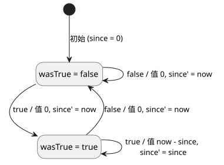
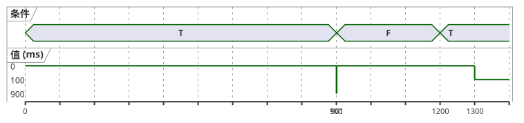

<!-- translation-source: docs/CONTINUOUS-BOOL-TIMER-CONTRACT.md -->
[英文原文](CONTINUOUS-BOOL-TIMER-CONTRACT.md)

# 连续 Bool 定时器元数据与兼容性契约

状态：针对 NT-T1-A 的、经 Main 评审的实现交接，2026-09-15。
跟踪：language #46 / 本地 TASK-85.2.1。编译器实现仍由 #47 负责。

本契约只填补一个很窄的空白。它度量一个 Bool 条件连续保持 `true` 的时长，并在条件为 `false` 时立即返回零。

它**不**新增：

- 日历时间；
- 新的 VM 操作码；
- 暂停/继续式累计；
- 通用的流（stream）库。

现有的 `elapsed(state)` 行为保持不变。

本文档内容：

- 新定时器与现有 elapsed 定时器有何不同；
- 消费者必须接受或拒绝哪些清单（manifest）描述符；
- 定时器如何降级为两个私有状态；
- 源映射（source map）与追踪元数据；
- T01 一致性测试向量；
- 本契约确立了什么、没有确立什么。

## 两种不同的经过时间含义

现有的定时器描述符属于旧版（legacy），并且仍然有效：

```json
{"name":"age","state":"phase","clockInput":"__gf_now_ms"}
```

它表示“自所引用的状态上次改变以来的时间”。因此，它可以报告在任一状态中停留的时间，包括一个 Bool 保持 false 的时长。新的消费者必须继续接受这个完全一致的三字段描述符，保持其当前语义及其生成的 `since` / `initialized` 状态绑定。

新的描述符是精确的，并且明确不同：

```json
{"name":"active_for","mode":"continuous-true","clockInput":"__gf_now_ms"}
```

它表示“作者编写的 Bool 条件连续保持为 true 的时间；否则为零”。条件表达式已经编译进 GFB1，并通过定时器声明的源追踪进行关联。清单不会再把它重复保存为可编辑的表达式字符串。

| 描述符 | 键 | 报告内容 |
| --- | --- | --- |
| 旧版 | `name`, `state`, `clockInput` | 自 `state` 上次改变以来的时间，不论处于哪个状态 |
| 连续 | `name`, `mode` (`"continuous-true"`), `clockInput` | 条件连续为 true 的时间，否则为 0 |

NT-T1-A 有意不选定产生此描述符的公开源写法。这一语言表层决定必须在 #47 接受新的源语法之前经过评审。下文的描述符、降级语义、兼容性规则和测试均与该写法无关，已独立确定。

## 精确的消费者兼容性

定时器列表仍保留在当前的控制清单中。其顶层格式不会仅仅因为新增此描述符而改变。

新的消费者只接受以下两种形状之一：

- 旧版：键 `name`、`state`、`clockInput`；或
- 连续：键 `name`、`mode`、`clockInput`，且 `mode == "continuous-true"`。

在 VM 实例化或任何状态变更之前，它会拒绝以下所有情况：

- 混合描述符（`state` 加 `mode`）；
- 缺少字段或存在多余字段；
- 未知的模式；
- 无效的名称；
- 重复的定时器名称；
- 除 `__gf_now_ms` 以外的任何时钟输入。

支持连续描述符不得导致消费者拒绝旧版清单。

现有的（旧）消费者已经精确检查旧版键集合。因此它会在执行之前拒绝连续描述符，因为 `mode` 是未知键且缺少 `state`。这种失败即关闭（fail-closed）的结果是必需的，并且必须有回归测试。被拒绝的连续描述符绝不会被降级为旧版的 elapsed 含义。

已签名的可移植包继续覆盖精确的清单和源映射。包验证必须使用能够理解所选描述符的消费者 profile。有效的签名并不会让不受支持的描述符变得可执行。

## 使用两个私有状态进行降级

每个连续定时器恰好拥有两个生成的状态。它们独立于其他所有定时器实例：

| 角色 | 生成的名称 | 初始值 | 含义 |
|---|---|---:|---|
| `wasTrue` | `__gf_timer_was_true_<timer>` | `false` | 在前一次被接受的扫描中条件为 true |
| `since` | `__gf_timer_since_<timer>` | `0` | 本次不间断 true 区间开始时的单调毫秒时刻 |

设 `condition` 为当前扫描编译出的 Bool，`now` 为被接受的单调时间。定时器值和下一状态等价于：

```text
value      = if condition && wasTrue then now - since else 0
wasTrue'   = condition
since'     = if !condition then now
             else if !wasTrue then now
             else since
```

用文字表述：在第一次为 true 的扫描中，值为 0，`since` 被设为 `now`。当条件保持 true 时，值为 `now - since`。任何为 false 的扫描都返回 0 并重置区间。

下面的状态图把每次被接受的扫描表示为一次转换，标注为 `condition / value, next since`。



下面的时间线展示一致性表中的 T01-RESET 向量。值只在被接受的扫描时刻（0、900、901、1200 和 1300 ms）才有定义。



**时钟规则。** 定时器值是一个 `Duration`。它使用现有的精确、非负毫秒时钟边界。宿主会在执行扫描之前拒绝不安全、缺失、非整数或倒退的 `now`。被拒绝的扫描不会更新任何一个私有状态，也不会把陈旧的追踪作为新结果返回。

**故障必须显式处理。** 条件是一个带类型的 Bool 表达式，遵循语言常规的当前/前一状态规则。NT-T1-A 不允许从 `Result<Bool>` 隐式转换为 Bool。作者必须显式处理传感器故障，例如在 fault 分支中选择 `false`。只有这样得到的 Bool 才会到达定时器。编译器不会把“故障即 false”臆造成一条全局策略。

**没有新引擎。** 这种降级只使用现有的常量、Bool 运算、条件表达式、减法、状态转换和单调时钟输入。GFB1 格式和操作码以及 Rust/WASM VM 均保持不变。#47 负责编译器生成与一致性。它不会在宿主适配器中新增第二个定时器引擎。

## 源与追踪元数据

作者编写的定时器声明仍然是权威的源节点。它的两个私有状态绑定使用现有的 `generated` 记录，角色严格如下：

- `{ declaration: <timer>, role: "wasTrue" }`
- `{ declaration: <timer>, role: "since" }`

两个绑定都指向同一个定时器声明节点，并公开 `stateBefore` / `stateAfter`。在严格的源映射恢复过程中，以下各项必须全部一致：

- 清单描述符；
- 两个生成的状态名称；
- 节点 ID、种类和位置；
- 源修订版和字节码修订版。

恢复会拒绝缺失、重复或互换的角色，旧版角色与连续角色的混用，以及属于其他定时器的生成状态。

校验取决于描述符 profile：

| 描述符 | 必需的生成角色（严格） |
| --- | --- |
| 旧版 | `since` / `initialized` |
| 连续 | `wasTrue` / `since` |

因此，严格恢复会同时接收已经校验过的清单以及字节、源映射和追踪元数据。它将描述符的名称、模式和时钟输入与生成的角色进行交叉核对。脱离清单单独检查追踪元数据，无法确立这种一致性。

**静态依赖。** 定时器值的静态依赖包含对编译后 Bool 条件的所有可能读取。这遵循现有规则：条件表达式的两个分支都是可能的静态读取。它并不声称每一次读取都导致了观测到的经过时间值。新增的依赖目标严格为 `{ field: "timerValue", name: <timer> }`。读取沿用现有的 `inputs`、`stateBefore` 和 `stateAfter` 字段词汇。运行时追踪继续区分前一状态和下一状态。UI 时序图和意图导航是独立的消费者。

## T01 一致性测试向量

每个向量都从一个全新的运行时开始，除非其行明确延续同一个实例。`value` 是该次扫描中可见的定时器值。`T` 和 `F` 是条件值 true 和 false。

| 向量 | 被接受的扫描 `(now, condition → value)` | 要求的结果 |
|---|---|---|
| T01-FALSE | `(0,F→0)`, `(500,F→0)` | false 时立即且持续为零 |
| T01-FIRST | `(1000,T→0)` | 第一次 true 扫描以零开始区间 |
| T01-SAME | `(1000,T→0)`, `(1000,T→0)`, `(1500,T→500)` | 相同时间戳既不推进也不重置 |
| T01-RESET | `(0,T→0)`, `(900,T→900)`, `(901,F→0)`, `(1200,T→0)`, `(1300,T→100)` | false 会重置；之后的 true 开始新的区间 |
| T01-ROLLBACK | 接受 `(1000,T→0)`，拒绝 `(999,T)`，然后接受 `(1500,T→500)` | 时间倒退在变更之前被拒绝；区间得以保留 |
| T01-CLOCK-INVALID | 在一次被接受的扫描之后，尝试缺失、负数、小数和不安全的 `now` | 每次扫描都在变更之前被拒绝，不返回新结果，下一次有效扫描从最后被接受的状态继续 |
| T01-FAULT | 在一段 true 区间之后，显式的 fault 分支产生 `F` | 值变为零；没有隐式的传感器强制转换 |
| T01-RESULT-TYPE | 直接将 `Result<Bool>` 传感器/信号编译为定时器条件 | 编译失败；必须使用显式的 `case ok(...) / fault(...)` Bool |
| T01-INSTANCES | A 从 0 开始为 true；B 在 700 首次为 true | A 和 B 保持各自独立的 `wasTrue`/`since` 和值 |
| T01-SOURCE | 编译并恢复一个文学式（literate）声明 | 描述符、两个角色、节点位置和两个修订版哈希均一致 |

兼容性向量还额外证明：

1. 新的消费者运行未经修改的有效旧版清单，并产生现有的 elapsed 追踪；
2. 旧的消费者在创建 VM 之前拒绝连续描述符；
3. 新的消费者在创建 VM 之前拒绝混合、未知模式、多余字段和格式错误的描述符；
4. 在 #47 之后，对于同一被接受的扫描带（scan tape），原生追踪与 WASM 追踪一致。

## 证据边界与交接

完成 NT-T1-A 产出的是一份经过评审的契约，而不是编译器实现。

- 只有在语言评审选定公开源写法之后，NT-T1-B/#47 才可以推进。
- 接受 #47 需要编译器、清单消费者、源映射、原生与 WASM 的一致性。
- 设备时钟适配器、固件上传、GPIO、继电器、物理负载、日历时间以及面向农户的 UX 仍属于独立的关口。
