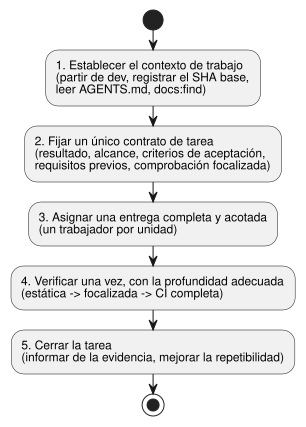
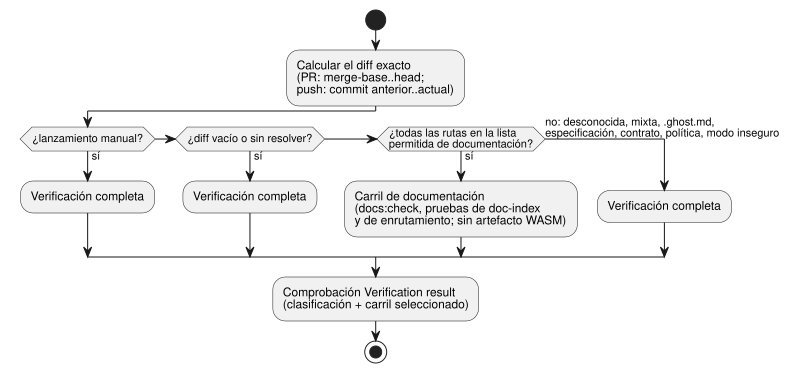

<!-- translation-source: docs/DEVELOPMENT-WORKFLOW.md -->
[Original en inglés](DEVELOPMENT-WORKFLOW.md)

# Flujo de trabajo de desarrollo eficiente

Este procedimiento cubre cuatro tipos de trabajo en el repositorio del lenguaje
GhostFlow: desarrollo de funcionalidades, corrección de errores, adición de
documentación y actualización de documentación. Mantiene centrados el contrato
de la tarea y la verificación. No sustituye la política del repositorio que
figura en `AGENTS.md` ni en [`VERIFICATION.md`](VERIFICATION.es.md).

Trabajo relacionado:
[#348](https://github.com/callin2/ghostflow-language/issues/348) y la
[skill doc-index](https://github.com/callin2/doc-index/issues/2) compartida.

El procedimiento tiene cinco pasos. El diagrama siguiente los muestra en orden.



## 1. Establecer el contexto de trabajo

Antes de cambiar nada:

1. Comience el trabajo nuevo de GhostFlow a partir de `dev`.
2. Confirme la raíz real del repositorio y la rama.
3. Registre el SHA base exacto de Git.
4. Compruebe si el árbol de trabajo (worktree) tiene cambios existentes.

Nunca deduzca el contenido de una rama a partir de un checkout temporal con
nombre.

Lea el `AGENTS.md` local. Después, para cualquier tipo de tarea, busque en el
índice de documentos antes de leer los archivos de diseño, documentación o
código fuente pertinentes:

```sh
npm run docs:find -- --limit 8 QUERY
```

Este comando busca en las rutas, los títulos y los tipos de Markdown/HTML
indexados. No es una búsqueda de texto completo. Cuando necesite buscar en el
contenido de la prosa o del código fuente, use `rg` o abra los archivos que el
comando identificó. No repita la búsqueda en el índice ni la investigación del
código fuente durante las entregas (handoffs), salvo que lo exija nueva
evidencia.

## 2. Fijar un único contrato de tarea

Indique estos elementos para la tarea:

- el resultado solicitado;
- el alcance;
- los criterios de aceptación pendientes;
- los requisitos previos estrictos;
- el comando de verificación focalizada.

Separe el trabajo en tres grupos: completado, bloqueado por un requisito previo
real y realizable de forma independiente. Deje fuera del alcance cualquier
limpieza no solicitada.

| Trabajo | Entrada y resultado requerido | Verificación focalizada |
| --- | --- | --- |
| Funcionalidad | Confirme el módulo responsable y el contrato pertinente. Implemente el comportamiento solicitado y su cobertura significativa. | Ejecute la prueba específica del comportamiento modificado y, después, la CI obligatoria del repositorio. |
| Corrección de errores | Capture primero una reproducción que falle. Conserve el oráculo de pruebas existente y añada la comprobación de regresión más pequeña posible. | Demuestre que la reproducción falla antes de la corrección y pasa después; ejecute la CI obligatoria del repositorio. |
| Adición de documentación | Confirme el público y la ubicación canónica. Añada los documentos correspondientes en inglés/coreano, los enlaces de traducción y los marcadores de origen, y las entradas del manifiesto/catálogo. | `npm run docs:check`; ejecute cualquier comprobación focalizada de ejemplos o del catálogo de requisitos que corresponda. |
| Actualización de documentación | Edite ambas versiones de idioma y actualice los metadatos del manifiesto/catálogo afectados. Mantenga el original canónico como autoridad, haga coincidir los ejemplos ejecutables entre traducciones y conserve los registros históricos. Para cambios autorizados de fuente o de semántica, edite primero el original canónico, después regenere las salidas derivadas afectadas y ejecute las comprobaciones adecuadas. El trabajo solo de traducción no modifica el código del programa. | `npm run docs:check`; ejecute comprobaciones focalizadas de ejemplos o del catálogo de requisitos cuando se vean afectados. |

### Registro de cambios de las reglas del lenguaje

Algunos cambios deben registrarse en los archivos raíz `CHANGELOG.md` y
`CHANGELOG.ko.md` en el mismo PR:

- cualquier cambio en el significado de la sintaxis, los tipos, la evaluación,
  el estado, el tiempo, la salida o las restricciones aceptados;
- cualquier cambio en el comportamiento de los errores semánticos;
- una corrección de errores que cambie el comportamiento observable del
  lenguaje.

Si el par aún no existe, créelo con una sección `Unreleased` / `미출시` en el
primer cambio de este tipo. No invente cambios históricos ni versiones de
publicación.

Cada entrada registra:

- la fecha;
- la regla o la sección de Reference afectada;
- un resumen conciso del comportamiento antes→después y el motivo;
- el impacto de compatibilidad o de migración, cuando corresponda;
- un ejemplo mínimo y la evidencia de regresión;
- el enlace a la issue/PR.

Etiquete una corrección que restablece el comportamiento documentado como
corrección de errores, no como una nueva decisión de especificación. Actualice
juntas las secciones de Reference, los ejemplos, la documentación en
inglés/coreano y las pruebas afectados, y conserve las entradas anteriores.

Mantenga diferenciadas estas versiones: versiones de reglas/perfil del
lenguaje, versiones de GFB/ABI y versiones de paquetes. Las correcciones de
erratas, de traducción o de maquetación por sí solas no necesitan una entrada
semántica. Al crear el par, siga la política normal de índice/comprobación de
la documentación.

## 3. Asignar una entrega completa y acotada

Use el trabajador capaz más económico:

| Trabajador | Uso |
| --- | --- |
| Luna | trabajo mecánico |
| Sol | implementación sustancial |
| Astra | trabajo excepcionalmente difícil o sin resolver |

Las unidades independientes y sin solapamiento pueden ejecutarse en paralelo.
Asigne a cada trabajador una unidad completa y acotada, que incluya la
implementación, las pruebas y la documentación cuando sea necesario. Evite una
cadena de entregas separadas de investigación, implementación y pruebas. El
agente principal es responsable del diseño, la prioridad, la integración y la
revisión final.

Use esta plantilla de entrega:

```text
Outcome:
Scope and owned files:
Completed / blocked / independent:
Acceptance criteria:
Prerequisites and constraints:
Focused verification command:
Return: changed files, commands and results, remaining risks or blockers.
```

## 4. Verificar una vez, con la profundidad adecuada

Ejecute las comprobaciones en este orden: comprobaciones estáticas, luego
pruebas focalizadas y luego la CI completa obligatoria. No debilite pruebas ni
puertas de control para conseguir que pasen. Reutilice evidencia previa solo
cuando coincidan la fuente, las dependencias, la cadena de herramientas, la
configuración y las entradas pertinentes del entorno. Informe de cada comando,
su código de salida, los recuentos útiles y cualquier limitación pendiente.

**Puerta temprana de CI.** La CI ejecuta
`node --test --test-reporter=tap tests/ci-verification-routing.test.mjs tests/verified-wasm-artifact.test.mjs`
en el trabajo de clasificación, antes de los carriles del compilador. Estos
contratos sobre archivos locales no necesitan instalar dependencias ni el
compilador. Mantenga esta puerta temprana y mantenga también todas las puertas
de verificación posteriores.
La [issue #534](https://github.com/callin2/ghostflow-language/issues/534)
registra el fallo tardío observado del workflow y el enlace a System #196.

**Extractos del catálogo de requisitos.** El verificador valida los extractos
del catálogo de requisitos antes de la compilación nativa o de la reproducción
(replay). Si las líneas de la fuente se desplazan, reubique el extracto sin
cambios y conserve su hash. Nunca actualice un hash de evidencia histórica para
ocultar una deriva.

**Orden y entradas congeladas.** Espere a obtener resultados estáticos y
focalizados exitosos antes de iniciar la verificación completa. Congele los
archivos de entrada durante cada ejecución. Una ejecución iniciada antes de una
corrección no valida el árbol final.

**Requisitos previos para un consumidor con nombre.** Cuando su cambio sea un
requisito previo de un consumidor actual con nombre, fije ese consumidor al
candidato inmutable del responsable. El conjunto completo de regresiones
afectadas del consumidor debe pasar antes de que el responsable haga el merge.
Las pruebas exclusivas del responsable no establecen la compatibilidad del ciclo
de vida del consumidor. Conserve los oráculos existentes del consumidor y la
evidencia histórica.

**Dependencias de Node.** Antes de reutilizar un directorio de dependencias de
Node, ejecute `~/.codex/bin/test-compact -- npm ls --depth=0` desde la raíz del
paquete verificado. Un lockfile coincidente o una importación exitosa no
demuestran que todas las dependencias fijadas estén instaladas. Si la
validación falla, ejecute un
`~/.codex/bin/test-compact -- npm ci --ignore-scripts` local al worktree antes
de probar. No repare implícitamente el directorio de dependencias de otro
worktree.

**Lotes de documentación.** Regenere el índice una vez después del lote. Luego
compruebe las traducciones y la actualización del índice:

```sh
npm run docs:index
npm run docs:check
```

**Enrutamiento de carriles de CI.** El workflow Verified WASM, que se activa
siempre, enruta cada diff exacto a un carril, como se describe en la
[issue #357](https://github.com/callin2/ghostflow-language/issues/357).

Solo estas rutas cumplen los requisitos para el carril ligero de documentación:

- los pares en inglés/coreano de README, CONTRIBUTING y `docs/DOCUMENTATION`;
- `INDEX.md` y `docs/INDEX.md`;
- los cuatro archivos `docs/assets/readme-{hero,intent,replay,trace}.svg`;
- `docs/translations.json`, pero solo cuando los únicos cambios añaden, eliminan
  o actualizan los hashes de esos pares de documentos ordinarios. Todos los
  demás pares y los metadatos de la política deben permanecer idénticos.

Estos cambios requieren verificación completa:

- rutas desconocidas y cambios mixtos;
- archivos `.ghost.md`, especificaciones, contratos y política de verificación;
- modos de archivo inseguros;
- diffs vacíos o sin resolver.

En un PR, el diff compara la merge-base con el head. En un push, compara el
commit anterior exacto con el commit actual.



El carril de documentación instala las dependencias de Node sin scripts.
Ejecuta la puerta `docs:check` completa, las regresiones del contrato
doc-index y las pruebas focalizadas de enrutamiento. No produce ningún artefacto
WASM.

Un lanzamiento manual del workflow (workflow dispatch) siempre ejecuta la
verificación completa. Úselo cuando necesite un artefacto de un SHA exacto.

La comprobación final `Verification result` requiere una clasificación exitosa
y un carril seleccionado exitoso. Exija que esté en verde antes de hacer el
merge. La configuración de protección de ramas no cambia; esta comprobación no
crea una regla de comprobación obligatoria impuesta por la plataforma.

Antes de ampliar la lista de rutas permitidas del carril ligero, revise las
pruebas existentes que leen las rutas propuestas y mantenga sus aserciones
aplicables en ese carril.

`docs:check` es la puerta de CI de solo comprobación. Si cambia un comprobador,
ejecute sus pruebas focalizadas:

```sh
node --test tests/doc-translations.test.mjs tests/doc-index.test.mjs
```

Los informes están exentos de traducción, pero siguen indexados. Una edición
solo del cuerpo puede dejar sin cambios los metadatos indexados, así que lea la
fuente al confirmar el contenido. El mantenimiento por agentes y las
comprobaciones de CI no son un vigilante del sistema de archivos.

## 5. Cerrar la tarea y mejorar la repetibilidad

**Limpieza de ramas tras el merge.** Después de que un PR de funcionalidad del
mismo repositorio se fusiona en `dev`, la CI elimina su rama head remota. Solo
lo hace cuando la punta remota actual sigue siendo igual al SHA head del evento
de merge. Un force-with-lease exacto de Git protege frente a actualizaciones
concurrentes. La CI conserva:

- los heads de forks;
- las puntas ausentes o que han avanzado;
- `main`, `dev`, la rama predeterminada y las ramas de publicación.

Esta automatización nunca elimina ramas ni worktrees locales.

Al integrar ramas históricas cuya ascendencia debe conservarse, use un commit
de merge. Un squash no convierte sus puntas originales en ancestros de `dev`.

**Informe.** Informe del cambio exacto, la evidencia y los comandos, el código
de salida, los recuentos pertinentes, las limitaciones y la issue o pull request
vinculada. No repita una revisión completa cuando los resultados automatizados
pasan y no queda ninguna cuestión semántica, de diseño o de seguridad.

**Hábitos de eficiencia.**

- Mida los cuellos de botella antes de proponer un cambio en la cadencia de la
  CI.
- Compruebe el espacio en disco antes de compilaciones pesadas.
- Agrupe las escrituras externas y actualice solo los campos afectados.

**Mejorar la repetibilidad.** Antes de cerrar, busque pasos de revisión
repetidos que una comprobación estática existente pueda sustituir. Después,
considere la automatización más pequeña justificada para cualquier operación
repetida restante y añádala dentro del alcance autorizado. Mantenga las pruebas
dinámicas o la evidencia de hardware cuando las comprobaciones estáticas no
puedan establecer el comportamiento. El trabajo rutinario no requiere una
solicitud de aprobación aparte.
