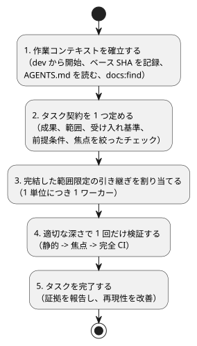
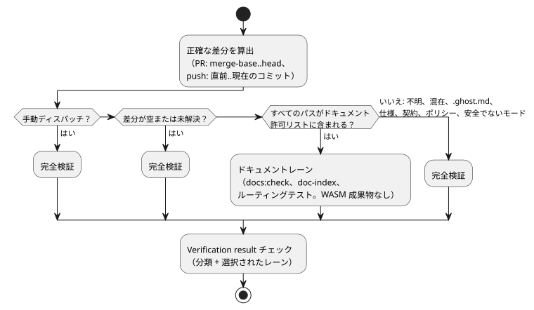

<!-- translation-source: docs/DEVELOPMENT-WORKFLOW.md -->
[英語の原文](DEVELOPMENT-WORKFLOW.md)

# 効率的な開発ワークフロー

この手順は、GhostFlow 言語リポジトリにおける 4 種類の作業を対象とします。機能開発、
バグ修正、ドキュメントの追加、ドキュメントの更新です。タスク契約と検証の焦点を
絞った状態に保ちます。`AGENTS.md` や [`VERIFICATION.md`](VERIFICATION.ja.md) にある
リポジトリのポリシーを置き換えるものではありません。

関連する作業: [#348](https://github.com/callin2/ghostflow-language/issues/348)
と共有の [doc-index スキル](https://github.com/callin2/doc-index/issues/2)。

手順は 5 つのステップからなります。下の図は、それらを順に示しています。



## 1. 作業コンテキストを確立する

何かを変更する前に、次のことを行います。

1. 新しい GhostFlow の作業は `dev` から始めます。
2. 実際のリポジトリルートとブランチを確認します。
3. 正確な Git のベース SHA を記録します。
4. ワークツリーに既存の変更がないか確認します。

名前付きの一時チェックアウトから、ブランチの内容を推測してはなりません。

ローカルの `AGENTS.md` を読みます。その後、どの種類のタスクでも、関連する設計、
ドキュメント、ソースファイルを読む前に、ドキュメントインデックスを検索します。

```sh
npm run docs:find -- --limit 8 QUERY
```

このコマンドは、インデックス化された Markdown/HTML のパス、タイトル、種類を検索します。
全文検索ではありません。本文やソースの内容を検索する必要がある場合は、`rg` を使うか、
このコマンドが特定したファイルを開いてください。新しい証拠が必要としない限り、引き継ぎの
たびにインデックス検索やソースの調査を繰り返さないでください。

## 2. タスク契約を 1 つ定める

タスクについて、次の項目を明記します。

- 求められている成果
- 範囲
- 残っている受け入れ基準
- 必須の前提条件
- 焦点を絞った検証コマンド

作業を 3 つのグループに分けます。完了したもの、実際の前提条件によってブロックされている
もの、独立して実行できるものです。求められていない整理作業は範囲外にします。

| 作業 | 着手時と求められる結果 | 焦点を絞った検証 |
| --- | --- | --- |
| 機能 | 所有するモジュールと関連する契約を確認する。求められた振る舞いと、意味のあるカバレッジを実装する。 | 変更した振る舞いの限定的なテストを実行し、その後リポジトリで必須の CI を実行する。 |
| バグ修正 | まず失敗する再現を捕捉する。既存のテストオラクルを保持し、最小の回帰チェックを追加する。 | 再現が修正前に失敗し、修正後に成功することを示す。リポジトリで必須の CI を実行する。 |
| ドキュメントの追加 | 対象読者と正規の配置場所を確認する。対応する英語/韓国語の文書、翻訳リンクとソースマーカー、マニフェスト/カタログのエントリを追加する。 | `npm run docs:check`。該当する例や要件カタログの焦点チェックがあれば実行する。 |
| ドキュメントの更新 | 両方の言語版を編集し、影響を受けるマニフェスト/カタログのメタデータを更新する。正本の原文を正としたまま、翻訳間で実行可能な例を一致させ、履歴の記録を保持する。許可されたソースやセマンティクスの変更では、まず正本の原文を編集し、その後影響を受ける派生出力を再生成して適切なチェックを実行する。翻訳のみの作業ではプログラムコードを変更しない。 | `npm run docs:check`。影響がある場合は、例や要件カタログの焦点チェックを実行する。 |

### 言語規則の変更履歴

一部の変更は、同じ PR の中でルートの `CHANGELOG.md` と `CHANGELOG.ko.md` に記録しなければ
なりません。

- 受け入れられた構文、型、評価、状態、時間、出力、制約の意味の変更
- 意味エラーの振る舞いの変更
- 観測可能な言語の振る舞いを変えるバグ修正

このペアがまだ存在しない場合は、最初のそのような変更の際に `Unreleased` / `미출시`
セクションを持つペアを作成します。過去の変更やリリースバージョンを捏造してはなりません。

各エントリには次のものを記録します。

- 日付
- 影響を受ける規則または Reference のセクション
- 簡潔な変更前→変更後の振る舞いと理由
- 該当する場合は、互換性または移行への影響
- 最小限の例と回帰の証拠
- issue/PR へのリンク

文書化された振る舞いを回復する修正には、新しい仕様上の判断ではなくバグ修正としてラベルを
付けます。影響を受ける Reference のセクション、例、英語/韓国語の文書、テストを一緒に更新し、
以前のエントリは保持します。

次のバージョンは区別しておきます。言語規則/プロファイルのバージョン、GFB/ABI の
バージョン、パッケージのバージョンです。誤字、翻訳、レイアウトだけの編集には、
セマンティクスのエントリは不要です。ペアを作成するときは、通常のドキュメントの
インデックス/チェックのポリシーに従ってください。

## 3. 完結した範囲限定の引き継ぎを割り当てる

能力が足りる中で最も安価なワーカーを使います。

| ワーカー | 用途 |
| --- | --- |
| Luna | 機械的な作業 |
| Sol | 実質的な実装 |
| Astra | 非常に難しい、または未解決の作業 |

独立していて重ならない単位は、並行して実行してかまいません。各ワーカーには、必要に応じて
実装、テスト、ドキュメントを含む、完結した範囲限定の単位を 1 つ渡します。調査、実装、
テストを別々の引き継ぎとして連鎖させることは避けます。設計、優先順位、統合、最終レビューは
メインエージェントが所有します。

次の引き継ぎテンプレートを使います。

```text
成果:
範囲と担当ファイル:
完了 / ブロック / 独立:
受け入れ基準:
前提条件と制約:
焦点を絞った検証コマンド:
返却: 変更したファイル、コマンドと結果、残るリスクまたはブロッカー。
```

## 4. 適切な深さで 1 回だけ検証する

チェックは次の順に実行します。静的チェック、次に焦点を絞ったテスト、次に必須の完全 CI
です。合格させるためにテストやゲートを弱めてはなりません。以前の証拠を再利用するのは、
ソース、依存関係、ツールチェーン、設定、関連する環境入力がすべて一致する場合だけにします。
各コマンドについて、その終了ステータス、有用な件数、残っている限界を報告します。

**早期 CI ゲート。** CI は、分類ジョブの中で、コンパイラのレーンより前に
`node --test --test-reporter=tap tests/ci-verification-routing.test.mjs tests/verified-wasm-artifact.test.mjs`
を実行します。これらのローカルファイルの契約には、依存関係のインストールもコンパイラも
必要ありません。この早期ゲートを維持し、下流の検証ゲートもすべて維持してください。
[Issue #534](https://github.com/callin2/ghostflow-language/issues/534) には、観測された
遅いワークフローの失敗と System #196 へのリンクが記録されています。

**要件カタログの抜粋。** 検証ツールは、ネイティブのコンパイルやリプレイの前に、要件
カタログの抜粋を検証します。ソースの行が移動した場合は、変更されていない抜粋の位置を
移し、そのハッシュは保持します。ずれを隠すために、過去の証拠のハッシュを更新しては
なりません。

**順序と凍結された入力。** 完全な検証を始める前に、静的チェックと焦点を絞ったテストの
成功を待ちます。各実行の間は入力ファイルを凍結します。修正の前に始まった実行は、最終的な
ツリーを検証したことになりません。

**名前付きの利用側の前提条件。** 変更が、名前の付いた現在の利用側の前提条件である場合は、
その利用側を不変の所有者候補に固定します。所有者がマージする前に、利用側の影響を受ける
回帰スイート全体が成功しなければなりません。所有者だけのテストでは、利用側のライフサイクル
互換性は確立できません。既存の利用側のオラクルと過去の証拠を保持してください。

**Node の依存関係。** Node の依存関係ディレクトリを再利用する前に、検証済みのパッケージ
ルートから `~/.codex/bin/test-compact -- npm ls --depth=0` を実行します。ロックファイルが
一致していることや、1 回のインポートが成功したことは、固定されたすべての依存関係が
インストールされていることを証明しません。検証が失敗した場合は、テストの前に
ワークツリーローカルで `~/.codex/bin/test-compact -- npm ci --ignore-scripts` を実行します。
別のワークツリーの依存関係ディレクトリを暗黙のうちに修復してはなりません。

**ドキュメントのバッチ。** バッチの後にインデックスを 1 回だけ再生成します。その後、翻訳と
インデックスの鮮度を確認します。

```sh
npm run docs:index
npm run docs:check
```

**CI レーンのルーティング。** 常にトリガーされる Verified WASM ワークフローは、
[issue #357](https://github.com/callin2/ghostflow-language/issues/357) で説明されているように、
正確な差分ごとにレーンを振り分けます。

軽量なドキュメントレーンの対象になるのは、次のパスだけです。

- README、CONTRIBUTING、`docs/DOCUMENTATION` の英語/韓国語のペア
- `INDEX.md` と `docs/INDEX.md`
- 4 つの `docs/assets/readme-{hero,intent,replay,trace}.svg` ファイル
- `docs/translations.json`。ただし、変更がそれらの通常の文書ペアの追加、削除、
  ハッシュ更新だけである場合に限ります。それ以外のすべてのペアとポリシーのメタデータは
  同一のままでなければなりません。

次の変更には完全な検証が必要です。

- 不明なパスと混在した変更
- `.ghost.md` ファイル、仕様、契約、検証ポリシー
- 安全でないファイルモード
- 空または未解決の差分

PR の場合、差分は merge-base と head を比較します。push の場合は、正確な直前のコミットと
現在のコミットを比較します。



ドキュメントレーンは、スクリプトなしで Node の依存関係をインストールします。`docs:check`
ゲート全体、doc-index の契約の回帰テスト、焦点を絞ったルーティングテストを実行します。
WASM の成果物は生成しません。

手動のワークフローディスパッチは、常に完全な検証を実行します。正確な SHA の成果物が必要な
場合に使ってください。

最終的な `Verification result` チェックには、分類の成功と、選択されたレーンの成功が必要です。
マージの前に、これが緑であることを必須にしてください。ブランチ保護の設定は変わりません。
このチェックは、プラットフォームが強制する必須チェックの規則を作成するものではありません。

軽量な許可リストを広げる前に、提案するパスを読む既存のテストを調べ、該当するアサーションを
そのレーンに残してください。

`docs:check` はチェック専用の CI ゲートです。チェッカーを変更した場合は、その焦点を絞った
テストを実行します。

```sh
node --test tests/doc-translations.test.mjs tests/doc-index.test.mjs
```

レポートは翻訳の対象外ですが、インデックスには含まれます。本文だけの編集ではインデックスの
メタデータが変わらないことがあるため、内容を確認するときはソースを読んでください。
エージェントによるメンテナンスと CI のチェックは、ファイルシステムの監視ではありません。

## 5. タスクを完了し、再現性を改善する

**マージ後のブランチの整理。** 同一リポジトリの機能 PR が `dev` にマージされた後、CI は
そのリモートの head ブランチを削除します。削除するのは、現在のリモートの先端がマージ
イベントの head SHA とまだ等しい場合だけです。正確な Git の force-with-lease によって、
同時更新から保護されます。CI は次のものを保持します。

- フォークの head
- 存在しない先端、または先に進んだ先端
- `main`、`dev`、デフォルトブランチ、リリースブランチ

この自動化が、ローカルのブランチやワークツリーを削除することは決してありません。

祖先関係を保持しなければならない過去のブランチを統合するときは、マージコミットを使います。
スカッシュでは、それらの元の先端は `dev` の祖先になりません。

**報告。** 正確な変更、証拠とコマンド、終了ステータス、関連する件数、限界、リンクされた
issue またはプルリクエストを報告します。自動化された結果が成功し、セマンティクス、設計、
安全性の疑問が残っていない場合は、完全なレビューを繰り返さないでください。

**効率化の習慣。**

- CI の実行頻度の変更を提案する前に、ボトルネックを測定します。
- 重いビルドの前にディスク容量を確認します。
- 外部への書き込みはまとめて行い、影響を受けるフィールドだけを更新します。

**再現性の改善。** タスクを完了する前に、既存の静的チェックで置き換えられる、繰り返し
行われているレビュー手順がないか探します。その後、残っている繰り返し作業について、
正当化できる最小の自動化を検討し、許可された範囲内で追加します。静的チェックでは振る舞いを
確立できない場合は、動的なテストやハードウェアの証拠を残します。定型的な作業に、別途の
承認依頼は必要ありません。
