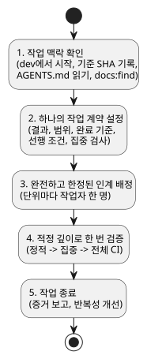
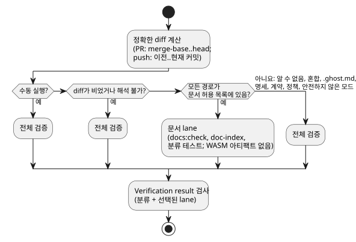

<!-- translation-source: docs/DEVELOPMENT-WORKFLOW.md -->
[영문 원문](DEVELOPMENT-WORKFLOW.md)

# 효율적인 개발 절차

이 절차는 GhostFlow 언어 저장소의 네 가지 작업, 즉 기능 추가, 버그 수정, 문서 추가,
문서 수정을 다룹니다. 작업 계약과 검증 범위를 집중적으로 유지합니다. 저장소 정책인
`AGENTS.md`나 [`VERIFICATION.md`](VERIFICATION.md)를 대체하지 않습니다.

관련 작업: [#348](https://github.com/callin2/ghostflow-language/issues/348) 및 공유
[doc-index 스킬](https://github.com/callin2/doc-index/issues/2).

절차는 다섯 단계로 이루어집니다. 아래 다이어그램은 그 순서를 보여 줍니다.



## 1. 작업 맥락 확인

무엇이든 바꾸기 전에 다음을 합니다.

1. 새 GhostFlow 작업은 `dev`에서 시작합니다.
2. 실제 저장소 루트와 브랜치를 확인합니다.
3. 정확한 Git 기준 SHA를 기록합니다.
4. 작업 트리에 기존 변경이 있는지 확인합니다.

이름이 붙은 임시 체크아웃을 보고 브랜치의 내용을 추정해서는 안 됩니다.

로컬 `AGENTS.md`를 읽습니다. 그다음, 작업 유형과 관계없이 관련 설계, 문서, 소스
파일을 읽기 전에 문서 인덱스를 검색합니다.

```sh
npm run docs:find -- --limit 8 QUERY
```

이 명령은 색인된 Markdown/HTML의 경로, 제목, 유형을 검색합니다. 전체 텍스트 검색은
아닙니다. 본문이나 소스 내용을 검색해야 하면 `rg`를 사용하거나 이 명령이 찾아 준
파일을 엽니다. 새 근거가 필요한 경우가 아니라면 인계 과정에서 인덱스 검색이나 소스
조사를 반복하지 않습니다.

## 2. 하나의 작업 계약 설정

작업에 대해 다음 항목을 명시합니다.

- 요청된 결과
- 범위
- 남은 완료 기준
- 필수 선행 조건
- 집중 검증 명령

작업을 세 그룹으로 나눕니다. 완료된 작업, 실제 선행 조건 때문에 막힌 작업,
독립적으로 진행할 수 있는 작업입니다. 요청하지 않은 정리는 범위에 넣지 않습니다.

| 작업 | 시작 조건과 필요한 결과 | 집중 검증 |
| --- | --- | --- |
| 기능 추가 | 담당 모듈과 관련 계약을 확인합니다. 요청된 동작과 의미 있는 검증을 구현합니다. | 변경된 동작에 대한 좁은 테스트를 실행한 뒤 필수 저장소 CI를 실행합니다. |
| 버그 수정 | 먼저 실패하는 재현 사례를 확보합니다. 기존 테스트 기준(oracle)을 보존하고 가장 작은 회귀 검사를 추가합니다. | 수정 전에는 재현이 실패하고 수정 후에는 통과함을 보인 뒤 필수 저장소 CI를 실행합니다. |
| 문서 추가 | 독자와 정본 위치를 확인합니다. 대응하는 영어/한국어 문서, 번역 링크와 출처 표시, manifest/catalog 항목을 추가합니다. | `npm run docs:check`; 해당하는 예제 또는 requirement-catalog 집중 검사를 실행합니다. |
| 문서 수정 | 두 언어 버전을 모두 편집하고 영향받는 manifest/catalog 메타데이터를 갱신합니다. 정본 원문의 권위를 유지하고, 번역 간 실행 예제를 일치시키며, 과거 기록을 보존합니다. 승인된 소스 변경이나 의미 변경은 정본 원문을 먼저 편집한 뒤 영향받는 파생 출력을 다시 생성하고 적절한 검사를 실행합니다. 번역만 하는 작업은 프로그램 코드를 바꾸지 않습니다. | `npm run docs:check`; 영향이 있으면 예제 또는 requirement-catalog 집중 검사를 실행합니다. |

### 언어 규칙 변경 기록

일부 변경은 같은 PR에서 루트 `CHANGELOG.md`와 `CHANGELOG.ko.md`에 기록해야 합니다.

- 허용된 문법, 타입, 평가, 상태, 시간, 출력, 제약의 의미를 바꾸는 모든 변경
- 의미 오류 처리 방식을 바꾸는 모든 변경
- 관측 가능한 언어 동작을 바꾸는 버그 수정

이 쌍이 아직 없다면, 처음으로 해당 변경이 생길 때 `Unreleased` / `미출시` 절을 가진
쌍을 만듭니다. 근거 없는 과거 변경이나 릴리스 버전을 지어내지 않습니다.

각 항목에는 다음을 기록합니다.

- 날짜
- 영향받는 규칙 또는 Reference 절
- 간결한 변경 전→후 동작과 그 이유
- 해당하는 경우 호환성 또는 마이그레이션 영향
- 최소 예제와 회귀 증거
- 이슈/PR 링크

문서화된 동작을 되살리는 수정은 새 명세 결정이 아니라 버그 수정으로 표시합니다.
영향받는 Reference 절, 예제, 영어/한국어 문서, 테스트를 함께 갱신하고 이전 항목을
보존합니다.

다음 버전들은 서로 구분합니다. 언어 규칙/프로필 버전, GFB/ABI 버전, 패키지
버전입니다. 오탈자, 번역, 레이아웃만 바꾸는 편집에는 의미 항목이 필요하지 않습니다.
쌍을 만들 때는 일반적인 문서 인덱스/검사 정책을 따릅니다.

## 3. 완전하고 한정된 인계 배정

작업을 해낼 수 있는 가장 저렴한 작업자를 씁니다.

| 작업자 | 용도 |
| --- | --- |
| Luna | 기계적인 작업 |
| Sol | 실질적인 구현 |
| Astra | 예외적으로 어렵거나 해결되지 않은 작업 |

서로 겹치지 않는 독립 단위는 병렬로 진행할 수 있습니다. 각 작업자에게는 필요한 경우
구현, 테스트, 문서를 모두 포함한 완전하고 한정된 단위 하나를 줍니다. 조사, 구현,
테스트를 따로따로 이어서 인계하는 사슬은 피합니다. 설계, 우선순위, 통합, 최종 검토는
주 에이전트가 맡습니다.

다음 인계 템플릿을 사용합니다.

```text
결과:
범위 및 담당 파일:
완료 / 차단 / 독립 작업:
완료 기준:
선행 조건 및 제약:
집중 검증 명령:
회신: 변경 파일, 명령과 결과, 남은 위험 또는 차단 사유.
```

## 4. 적정 깊이로 한 번 검증

검사는 정적 검사, 집중 테스트, 필수 전체 CI 순서로 실행합니다. 통과시키려고 테스트나
게이트를 약화해서는 안 됩니다. 소스, 의존성, 도구 체인, 설정, 관련 환경 입력이 모두
같을 때만 이전 증거를 재사용합니다. 각 명령, 종료 상태, 유용한 건수, 남은 한계를
보고합니다.

**조기 CI 게이트.** CI는 분류 job에서 컴파일러 lane보다 먼저
`node --test --test-reporter=tap tests/ci-verification-routing.test.mjs tests/verified-wasm-artifact.test.mjs`
를 실행합니다. 이 로컬 파일 계약 검사에는 의존성 설치도 컴파일러도 필요 없습니다. 이
조기 게이트를 유지하고, 이후의 모든 검증 게이트도 함께 유지합니다.
[이슈 #534](https://github.com/callin2/ghostflow-language/issues/534)에 실제로 관찰된
늦은 workflow 실패와 System #196 링크가 기록되어 있습니다.

**requirement-catalog 발췌.** verifier는 native 컴파일이나 재생 전에
requirement-catalog 발췌(excerpt)를 검증합니다. 소스 줄이 이동하면 변경되지 않은
발췌의 위치만 옮기고 해시는 유지합니다. 드리프트를 숨기려고 과거 증거 해시를 갱신해서는
절대 안 됩니다.

**순서와 입력 고정.** 정적 검사와 집중 검사가 성공한 것을 확인한 뒤 전체 검증을
시작합니다. 각 실행 동안 입력 파일을 고정합니다. 수정 전에 시작된 실행은 최종 트리를
검증하지 않습니다.

**이름이 지정된 consumer의 선행 작업.** 변경이 현재 이름이 지정된 consumer의 선행
작업이라면, 그 consumer를 불변 owner 후보에 고정합니다. owner를 병합하기 전에 consumer의
영향받는 전체 회귀 테스트 모음이 통과해야 합니다. owner 쪽 테스트만으로는 consumer
lifecycle 호환성을 입증할 수 없습니다. 기존 consumer oracle과 과거 증거를 보존합니다.

**Node 의존성.** Node 의존성 디렉터리를 재사용하기 전에, 검증한 패키지 루트에서
`~/.codex/bin/test-compact -- npm ls --depth=0`을 실행합니다. 잠금 파일이 일치하거나
import가 한 번 성공했다고 해서 고정된 모든 의존성이 설치되었다는 증거는 아닙니다.
검증에 실패하면 테스트 전에 해당 worktree 안에서
`~/.codex/bin/test-compact -- npm ci --ignore-scripts`를 실행합니다. 다른 worktree의
의존성 디렉터리를 암묵적으로 고치지 않습니다.

**문서 묶음.** 묶음 작업이 끝난 뒤 인덱스를 한 번 다시 생성합니다. 그다음 번역과 인덱스
최신성을 검사합니다.

```sh
npm run docs:index
npm run docs:check
```

**CI lane 분류.** 항상 실행되는 Verified WASM workflow는
[이슈 #357](https://github.com/callin2/ghostflow-language/issues/357)에 설명된 대로
정확한 diff를 각각 하나의 lane으로 분류합니다.

다음 경로만 경량 문서 lane에 해당합니다.

- README, CONTRIBUTING, `docs/DOCUMENTATION`의 영어/한국어 쌍
- `INDEX.md`와 `docs/INDEX.md`
- 네 개의 `docs/assets/readme-{hero,intent,replay,trace}.svg` 파일
- `docs/translations.json`. 단, 변경 내용이 위 일반 문서 쌍의 추가, 삭제, 해시 갱신뿐인
  경우에만 해당합니다. 다른 모든 쌍과 정책 메타데이터는 동일하게 유지되어야 합니다.

다음 변경에는 전체 검증이 필요합니다.

- 알 수 없는 경로와 혼합 변경
- `.ghost.md` 파일, 명세, 계약, 검증 정책
- 안전하지 않은 파일 모드
- 비어 있거나 해석할 수 없는 diff

PR에서는 diff가 merge-base와 head를 비교합니다. push에서는 정확한 이전 커밋과 현재
커밋을 비교합니다.



문서 lane은 스크립트 없이 Node 의존성을 설치합니다. 전체 `docs:check` 게이트,
doc-index 계약 회귀 테스트, 집중된 분류 테스트를 실행합니다. WASM 아티팩트는 만들지
않습니다.

수동 workflow 실행은 항상 전체 검증을 실행합니다. 정확한 SHA의 아티팩트가 필요할 때
사용합니다.

최종 `Verification result` 검사는 분류의 성공과 선택된 lane의 성공을 요구합니다. 병합
전에 이 검사가 통과(green)해야 합니다. 브랜치 보호 설정은 바뀌지 않습니다. 이 검사가
플랫폼에서 강제되는 필수 검사 규칙을 만들지는 않습니다.

경량 허용 목록을 넓히기 전에, 제안된 경로를 읽는 기존 테스트를 살펴보고 그 경로에
적용되는 assertion을 해당 lane에서도 유지합니다.

`docs:check`는 CI에서 쓰는 검사 전용 게이트입니다. 검사기를 바꿨다면 해당 집중 테스트를
실행합니다.

```sh
node --test tests/doc-translations.test.mjs tests/doc-index.test.mjs
```

보고서는 번역 대상에서 제외되지만 색인에는 포함됩니다. 본문만 바꾼 편집은 색인
메타데이터를 바꾸지 않을 수 있으므로, 내용을 확인할 때는 원본을 읽습니다. 에이전트
유지 관리와 CI 검사는 파일 시스템 감시자가 아닙니다.

## 5. 작업 종료와 반복성 개선

**병합 후 브랜치 정리.** 같은 저장소의 기능 PR이 `dev`에 병합되면 CI가 원격 head
브랜치를 삭제합니다. 단, 현재 원격 tip이 병합 이벤트의 head SHA와 여전히 같을 때만
삭제합니다. 정확한 Git force-with-lease가 동시 갱신을 막아 줍니다. CI는 다음을
보존합니다.

- 포크 head
- 없거나 앞으로 진행된 tip
- `main`, `dev`, 기본 브랜치, 릴리스 브랜치

이 자동화는 로컬 브랜치나 worktree를 절대 삭제하지 않습니다.

조상 관계를 보존해야 하는 과거 브랜치를 통합할 때는 merge commit을 사용합니다.
squash는 원래 tip을 `dev`의 조상으로 만들지 않습니다.

**보고.** 정확한 변경, 증거와 명령, 종료 상태, 관련 건수, 한계, 연결된 이슈나 풀
리퀘스트를 보고합니다. 자동 검사 결과가 통과하고 의미, 설계, 안전에 관한 질문이 남지
않았다면 전체 검토를 반복하지 않습니다.

**효율 습관.**

- CI 주기 변경을 제안하기 전에 병목을 측정합니다.
- 무거운 빌드 전에 디스크 공간을 확인합니다.
- 외부 쓰기는 묶어서 실행하고 영향받는 필드만 갱신합니다.

**반복성 개선.** 작업을 닫기 전에, 기존 정적 검사로 대체할 수 있는 반복 검토 단계를
찾습니다. 그다음 남은 반복 작업에 대해 정당화되는 가장 작은 자동화를 검토하고, 승인된
범위 안에서 추가합니다. 정적 검사로 동작을 확인할 수 없는 경우에는 동적 테스트나
하드웨어 증거를 유지합니다. 일상적인 작업에는 별도의 승인 요청이 필요하지 않습니다.
