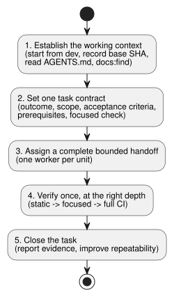
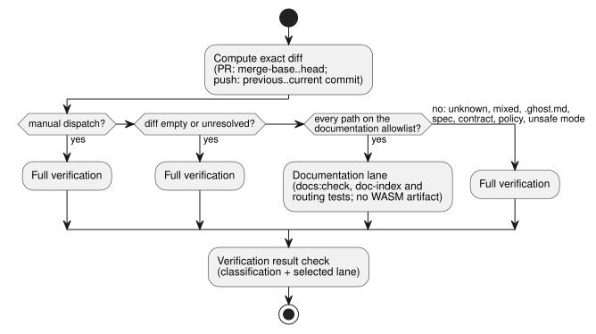

# Efficient development workflow

This procedure covers four kinds of work in the GhostFlow language repository:
feature work, bug fixes, documentation additions and documentation updates. It
keeps the task contract and the verification focused. It does not replace the
repository policy in `AGENTS.md` or [`VERIFICATION.md`](VERIFICATION.md).

Related work: [#348](https://github.com/callin2/ghostflow-language/issues/348)
and the shared [doc-index skill](https://github.com/callin2/doc-index/issues/2).

The procedure has five steps. The diagram below shows them in order.



## 1. Establish the working context

Before you change anything:

1. Start new GhostFlow work from `dev`.
2. Confirm the actual repository root and branch.
3. Record the exact Git base SHA.
4. Check the worktree for existing changes.

Never infer a branch's contents from a named temporary checkout.

Read the local `AGENTS.md`. Then, for every task type, search the document index
before reading relevant design, documentation or source files:

```sh
npm run docs:find -- --limit 8 QUERY
```

This command searches indexed Markdown/HTML paths, titles and types. It is not
full-text search. When you need to search prose or source content, use `rg` or
open the files it identified. Do not repeat the index search or the source
investigation during handoffs unless new evidence requires it.

## 2. Set one task contract

State these items for the task:

- the requested outcome;
- the scope;
- the remaining acceptance criteria;
- hard prerequisites;
- the focused verification command.

Separate the work into three groups: complete, blocked by a real prerequisite,
and independently actionable. Keep unrequested cleanup out of scope.

| Work | Entry and required result | Focused verification |
| --- | --- | --- |
| Feature | Confirm the owning module and relevant contract. Implement the requested behavior and its meaningful coverage. | Run the narrow test for the changed behavior, then required repository CI. |
| Bug fix | Capture a failing reproduction first. Preserve the existing test oracle and add the smallest regression check. | Show the reproduction fails before the fix and passes after it; run required repository CI. |
| Documentation addition | Confirm audience and canonical location. Add matching English/Korean documents, translation links and source markers, and manifest/catalog entries. | `npm run docs:check`; run any focused example or requirement-catalog check that applies. |
| Documentation update | Edit both language versions and update affected manifest/catalog metadata. Keep the canonical original authoritative, match executable examples across translations and preserve historical records. For authorized source or semantic changes, edit the canonical original first, then regenerate affected derived outputs and run appropriate checks. Translation-only work leaves program code unchanged. | `npm run docs:check`; run focused example or requirement-catalog checks when affected. |

### Language-rule changelog

Some changes must be recorded in the root `CHANGELOG.md` and `CHANGELOG.ko.md`
in the same PR:

- any change to the meaning of accepted syntax, types, evaluation, state, time,
  output or constraints;
- any change to semantic-error behavior;
- a bug fix that changes observable language behavior.

If the pair does not exist yet, create it with an `Unreleased` / `미출시`
section on the first such change. Do not invent historical changes or release
versions.

Each entry records:

- the date;
- the affected rule or Reference section;
- a concise before→after behavior and the reason;
- compatibility or migration impact, when applicable;
- a minimal example and regression evidence;
- the issue/PR link.

Label a fix that restores documented behavior as a bug fix, not as a new
specification decision. Update the affected Reference sections, examples,
English/Korean docs and tests together, and preserve prior entries.

Keep these versions distinct: language-rule/profile versions, GFB/ABI versions
and package versions. Typo, translation or layout edits alone need no semantic
entry. When you create the pair, follow the normal documentation index/check
policy.

## 3. Assign a complete bounded handoff

Use the cheapest capable worker:

| Worker | Use for |
| --- | --- |
| Luna | mechanical work |
| Sol | substantive implementation |
| Astra | exceptionally difficult or unresolved work |

Independent, non-overlapping units may run in parallel. Give each worker one
complete bounded unit, including implementation, tests and documentation where
needed. Avoid a chain of separate investigation, implementation and testing
handoffs. The main agent owns design, priority, integration and final review.

Use this handoff template:

```text
Outcome:
Scope and owned files:
Completed / blocked / independent:
Acceptance criteria:
Prerequisites and constraints:
Focused verification command:
Return: changed files, commands and results, remaining risks or blockers.
```

## 4. Verify once, at the right depth

Run checks in this order: static checks, then focused tests, then the required
full CI. Do not weaken tests or gates to obtain a pass. Reuse previous evidence
only when source, dependencies, toolchain, configuration and relevant
environment inputs all match. Report each command, its exit status, useful
counts and any remaining limit.

**Early CI gate.** CI runs
`node --test --test-reporter=tap tests/ci-verification-routing.test.mjs tests/verified-wasm-artifact.test.mjs`
in the classification job, before the compiler lanes. These local-file contracts
need no dependency installation and no compiler. Keep this early gate and also
keep all downstream verification gates.
[Issue #534](https://github.com/callin2/ghostflow-language/issues/534) records
the observed late workflow failure and the link to System #196.

**Requirement-catalog excerpts.** The verifier validates requirement-catalog
excerpts before native compilation or replay. If source lines move, relocate the
unchanged excerpt and keep its hash. Never refresh a historical evidence hash to
hide drift.

**Ordering and frozen inputs.** Wait for successful static and focused results
before starting full verification. Freeze input files during each run. A run
that started before a correction does not validate the final tree.

**Prerequisites for a named consumer.** When your change is a prerequisite of a
named current consumer, pin that consumer to the immutable owner candidate. The
consumer's full affected regression suite must pass before the owner merges.
Owner-only tests do not establish consumer lifecycle compatibility. Preserve
existing consumer oracles and historical evidence.

**Node dependencies.** Before reusing a Node dependency directory, run
`~/.codex/bin/test-compact -- npm ls --depth=0` from the verified package root.
A matching lockfile or one successful import does not prove that all pinned
dependencies are installed. If validation fails, run a worktree-local
`~/.codex/bin/test-compact -- npm ci --ignore-scripts` before testing. Do not
implicitly repair another worktree's dependency directory.

**Documentation batches.** Regenerate the index once after the batch. Then check
translations and index freshness:

```sh
npm run docs:index
npm run docs:check
```

**CI lane routing.** The always-triggered Verified WASM workflow routes each
exact diff to a lane, as described in
[issue #357](https://github.com/callin2/ghostflow-language/issues/357).

Only these paths qualify for the lightweight documentation lane:

- the README, CONTRIBUTING and `docs/DOCUMENTATION` English/Korean pairs;
- `INDEX.md` and `docs/INDEX.md`;
- the four `docs/assets/readme-{hero,intent,replay,trace}.svg` files;
- `docs/translations.json`, but only when the only changes add, remove or
  update the hashes of those ordinary document pairs. All other pairs and the
  policy metadata must stay identical.

These changes require full verification:

- unknown paths and mixed changes;
- `.ghost.md` files, specifications, contracts and verification policy;
- unsafe file modes;
- empty or unresolved diffs.

For a PR, the diff compares the merge-base with the head. For a push, it
compares the exact previous commit with the current commit.



The documentation lane installs Node dependencies without scripts. It runs the
whole `docs:check` gate, the doc-index contract regressions and the focused
routing tests. It produces no WASM artifact.

A manual workflow dispatch always runs full verification. Use it when you need
an exact-SHA artifact.

The final `Verification result` check requires a successful classification and
a successful selected lane. Require it to be green before merging. Branch
protection settings are unchanged; this check does not create a
platform-enforced required-check rule.

Before broadening the lightweight allowlist, inspect existing tests that read
the proposed paths, and keep their applicable assertions in that lane.

`docs:check` is the check-only CI gate. If you change a checker, run its focused
tests:

```sh
node --test tests/doc-translations.test.mjs tests/doc-index.test.mjs
```

Reports are exempt from translation but remain indexed. A body-only edit may
leave indexed metadata unchanged, so read the source when confirming content.
Agent maintenance and CI checks are not a filesystem watcher.

## 5. Close the task and improve repeatability

**Branch cleanup after merge.** After a same-repository feature PR merges into
`dev`, CI deletes its remote head branch. It does so only when the current
remote tip still equals the merged event's head SHA. An exact Git
force-with-lease protects against concurrent updates. CI preserves:

- fork heads;
- absent or advanced tips;
- `main`, `dev`, the default branch and release branches.

This automation never removes local branches or worktrees.

When integrating historical branches whose ancestry must be preserved, use a
merge commit. A squash does not make their original tips ancestors of `dev`.

**Report.** Report the exact change, the evidence and commands, exit status,
relevant counts, limits, and the linked issue or pull request. Do not repeat a
full review when automated results pass and no semantic, design or safety
question remains.

**Efficiency habits.**

- Measure bottlenecks before proposing a CI cadence change.
- Check disk space before heavy builds.
- Batch external writes and update only the affected fields.

**Improve repeatability.** Before closing, look for repeated review steps that
an existing static check can replace. Then consider the smallest justified
automation for any remaining repeated operation, and add it within the
authorized scope. Keep dynamic tests or hardware evidence where static checks
cannot establish behavior. Routine work does not require a separate approval
request.
