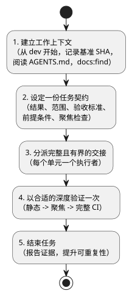
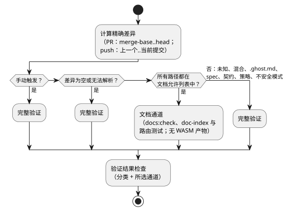

<!-- translation-source: docs/DEVELOPMENT-WORKFLOW.md -->
[英文原文](DEVELOPMENT-WORKFLOW.md)

# 高效开发工作流

本流程涵盖 GhostFlow 语言仓库中的四类工作：功能开发、缺陷修复、新增文档和更新文档。它使任务契约和验证保持聚焦。它不替代 `AGENTS.md` 或 [`VERIFICATION.md`](VERIFICATION.zh.md) 中的仓库策略。

相关工作：[#348](https://github.com/callin2/ghostflow-language/issues/348) 以及共享的 [doc-index skill](https://github.com/callin2/doc-index/issues/2)。

该流程分为五个步骤。下图按顺序展示这些步骤。



## 1. 建立工作上下文

在做任何修改之前：

1. 从 `dev` 开始新的 GhostFlow 工作。
2. 确认实际的仓库根目录和分支。
3. 记录精确的 Git 基准 SHA。
4. 检查工作树中是否已有改动。

绝不要根据某个命名的临时检出来推断分支内容。

阅读本地的 `AGENTS.md`。然后，对于每种任务类型，在阅读相关的设计、文档或源文件之前，先搜索文档索引：

```sh
npm run docs:find -- --limit 8 QUERY
```

该命令搜索已索引的 Markdown/HTML 路径、标题和类型。它不是全文搜索。需要搜索正文或源代码内容时，请使用 `rg`，或打开它找到的文件。除非有新的证据需要，否则不要在交接过程中重复索引搜索或源代码调查。

## 2. 设定一份任务契约

为任务写明以下各项：

- 所请求的结果；
- 范围；
- 剩余的验收标准；
- 硬性前提条件；
- 聚焦的验证命令。

将工作分为三组：已完成、被真实前提条件阻塞、可独立推进。不要把未被要求的清理工作纳入范围。

| 工作 | 切入点与要求的结果 | 聚焦验证 |
| --- | --- | --- |
| 功能 | 确认所属模块和相关契约。实现所请求的行为及其有意义的测试覆盖。 | 运行针对所改行为的窄范围测试，然后运行仓库要求的 CI。 |
| 缺陷修复 | 先获取一个失败的复现。保留现有的测试判定依据（oracle），并添加最小的回归检查。 | 证明复现在修复前失败、修复后通过；运行仓库要求的 CI。 |
| 新增文档 | 确认目标读者和规范位置。添加对应的英文/韩文文档、翻译链接和源标记，以及清单/目录条目。 | `npm run docs:check`；运行适用的聚焦示例检查或需求目录检查。 |
| 更新文档 | 编辑两种语言版本，并更新受影响的清单/目录元数据。保持规范原文的权威性，使各翻译中的可执行示例保持一致，并保留历史记录。对于经授权的源或语义变更，先编辑规范原文，然后重新生成受影响的派生输出并运行相应检查。仅翻译的工作不改动程序代码。 | `npm run docs:check`；受影响时运行聚焦示例检查或需求目录检查。 |

### 语言规则变更日志

某些变更必须在同一个 PR 中记录到根目录的 `CHANGELOG.md` 和 `CHANGELOG.ko.md`：

- 对已接受的语法、类型、求值、状态、时间、输出或约束含义的任何更改；
- 对语义错误行为的任何更改；
- 改变可观察语言行为的缺陷修复。

如果这对文件尚不存在，请在第一次出现此类变更时创建它，并包含 `Unreleased` / `미출시` 小节。不要虚构历史变更或发布版本。

每个条目记录：

- 日期；
- 受影响的规则或 Reference 章节；
- 简明的“之前→之后”行为及原因；
- 适用时的兼容性或迁移影响；
- 最小示例和回归证据；
- issue/PR 链接。

恢复已文档化行为的修复应标记为缺陷修复，而不是新的规范决定。同时更新受影响的 Reference 章节、示例、英文/韩文文档和测试，并保留先前的条目。

区分以下几类版本：语言规则/profile 版本、GFB/ABI 版本和包版本。仅涉及错别字、翻译或排版的编辑不需要语义条目。创建这对文件时，遵循常规的文档索引/检查策略。

## 3. 分派完整且有界的交接

使用能够胜任的最低成本执行者：

| 执行者 | 用途 |
| --- | --- |
| Luna | 机械性工作 |
| Sol | 实质性实现 |
| Astra | 异常困难或尚未解决的工作 |

彼此独立、互不重叠的单元可以并行运行。给每个执行者一个完整且有界的单元，必要时包括实现、测试和文档。避免把调查、实现和测试拆成一连串独立的交接。主代理负责设计、优先级、集成和最终评审。

使用以下交接模板：

```text
Outcome:
Scope and owned files:
Completed / blocked / independent:
Acceptance criteria:
Prerequisites and constraints:
Focused verification command:
Return: changed files, commands and results, remaining risks or blockers.
```

## 4. 以合适的深度验证一次

按以下顺序运行检查：先静态检查，再聚焦测试，最后是要求的完整 CI。不要为了通过而削弱测试或关口。只有当源代码、依赖、工具链、配置以及相关环境输入全部一致时，才可以复用之前的证据。报告每条命令、其退出状态、有用的计数以及任何剩余的限制。

**早期 CI 关口。** CI 在分类作业中、编译器通道之前运行 `node --test --test-reporter=tap tests/ci-verification-routing.test.mjs tests/verified-wasm-artifact.test.mjs`。这些本地文件契约既不需要安装依赖，也不需要编译器。保留这一早期关口，同时也保留所有下游验证关口。[Issue #534](https://github.com/callin2/ghostflow-language/issues/534) 记录了所观察到的工作流后期失败以及与 System #196 的关联。

**需求目录摘录。** 验证器在原生编译或重放之前校验需求目录摘录。如果源代码行发生移动，请重新定位未改动的摘录并保留其哈希。绝不要为了掩盖偏差而刷新历史证据哈希。

**顺序与冻结输入。** 在开始完整验证之前，等待静态检查和聚焦测试成功。每次运行期间冻结输入文件。在某次修正之前开始的运行不能验证最终的代码树。

**具名消费者的前提条件。** 当你的变更是某个具名的当前消费者的前提条件时，将该消费者固定到不可变的所有者候选版本。在所有者合并之前，消费者受影响的完整回归套件必须通过。仅有所有者自身的测试并不能确立消费者生命周期的兼容性。保留现有的消费者判定依据和历史证据。

**Node 依赖。** 在复用某个 Node 依赖目录之前，从已验证的包根目录运行 `~/.codex/bin/test-compact -- npm ls --depth=0`。匹配的锁文件或一次成功的导入并不能证明所有固定版本的依赖都已安装。如果校验失败，在测试之前运行工作树本地的 `~/.codex/bin/test-compact -- npm ci --ignore-scripts`。不要隐式修复其他工作树的依赖目录。

**文档批次。** 在批次完成后重新生成一次索引。然后检查翻译和索引的新鲜度：

```sh
npm run docs:index
npm run docs:check
```

**CI 通道路由。** 始终触发的 Verified WASM 工作流会把每个精确差异路由到某个通道，详见 [issue #357](https://github.com/callin2/ghostflow-language/issues/357)。

只有以下路径有资格进入轻量级文档通道：

- README、CONTRIBUTING 和 `docs/DOCUMENTATION` 的英文/韩文文档对；
- `INDEX.md` 和 `docs/INDEX.md`；
- 四个 `docs/assets/readme-{hero,intent,replay,trace}.svg` 文件；
- `docs/translations.json`，但仅限于其唯一的改动是添加、删除或更新上述普通文档对的哈希。其他所有文档对以及策略元数据必须保持不变。

以下变更需要完整验证：

- 未知路径和混合变更；
- `.ghost.md` 文件、规范、契约和验证策略；
- 不安全的文件模式；
- 为空或无法解析的差异。

对于 PR，差异比较 merge-base 与 head。对于 push，差异比较精确的上一个提交与当前提交。



文档通道在不运行脚本的情况下安装 Node 依赖。它运行完整的 `docs:check` 关口、doc-index 契约回归测试以及聚焦的路由测试。它不产生 WASM 产物。

手动触发工作流（workflow dispatch）始终运行完整验证。需要针对精确 SHA 的产物时使用它。

最终的 `Verification result` 检查要求分类成功且所选通道成功。合并之前要求它为绿色。分支保护设置保持不变；此检查不会创建由平台强制执行的必需检查规则。

在扩大轻量级允许列表之前，检查读取拟加入路径的现有测试，并在该通道中保留其适用的断言。

`docs:check` 是只做检查的 CI 关口。如果你修改了某个检查器，请运行其聚焦测试：

```sh
node --test tests/doc-translations.test.mjs tests/doc-index.test.mjs
```

报告类文档免于翻译，但仍会被索引。仅修改正文的编辑可能不会改变已索引的元数据，因此确认内容时请阅读源文件。代理维护和 CI 检查都不是文件系统监视器。

## 5. 结束任务并提升可重复性

**合并后的分支清理。** 同一仓库的功能 PR 合并到 `dev` 之后，CI 会删除其远程 head 分支。仅当当前远程分支末端仍等于合并事件的 head SHA 时才会这样做。精确的 Git force-with-lease 可防止并发更新。CI 会保留：

- fork 的 head；
- 不存在或已前进的分支末端；
- `main`、`dev`、默认分支和发布分支。

此自动化绝不会删除本地分支或工作树。

集成必须保留祖先关系的历史分支时，请使用合并提交。squash 不会让它们原来的分支末端成为 `dev` 的祖先。

**报告。** 报告精确的变更、证据和命令、退出状态、相关计数、限制，以及关联的 issue 或 pull request。当自动化结果通过且不再存在语义、设计或安全方面的问题时，不要重复进行完整评审。

**效率习惯。**

- 在提议更改 CI 执行频率之前，先测量瓶颈。
- 在进行繁重构建之前检查磁盘空间。
- 批量进行外部写入，只更新受影响的字段。

**提升可重复性。** 在结束任务之前，寻找可由现有静态检查替代的重复评审步骤。然后为剩余的重复操作考虑最小且合理的自动化，并在授权范围内添加。对于静态检查无法确立的行为，保留动态测试或硬件证据。例行工作不需要单独申请批准。
