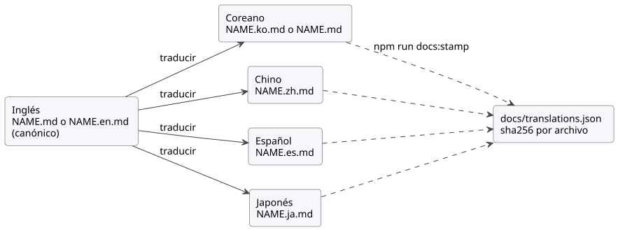

<!-- translation-source: docs/DOCUMENTATION-LANGUAGES.md -->
[Original en inglés](DOCUMENTATION-LANGUAGES.md)

# Idiomas de la documentación

Esta política indica qué idiomas usa la documentación de GhostFlow, cómo se
nombran y comprueban los archivos traducidos y cómo se registra una traducción
revisada. Cómo escribir y traducir bien se explica en la
[guía de estilo de la documentación](DOCUMENTATION-STYLE.es.md), que también
contiene el glosario. Para consultar esta política en coreano, vea la
[versión en coreano](DOCUMENTATION-LANGUAGES.ko.md).

**Búsqueda y comprobación de documentos.** El
[flujo de trabajo de desarrollo](DEVELOPMENT-WORKFLOW.es.md) combina el
descubrimiento de documentos y la verificación en un único procedimiento. Hay
tres comandos importantes:

| Comando | Qué hace |
| --- | --- |
| `npm run docs:find -- --limit 8 QUERY` | Comprueba si el índice está actualizado sin escribir nada y busca en las rutas y los títulos de Markdown/HTML del repositorio. |
| `npm run docs:index` | Se ejecuta después de cada lote de ediciones completado. Regenera `docs/INDEX.md` y, después, el `INDEX.md` raíz. |
| `npm run docs:check` | Se ejecuta antes de compilaciones pesadas. Combina la validación de traducciones, la actualización de los diagramas, la procedencia fijada de la herramienta de índice y ambas comprobaciones de actualización del índice. |

Esta política registra la solicitud del usuario del 2026-09-28 de disponer de
versiones en inglés y en coreano de todos los documentos excepto los informes.
Seguimiento: [#344](https://github.com/callin2/ghostflow-language/issues/344).
Amplía esa solicitud con traducciones al chino simplificado, al español y al
japonés, y convierte el inglés en el idioma canónico de la prosa redactada por
autores.

## Alcance

**Qué debe traducirse.** La documentación redactada por autores debe estar
disponible en inglés y en coreano, y se traduce al chino, al español y al
japonés. Los informes y la evidencia histórica de ejecución/medición pueden
permanecer en su idioma original.

| Código | Idioma | Estado |
| --- | --- | --- |
| `en` | Inglés | Obligatorio; el idioma canónico de la prosa redactada por autores |
| `ko` | Coreano | Obligatorio |
| `zh` | Chino (simplificado) | Traducido del inglés; se comprueba por completo cuando existe |
| `es` | Español | Traducido del inglés; se comprueba por completo cuando existe |
| `ja` | Japonés | Traducido del inglés; se comprueba por completo cuando existe |

Clasifique en `docs/translations.json` cada archivo Markdown con seguimiento, o
sin seguimiento y no ignorado:

- Una exclusión requiere una ruta exacta y un motivo concreto.
- No exima un directorio completo.
- Los metadatos generados, los fixtures de prueba y los documentos de fuente
  canónica también requieren una clasificación explícita.

El código fuente que no es Markdown, los metadatos generados y las pruebas
quedan fuera de esta puerta de control de Markdown.

## Nombres de archivo

Las rutas nunca se mueven, de modo que los enlaces existentes siguen
funcionando. El `NAME.md` sin sufijo conserva el idioma que tiene hoy; ese es el
*idioma base* del documento (`en` o `ko`). Cada uno de los demás idiomas usa un
archivo hermano `NAME.<code>.md`:

| Idioma base de `NAME.md` | Inglés | Coreano | Chino | Español | Japonés |
| --- | --- | --- | --- | --- | --- |
| Inglés | `NAME.md` | `NAME.ko.md` | `NAME.zh.md` | `NAME.es.md` | `NAME.ja.md` |
| Coreano | `NAME.en.md` | `NAME.md` | `NAME.zh.md` | `NAME.es.md` | `NAME.ja.md` |

Un `NAME.ghost.md` literario sigue el mismo patrón (`NAME.ghost.en.md`,
`NAME.ghost.zh.md`, …). `NAME.ghost.md` sigue siendo la única fuente
compilable; cualquier otro archivo de idioma es una proyección de
documentación, nunca una segunda entrada canónica de compilación.

## Fuente canónica y cadena de traducción

Cada documento tiene exactamente un archivo canónico, y el inglés es el idioma
canónico de la prosa redactada por autores:

- El archivo en inglés es canónico. Para un documento de base coreana es
  `NAME.en.md`, y el `NAME.md` en coreano pasa a ser una traducción de él.
- El coreano, el chino, el español y el japonés se traducen del archivo en
  inglés.
- Un documento de base coreana que aún no se ha reescrito puede conservar
  durante un tiempo su archivo canónico en coreano. En ese caso, su archivo en
  inglés traduce el archivo en coreano, y el chino, el español y el japonés
  siguen traduciendo el archivo en inglés. Consulte
  [Cambio del idioma canónico](#cambio-del-idioma-canónico).
- Los documentos literarios `*.ghost.md` siguen las mismas reglas para su prosa.
  Su código es la entrada del compilador, por lo que cada bloque de código, el
  front matter y cada marcador de máquina permanecen idénticos byte a byte en
  todos los idiomas, sea cual sea el archivo canónico.



El diagrama muestra la cadena: cada traducción se hace a partir del archivo en
inglés y sus resúmenes criptográficos (digests) se registran con
`npm run docs:stamp`.

## Reglas de traducción

**Qué conservar y qué traducir.**

- Conserve la fuente canónica original, las referencias de línea y los hashes
  históricos.
- Mantenga idénticos los bloques de código ejecutables. Un bloque de código es
  ejecutable salvo que su cadena de información sea `text`, `mermaid` o
  `plantuml`.
- Traduzca la prosa explicativa, y las etiquetas y los comentarios de los
  bloques `text`, `mermaid` y `plantuml`.
- Conserve exactamente las sentencias de código, los identificadores, las
  fórmulas y las citas literales de licencias.
- Conserve la secuencia de niveles de encabezado y los ID de anclas HTML
  explícitas (`<a id="…">`). El texto de los encabezados puede traducirse; los
  slugs implícitos de los encabezados no se comparan, por lo que los enlaces
  internos de una traducción pueden usar slugs traducidos.
- Mantenga el front matter YAML idéntico byte a byte.

**Cabecera de traducción.** Cada traducción comienza con
`<!-- translation-source: SOURCE_PATH -->`, donde `SOURCE_PATH` es la ruta en el
repositorio del archivo a partir del cual se tradujo. Un archivo que comienza
con front matter YAML coloca el marcador inmediatamente después del front
matter. La traducción también contiene un enlace Markdown ordinario a ese
archivo, con una ruta relativa o desde la raíz del repositorio, normalmente en
la línea siguiente y con una etiqueta traducida como `[영문 원문](NAME.md)`,
`[英文原文](NAME.md)`, `[Original en inglés](NAME.md)` o
`[英語の原文](NAME.md)`. El archivo canónico nunca lleva el marcador. En los
ejemplos traducidos, las afirmaciones sobre la fuente canónica se refieren
explícitamente al original enlazado.

**Enlaces a otros documentos.** Enlace a la contraparte del destino en el mismo
idioma cuando exista; en caso contrario, enlace al archivo en inglés. Conserve
un `#fragment` solo cuando nombre un ancla explícita.

## Diagramas

Escriba los diagramas en PlantUML y haga commit del SVG renderizado junto a la
fuente:

- Fuente: `docs/diagrams/<doc-slug>/<name>.puml` con etiquetas en inglés.
  `<doc-slug>` es el nombre de archivo en minúsculas separado por guiones
  (lower-kebab), sin su sufijo de idioma. La fuente puede comenzar con
  `!include ../_style.puml` para usar el estilo compartido; esto es opcional.
- Etiquetas traducidas: `docs/diagrams/<doc-slug>/<name>.<code>.puml`. Una
  traducción sin variante propia reutiliza el SVG en inglés.
- Salida renderizada: el archivo hermano `<name>.svg` o `<name>.<code>.svg`,
  incrustado con un enlace de imagen relativo como
  ``.

`npm run docs:diagrams:fetch` coloca el jar fijado de PlantUML (consulte
`tools/plantuml.json`) en el directorio ignorado `.cache/plantuml/` y verifica
su sha256. `npm run docs:diagrams` renderiza todos los diagramas con Java 17 o
posterior (`PLANTUML_JAVA`, `JAVA_HOME` o `java` en el `PATH`).
`npm run docs:diagrams:check`, que forma parte de `npm run docs:check`, no
necesita Java: cada SVG registra el sha256 de su fuente y del estilo compartido
cuando la fuente lo incluye, de modo que una fuente editada sin volver a
renderizar falla. Haga commit de `.puml` y `.svg` juntos.

## Manifiesto

El formato del manifiesto es `GhostFlow/document-translations-v2`.

- Cada documento registra `document` (la ruta sin sufijo), `baseLanguage`
  (`en` o `ko`), `canonical` (un código de idioma) y `files`, indexado por
  código de idioma.
- El archivo canónico registra `path` y `sha256`.
- Cada traducción registra `path`, `sha256`, `from` (el idioma a partir del cual
  se tradujo) y `sourceSha256` (el digest del archivo `from` con el que se
  comprobó la traducción).
- Cada exclusión registra `path` y `reason`.

```json
{
  "document": "docs/CONSTRAINTS.md",
  "baseLanguage": "ko",
  "canonical": "en",
  "files": {
    "en": { "path": "docs/CONSTRAINTS.en.md", "sha256": "…" },
    "ko": { "path": "docs/CONSTRAINTS.md", "sha256": "…", "from": "en", "sourceSha256": "…" },
    "zh": { "path": "docs/CONSTRAINTS.zh.md", "sha256": "…", "from": "en", "sourceSha256": "…" }
  }
}
```

La puerta de control comprueba la cobertura, las rutas, los archivos
obligatorios `en` y `ko`, los enlaces, los marcadores translation-source, la
actualización, los encabezados, las anclas explícitas, el front matter y la
conservación del código para cada idioma registrado. Un archivo en chino,
español o japonés presente en disco que no esté registrado falla por no estar
clasificado. Cuando cambia un archivo fuente, cada traducción hecha a partir de
él informa de un `sourceSha256` obsoleto hasta que se actualiza y se vuelve a
sellar.

## Sellado de digests

Los digests nunca se actualizan automáticamente. Después de revisar un conjunto
de traducciones, regístrelo de forma deliberada:

```sh
npm run docs:stamp -- docs/NAME.md --languages en,ko,zh
npm run docs:stamp -- docs/NAME.md --all
npm run docs:stamp -- docs/NEW.md --base-language en --languages en,ko
npm run docs:stamp -- docs/NAME.md --all --dry-run
npm run docs:stamp -- --auto --dry-run
```

`DOCUMENT` puede ser la ruta sin sufijo o cualquiera de sus archivos de idioma.
`--all` sella todos los archivos de idioma presentes en disco. `--auto` hace lo
mismo para cada documento del manifiesto, leyendo el marcador
translation-source de cada archivo para encontrar su idioma de origen y el
archivo canónico. El sellado valida las entradas actualizadas (marcadores,
enlaces, encabezados, anclas, front matter, código, actualización) y no escribe
nada si alguna entrada no es válida.
`npm run docs:translations:coverage` muestra el progreso por idioma; añada
`-- --missing` para ver los documentos que faltan.

## Cambio del idioma canónico

Para hacer canónico el inglés en un documento de base coreana:

1. Reescriba `NAME.en.md` y elimine su marcador translation-source.
2. Actualice `NAME.md` (coreano) a partir del texto en inglés. Comiéncelo con
   `<!-- translation-source: docs/NAME.en.md -->` (después de cualquier front
   matter) y un enlace al archivo en inglés.
3. Asegúrese de que los archivos en chino, español y japonés apunten a
   `NAME.en.md`.
4. Ejecute `npm run docs:stamp -- docs/NAME.md --canonical en --all`, o
   `npm run docs:stamp -- --auto` para todos los documentos a la vez.

## Actualización y verificación

Actualice todos los idiomas afectados y sus digests del manifiesto en el mismo
cambio. Después ejecute `npm run docs:check` y
`node --test tests/doc-translations.test.mjs tests/doc-diagrams.test.mjs`.

- Resuelva las comparaciones de fuentes con `git rev-parse` y `git show` en el
  worktree de destino. Un checkout temporal con nombre no es evidencia del
  contenido de una rama.
- El verificador ejecuta esta puerta de control antes de las compilaciones del
  host.
- Los hashes solo establecen que el contenido está actualizado.

Los digests no demuestran el significado de la traducción. Los revisores deben
comprobar que cada idioma transmite la misma intención y las mismas
restricciones.
