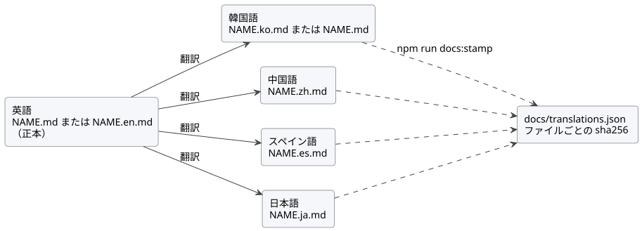

<!-- translation-source: docs/DOCUMENTATION-LANGUAGES.md -->
[英語の原文](DOCUMENTATION-LANGUAGES.md)

# ドキュメントの言語

このポリシーは、GhostFlow のドキュメントがどの言語を使うか、翻訳ファイルの命名と確認の
方法、レビュー済みの翻訳を記録する方法を定めます。よい文章を書き、よい翻訳をする方法は、
用語集も収録している[ドキュメントスタイルガイド](DOCUMENTATION-STYLE.ja.md)にあります。
このポリシーの韓国語版は、[韓国語版](DOCUMENTATION-LANGUAGES.ko.md)を参照してください。

**文書の検索と確認。** [開発ワークフロー](DEVELOPMENT-WORKFLOW.ja.md)は、文書の発見と
検証を 1 つの手順にまとめています。重要なコマンドは 3 つです。

| コマンド | 内容 |
| --- | --- |
| `npm run docs:find -- --limit 8 QUERY` | 書き込みを行わずにインデックスの鮮度を確認し、リポジトリの Markdown/HTML のパスとタイトルを検索します。 |
| `npm run docs:index` | 編集のバッチが完了するたびに実行します。`docs/INDEX.md` を再生成し、次にルートの `INDEX.md` を再生成します。 |
| `npm run docs:check` | 重いビルドの前に実行します。翻訳の検証、図の鮮度、固定されたインデックスツールの来歴、両方のインデックスの鮮度チェックをまとめて行います。 |

このポリシーは、レポートを除くすべての文書について英語版と韓国語版を用意するという、
2026-09-28 のユーザーの要望を記録したものです。トラッキング: [#344](https://github.com/callin2/ghostflow-language/issues/344)。
この要望を簡体字中国語、スペイン語、日本語の翻訳で拡張し、作成される本文の正本言語を
英語にしています。

## 範囲

**翻訳しなければならないもの。** 作成されたドキュメントは英語と韓国語で提供されなければ
ならず、さらに中国語、スペイン語、日本語に翻訳されます。レポートと、過去の実行/測定の
証拠は、元の言語のままでかまいません。

| コード | 言語 | 状態 |
| --- | --- | --- |
| `en` | 英語 | 必須。作成される本文の正本言語 |
| `ko` | 韓国語 | 必須 |
| `zh` | 中国語（簡体字） | 英語から翻訳。存在する場合は完全に確認される |
| `es` | スペイン語 | 英語から翻訳。存在する場合は完全に確認される |
| `ja` | 日本語 | 英語から翻訳。存在する場合は完全に確認される |

追跡されている Markdown ファイルと、無視されていない未追跡の Markdown ファイルはすべて、
`docs/translations.json` で分類します。

- 除外には、正確なパスと具体的な理由が必要です。
- ディレクトリ全体を除外してはなりません。
- 生成されたメタデータ、テストフィクスチャ、正本のソース文書にも、明示的な分類が必要です。

Markdown 以外のソース、生成されたメタデータ、テストは、この Markdown ゲートの対象外です。

## ファイル名

パスは決して移動しないため、既存のリンクは引き続き機能します。接尾辞のない `NAME.md` は
現在の言語のままです。これがその文書の*ベース言語*（`en` または `ko`）です。ほかの言語は
すべて、兄弟ファイル `NAME.<code>.md` を使います。

| `NAME.md` のベース言語 | 英語 | 韓国語 | 中国語 | スペイン語 | 日本語 |
| --- | --- | --- | --- | --- | --- |
| 英語 | `NAME.md` | `NAME.ko.md` | `NAME.zh.md` | `NAME.es.md` | `NAME.ja.md` |
| 韓国語 | `NAME.en.md` | `NAME.md` | `NAME.zh.md` | `NAME.es.md` | `NAME.ja.md` |

文芸的（literate）な `NAME.ghost.md` も同じパターンに従います（`NAME.ghost.en.md`、
`NAME.ghost.zh.md`、…）。コンパイル可能なソースは `NAME.ghost.md` だけです。ほかの言語の
ファイルはすべてドキュメントとしての投影であり、2 つ目の正本のコンパイル入力には決して
なりません。

## 正本ソースと翻訳の連鎖

各文書には正本のファイルがちょうど 1 つあり、作成される本文の正本言語は英語です。

- 英語のファイルが正本です。韓国語ベースの文書では、これは `NAME.en.md` であり、韓国語の
  `NAME.md` はその翻訳になります。
- 韓国語、中国語、スペイン語、日本語は、英語のファイルから翻訳されます。
- まだ書き直されていない韓国語ベースの文書は、しばらくの間、韓国語の正本ファイルを保持して
  かまいません。その場合、英語のファイルは韓国語のファイルを翻訳したものであり、中国語、
  スペイン語、日本語は引き続き英語のファイルを翻訳します。
  [正本言語の変更](#正本言語の変更)を参照してください。
- 文芸的な `*.ghost.md` 文書も、本文については同じ規則に従います。そのコードはコンパイラの
  入力であるため、どのファイルが正本であっても、すべてのコードブロック、フロントマター、
  すべての機械用マーカーは、すべての言語でバイト単位で同一に保たれます。



図は連鎖を示しています。すべての翻訳は英語のファイルから作られ、そのダイジェストは
`npm run docs:stamp` で記録されます。

## 翻訳の規則

**保持するものと翻訳するもの。**

- 元の正本ソース、行の参照、過去のハッシュを保持します。
- 実行可能なコードブロックは同一に保ちます。情報文字列が `text`、`mermaid`、`plantuml`
  でないコードブロックは、実行可能とみなします。
- 説明の本文と、`text`、`mermaid`、`plantuml` ブロック内のラベルとコメントを翻訳します。
- コードの文、識別子、数式、ライセンスの逐語的な引用は正確に保持します。
- 見出しレベルの並びと、明示的な HTML アンカー ID（`<a id="…">`）を保持します。見出しの
  テキストは翻訳してかまいません。暗黙の見出しスラッグは比較されないため、翻訳内の
  ページ内リンクは翻訳されたスラッグを使ってかまいません。
- YAML フロントマターはバイト単位で同一に保ちます。

**翻訳ヘッダ。** 各翻訳は `<!-- translation-source: SOURCE_PATH -->` で始まります。
`SOURCE_PATH` は、翻訳元のファイルのリポジトリ上のパスです。YAML フロントマターで始まる
ファイルでは、マーカーをフロントマターの直後に置きます。翻訳には、そのファイルへの通常の
Markdown リンクも含めます。パスは相対パスまたはリポジトリルートからのパスで、通常は次の
行に置き、`[영문 원문](NAME.md)`、`[英文原文](NAME.md)`、`[Original en inglés](NAME.md)`、
`[英語の原文](NAME.md)` のような翻訳されたラベルを付けます。正本のファイルがマーカーを
持つことは決してありません。翻訳された例の中で正本ソースについて述べる場合は、リンクされた
原文を明示的に指します。

**ほかの文書へのリンク。** リンク先の同じ言語の対応文書が存在する場合はそれにリンクし、
存在しない場合は英語のファイルにリンクします。`#fragment` は、明示的なアンカーを指す場合に
だけ残します。

## 図

図は PlantUML で書き、レンダリングした SVG をソースの隣にコミットします。

- ソース: 英語のラベルを持つ `docs/diagrams/<doc-slug>/<name>.puml`。
  `<doc-slug>` は、言語の接尾辞を除いたファイル名を小文字のケバブケースにしたものです。
  ソースは共有スタイルを使うために `!include ../_style.puml` で始めてもかまいません。
  これは任意です。
- 翻訳されたラベル: `docs/diagrams/<doc-slug>/<name>.<code>.puml`。独自の版を持たない翻訳は
  英語の SVG を再利用します。
- レンダリング出力: 兄弟ファイル `<name>.svg` または `<name>.<code>.svg`。
  `` のような相対パスの画像リンクで埋め込みます。

`npm run docs:diagrams:fetch` は、固定された PlantUML の jar（`tools/plantuml.json` を参照）を
無視対象の `.cache/plantuml/` ディレクトリに置き、その sha256 を検証します。
`npm run docs:diagrams` は、Java 17 以降（`PLANTUML_JAVA`、`JAVA_HOME`、または `PATH` 上の
`java`）ですべての図をレンダリングします。`npm run docs:check` の一部である
`npm run docs:diagrams:check` には Java は必要ありません。各 SVG は、そのソースの sha256 と、
ソースが共有スタイルを取り込んでいる場合はそのスタイルの sha256 を記録しているため、
再レンダリングせずにソースを編集すると失敗します。`.puml` と `.svg` は一緒にコミットして
ください。

## マニフェスト

マニフェストの形式は `GhostFlow/document-translations-v2` です。

- 各文書は、`document`（接尾辞のないパス）、`baseLanguage`（`en` または `ko`）、
  `canonical`（言語コード）、言語コードをキーとする `files` を記録します。
- 正本のファイルは `path` と `sha256` を記録します。
- 各翻訳は、`path`、`sha256`、`from`（翻訳元の言語）、`sourceSha256`（翻訳を確認した時点の
  `from` ファイルのダイジェスト）を記録します。
- 各除外は `path` と `reason` を記録します。

```json
{
  "document": "docs/CONSTRAINTS.md",
  "baseLanguage": "ko",
  "canonical": "en",
  "files": {
    "en": { "path": "docs/CONSTRAINTS.en.md", "sha256": "…" },
    "ko": { "path": "docs/CONSTRAINTS.md", "sha256": "…", "from": "en", "sourceSha256": "…" },
    "zh": { "path": "docs/CONSTRAINTS.zh.md", "sha256": "…", "from": "en", "sourceSha256": "…" }
  }
}
```

ゲートは、記録されたすべての言語について、カバレッジ、パス、必須の `en` と `ko` の
ファイル、リンク、translation-source マーカー、鮮度、見出し、明示的なアンカー、
フロントマター、コードの保持を確認します。ディスク上にあっても記録されていない中国語、
スペイン語、日本語のファイルは、未分類として失敗します。ソースファイルが変更されると、
そこから作られたすべての翻訳は、更新されて再びスタンプされるまで、古い `sourceSha256` を
報告します。

## ダイジェストのスタンプ

ダイジェストが自動的に更新されることは決してありません。翻訳のセットをレビューした後、
意図的に記録します。

```sh
npm run docs:stamp -- docs/NAME.md --languages en,ko,zh
npm run docs:stamp -- docs/NAME.md --all
npm run docs:stamp -- docs/NEW.md --base-language en --languages en,ko
npm run docs:stamp -- docs/NAME.md --all --dry-run
npm run docs:stamp -- --auto --dry-run
```

`DOCUMENT` には、接尾辞のないパスか、そのいずれかの言語ファイルを指定できます。`--all` は
ディスク上に存在するすべての言語ファイルをスタンプします。`--auto` はマニフェスト内の
すべての文書について同じことを行い、各ファイルの translation-source マーカーを読んで、
そのソース言語と正本のファイルを特定します。スタンプは更新されるエントリ（マーカー、
リンク、見出し、アンカー、フロントマター、コード、鮮度）を検証し、無効なエントリが 1 つでも
あれば何も書き込みません。
`npm run docs:translations:coverage` は言語ごとの進捗を一覧表示します。欠けている文書を
表示するには `-- --missing` を追加します。

## 正本言語の変更

韓国語ベースの文書で英語を正本にするには、次のようにします。

1. `NAME.en.md` を書き直し、その translation-source マーカーを削除します。
2. 英語のテキストから `NAME.md`（韓国語）を更新します。（フロントマターがあればその後に）
   `<!-- translation-source: docs/NAME.en.md -->` で始め、英語のファイルへのリンクを
   置きます。
3. 中国語、スペイン語、日本語のファイルが `NAME.en.md` を指していることを確認します。
4. `npm run docs:stamp -- docs/NAME.md --canonical en --all` を実行するか、すべての文書を
   一度に処理する場合は `npm run docs:stamp -- --auto` を実行します。

## 更新と検証

影響を受けるすべての言語とそのマニフェストのダイジェストを、同じ変更の中で更新します。
その後、`npm run docs:check` と
`node --test tests/doc-translations.test.mjs tests/doc-diagrams.test.mjs` を実行します。

- ソースの比較は、対象のワークツリーで `git rev-parse` と `git show` を使って解決します。
  名前付きの一時チェックアウトは、ブランチの内容の証拠にはなりません。
- 検証ツールは、ホストのビルドの前にこのゲートを実行します。
- ハッシュが確立するのは鮮度だけです。

ダイジェストは翻訳の意味を証明しません。レビュー担当者は、すべての言語が同じ意図と制約を
伝えていることを確認しなければなりません。
