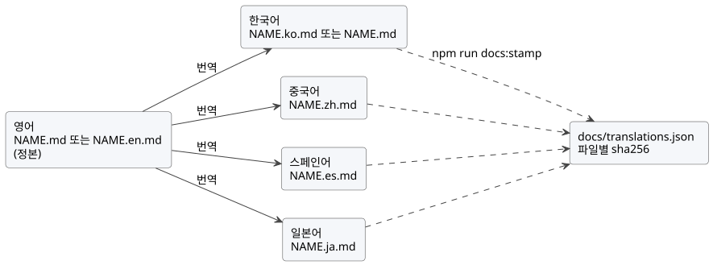

<!-- translation-source: docs/DOCUMENTATION-LANGUAGES.md -->
[영문 원문](DOCUMENTATION-LANGUAGES.md)

# 문서 언어

이 정책은 GhostFlow 문서가 어떤 언어를 쓰는지, 번역 파일의 이름을 어떻게 짓고
어떻게 검사하는지, 검토한 번역을 어떻게 기록하는지 정합니다. 잘 쓰고 잘
번역하는 방법은 용어집이 함께 있는 [문서 스타일 가이드](DOCUMENTATION-STYLE.ko.md)에
있습니다. 이 정책의 영어판은 [영문 원문](DOCUMENTATION-LANGUAGES.md)입니다.

**문서 찾기와 검사.** [개발 작업 흐름](DEVELOPMENT-WORKFLOW.ko.md)은 문서 탐색과
검증을 하나의 절차로 묶습니다. 중요한 명령은 세 가지입니다.

| 명령 | 하는 일 |
| --- | --- |
| `npm run docs:find -- --limit 8 QUERY` | 파일을 쓰지 않고 색인이 최신인지 검사하고, 저장소 Markdown/HTML 경로와 제목을 검색합니다. |
| `npm run docs:index` | 편집 묶음이 끝날 때마다 실행합니다. `docs/INDEX.md`, 이어서 루트 `INDEX.md`를 다시 생성합니다. |
| `npm run docs:check` | 무거운 빌드 전에 실행합니다. 번역 검증, 다이어그램 최신 상태, 고정된 색인 도구 출처, 두 색인의 최신 상태 검사를 함께 수행합니다. |

이 정책은 보고서를 제외한 모든 문서에 영어와 한국어 버전이 있어야 한다는
2026-09-28 사용자 요청을 기록합니다. 추적: [#344](https://github.com/callin2/ghostflow-language/issues/344).
여기에 간체 중국어, 스페인어, 일본어 번역을 더하고, 작성된 설명 문서의 정본
언어를 영어로 정합니다.

## 범위

**번역해야 하는 문서.** 작성된 문서는 영어와 한국어로 제공해야 하며, 중국어,
스페인어, 일본어로도 번역합니다. 보고서와 과거 실행·측정 증거는 원래 언어로
둘 수 있습니다.

| 코드 | 언어 | 상태 |
| --- | --- | --- |
| `en` | 영어 | 필수. 작성된 설명 문서의 정본 언어 |
| `ko` | 한국어 | 필수 |
| `zh` | 중국어(간체) | 영어에서 번역. 있으면 전부 검사 |
| `es` | 스페인어 | 영어에서 번역. 있으면 전부 검사 |
| `ja` | 일본어 | 영어에서 번역. 있으면 전부 검사 |

Git 추적 파일과 무시되지 않은 미추적 Markdown 파일을 모두
`docs/translations.json`에 분류합니다.

- 제외 항목에는 정확한 경로와 구체적인 이유가 필요합니다.
- 디렉터리 전체를 제외하지 않습니다.
- 생성 메타데이터, 테스트 픽스처, 정본 소스 문서도 명시적으로 분류합니다.

Markdown이 아닌 소스, 생성 메타데이터, 테스트는 이 Markdown 검사 대상 밖입니다.

## 파일 이름

경로는 옮기지 않으므로 기존 링크는 계속 동작합니다. 접미사 없는 `NAME.md`는
지금의 언어를 유지하며, 이것이 문서의 *기본 언어*(`en` 또는 `ko`)입니다.
다른 언어는 모두 형제 파일 `NAME.<code>.md`를 씁니다.

| `NAME.md`의 기본 언어 | 영어 | 한국어 | 중국어 | 스페인어 | 일본어 |
| --- | --- | --- | --- | --- | --- |
| 영어 | `NAME.md` | `NAME.ko.md` | `NAME.zh.md` | `NAME.es.md` | `NAME.ja.md` |
| 한국어 | `NAME.en.md` | `NAME.md` | `NAME.zh.md` | `NAME.es.md` | `NAME.ja.md` |

문서형 소스(literate source) `NAME.ghost.md`도 같은 규칙을 따릅니다
(`NAME.ghost.en.md`, `NAME.ghost.zh.md`, …). 컴파일 가능한 소스는
`NAME.ghost.md` 하나뿐입니다. 다른 언어 파일은 모두 문서 투영이며, 두 번째 정본
컴파일 입력이 아닙니다.

## 정본 소스와 번역 사슬

각 문서에는 정본 파일이 정확히 하나 있고, 작성된 설명 문서의 정본 언어는
영어입니다.

- 영어 파일이 정본입니다. 한국어 기본 문서에서는 `NAME.en.md`가 정본이고,
  한국어 `NAME.md`는 그 번역이 됩니다.
- 한국어, 중국어, 스페인어, 일본어는 영어 파일에서 번역합니다.
- 아직 다시 쓰지 않은 한국어 기본 문서는 당분간 한국어 정본 파일을 유지할 수
  있습니다. 이때 영어 파일은 한국어 파일의 번역이고, 중국어, 스페인어,
  일본어는 여전히 영어 파일에서 번역합니다.
  [정본 언어 바꾸기](#정본-언어-바꾸기)를 참고하세요.
- 문서형 `*.ghost.md` 문서도 설명 문장에는 같은 규칙을 적용합니다. 코드는
  컴파일러 입력이므로, 어느 파일이 정본이든 모든 코드 블록, front matter,
  기계용 표시는 모든 언어에서 바이트 단위로 같아야 합니다.



이 그림은 번역 사슬을 보여 줍니다. 모든 번역은 영어 파일에서 만들고, 그 해시는
`npm run docs:stamp`로 기록합니다.

## 번역 규칙

**보존할 것과 번역할 것.**

- 원래 정본 소스, 줄 참조, 과거 해시를 보존합니다.
- 실행 코드 블록은 동일하게 유지합니다. 정보 문자열이 `text`, `mermaid`,
  `plantuml`이 아닌 코드 블록은 모두 실행 코드 블록입니다.
- 설명 문장과, `text`, `mermaid`, `plantuml` 블록의 레이블과 주석은 번역합니다.
- 코드 문장, 식별자, 수식, 축어 인용된 라이선스 문구는 정확히 보존합니다.
- 제목 수준의 순서와 명시적인 HTML 앵커 ID(`<a id="…">`)를 보존합니다. 제목
  문구는 번역할 수 있습니다. 자동 생성되는 제목 슬러그는 비교하지 않으므로,
  번역 안의 문서 내부 링크는 번역된 슬러그를 써도 됩니다.
- YAML front matter는 바이트 단위로 같게 유지합니다.

**번역 머리글.** 각 번역은 `<!-- translation-source: SOURCE_PATH -->`로
시작합니다. `SOURCE_PATH`는 번역의 바탕이 된 파일의 저장소 경로입니다. YAML
front matter로 시작하는 파일은 front matter 바로 뒤에 이 표시를 둡니다. 번역에는
그 파일로 가는 일반 Markdown 링크도 넣습니다. 링크는 상대 경로나 저장소 루트
경로를 쓰고, 보통 다음 줄에 `[영문 원문](NAME.md)`, `[英文原文](NAME.md)`,
`[Original en inglés](NAME.md)`, `[英語の原文](NAME.md)`처럼 번역된 레이블로
둡니다. 정본 파일에는 이 표시를 넣지 않습니다. 번역 예제에서 정본 소스를
언급할 때는 링크된 원본을 명시적으로 가리킵니다.

**다른 문서로 가는 링크.** 대상 문서의 같은 언어판이 있으면 그것을, 없으면 영어
파일을 가리킵니다. `#fragment`는 명시적 앵커를 가리킬 때만 유지합니다.

## 다이어그램

다이어그램은 PlantUML로 작성하고, 렌더링한 SVG를 소스 옆에 함께 커밋합니다.

- 소스: 영어 레이블을 쓴 `docs/diagrams/<doc-slug>/<name>.puml`.
  `<doc-slug>`는 언어 접미사를 뺀 파일 이름의 소문자 케밥 표기입니다. 공통
  스타일을 쓰려면 소스 첫머리에 `!include ../_style.puml`을 둘 수 있으며, 이는
  선택 사항입니다.
- 번역된 레이블: `docs/diagrams/<doc-slug>/<name>.<code>.puml`. 자기 언어판이
  없는 번역은 영어 SVG를 그대로 씁니다.
- 렌더링 결과: 형제 파일 `<name>.svg` 또는 `<name>.<code>.svg`이며,
  `` 같은 상대 이미지 링크로
  넣습니다.

`npm run docs:diagrams:fetch`는 고정된 PlantUML jar(`tools/plantuml.json` 참고)를
Git이 무시하는 `.cache/plantuml/` 디렉터리에 두고 sha256을 검증합니다.
`npm run docs:diagrams`는 Java 17 이상(`PLANTUML_JAVA`, `JAVA_HOME`, 또는
`PATH`의 `java`)으로 모든 다이어그램을 렌더링합니다. `npm run docs:check`에
포함된 `npm run docs:diagrams:check`는 Java가 필요 없습니다. 각 SVG는 소스의
sha256과, 소스가 공통 스타일을 포함하면 그 스타일의 sha256을 기록하므로, 소스를
고치고 다시 렌더링하지 않으면 검사가 실패합니다. `.puml`과 `.svg`는 함께
커밋합니다.

## 매니페스트

매니페스트 형식은 `GhostFlow/document-translations-v2`입니다.

- 각 문서는 `document`(접미사 없는 경로), `baseLanguage`(`en` 또는 `ko`),
  `canonical`(언어 코드), 언어 코드를 키로 하는 `files`를 기록합니다.
- 정본 파일은 `path`와 `sha256`을 기록합니다.
- 각 번역은 `path`, `sha256`, `from`(번역의 바탕이 된 언어),
  `sourceSha256`(번역을 대조한 `from` 파일의 해시)을 기록합니다.
- 각 제외 항목은 `path`와 `reason`을 기록합니다.

```json
{
  "document": "docs/CONSTRAINTS.md",
  "baseLanguage": "ko",
  "canonical": "en",
  "files": {
    "en": { "path": "docs/CONSTRAINTS.en.md", "sha256": "…" },
    "ko": { "path": "docs/CONSTRAINTS.md", "sha256": "…", "from": "en", "sourceSha256": "…" },
    "zh": { "path": "docs/CONSTRAINTS.zh.md", "sha256": "…", "from": "en", "sourceSha256": "…" }
  }
}
```

검사는 기록된 모든 언어에 대해 분류, 경로, 필수 `en`·`ko` 파일, 링크,
translation-source 표시, 최신 상태, 제목, 명시적 앵커, front matter, 코드 보존을
확인합니다. 디스크에 있지만 기록되지 않은 중국어, 스페인어, 일본어 파일은
미분류로 실패합니다. 소스 파일이 바뀌면, 그 파일에서 만든 번역은 갱신하고 다시
기록할 때까지 모두 오래된 `sourceSha256`으로 보고됩니다.

## 해시 기록

해시는 자동으로 갱신되지 않습니다. 번역 묶음을 검토한 뒤 의도적으로 기록합니다.

```sh
npm run docs:stamp -- docs/NAME.md --languages en,ko,zh
npm run docs:stamp -- docs/NAME.md --all
npm run docs:stamp -- docs/NEW.md --base-language en --languages en,ko
npm run docs:stamp -- docs/NAME.md --all --dry-run
npm run docs:stamp -- --auto --dry-run
```

`DOCUMENT`는 접미사 없는 경로나 그 문서의 어느 언어 파일이어도 됩니다.
`--all`은 디스크에 있는 모든 언어 파일을 기록합니다. `--auto`는 매니페스트의
모든 문서에 대해 같은 일을 하며, 각 파일의 translation-source 표시를 읽어
원본 언어와 정본 파일을 찾습니다. 기록 도구는 갱신된 항목(표시, 링크, 제목,
앵커, front matter, 코드, 최신 상태)을 검증하고, 하나라도 잘못되면 아무것도
쓰지 않습니다. `npm run docs:translations:coverage`는 언어별 진행 상황을
보여 줍니다. 빠진 문서 목록은 `-- --missing`을 붙여 확인합니다.

## 정본 언어 바꾸기

한국어 기본 문서의 정본을 영어로 바꾸려면 다음과 같이 합니다.

1. `NAME.en.md`를 다시 쓰고 translation-source 표시를 지웁니다.
2. 영어 문장을 바탕으로 한국어 `NAME.md`를 갱신합니다. (front matter가 있으면
   그 뒤에) `<!-- translation-source: docs/NAME.en.md -->`와 영어 파일 링크로
   시작합니다.
3. 중국어, 스페인어, 일본어 파일이 `NAME.en.md`를 가리키는지 확인합니다.
4. `npm run docs:stamp -- docs/NAME.md --canonical en --all`을 실행하거나, 모든
   문서를 한꺼번에 처리하려면 `npm run docs:stamp -- --auto`를 실행합니다.

## 갱신과 검증

영향받는 모든 언어와 매니페스트 해시를 같은 변경에서 갱신합니다. 그다음
`npm run docs:check`와
`node --test tests/doc-translations.test.mjs tests/doc-diagrams.test.mjs`를
실행합니다.

- 소스 비교는 대상 작업 트리에서 `git rev-parse`와 `git show`로 확인합니다.
  이름 붙인 임시 체크아웃은 해당 브랜치의 내용을 증명하지 않습니다.
- 검증기는 호스트 빌드 전에 이 검사를 실행합니다.
- 해시는 최신 여부만 확인합니다.

해시는 번역의 의미를 증명하지 않습니다. 검토자는 모든 언어가 같은 의도와
제약을 전달하는지 확인해야 합니다.
