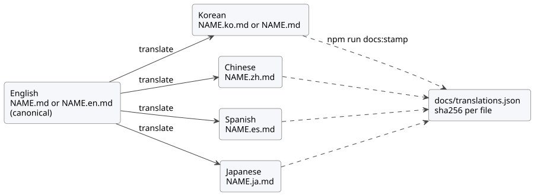

# Documentation languages

This policy says which languages GhostFlow documentation uses, how translated
files are named and checked, and how to record a reviewed translation. How to
write and translate well is in the [documentation style guide](DOCUMENTATION-STYLE.md),
which also holds the glossary. For this policy in Korean, see the
[Korean version](DOCUMENTATION-LANGUAGES.ko.md).

**Finding and checking documents.** The
[development workflow](DEVELOPMENT-WORKFLOW.md) combines document discovery and
verification into one procedure. Three commands matter:

| Command | What it does |
| --- | --- |
| `npm run docs:find -- --limit 8 QUERY` | Checks index freshness without writing, and searches repository Markdown/HTML paths and titles. |
| `npm run docs:index` | Run after each completed edit batch. Regenerates `docs/INDEX.md`, then the root `INDEX.md`. |
| `npm run docs:check` | Run before heavy builds. Combines translation validation, diagram freshness, pinned index-tool provenance and both index freshness checks. |

This policy records the user's 2026-09-28 request for English and Korean
versions of every document except reports. Tracking: [#344](https://github.com/callin2/ghostflow-language/issues/344).
It extends that request with Simplified Chinese, Spanish and Japanese
translations, and makes English the canonical language for authored prose.

## Scope

**What must be translated.** Authored documentation must be available in
English and Korean, and is translated into Chinese, Spanish and Japanese.
Reports and historical execution/measurement evidence may stay in their
original language.

| Code | Language | Status |
| --- | --- | --- |
| `en` | English | Required; the canonical language for authored prose |
| `ko` | Korean | Required |
| `zh` | Chinese (Simplified) | Translated from English; fully checked when present |
| `es` | Spanish | Translated from English; fully checked when present |
| `ja` | Japanese | Translated from English; fully checked when present |

Classify every tracked or nonignored untracked Markdown file in
`docs/translations.json`:

- An exclusion requires an exact path and a concrete reason.
- Do not exempt a whole directory.
- Generated metadata, test fixtures and canonical source documents also require
  explicit classification.

Non-Markdown source, generated metadata and tests are outside this Markdown
gate.

## File names

Paths never move, so existing links keep working. The unsuffixed `NAME.md`
keeps the language it has today; this is the document's *base language* (`en`
or `ko`). Every other language uses a sibling `NAME.<code>.md`:

| Base language of `NAME.md` | English | Korean | Chinese | Spanish | Japanese |
| --- | --- | --- | --- | --- | --- |
| English | `NAME.md` | `NAME.ko.md` | `NAME.zh.md` | `NAME.es.md` | `NAME.ja.md` |
| Korean | `NAME.en.md` | `NAME.md` | `NAME.zh.md` | `NAME.es.md` | `NAME.ja.md` |

A literate `NAME.ghost.md` follows the same pattern (`NAME.ghost.en.md`,
`NAME.ghost.zh.md`, …). `NAME.ghost.md` stays the only compilable source; every
other language file is a documentation projection, never a second canonical
compile input.

## Canonical source and translation chain

Each document has exactly one canonical file, and English is the canonical
language for authored prose:

- The English file is canonical. For a Korean-base document this is
  `NAME.en.md`, and the Korean `NAME.md` becomes a translation of it.
- Korean, Chinese, Spanish and Japanese are translated from the English file.
- A Korean-base document that has not been rewritten yet may keep its Korean
  canonical file for a while. Its English file then translates the Korean file,
  and Chinese, Spanish and Japanese still translate the English file. See
  [Changing the canonical language](#changing-the-canonical-language).
- Literate `*.ghost.md` documents follow the same rules for their prose. Their
  code is the compiler input, so every code block, the front matter and every
  machine marker stay byte-identical in every language, whichever file is
  canonical.



The diagram shows the chain: every translation is made from the English file
and its digests are recorded with `npm run docs:stamp`.

## Translation rules

**What to preserve and what to translate.**

- Preserve the original canonical source, line references and historical
  hashes.
- Keep executable code blocks identical. A code block is executable unless its
  info string is `text`, `mermaid` or `plantuml`.
- Translate explanatory prose, and the labels and comments in `text`, `mermaid`
  and `plantuml` blocks.
- Preserve code statements, identifiers, formulas and verbatim license
  quotations exactly.
- Preserve the heading-level sequence and explicit HTML anchor IDs
  (`<a id="…">`). Heading text may be translated; implicit heading slugs are
  not compared, so in-page links in a translation may use translated slugs.
- Keep YAML front matter byte-identical.

**Translation header.** Each translation starts with
`<!-- translation-source: SOURCE_PATH -->`, where `SOURCE_PATH` is the
repository path of the file it was translated from. A file that begins with YAML
front matter puts the marker directly after the front matter. The translation
also contains an ordinary Markdown link to that file, using a relative or
repository-root path, normally on the next line with a translated label such as
`[영문 원문](NAME.md)`, `[英文原文](NAME.md)`, `[Original en inglés](NAME.md)` or
`[英語の原文](NAME.md)`. The canonical file never carries the marker. In
translated examples, claims about the canonical source refer explicitly to the
linked original.

**Links to other documents.** Link to the same-language counterpart of the
target when it exists; otherwise link to the English file. Keep a `#fragment`
only when it names an explicit anchor.

## Diagrams

Write diagrams in PlantUML and commit the rendered SVG next to the source:

- Source: `docs/diagrams/<doc-slug>/<name>.puml` with English labels.
  `<doc-slug>` is the lower-kebab file name without its language suffix. The
  source may start with `!include ../_style.puml` to use the shared style; this
  is optional.
- Translated labels: `docs/diagrams/<doc-slug>/<name>.<code>.puml`. A
  translation without its own variant reuses the English SVG.
- Rendered output: the sibling `<name>.svg` or `<name>.<code>.svg`, embedded with
  a relative image link such as ``.

`npm run docs:diagrams:fetch` places the pinned PlantUML jar (see
`tools/plantuml.json`) in the ignored `.cache/plantuml/` directory and verifies
its sha256. `npm run docs:diagrams` renders every diagram with Java 17 or later
(`PLANTUML_JAVA`, `JAVA_HOME` or `java` on `PATH`). `npm run docs:diagrams:check`,
part of `npm run docs:check`, needs no Java: each SVG records the sha256 of its
source and of the shared style when the source includes it, so an edited source
without a re-render fails. Commit `.puml` and `.svg` together.

## Manifest

The manifest format is `GhostFlow/document-translations-v2`.

- Each document records `document` (the unsuffixed path), `baseLanguage` (`en`
  or `ko`), `canonical` (a language code) and `files`, keyed by language code.
- The canonical file records `path` and `sha256`.
- Each translation records `path`, `sha256`, `from` (the language it was
  translated from) and `sourceSha256` (the digest of the `from` file that the
  translation was checked against).
- Each exclusion records `path` and `reason`.

```json
{
  "document": "docs/CONSTRAINTS.md",
  "baseLanguage": "ko",
  "canonical": "en",
  "files": {
    "en": { "path": "docs/CONSTRAINTS.en.md", "sha256": "…" },
    "ko": { "path": "docs/CONSTRAINTS.md", "sha256": "…", "from": "en", "sourceSha256": "…" },
    "zh": { "path": "docs/CONSTRAINTS.zh.md", "sha256": "…", "from": "en", "sourceSha256": "…" }
  }
}
```

The gate checks coverage, paths, the required `en` and `ko` files, links,
translation-source markers, freshness, headings, explicit anchors, front matter
and code preservation for every recorded language. A Chinese, Spanish or
Japanese file on disk that is not recorded fails as unclassified. When a source
file changes, every translation made from it reports a stale `sourceSha256`
until it is updated and stamped again.

## Stamping digests

Digests are never refreshed automatically. After you review a translation set,
record it deliberately:

```sh
npm run docs:stamp -- docs/NAME.md --languages en,ko,zh
npm run docs:stamp -- docs/NAME.md --all
npm run docs:stamp -- docs/NEW.md --base-language en --languages en,ko
npm run docs:stamp -- docs/NAME.md --all --dry-run
npm run docs:stamp -- --auto --dry-run
```

`DOCUMENT` may be the unsuffixed path or any of its language files. `--all`
stamps every language file present on disk. `--auto` does the same for every
document in the manifest, reading each file's translation-source marker to find
its source language and the canonical file. Stamping validates the updated
entries (markers, links, headings, anchors, front matter, code, freshness) and
writes nothing if any entry is invalid.
`npm run docs:translations:coverage` lists per-language progress; add
`-- --missing` for the missing documents.

## Changing the canonical language

To make English canonical for a Korean-base document:

1. Rewrite `NAME.en.md` and remove its translation-source marker.
2. Update `NAME.md` (Korean) from the English text. Start it with
   `<!-- translation-source: docs/NAME.en.md -->` (after any front matter) and
   a link to the English file.
3. Make sure the Chinese, Spanish and Japanese files point to `NAME.en.md`.
4. Run `npm run docs:stamp -- docs/NAME.md --canonical en --all`, or
   `npm run docs:stamp -- --auto` for every document at once.

## Updating and verifying

Update every affected language and its manifest digests in the same change.
Then run `npm run docs:check` and
`node --test tests/doc-translations.test.mjs tests/doc-diagrams.test.mjs`.

- Resolve source comparisons with `git rev-parse` and `git show` in the target
  worktree. A named temporary checkout is not evidence of a branch's contents.
- The verifier runs this gate before host builds.
- Hashes establish freshness only.

Digests do not prove translation meaning. Reviewers must check that every
language conveys the same intent and constraints.
