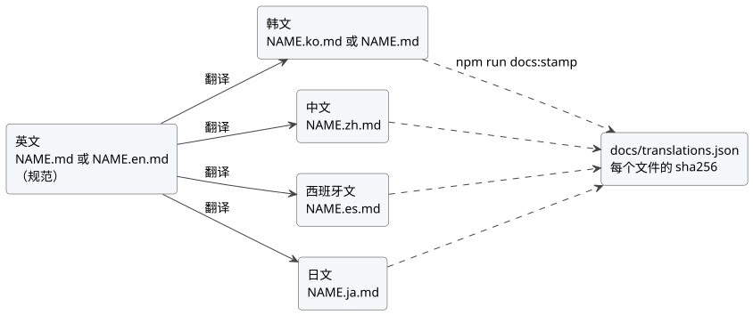

<!-- translation-source: docs/DOCUMENTATION-LANGUAGES.md -->
[英文原文](DOCUMENTATION-LANGUAGES.md)

# 文档语言

本策略说明 GhostFlow 文档使用哪些语言、翻译文件如何命名和检查，以及如何记录经过评审的翻译。如何写好文档和译好文档，请参阅[文档风格指南](DOCUMENTATION-STYLE.zh.md)，其中也包含术语表。本策略的韩文版本参见[韩文版](DOCUMENTATION-LANGUAGES.ko.md)。

**查找与检查文档。** [开发工作流](DEVELOPMENT-WORKFLOW.zh.md)将文档查找与验证合并为一个流程。其中有三条重要命令：

| 命令 | 作用 |
| --- | --- |
| `npm run docs:find -- --limit 8 QUERY` | 在不写入的情况下检查索引新鲜度，并搜索仓库中 Markdown/HTML 的路径和标题。 |
| `npm run docs:index` | 在每批编辑完成后运行。重新生成 `docs/INDEX.md`，然后重新生成根目录的 `INDEX.md`。 |
| `npm run docs:check` | 在繁重构建之前运行。综合执行翻译校验、图表新鲜度、固定版本的索引工具来源以及两项索引新鲜度检查。 |

本策略记录了用户在 2026-09-28 提出的请求：除报告外，每份文档都要有英文版和韩文版。跟踪：[#344](https://github.com/callin2/ghostflow-language/issues/344)。本策略在该请求的基础上增加了简体中文、西班牙文和日文翻译，并将英文定为所撰写正文的规范语言。

## 范围

**哪些内容必须翻译。** 撰写的文档必须提供英文版和韩文版，并翻译为中文、西班牙文和日文。报告以及历史执行/测量证据可以保留其原始语言。

| 代码 | 语言 | 状态 |
| --- | --- | --- |
| `en` | 英文 | 必需；所撰写正文的规范语言 |
| `ko` | 韩文 | 必需 |
| `zh` | 中文（简体） | 从英文翻译；存在时进行完整检查 |
| `es` | 西班牙文 | 从英文翻译；存在时进行完整检查 |
| `ja` | 日文 | 从英文翻译；存在时进行完整检查 |

在 `docs/translations.json` 中为每个已跟踪的或未被忽略的未跟踪 Markdown 文件分类：

- 排除项需要精确的路径和具体的理由。
- 不要豁免整个目录。
- 生成的元数据、测试夹具和规范源文档同样需要显式分类。

非 Markdown 源文件、生成的元数据和测试不在此 Markdown 关口的范围内。

## 文件名

路径永不移动，因此现有链接始终有效。不带后缀的 `NAME.md` 保持其当前的语言；这就是该文档的*基础语言*（`en` 或 `ko`）。其他每种语言都使用同级文件 `NAME.<code>.md`：

| `NAME.md` 的基础语言 | 英文 | 韩文 | 中文 | 西班牙文 | 日文 |
| --- | --- | --- | --- | --- | --- |
| 英文 | `NAME.md` | `NAME.ko.md` | `NAME.zh.md` | `NAME.es.md` | `NAME.ja.md` |
| 韩文 | `NAME.en.md` | `NAME.md` | `NAME.zh.md` | `NAME.es.md` | `NAME.ja.md` |

文学式（literate）`NAME.ghost.md` 遵循相同的模式（`NAME.ghost.en.md`、`NAME.ghost.zh.md`……）。`NAME.ghost.md` 始终是唯一可编译的源；其他每个语言文件都是文档投影，绝不是第二个规范编译输入。

## 规范源与翻译链

每份文档恰好有一个规范文件，并且英文是所撰写正文的规范语言：

- 英文文件是规范文件。对于以韩文为基础语言的文档，规范文件是 `NAME.en.md`，而韩文 `NAME.md` 成为它的翻译。
- 韩文、中文、西班牙文和日文均从英文文件翻译。
- 尚未重写的、以韩文为基础语言的文档可以暂时保留其韩文规范文件。此时其英文文件翻译自韩文文件，而中文、西班牙文和日文仍从英文文件翻译。参见[更改规范语言](#更改规范语言)。
- 文学式 `*.ghost.md` 文档的正文遵循相同的规则。其代码是编译器输入，因此无论哪个文件是规范文件，每个代码块、front matter（前置元数据）和每个机器标记在所有语言中都保持字节一致。



该图展示了翻译链：每个翻译都由英文文件翻译而来，其摘要通过 `npm run docs:stamp` 记录。

## 翻译规则

**需要保留什么、翻译什么。**

- 保留原始规范源、行引用和历史哈希。
- 保持可执行代码块完全一致。除非代码块的信息字符串为 `text`、`mermaid` 或 `plantuml`，否则该代码块即为可执行代码块。
- 翻译说明性正文，以及 `text`、`mermaid` 和 `plantuml` 块中的标签和注释。
- 精确保留代码语句、标识符、公式和逐字引用的许可证文本。
- 保留标题层级序列和显式 HTML 锚点 ID（`<a id="…">`）。标题文本可以翻译；隐式标题 slug 不参与比较，因此翻译中的页内链接可以使用翻译后的 slug。
- 保持 YAML front matter 字节一致。

**翻译头部。** 每个翻译以 `<!-- translation-source: SOURCE_PATH -->` 开头，其中 `SOURCE_PATH` 是其翻译来源文件的仓库路径。以 YAML front matter 开头的文件将该标记紧跟在 front matter 之后。翻译中还包含一个指向该文件的普通 Markdown 链接，使用相对路径或仓库根路径，通常位于下一行，并带有翻译后的标签，例如 `[영문 원문](NAME.md)`、`[英文原文](NAME.md)`、`[Original en inglés](NAME.md)` 或 `[英語の原文](NAME.md)`。规范文件从不带有该标记。在翻译后的示例中，关于规范源的陈述会明确指向所链接的原文。

**指向其他文档的链接。** 目标存在同语言对应文件时链接到该文件；否则链接到英文文件。仅当 `#fragment` 指向显式锚点时才保留它。

## 图表

用 PlantUML 编写图表，并将渲染出的 SVG 提交到源文件旁边：

- 源：`docs/diagrams/<doc-slug>/<name>.puml`，使用英文标签。`<doc-slug>` 是去掉语言后缀的 lower-kebab 文件名。源文件可以以 `!include ../_style.puml` 开头来使用共享样式；这是可选的。
- 翻译后的标签：`docs/diagrams/<doc-slug>/<name>.<code>.puml`。没有自身变体的翻译复用英文 SVG。
- 渲染输出：同级的 `<name>.svg` 或 `<name>.<code>.svg`，通过相对图片链接嵌入，例如 ``。

`npm run docs:diagrams:fetch` 将固定版本的 PlantUML jar（参见 `tools/plantuml.json`）放到被忽略的 `.cache/plantuml/` 目录中，并校验其 sha256。`npm run docs:diagrams` 使用 Java 17 或更高版本（`PLANTUML_JAVA`、`JAVA_HOME` 或 `PATH` 中的 `java`）渲染所有图表。`npm run docs:diagrams:check` 是 `npm run docs:check` 的一部分，不需要 Java：每个 SVG 都记录其源文件的 sha256，以及源文件引入共享样式时该样式的 sha256，因此编辑了源文件却未重新渲染会导致检查失败。请将 `.puml` 和 `.svg` 一起提交。

## 清单

清单格式为 `GhostFlow/document-translations-v2`。

- 每份文档记录 `document`（不带后缀的路径）、`baseLanguage`（`en` 或 `ko`）、`canonical`（语言代码）以及以语言代码为键的 `files`。
- 规范文件记录 `path` 和 `sha256`。
- 每个翻译记录 `path`、`sha256`、`from`（翻译来源语言）和 `sourceSha256`（翻译核对时所依据的 `from` 文件的摘要）。
- 每个排除项记录 `path` 和 `reason`。

```json
{
  "document": "docs/CONSTRAINTS.md",
  "baseLanguage": "ko",
  "canonical": "en",
  "files": {
    "en": { "path": "docs/CONSTRAINTS.en.md", "sha256": "…" },
    "ko": { "path": "docs/CONSTRAINTS.md", "sha256": "…", "from": "en", "sourceSha256": "…" },
    "zh": { "path": "docs/CONSTRAINTS.zh.md", "sha256": "…", "from": "en", "sourceSha256": "…" }
  }
}
```

该关口对每种已记录的语言检查覆盖范围、路径、必需的 `en` 和 `ko` 文件、链接、translation-source 标记、新鲜度、标题、显式锚点、front matter 以及代码保留情况。磁盘上存在但未被记录的中文、西班牙文或日文文件会作为未分类文件而失败。当某个源文件发生变化时，由它翻译而来的每个翻译都会报告 `sourceSha256` 已陈旧，直到其被更新并重新盖章（stamp）。

## 记录摘要

摘要从不自动刷新。评审完一组翻译后，请有意识地记录它：

```sh
npm run docs:stamp -- docs/NAME.md --languages en,ko,zh
npm run docs:stamp -- docs/NAME.md --all
npm run docs:stamp -- docs/NEW.md --base-language en --languages en,ko
npm run docs:stamp -- docs/NAME.md --all --dry-run
npm run docs:stamp -- --auto --dry-run
```

`DOCUMENT` 可以是不带后缀的路径，也可以是其任一语言文件。`--all` 为磁盘上存在的每个语言文件盖章。`--auto` 对清单中的每份文档执行相同操作，它读取每个文件的 translation-source 标记来确定其来源语言和规范文件。盖章会校验更新后的条目（标记、链接、标题、锚点、front matter、代码、新鲜度），只要有任何条目无效，就不写入任何内容。`npm run docs:translations:coverage` 列出各语言的进度；加上 `-- --missing` 可列出缺失的文档。

## 更改规范语言

要将以韩文为基础语言的文档改为以英文为规范：

1. 重写 `NAME.en.md` 并删除其 translation-source 标记。
2. 根据英文文本更新 `NAME.md`（韩文）。以 `<!-- translation-source: docs/NAME.en.md -->` 开头（位于任何 front matter 之后），并加上指向英文文件的链接。
3. 确保中文、西班牙文和日文文件指向 `NAME.en.md`。
4. 运行 `npm run docs:stamp -- docs/NAME.md --canonical en --all`，或运行 `npm run docs:stamp -- --auto` 一次处理所有文档。

## 更新与验证

在同一次变更中更新每种受影响的语言及其清单摘要。然后运行 `npm run docs:check` 和 `node --test tests/doc-translations.test.mjs tests/doc-diagrams.test.mjs`。

- 在目标工作树中用 `git rev-parse` 和 `git show` 解析源文件比较。命名的临时检出不能作为分支内容的证据。
- 验证器在宿主构建之前运行此关口。
- 哈希只确立新鲜度。

摘要不能证明翻译的含义。评审者必须检查每种语言传达的意图和约束是否一致。
