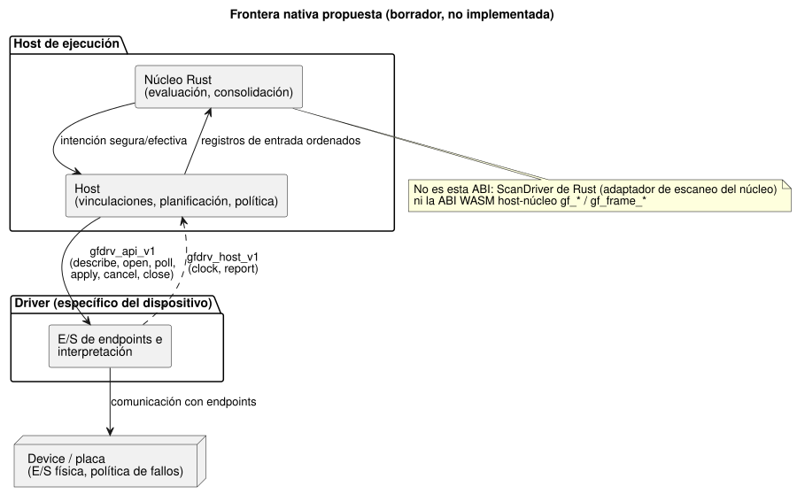
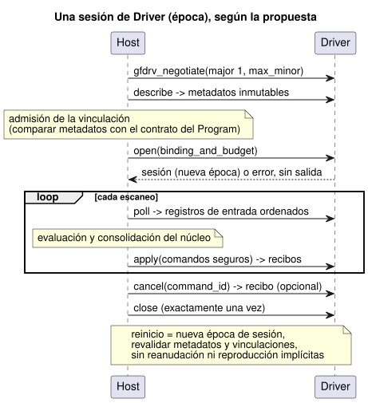

<!-- translation-source: docs/DRIVER-ABI-V1-DRAFT.md -->
[Original en inglés](DRIVER-ABI-V1-DRAFT.md)

# Borrador v1 de la ABI C Host–Driver

[Traducción al coreano](DRIVER-ABI-V1-DRAFT.ko.md)

Este borrador propone una frontera a nivel de C entre un host de ejecución y un
Driver específico del dispositivo. Es una propuesta para revisión, no una
implementación.

**En este documento**

- [Estado y autoridad](#estado-y-autoridad): qué es este borrador y qué no es.
- [Negociación y frontera de funciones](#negociación-y-frontera-de-funciones): la forma ilustrativa en C y las reglas de memoria.
- [Metadatos y admisión de vinculaciones](#metadatos-y-admisión-de-vinculaciones): cómo se describe un Driver y cómo las entradas transportan su calidad.
- [Ciclo de vida, orden y fallos](#ciclo-de-vida-orden-y-fallos): sesiones, recibos, cancelación, errores y presupuestos.
- [Plan representativo de conformidad virtual](#plan-representativo-de-conformidad-virtual): cómo lo probaría un futuro arnés de pruebas.

**Una nota sobre los nombres.** El título dice "Host–Driver" y las funciones usan
el prefijo `gfdrv_*` por razones históricas. En términos actuales, el borrador
describe una ABI nativa común de *adaptadores*:

- Los drivers de entrada y los renderizadores (renderers) de salida comparten esta única frontera con el host.
- Escribir y aplicar salidas es el rol del **renderizador**.
- El código fuente de los drivers pertenece a `farm-device-drivers`.
- Device integra el adaptador con su host y su placa.

Esta nota terminológica no adopta la ABI del borrador ni le cambia el nombre.

## Estado y autoridad

Issue #117: esta es una propuesta solo de documentación, para revisión. La
adopción real por parte de un consumidor sigue pendiente.

Este documento **no** implementa nada de lo siguiente:

- una ABI C;
- un cargador nativo de Drivers;
- integración con hardware;
- una suite de conformidad.

No es un requisito previo para la primera puesta en marcha de una placa. No
impone un contrato de producto de Device.

El lenguaje normativo sigue estando en la Referencia del lenguaje:
[Referencia §6.3](reference/06-composition-and-replay.es.md)
y [§4.7](reference/04-sensors-constraints-control.es.md#47-requested-safe-applied-confirmed).
La [frontera física](LLM-TOOLCHAIN-ARCHITECTURE.es.md)
asigna la E/S física y la política de fallos a Device.

En este documento, “debe” significa una *condición de aceptación propuesta* para
un consumidor que decida adoptar este borrador. No es un requisito sobre el
código actual.

**Quién es dueño de qué.** La frontera nativa une un host de ejecución con un
Driver específico del dispositivo:

- El **host** es dueño de la evaluación del núcleo, las vinculaciones (bindings) de la instalación, la planificación y la política.
- El **Driver** es dueño de la comunicación con los endpoints y de su interpretación.

El diagrama siguiente muestra esta división. El host se comunica con el Driver a
través de la tabla propuesta `gfdrv_api_v1`; el Driver devuelve las llamadas a
través de `gfdrv_host_v1`.



**Lo que esta ABI no es.** Varias interfaces existentes se parecen, pero son distintas:

- El `ScanDriver` de Rust existente es un adaptador de escaneo del núcleo, no esta ABI física.
- La `Capability` existente contiene solo tipo (kind), nombre y tipo de valor.
- Ninguna de las dos aporta los metadatos completos ni los recibos físicos que se proponen aquí.
- La ABI WASM `gf_*`/`gf_frame_*` es una interfaz host–núcleo independiente. Sus
  handles y errores numéricos no se reutilizan aquí.

La versión de la ABI es una versión propia. Es distinta de la revisión/perfil de
la fuente, del formato GFB y de las versiones de paquete, de vinculación y de
firmware.

## Negociación y frontera de funciones

La forma en C que aparece a continuación es ilustrativa. Define las direcciones de
llamada y la propiedad. **No** es un encabezado publicado ni un símbolo
implementado.

Dos tipos auxiliares transportan bytes:

- `gfdrv_bytes` es una vista de bytes de solo lectura, acotada y propiedad del llamador.
- `gfdrv_buffer` es almacenamiento escribible propiedad del llamador, con una capacidad y una longitud devuelta.

Los tipos de registro con nombre (metadatos, registros de entrada, comandos,
recibos) necesitan un esquema revisado antes de poder congelar un encabezado.

```c
#include <stdint.h>
typedef int32_t gfdrv_status; /* 0 success; stable positive errors below */
typedef struct { const uint8_t *data; uint32_t len; } gfdrv_bytes;
typedef struct { uint8_t *data; uint32_t capacity, len; } gfdrv_buffer;
typedef struct gfdrv_session gfdrv_session; /* opaque Driver-owned instance */
typedef struct gfdrv_host_v1 {
  uint32_t size, major, minor;
  void *context; /* opaque host token; Driver must not dereference it */
  gfdrv_status (*clock)(void *, uint64_t *epoch, uint64_t *monotonic_ms);
  gfdrv_status (*report)(void *, gfdrv_bytes record);
} gfdrv_host_v1;
typedef struct gfdrv_api_v1 {
  uint32_t size, major, minor;
  gfdrv_status (*describe)(gfdrv_buffer *metadata);
  gfdrv_status (*open)(const gfdrv_host_v1 *, gfdrv_bytes binding_and_budget,
                      gfdrv_session **out);
  gfdrv_status (*poll)(gfdrv_session *, gfdrv_buffer *input_records);
  gfdrv_status (*apply)(gfdrv_session *, gfdrv_bytes safe_commands,
                       gfdrv_buffer *receipts);
  gfdrv_status (*cancel)(gfdrv_session *, uint64_t command_id,
                        gfdrv_buffer *receipt);
  gfdrv_status (*close)(gfdrv_session *);
} gfdrv_api_v1;
gfdrv_status gfdrv_negotiate(uint32_t major, uint32_t max_minor,
                            uint32_t out_capacity, gfdrv_api_v1 *out);
```

**Negociación de versión.** La versión inicial propuesta es major 1, minor 0.
La negociación funciona así:

1. Seleccionar la versión minor más alta que ambos lados admitan dentro de major 1.
2. Comprobar el tamaño de ambas tablas y cada puntero de función obligatorio.
3. Rechazar una versión major no admitida.

Reglas adicionales de versionado:

- Las extensiones minor solo añaden campos opcionales al final. Un campo omitido
  está ausente; nadie lee más allá de `size`.
- Un cambio incompatible de diseño o de significado requiere una nueva versión major.
- Las funcionalidades obligatorias desconocidas se rechazan antes de `open` y antes de cualquier E/S.
- El consumidor fija el digest del artefacto del Driver, las versiones de ABI y de
  esquema y la convención de llamada de la plataforma.
- Basta con el enlazado estático o con una vía de registro explícita. La carga
  dinámica queda fuera de esta propuesta.

**Llamadas y memoria.**

- Las llamadas se serializan por sesión.
- Las callbacks son síncronas y acotadas, y no pueden reentrar en operaciones del Driver.
- Las vistas se toman prestadas solo durante la llamada; ninguno de los lados retiene punteros.
- Las tablas y `context` siguen siendo válidas hasta `close`.
- Ninguna propiedad de asignaciones de memoria cruza la frontera.
- Las comprobaciones de punteros nulos con longitud distinta de cero, desbordamiento,
  alineación y capacidad se hacen antes de cualquier acceso. Aun así, los
  llamadores deben proporcionar memoria válida y accesible.
- Si un búfer es demasiado pequeño, la llamada devuelve la longitud necesaria y no realiza E/S.
- `apply` y `cancel` comprueban la capacidad para recibos *antes* de cualquier
  efecto físico. `apply` reserva espacio para los recibos del peor caso de cada
  endpoint, de modo que un fallo posterior a una escritura sigue conservando todos
  los resultados.
- Ningún diseño de struct de Rust, diseño de enum, objeto de trait, panic ni
  excepción cruza la frontera C.
- La fuente GhostFlow contiene solo puertos lógicos y reglas. Nunca contiene
  handles de Driver, direcciones de bus ni detalles internos de Rust.

## Metadatos y admisión de vinculaciones

`describe` publica hechos inmutables sobre el Driver: su revisión y su digest,
los esquemas y funcionalidades admitidos, los ID de endpoint y los límites.

Para cada endpoint declara:

- dirección y tipo de carga útil;
- significado semántico, unidad y rango;
- el contrato de muestreo y temporización;
- el comportamiento de calidad y de errores;
- el alcance de la salida y de la relectura (readback);
- las operaciones admitidas.

Los hechos desconocidos siguen siendo desconocidos; nunca se rellenan con suposiciones.

**La admisión de la vinculación** compara estos hechos con el contrato lógico que
exige el Program y con la revisión de la instalación. La comparación incluye la
polaridad, los supuestos a prueba de fallos (fail-safe) y la fuente de evidencia
autorizada. No basta con que coincidan los nombres o los tipos primitivos.

- Un cambio en los metadatos invalida cualquier admisión anterior.
- No se permite volver a vincular en silencio una sesión activa.
- Un reemplazo compatible conserva la fuente y el artefacto y cambia solo las
  revisiones del Driver y de la vinculación, como permite la Referencia §6.3. No
  promete ejecuciones ininterrumpidas, continuidad de sensores ni reinicio automático.

**Los registros de entrada** conservan:

- la identidad del endpoint/fuente y la época de la fuente;
- el ID de muestra, la época del reloj y la marca de tiempo de adquisición;
- la carga útil, la presencia explícita y la calidad/motivo.

Los códigos de calidad de la ABI requieren un mapeo explícito a las calidades de
señal del núcleo:

| Calidad del núcleo | Código |
| --- | --- |
| `NotReady` | 0 |
| `Good` | 1 |
| `Disconnected` | 2 |
| `Stale` | 3 |
| `Invalid` | 4 |

Es decir, `NotReady=0`, `Good=1`, `Disconnected=2`, `Stale=3`, `Invalid=4`.
Los códigos desconocidos se rechazan.

La procedencia (medida, estimada o retenida) y la evidencia certificada de
intervalos son campos y contratos aparte. No son alias de estos códigos de
calidad. Una muestra ausente nunca puede convertirse en un valor bueno fabricado
ni en un certificado de continuidad. `sample`, `valid`, los filtros, `stale_after`
y `recover_after` de la fuente conservan su semántica de la Referencia.

## Ciclo de vida, orden y fallos

La secuencia siguiente muestra una sesión según la propuesta: negociar, describir,
admitir la vinculación, abrir, luego hacer poll y apply en cada escaneo y, por
último, cerrar.



**Apertura de una sesión.** Un `open` exitoso crea una sesión vinculada con su
propia época. Un `open` fallido no devuelve ninguna sesión y no aplica ninguna salida.

**Entradas y orden.**

- El host admite registros de entrada ordenados antes de la evaluación del núcleo.
- Los registros llevan ID de secuencia ordenados de forma monótona dentro de una época.
- Un duplicado idéntico es idempotente. Un duplicado modificado o un ID antiguo se
  rechaza. Los huecos se informan.
- El host registra un orden total explícito para las entradas, los comandos y los
  recibos que ocurren al mismo tiempo. Las marcas de tiempo por sí solas no los ordenan.
- `poll` nunca evalúa la fuente.

**Salidas.** `apply` recibe solo la intención segura/efectiva producida *después*
de la decisión del núcleo. Cada comando lleva un ID de comando, un ID de
ejecución/escaneo, la revisión de la vinculación y un plazo límite. Un lote de
intenciones no promete una conmutación física simultánea.

Los recibos distinguen cuatro resultados por endpoint: **aceptado** (accepted),
**aplicado** (applied), **fallido** (failed) y **desconocido** (unknown).
Conservan los resultados parciales. Tres tipos de evidencia se mantienen
separados, y ninguno sustituye a otro:

- Un acuse *aplicado* (applied) identifica el alcance de la operación.
- La *relectura* (readback) identifica el alcance del registro/latch.
- Un efecto físico *confirmado* (confirmed) requiere retroalimentación independiente con procedencia y calidad.

La consolidación (commit) del núcleo sigue separada de la E/S. Esta ABI no
introduce ninguna reversión (rollback) después de un fallo de salida.

**Cancelación, cierre y reinicio.**

- `cancel` identifica un comando e informa del resultado de la cancelación. Un
  recibo de cancelación no prueba un OFF físico, no deshace una acción aplicada y
  no borra el estado consolidado.
- Los recibos tardíos conservan sus ID originales y no pueden afectar a una época nueva.
- `close` termina el acceso exactamente una vez, acotado por el plazo acordado. El
  desmontaje no certifica que las salidas físicas sean seguras.
- Una vez invocado `close`, el host no debe reutilizar ni volver a cerrar el
  puntero, ni siquiera en caso de error. El Driver es dueño del desmontaje final.
- No se permite ninguna callback después de que `close` retorne. El desmontaje
  final no retiene punteros prestados del host.
- Un reinicio crea una nueva época de sesión, revalida los metadatos y las
  vinculaciones y usa una política explícita de punto de control (checkpoint) y
  recuperación del consumidor. No se permiten la reanudación implícita, la
  reutilización de recibos obsoletos ni la reproducción automática de comandos de
  salida anteriores.

El consumidor que adopte el borrador especifica la política de watchdog, detención,
reintento, solicitud de OFF y redespliegue. Este borrador no reemplaza ni certifica
la política de Device documentada en su revisión fijada por separado en la guía de
la frontera física.

**Errores.** Los errores nativos usan categorías numéricas estables (0 significa éxito):
`1 ABI_MISMATCH`, `2 INVALID_ARGUMENT`, `3 UNSUPPORTED`,
`4 BINDING_MISMATCH`, `5 BUFFER_TOO_SMALL`, `6 BUDGET_EXCEEDED`, `7 DEADLINE_EXCEEDED`,
`8 UNAVAILABLE`, `9 IO_FAILURE`, `10 CANCELLED`, `11 INVALID_STATE`, `12 INTERNAL`.

Los registros de diagnóstico acotados añaden los ID de operación/endpoint/comando,
la causa nativa, si se puede reintentar y el resultado observado. El texto del
mensaje no es la identidad de un error. Un error de operación nunca borra la
evidencia anterior de aplicado/desconocido.

**Presupuestos.** `open` negocia máximos explícitos para:

- endpoints;
- bytes y número de registros;
- comandos pendientes;
- diagnósticos retenidos;
- memoria;
- trabajo por llamada;
- plazos de finalización.

El Driver rechaza un presupuesto imposible de cumplir antes de la activación. Los
límites de longitud y de cantidad se comprueban antes de cualquier asignación o
E/S. El agotamiento produce un error determinista y una traza acotada. Este
borrador no inventa límites universales para las placas.

Un plazo síncrono acota solo el trabajo cooperativo. Detener una llamada nativa
bloqueada requiere una política de aislamiento/watchdog y evidencia propias del
consumidor. Los errores nunca implican seguridad física.

## Plan representativo de conformidad virtual

Un futuro arnés de pruebas fijará las revisiones del host, del Driver y del
esquema, y reproducirá una DI (entrada digital) virtual y una salida de relé:

| Caso | Evidencia de aceptación |
| --- | --- |
| Negociación y tablas | Una discrepancia de major, tablas cortas o la ausencia de una callback o funcionalidad obligatoria se rechazan sin E/S; una extensión minor opcional es segura. |
| Vinculación y calidad | Un reemplazo compatible conserva el artefacto del Program; unidades, temporización o calidad incorrectas se rechazan; la ausencia, los fallos, los duplicados y los cambios de época siguen siendo observables. |
| Escaneos ordenados | Los eventos simultáneos tienen un orden estable; los ID duplicados antiguos o modificados se rechazan; la decisión del núcleo y los recibos físicos se mantienen separados. |
| Salidas y cancelación | Los fallos retrasados o parciales, la discrepancia del latch, los recibos tardíos y la cancelación después de apply conservan las distinciones entre requested/safe/applied/confirmed. |
| Presupuestos y reinicio | Las pruebas de límites y desbordamiento, los búferes llenos, el trabajo o los plazos agotados y el cierre/reapertura producen errores acotados sin comandos obsoletos ni reanudaciones ocultas. |

El éxito virtual establece solo el comportamiento de la interfaz. No es una prueba
física, ni una certificación de plazos, ni la adopción de un firmware, ni soporte
para un cargador dinámico. Este documento no afirma ningún resultado de pruebas.

Las pruebas existentes sirven como líneas base de regresión host/núcleo, no como
prueba de la ABI C:

- [pruebas de trama de escaneo](../tests/scan-frame-wasm.test.mjs);
- [paridad de la cinta de escaneo](../tests/scan-tape-parity.test.mjs);
- [contratos de señal del núcleo](../crates/ghostflow-core/src/signals.rs).

Las [pruebas de intervalos del Driver](../tests/true-for-driver-contract.test.mjs)
también siguen siendo distintas del transporte de un futuro adaptador C y de la
evidencia autorizada de observación continua. Las muestras puntuales de DI no
certifican un intervalo.

Antes de la adopción, los responsables del host y del Driver deben acordar:

- la codificación concreta de los registros y los registros de tipos y unidades;
- la ABI de la plataforma;
- la vinculación de confianza;
- los presupuestos y plazos que se hacen cumplir;
- la política de fallos, reinicio y puntos de control;
- la evidencia del objetivo.

Estas son decisiones de adopción sin resolver. Este borrador, intencionadamente,
no elige la política de un producto por él.
