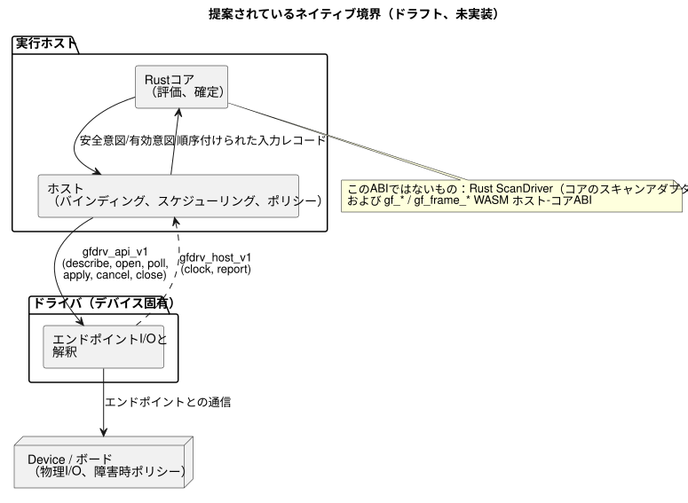
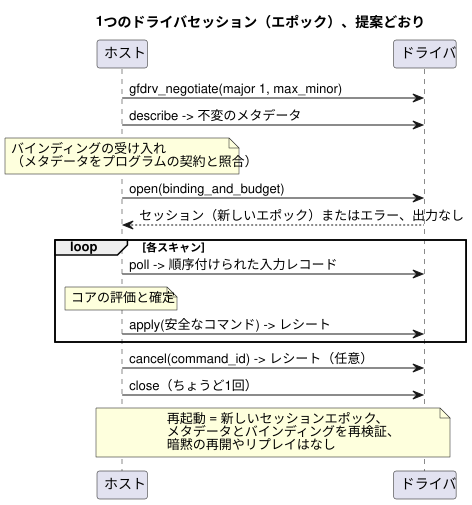

<!-- translation-source: docs/DRIVER-ABI-V1-DRAFT.md -->
[英語の原文](DRIVER-ABI-V1-DRAFT.md)

# Host–Driver C ABI v1 ドラフト

[韓国語訳](DRIVER-ABI-V1-DRAFT.ko.md)

このドラフトは、実行ホストとデバイス固有のドライバ（Driver）の間に置くCレベルの境界を提案するものです。これはレビューのための提案であり、実装ではありません。

**この文書の内容**

- [位置付けと規範の所在](#位置付けと規範の所在)：このドラフトが何であり、何でないか。
- [ネゴシエーションと関数境界](#ネゴシエーションと関数境界)：説明用のCの形とメモリ規則。
- [メタデータとバインディングの受け入れ](#メタデータとバインディングの受け入れ)：ドライバが自身をどう記述し、入力がどのように品質を伝えるか。
- [ライフサイクル、順序、障害](#ライフサイクル順序障害)：セッション、レシート、キャンセル、エラー、バジェット。
- [代表的な仮想適合性計画](#代表的な仮想適合性計画)：将来のハーネスがこれをどのようにテストするか。

**名前についての注記。** タイトルの「Host–Driver」と、関数の`gfdrv_*`プレフィックスは歴史的な理由によるものです。現在の用語では、このドラフトは共通のネイティブ*アダプタ*ABIを記述しています。

- 入力ドライバと出力レンダラーは、この1つのホスト境界を共有します。
- 出力の書き込みと適用は**レンダラー**の役割です。
- ドライバのソースは`farm-device-drivers`に属します。
- Deviceは、アダプタを自身のホストおよびボードと統合します。

この用語上の注記は、ドラフトABIを採用するものでも、その名前を変更するものでもありません。

## 位置付けと規範の所在

Issue #117：これはレビューのための、ドキュメントのみの提案です。実際の利用側（コンシューマ）による採用はまだ保留中です。

この文書は、以下のいずれも実装**しません**。

- C ABI
- ネイティブのドライバローダー
- ハードウェア統合
- 適合性テストスイート

これは最初のボード立ち上げの前提条件ではありません。また、Deviceの製品契約を義務付けるものでもありません。

規範的な記述は引き続き言語リファレンスにあります：
[リファレンス §6.3](reference/06-composition-and-replay.ja.md)
および[§4.7](reference/04-sensors-constraints-control.ja.md)。
[物理境界](LLM-TOOLCHAIN-ARCHITECTURE.ja.md)
は、物理I/Oと障害時ポリシーをDeviceに割り当てています。

この文書における「しなければなりません（must）」は、このドラフトの採用を選んだコンシューマに対する*提案された受け入れ条件*を意味します。現在のコードに対する要件ではありません。

**誰が何を所有するか。** ネイティブ境界は、実行ホストとデバイス固有のドライバを結び付けます。

- **ホスト**は、コア評価、設備のバインディング、スケジューリング、ポリシーを所有します。
- **ドライバ**は、エンドポイントとの通信と解釈を所有します。

次の図はこの分担を示しています。ホストは提案された`gfdrv_api_v1`テーブルを通じてドライバと通信し、ドライバは`gfdrv_host_v1`を通じてコールバックします。



**このABIではないもの。** 似て見える既存のインターフェースがいくつかありますが、これらは別物です。

- 既存のRustの`ScanDriver`はコアのスキャンアダプタであり、この物理ABIではありません。
- 既存の`Capability`には、種類、名前、値の型しか含まれていません。
- これらのいずれも、ここで提案する完全なメタデータや物理的なレシートを提供しません。
- `gf_*`/`gf_frame_*`のWASM ABIは、別のホスト–コア間インターフェースです。そのハンドルや数値エラーはここでは再利用しません。

ABIのバージョンは独自のバージョンです。ソースのリビジョン/プロファイル、GFBフォーマット、パッケージ、バインディング、ファームウェアの各バージョンとは区別されます。

## ネゴシエーションと関数境界

以下のCの形は説明用です。呼び出しの方向と所有権を定義します。公開されたヘッダでも、実装済みのシンボルでも**ありません**。

バイトを運ぶヘルパー型が2つあります。

- `gfdrv_bytes`は、呼び出し側が所有する、境界付きの読み取り専用バイトビューです。
- `gfdrv_buffer`は、呼び出し側が所有する書き込み可能な領域で、容量と返却される長さを持ちます。

名前付きのレコード型（メタデータ、入力レコード、コマンド、レシート）は、ヘッダを確定させる前にレビュー済みのスキーマが必要です。

```c
#include <stdint.h>
typedef int32_t gfdrv_status; /* 0 success; stable positive errors below */
typedef struct { const uint8_t *data; uint32_t len; } gfdrv_bytes;
typedef struct { uint8_t *data; uint32_t capacity, len; } gfdrv_buffer;
typedef struct gfdrv_session gfdrv_session; /* opaque Driver-owned instance */
typedef struct gfdrv_host_v1 {
  uint32_t size, major, minor;
  void *context; /* opaque host token; Driver must not dereference it */
  gfdrv_status (*clock)(void *, uint64_t *epoch, uint64_t *monotonic_ms);
  gfdrv_status (*report)(void *, gfdrv_bytes record);
} gfdrv_host_v1;
typedef struct gfdrv_api_v1 {
  uint32_t size, major, minor;
  gfdrv_status (*describe)(gfdrv_buffer *metadata);
  gfdrv_status (*open)(const gfdrv_host_v1 *, gfdrv_bytes binding_and_budget,
                      gfdrv_session **out);
  gfdrv_status (*poll)(gfdrv_session *, gfdrv_buffer *input_records);
  gfdrv_status (*apply)(gfdrv_session *, gfdrv_bytes safe_commands,
                       gfdrv_buffer *receipts);
  gfdrv_status (*cancel)(gfdrv_session *, uint64_t command_id,
                        gfdrv_buffer *receipt);
  gfdrv_status (*close)(gfdrv_session *);
} gfdrv_api_v1;
gfdrv_status gfdrv_negotiate(uint32_t major, uint32_t max_minor,
                            uint32_t out_capacity, gfdrv_api_v1 *out);
```

**バージョンネゴシエーション。** 提案する初期バージョンはメジャー1、マイナー0です。ネゴシエーションは次のように行われます。

1. メジャー1の範囲内で、双方がサポートする最も高いマイナーバージョンを選択します。
2. 両方のテーブルサイズと、すべての必須関数ポインタを確認します。
3. サポートされていないメジャーバージョンは拒否します。

その他のバージョニング規則：

- マイナー拡張は、オプションのフィールドを末尾に追加するだけです。省略されたフィールドは欠落として扱われ、誰も`size`を超えて読み取りません。
- レイアウトや意味を壊す変更には、新しいメジャーバージョンが必要です。
- 不明な必須機能は、`open`の前、かつあらゆるI/Oの前に拒否されます。
- コンシューマは、ドライバ成果物のダイジェスト、ABI/スキーマのバージョン、プラットフォームの呼び出し規約を固定（ピン留め）します。
- 静的リンクまたは明示的な登録経路で十分です。動的ロードはこの提案の範囲外です。

**呼び出しとメモリ。**

- 呼び出しはセッションごとに直列化されます。
- コールバックは同期的かつ有界であり、ドライバの操作に再入することはできません。
- ビューは呼び出しの間だけ借用されます。どちらの側もポインタを保持しません。
- テーブルと`context`は`close`まで有効です。
- メモリ割り当ての所有権は境界を越えません。
- 長さが0でないnullポインタ、オーバーフロー、アラインメント、容量のチェックは、あらゆるアクセスの前に行われます。それでも呼び出し側は、有効でアクセス可能なメモリを渡さなければなりません。
- バッファが小さすぎる場合、呼び出しは必要な長さを返し、I/Oは一切行いません。
- `apply`と`cancel`は、物理的な効果が生じる*前に*レシートの容量を確認します。`apply`はすべてのエンドポイントについて最悪ケースのレシート分の領域を確保するため、書き込み後に失敗しても、すべての結果が保持されます。
- Rustの構造体レイアウト、列挙型のレイアウト、トレイトオブジェクト、パニック、例外がC境界を越えることはありません。
- GhostFlowのソースには論理ポートとルールだけが含まれます。ドライバのハンドル、バスアドレス、Rustの内部構造が含まれることは決してありません。

## メタデータとバインディングの受け入れ

`describe`は、ドライバに関する不変の事実を公開します。具体的には、リビジョンとダイジェスト、サポートするスキーマと機能、エンドポイントIDと制限です。

各エンドポイントについて、次の項目を宣言します。

- 方向とペイロードの型
- 意味、単位、範囲
- サンプル/タイミングの契約
- 品質とエラー時の振る舞い
- 出力/リードバックのスコープ
- サポートする操作

不明な事実は不明のままであり、推測で埋められることは決してありません。

**バインディングの受け入れ**では、これらの事実を、プログラムが要求する論理契約および設備のリビジョンと照合します。この照合には、極性、フェイルセーフの前提、承認された証拠ソースが含まれます。名前やプリミティブ型が一致するだけでは不十分です。

- メタデータが変更されると、以前の受け入れはすべて無効になります。
- アクティブなセッションを暗黙に再バインドすることは許可されません。
- 互換デバイスの交換では、ソースと成果物を維持し、ドライバ/バインディングのリビジョンだけを変更します。これはリファレンス §6.3が許可する範囲です。実行の中断がないこと、センサの連続性、自動再起動は約束しません。

**入力レコード**は次の情報を保持します。

- エンドポイント/ソースの同一性とソースのエポック
- サンプルID、クロックのエポック、取得タイムスタンプ
- ペイロード、明示的な存在情報、品質/理由

ABIの品質コードは、コアの信号品質への明示的なマッピングを必要とします。

| コアの品質 | コード |
| --- | --- |
| `NotReady` | 0 |
| `Good` | 1 |
| `Disconnected` | 2 |
| `Stale` | 3 |
| `Invalid` | 4 |

つまり、`NotReady=0`、`Good=1`、`Disconnected=2`、`Stale=3`、`Invalid=4`です。不明なコードは拒否されます。

来歴（測定値、推定値、保持値）と、認証された区間の証拠は、別々のフィールドおよび契約です。これらの品質コードの別名ではありません。欠落したサンプルが、捏造された良好な値や連続性の証明書になることは決してありません。ソースの`sample`、`valid`、フィルタ、`stale_after`、`recover_after`は、リファレンスで定められた意味をそのまま保ちます。

## ライフサイクル、順序、障害

次のシーケンスは、提案されている1つのセッションを示しています。ネゴシエーション、記述、バインディングの受け入れ、オープンを行い、各スキャンでpollとapplyを実行し、最後にクローズします。



**セッションのオープン。** `open`が成功すると、独自のエポックを持つ、バインド済みのセッションが1つ作成されます。`open`が失敗した場合はセッションを返さず、出力も適用しません。

**入力と順序。**

- ホストは、コア評価の前に、順序付けられた入力レコードを受け入れます。
- レコードは、エポック内で単調に順序付けられたシーケンスIDを持ちます。
- 完全に同一の重複は冪等です。内容が変わった重複や古いIDは拒否されます。欠番は報告されます。
- ホストは、同時刻の入力、コマンド、レシートについて、明示的な全順序を記録します。タイムスタンプだけではそれらの順序は決まりません。
- `poll`がソースを評価することは決してありません。

**出力。** `apply`が受け取るのは、コアの判断の*後に*生成された安全意図/有効意図だけです。各コマンドは、コマンドID、実行（run）/スキャンID、バインディングのリビジョン、期限を持ちます。意図のバッチは、物理的な切り替えが同時に起こることを約束しません。

レシートは、エンドポイントごとに4つの結果を区別します：**受理（accepted）**、**適用済み（applied）**、**失敗（failed）**、**不明（unknown）**。部分的な結果も保持します。3種類の証拠は別々に扱われ、どれも他の代わりにはなりません。

- *適用済み（applied）*の確認応答は、操作のスコープを特定します。
- *リードバック*は、レジスタ/ラッチのスコープを特定します。
- *確認済み（confirmed）*の物理的効果には、来歴と品質を伴う独立したフィードバックが必要です。

コアの確定はI/Oとは別のままです。このABIは、出力の失敗後のロールバックを導入しません。

**キャンセル、クローズ、再起動。**

- `cancel`はコマンドを特定し、キャンセルの結果を報告します。キャンセルのレシートは、物理的なOFFを証明せず、適用済みの動作を取り消さず、確定済みの状態をクリアしません。
- 遅れて届いたレシートは元のIDを保持し、新しいエポックに影響を与えることはできません。
- `close`は、合意された期限の範囲内で、アクセスをちょうど1回だけ終了させます。終了処理は、物理出力が安全であることを証明しません。
- `close`を呼び出したら、エラーの場合であっても、ホストはそのポインタを再利用したり再度クローズしたりしてはなりません。最終的な終了処理はドライバが責任を持ちます。
- `close`が戻った後のコールバックは許可されません。最終的な終了処理は、借用したホストのポインタを保持しません。
- 再起動では新しいセッションエポックを作成し、メタデータとバインディングを再検証し、コンシューマが明示的に定めたチェックポイント/復旧ポリシーを使用します。暗黙の再開、古いレシートの再利用、以前の出力コマンドの自動リプレイは許可されません。

採用するコンシューマが、ウォッチドッグ、停止、リトライ、OFF要求、再デプロイのポリシーを定めます。このドラフトは、物理境界ガイドの中で個別に固定されたリビジョンとして文書化されているDeviceのポリシーを置き換えることも、証明することもありません。

**エラー。** ネイティブのエラーは、安定した数値カテゴリを使用します（0は成功を意味します）：
`1 ABI_MISMATCH`、`2 INVALID_ARGUMENT`、`3 UNSUPPORTED`、
`4 BINDING_MISMATCH`、`5 BUFFER_TOO_SMALL`、`6 BUDGET_EXCEEDED`、`7 DEADLINE_EXCEEDED`、
`8 UNAVAILABLE`、`9 IO_FAILURE`、`10 CANCELLED`、`11 INVALID_STATE`、`12 INTERNAL`。

有界の診断レコードには、操作/エンドポイント/コマンドのID、ネイティブの原因、リトライ可能性、観測された結果が加わります。メッセージテキストはエラーの識別子ではありません。操作エラーが、それ以前の適用済み/不明の証拠を消すことは決してありません。

**バジェット。** `open`は、次の項目について明示的な上限をネゴシエーションします。

- エンドポイント
- レコードのバイト数とレコード数
- 未完了のコマンド
- 保持する診断
- メモリ
- 呼び出しごとの作業量
- 完了期限

ドライバは、満たせないバジェットをアクティブ化の前に拒否します。長さと個数の制限は、メモリ割り当てやI/Oの前にチェックされます。上限に達すると、決定的なエラーと有界のトレースが生じます。このドラフトは、ボード共通の上限値を独自に定めることはしません。

同期的な期限が制限するのは、協調的な作業だけです。停止したネイティブ呼び出しを止めるには、コンシューマが所有する分離/ウォッチドッグのポリシーと証拠が必要です。エラーが物理的な安全性を意味することは決してありません。

## 代表的な仮想適合性計画

将来のハーネスは、ホスト、ドライバ、スキーマのリビジョンを固定し、仮想のDI（デジタル入力）とリレー出力をリプレイします。

| ケース | 受け入れの証拠 |
| --- | --- |
| ネゴシエーションとテーブル | メジャーの不一致、短いテーブル、必須のコールバック/機能の欠落はI/Oなしで拒否される。オプションのマイナー拡張は安全である。 |
| バインディングと品質 | 互換デバイスの交換ではプログラム成果物が保持される。誤った単位/タイミング/品質は拒否される。欠落、故障、重複、エポックの変化は観測可能なままである。 |
| 順序付けられたスキャン | 同時刻のイベントは安定した順序を持つ。古い/内容が変わった重複IDは拒否される。コアの判断と物理的なレシートは別々のままである。 |
| 出力とキャンセル | 遅延した失敗/部分的な失敗、ラッチの不一致、遅れて届いたレシート、適用後のキャンセルでも、requested/safe/applied/confirmedの区別が保たれる。 |
| バジェットと再起動 | 境界/オーバーフローのテスト、満杯のバッファ、作業量/期限の超過、close/reopenは、古いコマンドや隠れた再開なしに、有界のエラーを生じる。 |

仮想環境での成功が立証するのは、インターフェースの振る舞いだけです。物理的な証明、期限の認証、ファームウェアでの採用、動的ローダーのサポートを意味するものではありません。この文書はテスト結果を主張しません。

既存のテストは、C ABIの証明としてではなく、ホスト/コアの回帰ベースラインとして機能します。

- [scan-frameテスト](../tests/scan-frame-wasm.test.mjs)
- [scan-tapeパリティ](../tests/scan-tape-parity.test.mjs)
- [コアの信号契約](../crates/ghostflow-core/src/signals.rs)

[ドライバの区間テスト](../tests/true-for-driver-contract.test.mjs)も、将来のCアダプタのトランスポートや、承認された連続観測の証拠とは区別されたままです。点としてのDIサンプルは、区間を証明しません。

採用の前に、ホストとドライバの所有者は次の点について合意しなければなりません。

- 具体的なレコードのエンコーディングと、型/単位のレジストリ
- プラットフォームABI
- 信頼のバインディング
- 強制されるバジェットと期限
- 障害、再起動、チェックポイントのポリシー
- 対象となる証拠

これらは未解決の採用判断です。このドラフトは、製品のポリシーを製品に代わって意図的に選択しません。
