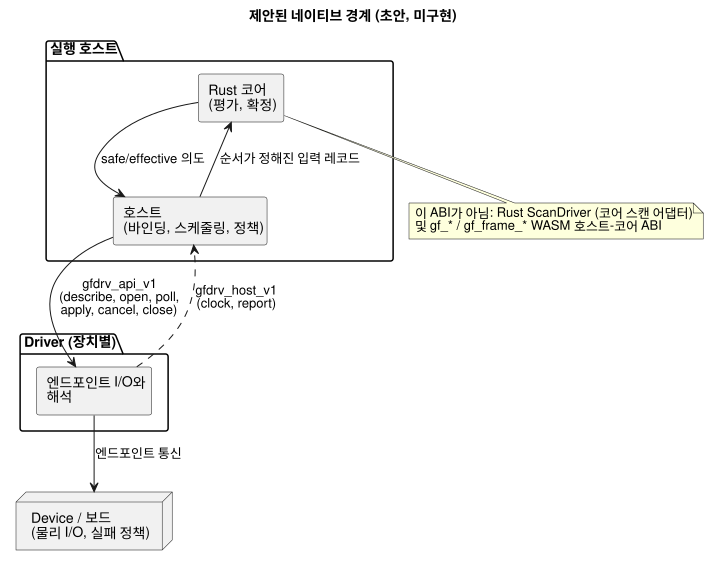
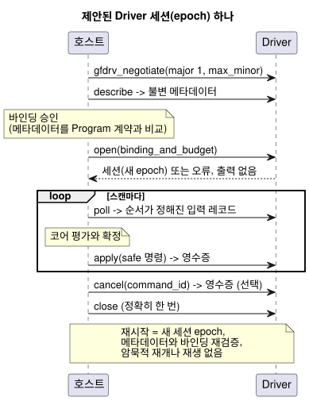

<!-- translation-source: docs/DRIVER-ABI-V1-DRAFT.md -->
[영문 원문](DRIVER-ABI-V1-DRAFT.md)

# Host–Driver C ABI v1 초안

이 초안은 실행 호스트와 장치별 Driver 사이의 C 수준 경계를 제안합니다. 검토를 위한
제안이며 구현이 아닙니다.

**이 문서의 내용**

- [상태와 권한](#상태와-권한): 이 초안이 무엇이고 무엇이 아닌지 설명합니다.
- [협상과 함수 경계](#협상과-함수-경계): 예시 C 형태와 메모리 규칙을 설명합니다.
- [메타데이터와 바인딩 승인](#메타데이터와-바인딩-승인): Driver가 자신을 기술하는 방법과 입력이 품질을 전달하는 방법을 설명합니다.
- [수명주기, 순서와 실패](#수명주기-순서와-실패): 세션, 영수증, 취소, 오류와 예산을 설명합니다.
- [대표 가상 적합성 검증 계획](#대표-가상-적합성-검증-계획): 향후 하네스가 이를 어떻게 검증할지 설명합니다.

**이름에 관한 참고.** 제목의 "Host–Driver"와 함수의 `gfdrv_*` 접두사는 역사적인
이유로 남아 있습니다. 현재 용어로 이 초안은 공통 네이티브 *adapter* ABI를 설명합니다.

- 입력 driver와 출력 renderer는 이 하나의 호스트 경계를 공유합니다.
- 출력을 쓰고 적용하는 것은 **renderer** 역할입니다.
- Driver 소스는 `farm-device-drivers`에 속합니다.
- Device는 adapter를 호스트와 보드에 통합합니다.

이 용어 정리는 초안 ABI를 채택하지 않으며 이름도 바꾸지 않습니다.

## 상태와 권한

이슈 #117: 이 문서는 검토를 위한 문서 전용 제안입니다. 실제 소비자의 채택은 아직
이루어지지 않았습니다.

이 문서는 다음 중 어느 것도 구현하지 **않습니다**.

- C ABI
- 네이티브 Driver 로더
- 하드웨어 통합
- 적합성 테스트 모음

이 문서는 첫 보드 구동(bring-up)의 선행 조건이 아닙니다. Device 제품 계약을
의무화하지도 않습니다.

규범적인 언어 정의는 여전히 Language Reference에 있습니다.
[Reference §6.3](reference/06-composition-and-replay.md)
및 [§4.7](reference/04-sensors-constraints-control.md#47-requested-safe-applied-confirmed)을 참고하십시오.
[물리 경계](LLM-TOOLCHAIN-ARCHITECTURE.ko.md)는
물리 I/O와 실패 정책을 Device에 배정합니다.

이 문서에서 "~해야 합니다"는 이 초안을 채택하기로 선택한 소비자에 대한 *제안된
수용 조건*을 뜻합니다. 현재 코드에 대한 요구 사항이 아닙니다.

**누가 무엇을 소유하는가.** 네이티브 경계는 실행 호스트와 장치별 Driver를 연결합니다.

- **호스트**는 코어 평가, 설치 바인딩, 스케줄링과 정책을 소유합니다.
- **Driver**는 엔드포인트 통신과 해석을 소유합니다.

아래 그림은 이 분담을 보여 줍니다. 호스트는 제안된 `gfdrv_api_v1` 테이블을 통해
Driver를 호출하고, Driver는 `gfdrv_host_v1`을 통해 호스트를 다시 호출합니다.



**이 ABI가 아닌 것.** 비슷해 보이지만 별개인 인터페이스가 여럿 있습니다.

- 기존 Rust `ScanDriver`는 코어 스캔 어댑터이며 이 물리 ABI가 아닙니다.
- 기존 `Capability`는 kind, name, value type만 포함합니다.
- 둘 다 여기서 제안하는 완전한 메타데이터나 물리 영수증을 제공하지 않습니다.
- `gf_*`/`gf_frame_*` WASM ABI는 별도의 호스트–코어 인터페이스입니다. 그 핸들과
  숫자 오류는 여기서 재사용하지 않습니다.

ABI 버전은 독립된 버전입니다. 소스 revision/프로필, GFB 형식, 패키지·바인딩·펌웨어
버전과 구분됩니다.

## 협상과 함수 경계

아래 C 형태는 예시입니다. 호출 방향과 소유권을 정의합니다. 공개된 헤더나 구현된
심볼이 **아닙니다**.

두 보조 타입이 바이트를 전달합니다.

- `gfdrv_bytes`는 호출자가 소유하는, 길이가 제한된 읽기 전용 바이트 뷰입니다.
- `gfdrv_buffer`는 용량과 반환 길이를 가진, 호출자 소유의 쓰기 가능 저장소입니다.

이름 붙은 레코드 타입(메타데이터, 입력 레코드, 명령, 영수증)은 헤더를 확정하기 전에
검토된 스키마가 필요합니다.

```c
#include <stdint.h>
typedef int32_t gfdrv_status; /* 0 success; stable positive errors below */
typedef struct { const uint8_t *data; uint32_t len; } gfdrv_bytes;
typedef struct { uint8_t *data; uint32_t capacity, len; } gfdrv_buffer;
typedef struct gfdrv_session gfdrv_session; /* opaque Driver-owned instance */
typedef struct gfdrv_host_v1 {
  uint32_t size, major, minor;
  void *context; /* opaque host token; Driver must not dereference it */
  gfdrv_status (*clock)(void *, uint64_t *epoch, uint64_t *monotonic_ms);
  gfdrv_status (*report)(void *, gfdrv_bytes record);
} gfdrv_host_v1;
typedef struct gfdrv_api_v1 {
  uint32_t size, major, minor;
  gfdrv_status (*describe)(gfdrv_buffer *metadata);
  gfdrv_status (*open)(const gfdrv_host_v1 *, gfdrv_bytes binding_and_budget,
                      gfdrv_session **out);
  gfdrv_status (*poll)(gfdrv_session *, gfdrv_buffer *input_records);
  gfdrv_status (*apply)(gfdrv_session *, gfdrv_bytes safe_commands,
                       gfdrv_buffer *receipts);
  gfdrv_status (*cancel)(gfdrv_session *, uint64_t command_id,
                        gfdrv_buffer *receipt);
  gfdrv_status (*close)(gfdrv_session *);
} gfdrv_api_v1;
gfdrv_status gfdrv_negotiate(uint32_t major, uint32_t max_minor,
                            uint32_t out_capacity, gfdrv_api_v1 *out);
```

**버전 협상.** 제안된 초기 버전은 major 1, minor 0입니다. 협상은 다음과 같이
진행됩니다.

1. major 1 안에서 양쪽이 모두 지원하는 가장 높은 minor 버전을 선택합니다.
2. 두 테이블의 크기와 모든 필수 함수 포인터를 검사합니다.
3. 지원하지 않는 major 버전은 거부합니다.

추가 버전 규칙은 다음과 같습니다.

- minor 확장은 선택 필드를 뒤에 덧붙이기만 합니다. 생략된 필드는 없는 것으로
  취급하며, 누구도 `size` 밖을 읽지 않습니다.
- 레이아웃이나 의미를 깨는 변경에는 새 major 버전이 필요합니다.
- 알 수 없는 필수 기능은 `open` 전, 그리고 어떤 I/O보다도 먼저 거부합니다.
- 소비자는 Driver 산출물 다이제스트, ABI/스키마 버전과 플랫폼 호출 규약을 고정합니다.
- 정적 링크나 명시적 등록 경로면 충분합니다. 동적 로딩은 이 제안의 범위 밖입니다.

**호출과 메모리.**

- 호출은 세션별로 직렬화됩니다.
- 콜백은 동기적이고 제한되며 Driver 작업에 재진입할 수 없습니다.
- 뷰는 호출이 진행되는 동안에만 빌리며, 어느 쪽도 포인터를 보관하지 않습니다.
- 테이블과 `context`는 `close`까지 유효합니다.
- 할당 소유권은 경계를 넘지 않습니다.
- 길이가 0이 아닌 null 포인터, 오버플로, 정렬과 용량 검사는 어떤 접근보다도 먼저
  수행합니다. 그래도 호출자는 유효하고 접근 가능한 메모리를 제공해야 합니다.
- 버퍼가 너무 작으면 호출은 필요한 길이를 반환하고 I/O를 수행하지 않습니다.
- `apply`와 `cancel`은 물리 효과가 일어나기 *전에* 영수증 용량을 검사합니다.
  `apply`는 모든 엔드포인트의 최악의 경우 영수증 공간을 확보하므로, 쓰기 후에
  실패해도 모든 결과가 보존됩니다.
- Rust 구조체 레이아웃, enum 레이아웃, trait object, panic이나 예외는 C 경계를
  넘지 않습니다.
- GhostFlow 소스에는 논리 포트와 규칙만 들어갑니다. Driver 핸들, 버스 주소나 Rust
  내부 구현은 절대 들어가지 않습니다.

## 메타데이터와 바인딩 승인

`describe`는 Driver에 관한 불변 사실을 공개합니다. 여기에는 Driver의 revision과
다이제스트, 지원하는 스키마와 기능, 엔드포인트 ID와 한계가 포함됩니다.

각 엔드포인트에 대해 다음을 선언합니다.

- 방향과 페이로드 타입
- 의미, 단위와 범위
- 샘플/시간 계약
- 품질과 오류 동작
- 출력/읽기 확인(readback) 범위
- 지원하는 작업

알 수 없는 사실은 unknown으로 남으며, 추측으로 채워 넣지 않습니다.

**바인딩 승인**은 이 사실들을 Program이 요구하는 논리 계약 및 설치 revision과
비교합니다. 비교에는 극성, 페일세이프 가정과 승인된 증거 출처도 포함됩니다. 이름이나
기본 타입이 일치하는 것만으로는 충분하지 않습니다.

- 메타데이터가 바뀌면 이전 승인은 무효가 됩니다.
- 활성 세션의 바인딩을 조용히 바꾸는 것은 허용되지 않습니다.
- 호환 교체는 Reference §6.3이 허용하는 대로 소스와 산출물을 유지하고 Driver/바인딩
  revision만 바꿉니다. 중단 없는 실행, 센서 연속성이나 자동 재시작을 약속하지 않습니다.

**입력 레코드**는 다음을 보존합니다.

- 엔드포인트/출처 identity와 출처 epoch
- 샘플 ID, 시계 epoch와 취득 타임스탬프
- 페이로드, 명시적 존재 여부, 품질/이유

ABI 품질 코드는 코어 신호 품질로의 명시적 매핑이 필요합니다.

| 코어 품질 | 코드 |
| --- | --- |
| `NotReady` | 0 |
| `Good` | 1 |
| `Disconnected` | 2 |
| `Stale` | 3 |
| `Invalid` | 4 |

즉 `NotReady=0`, `Good=1`, `Disconnected=2`, `Stale=3`, `Invalid=4`입니다.
알 수 없는 코드는 거부합니다.

provenance(측정값, 추정값 또는 유지값)와 인증된 구간 증거는 별도의 필드와 계약입니다.
이 품질 코드의 별칭이 아닙니다. 누락된 샘플은 결코 지어낸 좋은 값이나 연속성 인증서가
될 수 없습니다. 소스의 `sample`, `valid`, 필터, `stale_after`, `recover_after`는
Reference의 의미를 그대로 유지합니다.

## 수명주기, 순서와 실패

아래 시퀀스는 제안된 세션 하나를 보여 줍니다. 협상하고, 기술(describe)하고, 바인딩을
승인하고, 세션을 연 다음, 스캔마다 poll과 apply를 수행하고, 마지막으로 닫습니다.



**세션 열기.** `open`이 성공하면 자체 epoch를 가진 바인딩된 세션 하나가 만들어집니다.
`open`이 실패하면 세션을 반환하지 않고 출력도 적용하지 않습니다.

**입력과 순서.**

- 호스트는 코어 평가 전에 순서가 정해진 입력 레코드를 승인합니다.
- 레코드는 epoch 안에서 단조 증가하는 순번 ID를 가집니다.
- 완전히 같은 중복은 멱등적으로 처리합니다. 내용이 바뀐 중복이나 이전 ID는 거부합니다.
  누락 구간은 보고합니다.
- 호스트는 같은 시각의 입력, 명령과 영수증에 대해 명시적인 전체 순서를 기록합니다.
  타임스탬프만으로는 순서를 정하지 않습니다.
- `poll`은 소스를 평가하지 않습니다.

**출력.** `apply`는 코어 판단 *이후에* 만들어진 safe/effective 의도만 받습니다. 각
명령은 명령 ID, run/scan ID, 바인딩 revision과 마감 시간을 가집니다. 의도를 일괄로
보내도 물리적 동시 전환을 약속하지 않습니다.

영수증은 엔드포인트별로 네 가지 결과, 즉 **accepted**, **applied**, **failed**,
**unknown**을 구분합니다. 부분 결과도 보존합니다. 세 종류의 증거는 서로 분리되며,
어느 것도 다른 것을 대신하지 않습니다.

- *applied* 응답은 작업의 범위를 식별합니다.
- *읽기 확인(readback)*은 레지스터/래치 범위를 식별합니다.
- *confirmed* 물리 효과에는 provenance와 품질을 가진 독립 피드백이 필요합니다.

코어 확정은 I/O와 별개로 유지됩니다. 이 ABI는 출력 실패 뒤의 롤백을 도입하지 않습니다.

**취소, 닫기와 재시작.**

- `cancel`은 명령을 식별하고 취소 결과를 보고합니다. 취소 영수증은 물리적 OFF를
  증명하지 않고, 적용된 동작을 되돌리지 않으며, 확정된 상태를 지우지 않습니다.
- 늦게 도착한 영수증은 원래 ID를 유지하며 새 epoch에 영향을 줄 수 없습니다.
- `close`는 합의된 마감 시간 안에서 접근을 정확히 한 번 끝냅니다. 정리(teardown)는
  물리 출력이 안전하다는 것을 인증하지 않습니다.
- `close`를 호출한 뒤에는 오류가 나더라도 호스트가 그 포인터를 재사용하거나 다시
  close해서는 안 됩니다. 최종 정리는 Driver가 소유합니다.
- `close`가 반환된 뒤에는 어떤 콜백도 허용되지 않습니다. 최종 정리는 빌린 호스트
  포인터를 보관하지 않습니다.
- 재시작은 새 세션 epoch를 만들고, 메타데이터와 바인딩을 재검증하며, 명시적인 소비자
  checkpoint/복구 정책을 사용합니다. 암묵적 재개, 오래된 영수증의 재사용, 이전 출력
  명령의 자동 재생은 허용되지 않습니다.

watchdog, 정지(halt), 재시도, OFF 요청과 재배포 정책은 채택하는 소비자가 정합니다. 이
초안은 물리 경계 가이드에 별도로 고정된 revision으로 문서화된 Device 정책을 대체하거나
인증하지 않습니다.

**오류.** 네이티브 오류는 안정된 숫자 분류를 사용합니다(0은 성공).
`1 ABI_MISMATCH`, `2 INVALID_ARGUMENT`, `3 UNSUPPORTED`,
`4 BINDING_MISMATCH`, `5 BUFFER_TOO_SMALL`, `6 BUDGET_EXCEEDED`, `7 DEADLINE_EXCEEDED`,
`8 UNAVAILABLE`, `9 IO_FAILURE`, `10 CANCELLED`, `11 INVALID_STATE`, `12 INTERNAL`.

제한된 진단 레코드는 작업/엔드포인트/명령 ID, 네이티브 원인, 재시도 가능 여부와 관측된
결과를 덧붙입니다. 메시지 텍스트는 오류의 identity가 아닙니다. 작업 오류는 앞서 기록된
applied/unknown 증거를 지우지 않습니다.

**예산.** `open`은 다음 항목의 명시적 최댓값을 협상합니다.

- 엔드포인트
- 레코드 바이트와 레코드 개수
- 처리 중인 명령
- 보존하는 진단
- 메모리
- 호출당 작업량
- 완료 마감 시간

Driver는 충족할 수 없는 예산을 활성화 전에 거부합니다. 길이와 개수 한계는 할당이나
I/O 전에 검사합니다. 한계에 도달하면 결정적인 오류와 제한된 추적(trace)을 만듭니다. 이
초안은 보편적인 보드 한계를 새로 만들어 내지 않습니다.

동기 호출의 마감 시간은 협조적인 작업만 제한합니다. 멈춘 네이티브 호출을 중단하려면
소비자가 소유한 격리/watchdog 정책과 증거가 필요합니다. 오류는 결코 물리적 안전을
의미하지 않습니다.

## 대표 가상 적합성 검증 계획

향후 하네스는 호스트, Driver, 스키마 revision을 고정하고 가상 DI(디지털 입력)와 릴레이
출력을 재생합니다.

| 사례 | 수용 증거 |
| --- | --- |
| 협상과 테이블 | major 불일치, 짧은 테이블, 필수 콜백/기능 부재는 I/O 없이 거부합니다. 선택 minor 확장은 안전합니다. |
| 바인딩과 품질 | 호환 교체는 Program 산출물을 보존합니다. 잘못된 단위/시간/품질은 거부합니다. 부재, 고장, 중복과 epoch 변경은 관측 가능하게 남습니다. |
| 순서가 있는 스캔 | 같은 시각의 이벤트는 안정된 순서를 가집니다. 이전/변경된 중복 ID는 거부합니다. 코어 판단과 물리 영수증은 분리됩니다. |
| 출력과 취소 | 지연/부분 실패, 래치 불일치, 늦은 영수증과 적용 후 취소에서도 requested/safe/applied/confirmed 구분이 보존됩니다. |
| 예산과 재시작 | 경계/오버플로 테스트, 가득 찬 버퍼, 작업량/마감 시간 소진과 close/reopen은 오래된 명령이나 숨은 재개 없이 제한된 오류를 만듭니다. |

가상 검증의 성공은 인터페이스 동작만 입증합니다. 물리적 증명, 마감 시간 인증, 펌웨어
채택이나 동적 로더 지원을 뜻하지 않습니다. 이 문서는 어떤 테스트 결과도 주장하지 않습니다.

기존 테스트는 C ABI 증명이 아니라 호스트/코어 회귀 기준선으로 쓰입니다.

- [스캔 프레임 테스트](../tests/scan-frame-wasm.test.mjs)
- [스캔 테이프 parity](../tests/scan-tape-parity.test.mjs)
- [코어 신호 계약](../crates/ghostflow-core/src/signals.rs)

[Driver 구간 테스트](../tests/true-for-driver-contract.test.mjs) 역시 향후 C 어댑터의
전송, 그리고 승인된 연속 관측 증거와 구분됩니다. 점 단위 DI 샘플은 구간을 인증하지 않습니다.

채택 전에 호스트와 Driver 소유자는 다음에 합의해야 합니다.

- 구체적인 레코드 인코딩과 타입/단위 레지스트리
- 플랫폼 ABI
- 신뢰 바인딩
- 강제되는 예산과 마감 시간
- 실패, 재시작, checkpoint 정책
- 대상 증거

이 항목들은 아직 결정되지 않은 채택 사항입니다. 이 초안은 의도적으로 제품의 정책을
대신 선택하지 않습니다.
