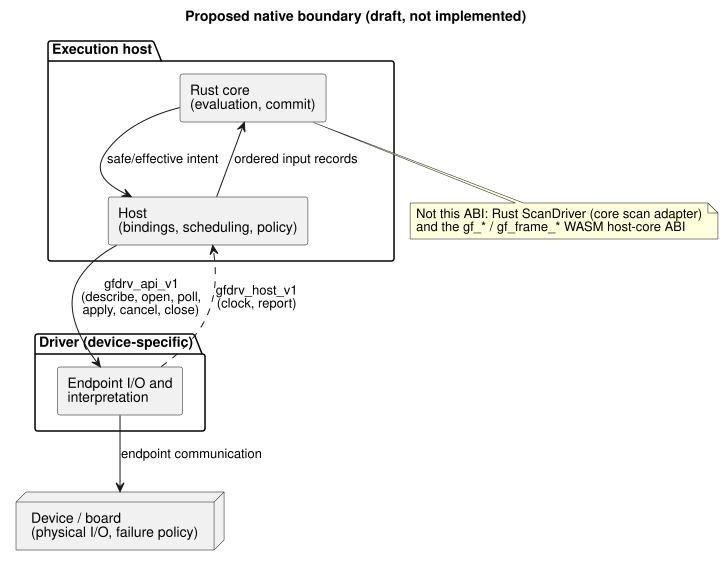
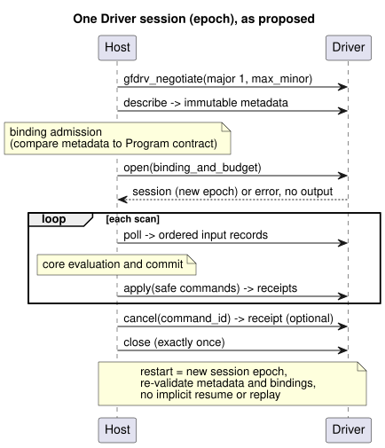

# Host–Driver C ABI v1 draft

[Korean translation](DRIVER-ABI-V1-DRAFT.ko.md)

This draft proposes a C-level boundary between an execution host and a
device-specific Driver. It is a proposal for review, not an implementation.

**In this document**

- [Status and authority](#status-and-authority): what this draft is, and what it is not.
- [Negotiation and function boundary](#negotiation-and-function-boundary): the illustrative C shape and memory rules.
- [Metadata and binding admission](#metadata-and-binding-admission): how a Driver describes itself and how inputs carry quality.
- [Lifecycle, ordering and failure](#lifecycle-ordering-and-failure): sessions, receipts, cancellation, errors and budgets.
- [Representative virtual conformance plan](#representative-virtual-conformance-plan): how a future harness would test it.

**A note on names.** The title says "Host–Driver" and the functions use the
`gfdrv_*` prefix for historical reasons. In current terms, the draft describes a
common native *adapter* ABI:

- Input drivers and output renderers share this one host boundary.
- Writing and applying outputs is the **renderer** role.
- Driver source belongs to `farm-device-drivers`.
- Device integrates the adapter with its host and board.

This terminology note does not adopt the draft ABI and does not rename it.

## Status and authority

Issue #117: this is a documentation-only proposal for review. Actual consumer
adoption is still pending.

This document does **not** implement any of the following:

- a C ABI;
- a native Driver loader;
- hardware integration;
- a conformance suite.

It is not a prerequisite for first-board bring-up. It does not mandate a Device
product contract.

The normative language remains in the Language Reference:
[Reference §6.3](reference/06-composition-and-replay.en.md#63-parameters-settings-dependencies-and-bindings)
and [§4.7](reference/04-sensors-constraints-control.en.md#47-requested-safe-applied-confirmed).
The [physical boundary](LLM-TOOLCHAIN-ARCHITECTURE.md#physical-driver-and-device-boundary)
assigns physical I/O and failure policy to Device.

In this document, “must” means a *proposed acceptance condition* for a consumer
that chooses to adopt this draft. It is not a requirement on current code.

**Who owns what.** The native boundary joins an execution host to a
device-specific Driver:

- The **host** owns core evaluation, installation bindings, scheduling and policy.
- The **Driver** owns endpoint communication and interpretation.

The diagram below shows this split. The host talks to the Driver through the
proposed `gfdrv_api_v1` table; the Driver calls back through `gfdrv_host_v1`.



**What this ABI is not.** Several existing interfaces look similar but are separate:

- The existing Rust `ScanDriver` is a core scan adapter, not this physical ABI.
- The existing `Capability` contains only kind, name and value type.
- Neither of these supplies the complete metadata or physical receipts proposed here.
- The `gf_*`/`gf_frame_*` WASM ABI is a separate host–core interface. Its handles
  and numeric errors are not reused here.

The ABI version is its own version. It is distinct from the source
revision/profile, the GFB format, and the package, binding and firmware versions.

## Negotiation and function boundary

The C shape below is illustrative. It defines call directions and ownership. It
is **not** a published header and not an implemented symbol.

Two helper types carry bytes:

- `gfdrv_bytes` is a caller-owned, bounded, read-only byte view.
- `gfdrv_buffer` is caller-owned writable storage with a capacity and a returned length.

The named record types (metadata, input records, commands, receipts) need a
reviewed schema before a header can be frozen.

```c
#include <stdint.h>
typedef int32_t gfdrv_status; /* 0 success; stable positive errors below */
typedef struct { const uint8_t *data; uint32_t len; } gfdrv_bytes;
typedef struct { uint8_t *data; uint32_t capacity, len; } gfdrv_buffer;
typedef struct gfdrv_session gfdrv_session; /* opaque Driver-owned instance */
typedef struct gfdrv_host_v1 {
  uint32_t size, major, minor;
  void *context; /* opaque host token; Driver must not dereference it */
  gfdrv_status (*clock)(void *, uint64_t *epoch, uint64_t *monotonic_ms);
  gfdrv_status (*report)(void *, gfdrv_bytes record);
} gfdrv_host_v1;
typedef struct gfdrv_api_v1 {
  uint32_t size, major, minor;
  gfdrv_status (*describe)(gfdrv_buffer *metadata);
  gfdrv_status (*open)(const gfdrv_host_v1 *, gfdrv_bytes binding_and_budget,
                      gfdrv_session **out);
  gfdrv_status (*poll)(gfdrv_session *, gfdrv_buffer *input_records);
  gfdrv_status (*apply)(gfdrv_session *, gfdrv_bytes safe_commands,
                       gfdrv_buffer *receipts);
  gfdrv_status (*cancel)(gfdrv_session *, uint64_t command_id,
                        gfdrv_buffer *receipt);
  gfdrv_status (*close)(gfdrv_session *);
} gfdrv_api_v1;
gfdrv_status gfdrv_negotiate(uint32_t major, uint32_t max_minor,
                            uint32_t out_capacity, gfdrv_api_v1 *out);
```

**Version negotiation.** The proposed initial version is major 1, minor 0.
Negotiation works as follows:

1. Select the highest minor version that both sides support within major 1.
2. Check both table sizes and every required function pointer.
3. Reject an unsupported major version.

Further versioning rules:

- Minor extensions only append optional fields. An omitted field is absent;
  nobody reads beyond `size`.
- A breaking change to layout or meaning requires a new major version.
- Unknown required features are rejected before `open` and before any I/O.
- The consumer pins the Driver artifact digest, the ABI/schema versions and the
  platform calling convention.
- Static linking or an explicit registration path is enough. Dynamic loading is
  outside this proposal.

**Calls and memory.**

- Calls are serialized per session.
- Callbacks are synchronous and bounded, and they cannot reenter Driver operations.
- Views are borrowed only for the duration of the call; neither side retains pointers.
- The tables and `context` remain valid until `close`.
- No allocation ownership crosses the boundary.
- Checks for null pointers with nonzero length, overflow, alignment and capacity
  happen before any access. Callers must still supply valid, accessible memory.
- If a buffer is too small, the call returns the required length and performs no I/O.
- `apply` and `cancel` check receipt capacity *before* any physical effect.
  `apply` reserves room for the worst-case receipts of every endpoint, so a
  failure after a write still preserves all outcomes.
- No Rust struct layout, enum layout, trait object, panic or exception crosses
  the C boundary.
- GhostFlow source contains only logical ports and rules. It never contains
  Driver handles, bus addresses or Rust internals.

## Metadata and binding admission

`describe` publishes immutable facts about the Driver: its revision and digest,
the supported schemas and features, endpoint IDs and limits.

For each endpoint it declares:

- direction and payload type;
- semantic meaning, unit and range;
- the sample/timing contract;
- quality and error behavior;
- output/readback scope;
- supported operations.

Unknown facts remain unknown; they are never filled in with guesses.

**Binding admission** compares these facts against the Program's required
logical contract and the installation revision. The comparison includes
polarity, fail-safe assumptions and the authorized evidence source. Matching
names or primitive types alone is not enough.

- Changed metadata invalidates any earlier admission.
- Silent rebinding of an active session is not allowed.
- A compatible replacement keeps the source and artifact and changes only the
  Driver/binding revisions, as Reference §6.3 permits. It does not promise
  uninterrupted runs, sensor continuity or automatic restart.

**Input records** retain:

- endpoint/source identity and source epoch;
- sample ID, clock epoch and acquisition timestamp;
- payload, explicit presence, and quality/reason.

ABI quality codes require an explicit mapping to the core signal qualities:

| Core quality | Code |
| --- | --- |
| `NotReady` | 0 |
| `Good` | 1 |
| `Disconnected` | 2 |
| `Stale` | 3 |
| `Invalid` | 4 |

That is, `NotReady=0`, `Good=1`, `Disconnected=2`, `Stale=3`, `Invalid=4`.
Unknown codes are rejected.

Provenance (measured, estimated or held) and certified interval evidence are
separate fields and contracts. They are not aliases for these quality codes.
A missing sample can never become a fabricated good value or a continuity
certificate. Source `sample`, `valid`, filters, `stale_after` and
`recover_after` keep their Reference semantics.

## Lifecycle, ordering and failure

The sequence below shows one session as proposed: negotiate, describe, admit the
binding, open, then poll and apply on each scan, and finally close.



**Opening a session.** A successful `open` creates one bound session with its
own epoch. A failed `open` returns no session and applies no output.

**Inputs and ordering.**

- The host admits ordered input records before core evaluation.
- Records carry monotonically ordered sequence IDs within an epoch.
- An identical duplicate is idempotent. A changed duplicate or an old ID is
  rejected. Gaps are reported.
- The host records an explicit total order for same-time inputs, commands and
  receipts. Timestamps alone do not order them.
- `poll` never evaluates source.

**Outputs.** `apply` receives only the safe/effective intent produced *after*
the core decision. Each command carries a command ID, run/scan ID, binding
revision and deadline. A batch of intents does not promise simultaneous
physical switching.

Receipts distinguish four outcomes per endpoint: **accepted**, **applied**,
**failed** and **unknown**. They preserve partial outcomes. Three kinds of
evidence stay separate, and none substitutes for another:

- An *applied* acknowledgement identifies the scope of the operation.
- *Readback* identifies the register/latch scope.
- A *confirmed* physical effect requires independent feedback with provenance and quality.

Core commit remains separate from I/O. This ABI introduces no rollback after an
output failure.

**Cancel, close and restart.**

- `cancel` identifies a command and reports the cancellation outcome. A
  cancellation receipt does not prove physical OFF, does not undo an applied
  action and does not clear committed state.
- Late receipts keep their original IDs and cannot affect a new epoch.
- `close` ends access exactly once, bounded by the agreed deadline. Teardown does
  not certify that physical outputs are safe.
- Once `close` is invoked, the host must not reuse or close the pointer again,
  even on error. The Driver owns eventual teardown.
- No callback is permitted after `close` returns. Eventual teardown retains no
  borrowed host pointers.
- A restart creates a new session epoch, revalidates metadata and bindings, and
  uses an explicit consumer checkpoint/recovery policy. Implicit resume, reuse of
  stale receipts and automatic replay of earlier output commands are not permitted.

The adopting consumer specifies watchdog, halt, retry, OFF-request and
redeployment policy. This draft does not replace or certify the Device policy
documented at its separately pinned revision in the physical-boundary guide.

**Errors.** Native errors use stable numeric categories (0 means success):
`1 ABI_MISMATCH`, `2 INVALID_ARGUMENT`, `3 UNSUPPORTED`,
`4 BINDING_MISMATCH`, `5 BUFFER_TOO_SMALL`, `6 BUDGET_EXCEEDED`, `7 DEADLINE_EXCEEDED`,
`8 UNAVAILABLE`, `9 IO_FAILURE`, `10 CANCELLED`, `11 INVALID_STATE`, `12 INTERNAL`.

Bounded diagnostic records add operation/endpoint/command IDs, the native cause,
retryability and the observed outcome. Message text is not an error identity.
An operation error never erases earlier applied/unknown evidence.

**Budgets.** `open` negotiates explicit maxima for:

- endpoints;
- record bytes and record counts;
- outstanding commands;
- retained diagnostics;
- memory;
- per-call work;
- completion deadlines.

The Driver rejects an unsatisfiable budget before activation. Length and count
limits are checked before allocation or I/O. Exhaustion yields a deterministic
error and a bounded trace. This draft invents no universal board limits.

A synchronous deadline bounds only cooperative work. Stopping a stuck native
call requires consumer-owned isolation/watchdog policy and evidence. Errors
never imply physical safety.

## Representative virtual conformance plan

A future harness will pin the host, Driver and schema revisions, and replay a
virtual DI (digital input) and a relay output:

| Case | Acceptance evidence |
| --- | --- |
| Negotiation and tables | Major mismatch, short tables, absent required callback/features reject without I/O; optional minor extension is safe. |
| Binding and quality | Compatible replacement preserves Program artifact; wrong units/timing/quality reject; absence, faults, duplicates and epoch changes remain observable. |
| Ordered scans | Same-time events have stable order; old/changed duplicate IDs reject; core decision and physical receipts stay separate. |
| Outputs and cancel | Delayed/partial failures, latch mismatch, late receipts and cancel-after-apply preserve requested/safe/applied/confirmed distinctions. |
| Budgets and restart | Boundary/overflow tests, full buffers, exhausted work/deadlines and close/reopen produce bounded errors without stale commands or hidden resume. |

Virtual success establishes interface behavior only. It is not physical proof,
deadline certification, firmware adoption or support for a dynamic loader. This
document claims no test results.

Existing tests serve as host/core regression baselines, not as C ABI proof:

- [scan-frame tests](../tests/scan-frame-wasm.test.mjs);
- [scan-tape parity](../tests/scan-tape-parity.test.mjs);
- [core signal contracts](../crates/ghostflow-core/src/signals.rs).

[Driver interval tests](../tests/true-for-driver-contract.test.mjs) also remain
distinct from a future C adapter's transport and from authorized
continuous-observation evidence. Point DI samples do not certify an interval.

Before adoption, host and Driver owners must agree on:

- concrete record encoding and type/unit registries;
- the platform ABI;
- trust binding;
- enforced budgets and deadlines;
- failure, restart and checkpoint policy;
- target evidence.

These are unresolved adoption decisions. This draft intentionally does not
choose a product's policy for it.
