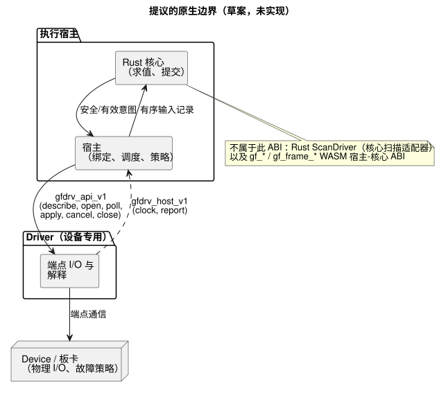
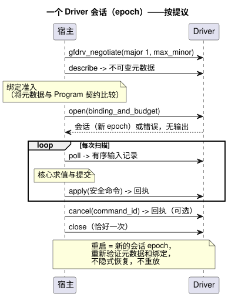

<!-- translation-source: docs/DRIVER-ABI-V1-DRAFT.md -->
[英文原文](DRIVER-ABI-V1-DRAFT.md)

# 宿主–Driver C ABI v1 草案

本草案提议在执行宿主与设备专用的 Driver 之间建立一个 C 级边界。它是一份供评审的提案，而不是实现。

**本文内容**

- [状态与权威性](#状态与权威性)：本草案是什么，以及不是什么。
- [协商与函数边界](#协商与函数边界)：示意性的 C 形态和内存规则。
- [元数据与绑定准入](#元数据与绑定准入)：Driver 如何描述自身，以及输入如何携带质量信息。
- [生命周期、顺序与故障](#生命周期顺序与故障)：会话、回执、取消、错误和预算。
- [代表性的虚拟一致性计划](#代表性的虚拟一致性计划)：未来的测试框架将如何测试它。

**关于名称的说明。** 由于历史原因，标题使用“Host–Driver”，函数使用 `gfdrv_*` 前缀。用当前的术语来说，本草案描述的是一个通用的原生 *适配器*（adapter）ABI：

- 输入驱动程序（driver）和输出渲染器（renderer）共享这一个宿主边界。
- 写入和应用输出属于 **渲染器（renderer）** 角色。
- Driver 源代码属于 `farm-device-drivers`。
- Device 负责把适配器与其宿主和板卡集成。

这条术语说明既不采纳本草案 ABI，也不对其重命名。

## 状态与权威性

Issue #117：这是一份仅限文档、供评审的提案。实际使用方的采纳仍待定。

本文档 **不** 实现以下任何内容：

- C ABI；
- 原生 Driver 加载器；
- 硬件集成；
- 一致性测试套件。

它不是首块板卡启动（bring-up）的前提条件，也不强制规定 Device 产品契约。

规范性语言仍以语言参考为准：
[Reference §6.3](reference/06-composition-and-replay.en.md#63-parameters-settings-dependencies-and-bindings)
和 [§4.7](reference/04-sensors-constraints-control.en.md#47-requested-safe-applied-confirmed)。
[物理边界](LLM-TOOLCHAIN-ARCHITECTURE.md#physical-driver-and-device-boundary)
将物理 I/O 和故障策略分配给 Device。

在本文档中，“必须”表示针对选择采纳本草案的使用方的 *提议验收条件*。它不是对当前代码的要求。

**职责归属。** 原生边界将执行宿主与设备专用的 Driver 连接起来：

- **宿主** 负责核心求值、安装绑定、调度和策略。
- **Driver** 负责端点通信和解释。

下图展示了这一划分。宿主通过提议的 `gfdrv_api_v1` 表与 Driver 通信；Driver 通过 `gfdrv_host_v1` 回调宿主。



**此 ABI 不是什么。** 若干现有接口看起来相似，但它们是独立的：

- 现有的 Rust `ScanDriver` 是核心扫描适配器，而不是这个物理 ABI。
- 现有的 `Capability` 只包含 kind、name 和值类型。
- 两者都不提供此处提议的完整元数据或物理回执。
- `gf_*`/`gf_frame_*` WASM ABI 是一个独立的宿主–核心接口。这里不复用它的句柄和数值错误。

ABI 版本是其自身的版本。它不同于源修订版/profile、GFB 格式，以及包、绑定和固件的版本。

## 协商与函数边界

下面的 C 形态仅为示意。它定义调用方向和所有权。它 **不是** 已发布的头文件，也不是已实现的符号。

两个辅助类型承载字节：

- `gfdrv_bytes` 是调用方拥有的、有界的只读字节视图。
- `gfdrv_buffer` 是调用方拥有的可写存储，带有容量和返回的长度。

这些具名记录类型（元数据、输入记录、命令、回执）需要先有经过评审的模式（schema），才能冻结头文件。

```c
#include <stdint.h>
typedef int32_t gfdrv_status; /* 0 success; stable positive errors below */
typedef struct { const uint8_t *data; uint32_t len; } gfdrv_bytes;
typedef struct { uint8_t *data; uint32_t capacity, len; } gfdrv_buffer;
typedef struct gfdrv_session gfdrv_session; /* opaque Driver-owned instance */
typedef struct gfdrv_host_v1 {
  uint32_t size, major, minor;
  void *context; /* opaque host token; Driver must not dereference it */
  gfdrv_status (*clock)(void *, uint64_t *epoch, uint64_t *monotonic_ms);
  gfdrv_status (*report)(void *, gfdrv_bytes record);
} gfdrv_host_v1;
typedef struct gfdrv_api_v1 {
  uint32_t size, major, minor;
  gfdrv_status (*describe)(gfdrv_buffer *metadata);
  gfdrv_status (*open)(const gfdrv_host_v1 *, gfdrv_bytes binding_and_budget,
                      gfdrv_session **out);
  gfdrv_status (*poll)(gfdrv_session *, gfdrv_buffer *input_records);
  gfdrv_status (*apply)(gfdrv_session *, gfdrv_bytes safe_commands,
                       gfdrv_buffer *receipts);
  gfdrv_status (*cancel)(gfdrv_session *, uint64_t command_id,
                        gfdrv_buffer *receipt);
  gfdrv_status (*close)(gfdrv_session *);
} gfdrv_api_v1;
gfdrv_status gfdrv_negotiate(uint32_t major, uint32_t max_minor,
                            uint32_t out_capacity, gfdrv_api_v1 *out);
```

**版本协商。** 提议的初始版本为 major 1、minor 0。协商过程如下：

1. 在 major 1 内选择双方都支持的最高 minor 版本。
2. 检查两张表的大小以及每个必需的函数指针。
3. 拒绝不支持的 major 版本。

其他版本规则：

- minor 扩展只追加可选字段。省略的字段视为缺失；任何一方都不读取超出 `size` 的部分。
- 对布局或含义的破坏性更改需要新的 major 版本。
- 未知的必需特性在 `open` 之前、在任何 I/O 之前即被拒绝。
- 使用方固定（pin）Driver 制品摘要、ABI/模式版本以及平台调用约定。
- 静态链接或显式注册路径就足够了。动态加载不在本提案范围内。

**调用与内存。**

- 每个会话内的调用是串行化的。
- 回调是同步且有界的，并且不能重入 Driver 操作。
- 视图只在调用期间被借用；任何一方都不保留指针。
- 表和 `context` 在 `close` 之前一直有效。
- 分配的所有权不跨越边界。
- 对“长度非零的空指针”、溢出、对齐和容量的检查都在任何访问之前进行。调用方仍必须提供有效且可访问的内存。
- 如果缓冲区太小，调用返回所需长度，并且不执行任何 I/O。
- `apply` 和 `cancel` 在产生任何物理效果 *之前* 检查回执容量。`apply` 为每个端点的最坏情况回执预留空间，因此即使在写入之后失败，也能保留所有结果。
- 任何 Rust 结构体布局、枚举布局、trait 对象、panic 或异常都不跨越 C 边界。
- GhostFlow 源代码只包含逻辑端口和规则。它绝不包含 Driver 句柄、总线地址或 Rust 内部细节。

## 元数据与绑定准入

`describe` 发布关于 Driver 的不可变事实：它的修订版和摘要、支持的模式和特性、端点 ID 和限制。

对于每个端点，它声明：

- 方向和负载类型；
- 语义含义、单位和范围；
- 样本/时序契约；
- 质量和错误行为；
- 输出/回读范围；
- 支持的操作。

未知的事实保持未知；绝不会用猜测来填补。

**绑定准入** 将这些事实与 Program 所需的逻辑契约以及安装修订版进行比较。比较内容包括极性、故障安全假设和获得授权的证据来源。仅名称或基本类型相同是不够的。

- 元数据发生变化会使先前的任何准入失效。
- 不允许对活动会话进行静默重新绑定。
- 兼容替换保持源代码和制品不变，只更改 Driver/绑定修订版，这正是 Reference §6.3 所允许的。它不承诺运行不中断、传感器连续性或自动重启。

**输入记录** 保留：

- 端点/来源身份标识和来源 epoch；
- 样本 ID、时钟 epoch 和采集时间戳；
- 负载、显式的存在性，以及质量/原因。

ABI 质量代码需要显式映射到核心信号质量：

| 核心质量 | 代码 |
| --- | --- |
| `NotReady` | 0 |
| `Good` | 1 |
| `Disconnected` | 2 |
| `Stale` | 3 |
| `Invalid` | 4 |

也就是 `NotReady=0`、`Good=1`、`Disconnected=2`、`Stale=3`、`Invalid=4`。未知代码会被拒绝。

来源（测量、估计或保持）和经认证的区间证据是单独的字段和契约。它们不是这些质量代码的别名。缺失的样本绝不能变成捏造的良好值或连续性证明。源代码中的 `sample`、`valid`、滤波器、`stale_after` 和 `recover_after` 保持其 Reference 语义。

## 生命周期、顺序与故障

下面的序列图展示了按提议进行的一个会话：协商、描述、准入绑定、打开，然后在每次扫描中轮询和应用，最后关闭。



**打开会话。** 成功的 `open` 创建一个已绑定的会话，它拥有自己的 epoch。失败的 `open` 不返回会话，也不应用任何输出。

**输入与顺序。**

- 宿主在核心求值之前准入有序的输入记录。
- 记录在一个 epoch 内携带单调有序的序列 ID。
- 完全相同的重复记录是幂等的。内容已变的重复记录或旧 ID 会被拒绝。间隙会被报告。
- 对于同一时刻的输入、命令和回执，宿主会记录一个显式的全序。仅凭时间戳不能为它们排序。
- `poll` 绝不对源代码求值。

**输出。** `apply` 只接收核心判定 *之后* 产生的安全/有效意图。每条命令携带命令 ID、运行/扫描 ID、绑定修订版和截止时间。一批意图并不承诺同时进行物理切换。

回执针对每个端点区分四种结果：**accepted**（已接受）、**applied**（已应用）、**failed**（失败）和 **unknown**（未知）。它们保留部分结果。三类证据彼此独立，任何一类都不能替代另一类：

- *已应用*（applied）确认标识操作的范围。
- *回读* 标识寄存器/锁存的范围。
- *已确认*（confirmed）的物理效果需要带有来源和质量的独立反馈。

核心提交始终与 I/O 分离。此 ABI 不会在输出失败后引入回滚。

**取消、关闭与重启。**

- `cancel` 标识一条命令并报告取消结果。取消回执不证明物理上已关闭（OFF），不撤销已应用的动作，也不清除已提交的状态。
- 迟到的回执保留其原始 ID，不能影响新的 epoch。
- `close` 恰好结束访问一次，并受约定截止时间的限制。拆除过程不证明物理输出是安全的。
- 一旦调用了 `close`，即使出错，宿主也不得再次复用或关闭该指针。最终的拆除由 Driver 负责。
- `close` 返回之后不允许任何回调。最终的拆除不保留任何借用的宿主指针。
- 重启会创建新的会话 epoch，重新验证元数据和绑定，并使用显式的使用方检查点/恢复策略。不允许隐式恢复、复用陈旧回执，也不允许自动重放先前的输出命令。

采纳方使用方负责规定看门狗、停机、重试、OFF 请求和重新部署策略。本草案不替代也不认证 Device 策略；该策略在物理边界指南中以单独固定的修订版记载。

**错误。** 原生错误使用稳定的数值类别（0 表示成功）：
`1 ABI_MISMATCH`、`2 INVALID_ARGUMENT`、`3 UNSUPPORTED`、
`4 BINDING_MISMATCH`、`5 BUFFER_TOO_SMALL`、`6 BUDGET_EXCEEDED`、`7 DEADLINE_EXCEEDED`、
`8 UNAVAILABLE`、`9 IO_FAILURE`、`10 CANCELLED`、`11 INVALID_STATE`、`12 INTERNAL`。

有界的诊断记录会补充操作/端点/命令 ID、原生原因、是否可重试以及观测到的结果。消息文本不是错误的身份标识。操作错误绝不会抹去先前的 applied/unknown 证据。

**预算。** `open` 为以下各项协商显式的上限：

- 端点；
- 记录字节数和记录数；
- 未完成的命令；
- 保留的诊断信息；
- 内存；
- 每次调用的工作量；
- 完成截止时间。

Driver 在激活之前拒绝无法满足的预算。长度和数量限制在分配或 I/O 之前检查。耗尽时产生确定性的错误和有界的追踪。本草案不编造通用的板卡限制。

同步截止时间只约束协作式的工作。要停止卡住的原生调用，需要由使用方负责的隔离/看门狗策略及其证据。错误绝不意味着物理上安全。

## 代表性的虚拟一致性计划

未来的测试框架将固定宿主、Driver 和模式的修订版，并重放一个虚拟 DI（数字输入）和一个继电器输出：

| 用例 | 验收证据 |
| --- | --- |
| 协商与表 | major 不匹配、表过短、缺少必需的回调/特性时，在不进行 I/O 的情况下拒绝；可选的 minor 扩展是安全的。 |
| 绑定与质量 | 兼容替换保留 Program 制品；错误的单位/时序/质量被拒绝；缺失、故障、重复和 epoch 变化保持可观测。 |
| 有序扫描 | 同一时刻的事件具有稳定的顺序；旧的/内容已变的重复 ID 被拒绝；核心判定与物理回执保持分离。 |
| 输出与取消 | 延迟/部分失败、锁存不匹配、迟到回执以及应用后的取消，都保留 requested/safe/applied/confirmed 的区分。 |
| 预算与重启 | 边界/溢出测试、缓冲区已满、工作量/截止时间耗尽以及关闭/重新打开，都产生有界的错误，且没有陈旧命令或隐藏的恢复。 |

虚拟测试的成功只确立接口行为。它不是物理证明、截止时间认证、固件采纳，也不表示支持动态加载器。本文档不声称任何测试结果。

现有测试作为宿主/核心的回归基线，而不是 C ABI 的证明：

- [扫描帧测试](../tests/scan-frame-wasm.test.mjs)；
- [扫描带一致性](../tests/scan-tape-parity.test.mjs)；
- [核心信号契约](../crates/ghostflow-core/src/signals.rs)。

[Driver 区间测试](../tests/true-for-driver-contract.test.mjs) 同样有别于未来 C 适配器的传输，也有别于经授权的连续观测证据。点状的 DI 样本不能证明一个区间。

在采纳之前，宿主和 Driver 的负责人必须就以下事项达成一致：

- 具体的记录编码以及类型/单位注册表；
- 平台 ABI；
- 信任绑定；
- 强制执行的预算和截止时间；
- 故障、重启和检查点策略；
- 目标证据。

这些是尚未解决的采纳决策。本草案有意不替任何产品选择其策略。
