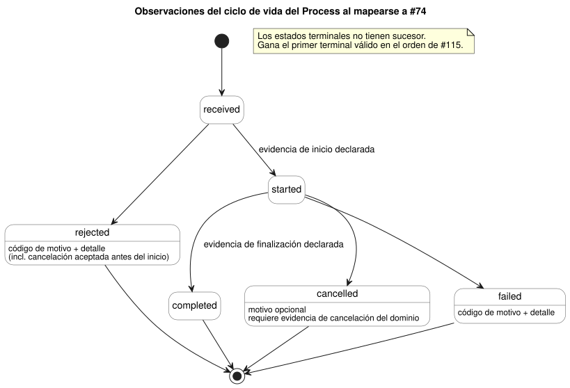

<!-- translation-source: docs/EFFECT-PROCESS-CONTRACT.md -->
[Original en inglés](EFFECT-PROCESS-CONTRACT.md)

# Contrato de Effect y Process

[한국어](EFFECT-PROCESS-CONTRACT.ko.md)

Este contrato explica cómo debería tratar GhostFlow las acciones que salen del
núcleo lógico: estados de salida deseados, comandos, procesos de larga duración,
mensajes y vistas renderizadas. Define identidades, el manejo de duplicados, el
ciclo de vida de una solicitud y lo que cada tipo de resultado puede y no puede
probar.

**Estado.** Este es un contrato conceptual más un modelo ejecutable local de las
pruebas para [#116](https://github.com/callin2/ghostflow-language/issues/116), que
se conserva para una adopción futura.

- **No** existe una unión aceptada de cinco tipos en la fuente GhostFlow.
- Este documento no implementa ningún compilador, motor de efectos del host,
  planificador de flujos de trabajo, esquema de transporte ni ABI.
- Cualquier sintaxis necesaria requiere una propuesta aparte.
- Emitir la clasificación y vincular solicitudes y resultados tipados requieren,
  cada uno, una adopción por parte del consumidor versionada por separado.

## Autoridad y propiedad

Este contrato se basa en las siguientes fuentes y nunca las anula:

| Fuente | De qué es dueña |
| --- | --- |
| [Referencia 2.8](reference/02-types-expressions-state.es.md#28-tick-e-instantánea-de-estado) | Decisiones lógicas atómicas. |
| [Referencia 4.7](reference/04-sensors-constraints-control.es.md#47-requested-safe-applied-confirmed) | Separación entre la evidencia de salida requested, safe, applied y confirmed. |
| [Referencia 5.3](reference/05-settings-and-observation.es.md) | Separación entre descriptores, instantáneas, eventos y resultados de ejecución. |
| [Contrato del flujo de interacción](INTERACTION-STREAM-CONTRACT.es.md) (#74) | El ciclo de vida propuesto para la observación de comandos. |
| [Contrato de orden del host](HOST-EVENT-ORDERING-CONTRACT.es.md) (#115) | El orden de los lotes de ingreso cerrados, la consolidación y los resultados de efectos posteriores. |
| [Borrador de la ABI de Driver](DRIVER-ABI-V1-DRAFT.es.md) (#117) | Una posible frontera física. Sigue siendo un borrador, no una implementación ni un requisito previo aquí. |

**El programa permanece en GhostFlow.** Las etapas de dominio de un Process, el
estado, los temporizadores, los predicados de cancelación y las restricciones
siguen siendo *reglas GhostFlow escritas por el autor*. El mismo núcleo Rust las
evalúa a lo largo de los ticks.

El host es dueño del ingreso, las vinculaciones (bindings), el despacho externo y
la exportación de evidencia. **No** ejecuta un segundo programa JSON que ejecute
esas etapas. Una observación del ciclo de vida informa de la evidencia de dominio
declarada. No puede dirigir una máquina de estados separada del host que
reemplace al programa escrito por el autor.

Enunciar este contrato no exige ninguna implementación de descriptores de
comando/alarma ni ninguna funcionalidad de frontend.

## Clasificación e identidad

Los cinco nombres siguientes son *categorías conceptuales*. No son palabras clave
de la fuente ni enums de registros.

Toda identidad incluye:

- las revisiones exactas de la fuente, del módulo y del artefacto, y la revisión de la vinculación;
- la ejecución (run);
- su propia posición de ocurrencia o de intento.

Los registros de resultado conservan la identidad original. Los nombres de
visualización y los valores primitivos no pueden establecer una correspondencia
entre una solicitud y su resultado.

| Tipo | Significado e identidad de la solicitud | Resultado y frontera de la observación |
| --- | --- | --- |
| DesiredState | Objetivo solicitado para un endpoint lógico declarado en un escaneo/revisión consolidado; los objetivos iguales repetidos son intención continua | Instantáneas requested/safe, resultados por intento de escritura y retroalimentación separada; cada escaneo no es un nuevo comando de una sola vez |
| Command | Una acción de dominio con un ID de solicitud explícito y un digest canónico de la solicitud tipada | Evidencia ordenada de recepción/inicio/terminal cuando se vincula a #74; el ACK del renderizador por sí solo no es la finalización del dominio ni una confirmación física |
| Process | Una solicitud identificada que abarca decisiones de estado/temporizador escritas por el autor a lo largo de varios ticks; la misma solicitud sigue siendo la raíz de correlación | Observaciones de inicio/progreso/estado actual y evidencia terminal del dominio; el progreso no es una nueva solicitud ni un nuevo estado del ciclo de vida |
| Message | Solicitud de envío explícita y su digest, identidad del canal/vinculación e identidad distinta del intento de envío | La evidencia de aceptación por la cola/servicio, de entrega o de fallo conserva el alcance declarado; la aceptación no prueba la entrega ni la lectura |
| Render | Proyección de solo lectura identificada por la fuente/esquema/ejecución exactos, el escaneo completado o la posición del evento y la revisión de la proyección | Resultado de presentación renderizado/no disponible/obsoleto; no se fabrica autoridad de control, finalización de comandos, retroalimentación ni consolidación |

Una vinculación explícita selecciona la evidencia para cada tipo y cualquier mapeo
al ciclo de vida de #74. Consecuencias importantes:

- No se impone ningún grafo universal de ciclo de vida a las escrituras de DesiredState ni a los resultados de Render.
- La finalización de un Message significa solo el alcance declarado. Un contrato
  de aceptación por la cola no puede presentarse como un contrato de mensaje entregado.
- Los escaneos repetidos con Bool verdadero **no** despachan implícitamente Commands, Processes ni Messages.
- No se infiere ningún detector de flancos, reintento, permiso de dominio ni garantía de entrega por defecto.

## Aceptación de solicitudes, duplicados y límites

Esta sección se aplica a las solicitudes de Command y de Process, y a las
solicitudes de Message identificadas explícitamente.

**Primero, registrar.** Antes de cualquier resultado, conserve el ID de la
solicitud, el digest de la solicitud tipada, la categoría y el contexto exacto.

**Duplicados.**

- El mismo ID, digest y contexto devuelve el estado actual retenido o un resultado
  explícito de duplicado. Nunca vuelve a iniciar ni a enviar.
- Una reconexión dentro de la misma ejecución, o un nuevo flujo de recopilación,
  no borra la deduplicación.

**Conflictos.** Cambiar la carga útil, el tipo o la vinculación bajo una identidad
existente es una *nueva admisión en conflicto*. Se rechaza sin cambiar el ciclo de
vida ni el digest de la solicitud original. Este conflicto no es un evento
`rejected` sucesor para una solicitud original que ya se inició o terminó.

**Límites.** Cada perfil tiene presupuestos finitos para entradas de
deduplicación, procesos activos, solicitudes de cancelación, historial de
resultados, cargas útiles e intentos de efecto.

- Reserve capacidad antes del inicio o del despacho, incluida la evidencia de
  resultado que necesitarán los efectos externos.
- Cuando se agote la capacidad, rechace la nueva admisión con un motivo declarado.
- Nunca desaloje en silencio una identidad de deduplicación activa o terminal; eso
  permitiría que la misma acción se iniciara dos veces.
- Si se pierde evidencia después de la admisión, conserve un hueco o fallo
  explícito y siga la política de cierre seguro (fail-closed) del host. Nunca
  invente una cadena exitosa.

## Ciclo de vida del Process y cancelación

Cuando se mapean a #74, las observaciones del ciclo de vida usan exactamente estos
estados y transiciones:

```text
received -> rejected
received -> started -> completed | cancelled | failed
```

El diagrama de estados siguiente muestra las mismas transiciones con la evidencia
que necesita cada una.



**Reglas para cada transición.**

- `received` va antes de cualquier resultado.
- El inicio y la finalización requieren la evidencia de dominio exacta que declara la vinculación.
- Un fallo antes del inicio es `rejected`. No fabrica un registro `started`.
- `rejected` y `failed` requieren un código de motivo declarado y un detalle no vacío.
- `received`, `started` y `completed` prohíben los motivos.
- `cancelled` puede llevar un motivo declarado.
- Un estado terminal no tiene sucesor.
- El estado actual es una proyección del último registro válido, no otra ocurrencia.

**Cancelación.** Una solicitud de cancelación tiene su propio ID de solicitud,
digest e identidad del objetivo.

- Recibir una cancelación no prueba la cancelación, ni un OFF físico inmediato, ni una reversión.
- Un hecho interno de "cancelación pendiente" puede coexistir con `started`. No
  añade ningún nuevo enum exportado del ciclo de vida.
- **Antes del inicio:** una cancelación aceptada por la política del dominio
  produce `rejected` con su motivo.
- **Después del inicio:** `cancelled` requiere evidencia declarada de cancelación del dominio.
- Una cancelación denegada o ineficaz no borra el progreso ni fabrica un estado terminal.

**Carreras entre resultados terminales.** Los recibos de finalización, cancelación
y fallo entran todos en el punto de serialización de #115.

- Solo puede calificar la evidencia válida para la solicitud y el contexto exactos.
- En un historial completo, *gana la primera transición terminal válida en ese
  orden*. Las afirmaciones terminales posteriores no pueden reescribirla.
- Las reglas de la fuente y del dominio deciden qué evidencia califica y si se
  acepta una cancelación. Esta regla de orden no inventa una prioridad universal de
  la cancelación sobre la finalización o el fallo.
- Las señales de parada/finalización que compiten dentro de una misma instantánea
  de entrada necesitan reglas escritas por el autor o un arbitraje explícito de la
  vinculación. El orden de los recibos no elige su resultado de dominio; solo se
  aplica después de que la evidencia califica.
- Una vinculación ausente rechaza la admisión en lugar de adivinar un resultado.
- Ante un hueco en el historial, conserve el estado observado como incompleto.
  Nunca fabrique eventos de inicio/terminales faltantes y nunca rechace una cadena
  basándose en una completitud supuesta.

## Fallo de efectos y reinicio

**Fallo de efectos.** El despacho ocurre solo después de una consolidación lógica exitosa.

- Un fallo externo conserva esa consolidación y su intención requested/safe, además
  de cada resultado de efecto parcial o incierto.
- El resultado correlacionado solo puede afectar a una decisión permitida
  *futura*, y solo a través de una vinculación tipada explícita.
- La política de detención del host/Device sigue teniendo autoridad. No hay
  continuación, reintento ni reinicio automáticos.
- La aceptación del registro/escritura por parte del renderizador y la
  confirmación por un sensor siguen siendo evidencias separadas.
- Completar una cancelación no afirma un apagado físico a menos que la evidencia
  declarada lo establezca realmente.

**Reinicio.** Un reinicio real usa una nueva identidad de ejecución.

- Los registros terminales antiguos siguen siendo historial terminal.
- Un proceso iniciado e interrumpido permanece incompleto/desconocido a menos que
  exista evidencia terminal real. Un reinicio por sí solo no es evidencia de
  `failed` ni de `cancelled`.
- Ningún efecto, envío de Message ni Process resucita automáticamente a partir de un estado actual antiguo.
- Un seguimiento explícito necesita una identidad de solicitud nueva y completa y
  las reglas de admisión de la nueva ejecución.
- La retroalimentación tardía de una ejecución, fuente o vinculación antigua es
  obsoleta para la ejecución actual. Puede conservarse con su identidad original
  como historial. No debe fabricar una consolidación, un progreso ni un resultado
  terminal actuales.

## Evidencia de conformidad y adopción

`tests/effect-process-contract.test.mjs` es un modelo de referencia ficticio y
acotado. No es un productor, ni un planificador, ni un sustituto de la ejecución
de Process en Rust. Sus objetos de identidad, evidencia y cancelación interna son
notación de prueba, no una serialización aprobada. La evidencia explícita de los
fixtures sustituye a los resultados de dominio escritos por el autor.

| Casos | Oráculo requerido |
| --- | --- |
| Fronteras entre tipos | DesiredState repetido sigue siendo intención; Command/Process/Message requieren solicitudes explícitas; la aceptación de un Message y el éxito de un Render no prueban ni la entrega ni una acción física |
| Duplicado/conflicto/límites | Un inicio/envío por identidad exacta; el conflicto conserva el original; la capacidad rechaza la admisión sin desalojar entradas de deduplicación |
| Cancelación antes/después del inicio | El rechazo antes del inicio tiene motivo; la cancelación pendiente después del inicio no se vuelve terminal sin evidencia de dominio |
| Carreras terminales y fallo | Una finalización/cancelación/fallo válido y serializado produce un único terminal inmutable; la evidencia y los motivos no válidos no pueden fabricar transiciones |
| Reinicio y evidencia obsoleta | Ninguna resurrección ni terminal inventado; se requiere una nueva identidad explícita; el contexto antiguo no puede modificar la nueva ejecución |

Para adoptar este contrato, un consumidor debe especificar las vinculaciones
tipadas, el alcance de la evidencia, el orden serializado de los recibos, la
retención acotada y la política de fallo/reinicio de cada host. Después, debe
ejercitar estos oráculos mediante productores reales.

Estas pruebas establecen solo el comportamiento del contrato. No establecen la
conformidad de despliegue, de entrega, del Driver ni física.
