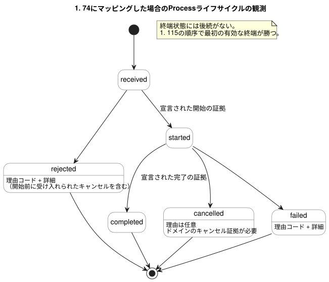

<!-- translation-source: docs/EFFECT-PROCESS-CONTRACT.md -->
[英語の原文](EFFECT-PROCESS-CONTRACT.md)

# EffectとProcessの契約

[한국어](EFFECT-PROCESS-CONTRACT.ko.md)

この契約は、論理コアの外側に及ぶ動作をGhostFlowがどのように扱うべきかを説明します。対象となるのは、望ましい出力状態、コマンド、長時間実行されるプロセス、メッセージ、レンダリングされたビューです。同一性、重複の扱い、リクエストのライフサイクル、そして各種の結果が何を証明でき、何を証明できないかを定義します。

**位置付け。** これは概念的な契約であり、[#116](https://github.com/callin2/ghostflow-language/issues/116)のためのテストローカルな実行可能モデルを伴います。将来の採用に備えて保持されています。

- 受け入れ済みの、5種類からなるGhostFlowソースのユニオンは**存在しません**。
- この文書は、コンパイラ、ホストのエフェクトエンジン、ワークフロースケジューラ、トランスポートスキーマ、ABIのいずれも実装しません。
- 必要な構文には、別途の提案が必要です。
- 分類を出力すること、および型付きのリクエストと結果をバインドすることには、それぞれ個別にバージョン管理されたコンシューマ（利用側）の採用が必要です。

## 規範の所在と所有権

この契約は、以下のソースの上に構築されるものであり、それらを上書きすることは決してありません。

| ソース | 所有する内容 |
| --- | --- |
| [リファレンス 2.8](reference/02-types-expressions-state.ja.md) | アトミックな論理判断。 |
| [リファレンス 4.7](reference/04-sensors-constraints-control.ja.md) | 要求（requested）、安全（safe）、適用済み（applied）、確認済み（confirmed）の出力の証拠の分離。 |
| [リファレンス 5.3](reference/05-settings-and-observation.ja.md) | ディスクリプタ、スナップショット、イベント、実行結果の分離。 |
| [インタラクションストリーム契約](INTERACTION-STREAM-CONTRACT.ja.md)（#74） | 提案されているコマンド観測のライフサイクル。 |
| [ホストの順序付け契約](HOST-EVENT-ORDERING-CONTRACT.ja.md)（#115） | 閉じた入力バッチ、確定、およびその後のエフェクト結果の順序。 |
| [ドライバABIドラフト](DRIVER-ABI-V1-DRAFT.ja.md)（#117） | 考えられる物理境界の1つ。ドラフトのままであり、実装でもここでの前提条件でもない。 |

**プログラムはGhostFlowの中にとどまります。** Processのドメイン段階、状態、タイマー、キャンセルの述語、制約は、*作成者が記述したGhostFlowのルール*のままです。同じRustコアが、tick（論理判断の単位）をまたいでそれらを評価します。

ホストは、入力の受け付け、バインディング、外部へのディスパッチ、証拠のエクスポートを所有します。それらの段階を実行する2つ目のJSONプログラムをホストが実行することは**ありません**。ライフサイクルの観測は、宣言されたドメインの証拠を報告します。作成者が記述したプログラムを置き換える、別のホスト状態機械を駆動することはできません。

この契約を述べることは、コマンド/アラームのディスクリプタの実装やフロントエンドの機能を要求するものではありません。

## 分類と同一性

以下の5つの名前は*概念上のカテゴリ*です。ソースのキーワードでも、レコードの列挙型でもありません。

すべての同一性には次のものが含まれます。

- ソース、モジュール、成果物の正確なリビジョン、およびバインディングのリビジョン
- 実行（run）
- それ自身の発生または試行の位置

結果レコードは元の同一性を保持します。表示名やプリミティブ値によって、リクエストとその結果を結び付けることはできません。

| 種類 | 意味とリクエストの同一性 | 結果と観測の境界 |
| --- | --- | --- |
| DesiredState | 確定済みのスキャン/リビジョンにおける、宣言された論理エンドポイントへの要求目標。同じ目標の繰り返しは継続する意図である | 要求/安全のスナップショット、書き込みごとの試行結果、別個のフィードバック。各スキャンは新しいワンショットのコマンドではない |
| Command | 明示的なリクエストIDと正準な型付きリクエストのダイジェストを持つ、1つのドメイン動作 | #74にバインドされた場合の、順序付けられた受信/開始/終端の証拠。レンダラーのACKだけでは、ドメインの完了も物理的な確認も意味しない |
| Process | 作成者が記述した状態/タイマーの判断をtickをまたいで行う、識別された1つのリクエスト。同じリクエストが相関の起点であり続ける | 開始/進捗/現在状態の観測と、終端のドメイン証拠。進捗は新しいリクエストでも、新しいライフサイクル状態でもない |
| Message | 明示的な送信リクエストとダイジェスト、チャネル/バインディングの同一性、および区別された送信試行の同一性 | キュー/サービスによる受理、配信、または失敗の証拠は、表明されたスコープを保持する。受理は配信や既読を証明しない |
| Render | 正確なソース/スキーマ/実行/完了済みスキャンまたはイベント位置、および投影リビジョンによって識別される読み取り専用の投影 | レンダリング済み/利用不可/古い（stale）という提示結果。制御権限、コマンドの完了、フィードバック、確定が作り出されることはない |

種類ごとの証拠、および#74ライフサイクルへのマッピングは、明示的なバインディングによって選択されます。重要な帰結は次のとおりです。

- DesiredStateの書き込みやRenderの結果に、普遍的なライフサイクルグラフが課されることはありません。
- Messageの完了は、宣言されたスコープだけを意味します。キュー受理の契約を、メッセージ配信済みの契約として提示することはできません。
- Boolのtrueが繰り返しスキャンされても、Command、Process、Messageが暗黙にディスパッチされることは**ありません**。
- 既定のエッジ検出、リトライ、ドメインの許可、配信保証が推論されることはありません。

## リクエストの受け入れ、重複、上限

この節は、CommandとProcessのリクエスト、および明示的に識別されたMessageのリクエストに適用されます。

**まず記録します。** いかなる結果よりも前に、リクエストID、型付きリクエストのダイジェスト、カテゴリ、正確なコンテキストを保存します。

**重複。**

- 同じID、ダイジェスト、コンテキストの場合は、保持されている現在のステータス、または明示的な重複結果を返します。再び開始したり送信したりすることは決してありません。
- 同じ実行内での再接続や、新しい収集ストリームによって、重複排除がクリアされることはありません。

**衝突。** 既存の同一性のもとでペイロード、種類、バインディングを変更することは、*衝突する新たな受け入れ*です。これは、元のリクエストのライフサイクルやダイジェストを変更せずに拒否されます。この衝突は、すでに開始または終了した元のリクエストに対する後続の`rejected`イベントではありません。

**上限。** 各プロファイルには、重複排除エントリ、アクティブなプロセス、キャンセルリクエスト、結果の履歴、ペイロード、エフェクトの試行について、有限のバジェットがあります。

- 開始またはディスパッチの前に、外部エフェクトが必要とする結果の証拠も含めて、容量を確保します。
- 容量が尽きた場合は、宣言された理由とともに新たな受け入れを拒否します。
- 実行中または終端済みの重複排除の同一性を、暗黙に追い出すことは決してしません。そうすると、同じ動作が2回開始されてしまう可能性があります。
- 受け入れの後に証拠が失われた場合は、明示的な欠落または故障を保存し、ホストのフェイルクローズポリシーに従います。成功の連鎖を捏造することは決してしません。

## プロセスのライフサイクルとキャンセル

#74にマッピングされる場合、ライフサイクルの観測は、正確に次の状態と遷移を使用します。

```text
received -> rejected
received -> started -> completed | cancelled | failed
```

次の状態図は、同じ遷移を、それぞれに必要な証拠とともに示しています。



**各遷移の規則。**

- `received`は、いかなる結果よりも前に来ます。
- 開始と完了には、バインディングが宣言する正確なドメインの証拠が必要です。
- 開始前の失敗は`rejected`です。`started`レコードを捏造することはありません。
- `rejected`と`failed`には、宣言された理由コードと、空でない詳細が必要です。
- `received`、`started`、`completed`は理由を持つことを禁止します。
- `cancelled`は、宣言された理由を持つことができます。
- 終端状態には後続がありません。
- 現在のステータスは最後の有効なレコードの投影であり、別の発生ではありません。

**キャンセル。** キャンセルリクエストは、独自のリクエストID、ダイジェスト、対象の同一性を持ちます。

- キャンセルを受信しても、キャンセル、即時の物理的なOFF、ロールバックが証明されるわけではありません。
- 内部的な「キャンセル保留中」という事実は、`started`と共存できます。これによって、エクスポートされるライフサイクルの列挙値が新たに増えることはありません。
- **開始前：** ドメインポリシーによって受け入れられたキャンセルは、その理由とともに`rejected`を生じます。
- **開始後：** `cancelled`には、宣言されたドメインのキャンセル証拠が必要です。
- 拒否された、または効果のなかったキャンセルは、進捗を消さず、終端状態を作り出しません。

**終端結果どうしの競合。** 完了、キャンセル、失敗のレシートは、すべて#115の直列化ポイントに入ります。

- 対象となり得るのは、正確なリクエストとコンテキストに対する有効な証拠だけです。
- 完全な履歴では、*その順序で最初の有効な終端遷移が勝ちます*。後から来た終端の主張がそれを書き換えることはできません。
- どの証拠が対象となるか、またキャンセルが受け入れられるかどうかは、ソースとドメインのルールが決めます。この順序付けの規則は、キャンセルを完了や失敗より優先するといった普遍的な優先順位を作り出すものではありません。
- 1つの入力スナップショット内で競合する停止/完了の信号には、作成者が記述したルールか、明示的なバインディングによる調停（アービトレーション）が必要です。レシートの順序がそれらのドメイン上の結果を選ぶことはありません。順序が適用されるのは、証拠が対象と認められた後だけです。
- バインディングが欠落している場合は、結果を推測せずに受け入れを拒否します。
- 履歴に欠落がある場合は、観測されたステータスを不完全なものとして保存します。欠けている開始/終端イベントを捏造することは決してなく、完全性を仮定して連鎖を拒否することも決してしません。

## エフェクトの失敗と再起動

**エフェクトの失敗。** ディスパッチは、論理的な確定が成功した後にのみ行われます。

- 外部での失敗が起きても、その確定と要求/安全の意図、および部分的または不確実なすべてのエフェクト結果は保持されます。
- 相関付けられた結果が影響を与えられるのは、*将来の*許可された判断だけであり、それも明示的な型付きバインディングを通じてのみです。
- ホスト/Deviceの停止ポリシーが引き続き優先されます。自動的な継続、リトライ、再起動はありません。
- レンダラーのレジスタ/書き込みの受理と、センサによる確認は、別々の証拠のままです。
- キャンセルが完了しても、宣言された証拠が実際にそれを立証しない限り、物理的な停止を主張するものではありません。

**再起動。** 実際の再起動では、新しい実行の同一性を使用します。

- 古い終端レコードは、終端の履歴のままです。
- 中断された開始済みのプロセスは、実際の終端証拠が存在しない限り、不完全/不明のままです。再起動だけでは、`failed`や`cancelled`の証拠になりません。
- エフェクト、Messageの送信、Processが、古い現在ステータスから自動的に復活することはありません。
- 明示的な後続処理には、新しい完全なリクエストの同一性と、新しい実行の受け入れ規則が必要です。
- 古い実行、ソース、バインディングからの遅れたフィードバックは、現在の実行にとっては古い（stale）ものです。元の同一性とともに履歴として保持することはできます。現在の確定、進捗、終端結果を捏造してはなりません。

## 適合性の証拠と採用

`tests/effect-process-contract.test.mjs`は、架空の、有界な参照モデルです。プロデューサでもスケジューラでもなく、RustによるProcess実行の代替でもありません。その同一性、証拠、内部のキャンセルオブジェクトはテスト用の表記であり、承認されたシリアライズ形式ではありません。明示的なフィクスチャの証拠が、作成者が記述したドメインの結果の代わりを務めます。

| ケース | 必要なオラクル |
| --- | --- |
| 種類の境界 | 繰り返されるDesiredStateは意図のままである。Command/Process/Messageには明示的なリクエストが必要である。Messageの受理とRenderの成功は、配信も物理的な動作も証明しない |
| 重複/衝突/上限 | 正確な同一性ごとに開始/送信は1回。衝突しても元が保持される。容量超過は重複排除エントリを追い出さずに受け入れを拒否する |
| 開始前/開始後のキャンセル | 開始前の拒否は理由を持つ。開始後の保留は、ドメインの証拠なしに終端にはならない |
| 終端の競合と失敗 | 直列化された有効な完了/キャンセル/失敗は、不変の終端を1つだけ生じる。無効な証拠や無効な理由は遷移を作り出せない |
| 再起動と古い証拠 | 復活や捏造された終端はない。明示的な新しい同一性が必要である。古いコンテキストは新しい実行を変更できない |

この契約を採用するには、コンシューマは型付きバインディング、証拠のスコープ、直列化されたレシートの順序、有界な保持、および各ホストの失敗/再起動ポリシーを規定しなければなりません。そのうえで、実際のプロデューサを通じてこれらのオラクルを検証しなければなりません。

これらのテストが立証するのは、契約上の振る舞いだけです。デプロイ、配信、ドライバ、物理的な適合性を立証するものではありません。
