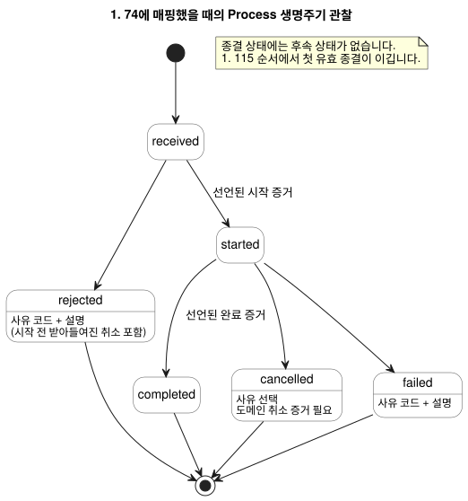

<!-- translation-source: docs/EFFECT-PROCESS-CONTRACT.md -->
[영문 원문](EFFECT-PROCESS-CONTRACT.md)

# Effect와 Process 계약

이 계약은 GhostFlow가 논리 코어 바깥에 닿는 동작을 어떻게 다뤄야 하는지 설명합니다.
여기에는 원하는 출력 상태, 명령, 오래 실행되는 process, 메시지와 렌더링된 뷰가
포함됩니다. 이 문서는 identity, 중복 처리, 요청의 생명주기, 그리고 각 종류의 결과가
증명할 수 있는 것과 없는 것을 정의합니다.

**상태.** 이 문서는 [#116](https://github.com/callin2/ghostflow-language/issues/116)을 위한
개념 계약과 실행 가능한 테스트 내부 모델이며, 향후 도입에 대비해 유지됩니다.

- 승인된 다섯 종류의 GhostFlow 소스 union은 **없습니다**.
- 이 문서는 컴파일러, 호스트 effect 엔진, workflow 스케줄러, 전송 스키마나 ABI를
  구현하지 않습니다.
- 필요한 문법이 있다면 별도의 제안이 필요합니다.
- 분류를 방출하는 일과 타입이 있는 요청·결과를 바인딩하는 일은 각각 별도로 버전이
  관리되는 소비자 도입이 필요합니다.

## 권한과 소유권

이 계약은 다음 출처 위에 세워지며, 결코 이들을 덮어쓰지 않습니다.

| 출처 | 소유하는 것 |
| --- | --- |
| [Reference 2.8](reference/02-types-expressions-state.md) | 원자적인 논리 판단. |
| [Reference 4.7](reference/04-sensors-constraints-control.md#47-requested-safe-applied-confirmed) | requested, safe, applied, confirmed 출력 증거의 구분. |
| [Reference 5.3](reference/05-settings-and-observation.md) | descriptor, snapshot, event와 실행 결과의 구분. |
| [Interaction stream 계약](INTERACTION-STREAM-CONTRACT.ko.md) (#74) | 제안된 명령 관찰 생명주기. |
| [호스트 순서 계약](HOST-EVENT-ORDERING-CONTRACT.ko.md) (#115) | 닫힌 ingress 배치, 확정과 그 뒤 effect 결과의 순서. |
| [Driver ABI 초안](DRIVER-ABI-V1-DRAFT.ko.md) (#117) | 가능한 물리 경계. 여전히 초안이며, 여기서는 구현도 선행 조건도 아닙니다. |

**프로그램은 GhostFlow 안에 남습니다.** Process의 도메인 단계, 상태, 타이머, 취소
조건(predicate)과 제약은 *작성된 GhostFlow 규칙*으로 남습니다. 같은 Rust 코어가 여러
tick에 걸쳐 이를 평가합니다.

호스트는 ingress, 바인딩, 외부 dispatch와 증거 export를 소유합니다. 그 단계들을
실행하는 두 번째 JSON 프로그램을 실행하지 **않습니다**. 생명주기 관찰은 선언된 도메인
증거를 보고할 뿐입니다. 작성된 프로그램을 대체하는 별도의 호스트 상태 기계를 구동할 수
없습니다.

이 계약을 명시한다고 해서 명령/알람 descriptor 구현이나 프런트엔드 기능이 필요해지지는
않습니다.

## 분류와 identity

아래 다섯 이름은 *개념적 분류*입니다. 소스 키워드도 아니고 레코드 enum도 아닙니다.

모든 identity에는 다음이 포함됩니다.

- 정확한 소스, 모듈, 산출물 revision과 바인딩 revision
- run
- 자체 occurrence 또는 attempt 위치

결과 레코드는 원래 identity를 유지합니다. 표시 이름이나 원시 값으로는 요청과 결과를
서로 연결할 수 없습니다.

| 종류 | 의미와 요청 identity | 결과와 관찰 경계 |
| --- | --- | --- |
| DesiredState | 확정된 scan/revision에서 선언된 논리 엔드포인트에 대한 요청 목표. 같은 목표가 반복되면 지속되는 의도입니다 | requested/safe snapshot, write attempt별 결과와 별도의 피드백. scan마다 새 일회성 명령이 되지 않습니다 |
| Command | 명시적 request ID와 정본 typed-request 다이제스트를 가진 하나의 도메인 동작 | #74에 바인딩되었을 때 순서가 있는 received/start/terminal 증거. renderer ACK만으로는 도메인 완료나 물리적 확인이 되지 않습니다 |
| Process | 작성된 상태/타이머 판단으로 여러 tick에 걸치는, 식별된 요청 하나. 같은 요청이 상관관계의 root로 남습니다 | started/progress/current-state 관찰과 terminal 도메인 증거. progress는 새 요청이나 새 생명주기 상태가 아닙니다 |
| Message | 명시적 send 요청과 다이제스트, 채널/바인딩 identity와 별도의 send-attempt identity | queue/서비스 수락, 전달 또는 실패 증거는 명시된 범위를 유지합니다. 수락은 전달이나 읽음을 증명하지 않습니다 |
| Render | 정확한 소스/스키마/run/완료된 scan 또는 event 위치와 projection revision으로 식별되는 읽기 전용 투영 | rendered/unavailable/stale 표시 결과. 제어 권한, 명령 완료, 피드백이나 확정을 만들어 내지 않습니다 |

명시적 바인딩이 종류별 증거와 #74 생명주기로의 매핑을 선택합니다. 중요한 결과는 다음과
같습니다.

- DesiredState write나 Render 결과에 보편적인 생명주기 그래프를 강제하지 않습니다.
- Message 완료는 선언된 범위만 뜻합니다. queue 수락 계약을 전달 완료 계약으로 내세울 수
  없습니다.
- true인 Bool scan이 반복되어도 Command, Process나 Message를 암묵적으로 dispatch하지
  **않습니다**.
- 기본 에지 검출기, 재시도, 도메인 권한이나 전달 보장을 추론하지 않습니다.

## 요청 수락, 중복과 한계

이 절은 Command와 Process 요청, 그리고 명시적으로 식별된 Message 요청에 적용됩니다.

**먼저 기록합니다.** 어떤 결과보다도 먼저 request ID, typed-request 다이제스트, 분류와
정확한 문맥을 보존합니다.

**중복.**

- 같은 ID, 다이제스트, 문맥이면 보존된 현재 상태나 명시적 중복 결과를 반환합니다. 다시
  시작하거나 다시 보내지 않습니다.
- 같은 run 안의 재연결이나 새 수집 스트림은 중복 제거(dedup)를 초기화하지 않습니다.

**충돌.** 기존 identity 아래에서 페이로드, 종류나 바인딩을 바꾸면 *충돌하는 새
admission*이 됩니다. 이는 원래 요청의 생명주기나 다이제스트를 바꾸지 않고 거부됩니다.
이 충돌은 이미 시작되었거나 종결된 원래 요청에 대한 후속 `rejected` event가 아닙니다.

**한계.** 각 프로필은 dedup 항목, 활성 process, 취소 요청, 결과 이력, 페이로드와 effect
attempt에 대해 유한한 예산을 가집니다.

- 시작이나 dispatch 전에 용량을 예약합니다. 외부 effect가 필요로 할 결과 증거도
  포함합니다.
- 용량이 소진되면 선언된 사유와 함께 새 admission을 거부합니다.
- 활성 또는 종결된 dedup identity를 조용히 제거해서는 안 됩니다. 그러면 같은 동작이 두
  번 시작될 수 있습니다.
- admission 뒤에 증거가 손실되면 명시적인 공백(gap)이나 fault를 보존하고 호스트의
  fail-closed 정책을 따릅니다. 성공한 체인을 지어내서는 안 됩니다.

## Process 생명주기와 취소

#74에 매핑되면 생명주기 관찰은 정확히 다음 상태와 전이만 사용합니다.

```text
received -> rejected
received -> started -> completed | cancelled | failed
```

아래 상태 다이어그램은 같은 전이와 각 전이에 필요한 증거를 보여 줍니다.



**전이별 규칙.**

- `received`는 어떤 결과보다도 먼저 옵니다.
- 시작과 완료에는 바인딩이 선언한 정확한 도메인 증거가 필요합니다.
- 시작 전의 실패는 `rejected`입니다. `started` 레코드를 지어내지 않습니다.
- `rejected`와 `failed`에는 선언된 사유 코드와 비어 있지 않은 설명이 필요합니다.
- `received`, `started`, `completed`에는 사유를 붙일 수 없습니다.
- `cancelled`에는 선언된 사유를 붙일 수 있습니다.
- 종결 상태에는 후속 상태가 없습니다.
- 현재 상태는 마지막 유효 레코드의 투영이며, 또 하나의 occurrence가 아닙니다.

**취소.** 취소 요청은 자체 request ID, 다이제스트와 대상 identity를 가집니다.

- 취소 요청을 받았다고 해서 취소, 즉각적인 물리적 OFF나 롤백이 증명되지는 않습니다.
- 내부의 "취소 대기 중" 사실은 `started`와 함께 존재할 수 있습니다. 이는 새로 export되는
  생명주기 enum을 추가하지 않습니다.
- **시작 전:** 도메인 정책이 받아들인 취소는 사유와 함께 `rejected`를 만듭니다.
- **시작 후:** `cancelled`에는 선언된 도메인 취소 증거가 필요합니다.
- 거부되었거나 효과가 없는 취소는 진행 상황을 지우지 않으며 종결 상태를 만들어 내지도
  않습니다.

**종결 결과 사이의 경쟁.** 완료, 취소, 실패 영수증은 모두 #115 직렬화 지점으로
들어갑니다.

- 정확한 요청과 문맥에 대한 유효한 증거만 자격이 있습니다.
- 완전한 이력에서는 *그 순서에서 첫 번째 유효한 종결 전이가 이깁니다*. 나중의 종결
  주장은 이를 다시 쓸 수 없습니다.
- 어떤 증거가 자격을 갖는지, 취소를 받아들일지는 소스와 도메인 규칙이 결정합니다. 이
  순서 규칙은 완료나 실패보다 취소를 우선하는 보편적 우선순위를 만들어 내지 않습니다.
- 하나의 입력 snapshot 안에서 경쟁하는 정지/완료 신호에는 작성된 규칙이나 명시적 바인딩
  중재가 필요합니다. 수신 순서가 도메인 결과를 고르지는 않으며, 증거가 자격을 갖춘 뒤에만
  적용됩니다.
- 바인딩이 없으면 결과를 추측하지 않고 admission을 거부합니다.
- 이력에 공백이 있으면 관찰된 상태를 불완전한 상태로 보존합니다. 빠진 시작/종결 event를
  지어내서는 안 되며, 완전성을 가정하여 체인을 거부해서도 안 됩니다.

## Effect 실패와 재시작

**Effect 실패.** dispatch는 논리 확정이 성공한 뒤에만 일어납니다.

- 외부 실패는 그 확정과 requested/safe 의도, 그리고 모든 부분적이거나 불확실한 effect
  결과를 보존합니다.
- 상관된 결과는 명시적인 타입 바인딩을 통해서만, 그리고 *이후의* 허용된 판단에만 영향을
  줄 수 있습니다.
- 호스트/Device의 정지 정책이 권한을 유지합니다. 자동 계속 실행, 재시도나 재시작은
  없습니다.
- renderer의 레지스터/write 수락과 센서 확인은 별개의 증거로 남습니다.
- 취소가 완료되었다고 해서, 선언된 증거가 실제로 확립하지 않는 한 물리적 정지를 주장하지
  않습니다.

**재시작.** 실제 재시작은 새 run identity를 사용합니다.

- 이전 종결 레코드는 종결 이력으로 남습니다.
- 중단된 started process는 실제 종결 증거가 없는 한 불완전/unknown 상태로 남습니다.
  재시작만으로는 `failed`나 `cancelled`의 증거가 되지 않습니다.
- 어떤 effect, Message 전송이나 Process도 이전 현재 상태로부터 자동으로 되살아나지
  않습니다.
- 명시적 후속 작업에는 새로운 전체 request identity와 새 run의 admission 규칙이
  필요합니다.
- 이전 run, 소스나 바인딩에서 늦게 도착한 피드백은 현재 실행에 대해 stale입니다. 원래
  identity와 함께 이력으로 보존할 수는 있습니다. 그러나 현재의 확정, 진행이나 종결 결과를
  지어내서는 안 됩니다.

## 적합성 증거와 도입

`tests/effect-process-contract.test.mjs`는 가상의, 제한된 참조 모델입니다. producer도
스케줄러도 아니며 Rust Process 실행의 대체물도 아닙니다. 그 안의 identity, 증거와 내부
취소 객체는 테스트 표기일 뿐, 승인된 직렬화 형식이 아닙니다. 명시적인 fixture 증거가
작성된 도메인 결과를 대신합니다.

| 사례 | 필수 oracle |
| --- | --- |
| 종류 경계 | 반복된 DesiredState는 의도로 남습니다. Command/Process/Message는 명시적 요청이 필요합니다. Message 수락과 Render 성공은 전달도 물리 동작도 증명하지 않습니다 |
| 중복/충돌/한계 | 정확한 identity당 시작/전송은 한 번입니다. 충돌은 원래 요청을 보존합니다. 용량 부족은 dedup 제거 없이 admission을 거부합니다 |
| 시작 전/후 취소 | 시작 전 거부에는 사유가 있습니다. 시작 후 대기 상태는 도메인 증거 없이 종결되지 않습니다 |
| 종결 경쟁과 실패 | 직렬화된 유효한 완료/취소/실패는 불변인 종결 하나를 만듭니다. 잘못된 증거와 잘못된 사유로는 전이를 만들어 낼 수 없습니다 |
| 재시작과 stale 증거 | 되살리기나 지어낸 종결이 없습니다. 명시적인 새 identity가 필요합니다. 이전 문맥은 새 run을 바꿀 수 없습니다 |

이 계약을 도입하려면 소비자는 타입 바인딩, 증거 범위, 직렬화된 영수증 순서, 제한된
보존과 각 호스트의 실패/재시작 정책을 명시해야 합니다. 그런 다음 실제 producer를 통해
이 oracle들을 검증해야 합니다.

이 테스트는 계약 동작만 확립합니다. 배포, 전달, Driver나 물리적 적합성은 확립하지
않습니다.
