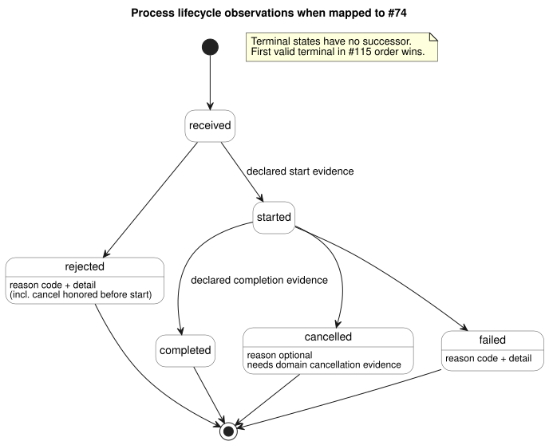

# Effect and Process contract

[한국어](EFFECT-PROCESS-CONTRACT.ko.md)

This contract explains how GhostFlow should treat actions that reach outside the
logical core: desired output states, commands, long-running processes, messages
and rendered views. It defines identities, duplicate handling, the lifecycle of
a request, and what each kind of result can and cannot prove.

**Status.** This is a conceptual contract plus an executable test-local model for
[#116](https://github.com/callin2/ghostflow-language/issues/116), kept for future adoption.

- There is **no** accepted five-kind GhostFlow source union.
- This document implements no compiler, host effect engine, workflow scheduler,
  transport schema or ABI.
- Any required syntax needs a separate proposal.
- Emitting the classification, and binding typed requests and results, each need
  separately versioned consumer adoption.

## Authority and ownership

This contract builds on, and never overrides, these sources:

| Source | What it owns |
| --- | --- |
| [Reference 2.8](reference/02-types-expressions-state.en.md#28-tick-and-state-snapshot) | Atomic logical decisions. |
| [Reference 4.7](reference/04-sensors-constraints-control.en.md#47-requested-safe-applied-confirmed) | Separation of requested, safe, applied and confirmed output evidence. |
| [Reference 5.3](reference/05-settings-and-observation.en.md#53-cabinet-view-independent-observation-model) | Separation of descriptors, snapshots, events and execution results. |
| [Interaction stream contract](INTERACTION-STREAM-CONTRACT.md) (#74) | The proposed command observation lifecycle. |
| [Host ordering contract](HOST-EVENT-ORDERING-CONTRACT.md) (#115) | Ordering of closed ingress batches, commit and subsequent effect results. |
| [Driver ABI draft](DRIVER-ABI-V1-DRAFT.md) (#117) | A possible physical boundary. It remains a draft, not an implementation or a prerequisite here. |

**The program stays in GhostFlow.** Process domain stages, state, timers,
cancellation predicates and constraints remain *authored GhostFlow rules*. The
same Rust core evaluates them across ticks.

The host owns ingress, bindings, external dispatch and evidence export. It does
**not** run a second JSON program that executes those stages. A lifecycle
observation reports declared domain evidence. It cannot drive a separate host
state machine that replaces the authored program.

Stating this contract does not require any command/alarm descriptor
implementation or frontend feature.

## Classification and identity

The five names below are *conceptual categories*. They are not source keywords
and not record enums.

Every identity includes:

- the exact source, module and artifact revisions, and the binding revision;
- the run;
- its own occurrence or attempt position.

Result records keep the original identity. Display names and primitive values
cannot establish a join between a request and its result.

| Kind | Meaning and request identity | Result and observation boundary |
| --- | --- | --- |
| DesiredState | Requested target for a declared logical endpoint at a committed scan/revision; repeated equal targets are continuing intent | Requested/safe snapshots, per-write attempt results and separate feedback; each scan is not a new one-shot command |
| Command | One domain action with explicit request ID and canonical typed-request digest | Ordered received/start/terminal evidence when bound to #74; renderer ACK alone is not domain completion or physical confirmation |
| Process | One identified request spanning authored state/timer decisions across ticks; same request remains the correlation root | Started/progress/current-state observations and terminal domain evidence; progress is not a new request or a new lifecycle state |
| Message | Explicit send request and digest, channel/binding identity and distinct send-attempt identity | Queue/service acceptance, delivery or failure evidence retain their stated scope; acceptance does not prove delivery or reading |
| Render | Read-only projection identified by exact source/schema/run/completed scan or event position and projection revision | Rendered/unavailable/stale presentation outcome; no control authority, command completion, feedback or commit is manufactured |

An explicit binding selects the evidence for each kind, and any mapping to the
#74 lifecycle. Important consequences:

- No universal lifecycle graph is imposed on DesiredState writes or Render results.
- Message completion means only the declared scope. A queue-acceptance contract
  cannot be presented as a delivered-message contract.
- Repeated true Bool scans do **not** implicitly dispatch Commands, Processes or Messages.
- No default edge detector, retry, domain permission or delivery guarantee is inferred.

## Request acceptance, duplicates and bounds

This section applies to Command and Process requests, and to Message requests
that are explicitly identified.

**Record first.** Before any outcome, preserve the request ID, the typed-request
digest, the category and the exact context.

**Duplicates.**

- The same ID, digest and context returns the retained current status, or an
  explicit duplicate result. It never starts or sends again.
- A same-run reconnect, or a new collection stream, does not clear deduplication.

**Conflicts.** Changing the payload, kind or binding under an existing identity
is a *conflicting new admission*. It is rejected without changing the original
request's lifecycle or digest. This conflict is not a successor `rejected`
event for an original request that has already started or terminated.

**Bounds.** Each profile has finite budgets for dedup entries, active processes,
cancellation requests, result history, payloads and effect attempts.

- Reserve capacity before start or dispatch, including the result evidence that
  external effects will need.
- When capacity is exhausted, reject the new admission with a declared reason.
- Never silently evict a live or terminal dedup identity; that would let the
  same action start twice.
- If evidence is lost after admission, preserve an explicit gap or fault and
  follow the host's fail-closed policy. Never invent a successful chain.

## Process lifecycle and cancellation

When mapped to #74, lifecycle observations use exactly these states and transitions:

```text
received -> rejected
received -> started -> completed | cancelled | failed
```

The state diagram below shows the same transitions with the evidence each one needs.



**Rules for each transition.**

- `received` comes before any outcome.
- Start and completion require the exact domain evidence that the binding declares.
- A failure before start is `rejected`. It does not fabricate a `started` record.
- `rejected` and `failed` require a declared reason code and nonempty detail.
- `received`, `started` and `completed` forbid reasons.
- `cancelled` may carry a declared reason.
- A terminal state has no successor.
- Current status is a projection of the last valid record, not another occurrence.

**Cancellation.** A cancellation request has its own request ID, digest and
target identity.

- Receiving a cancellation does not prove cancellation, immediate physical OFF or rollback.
- An internal "pending cancellation" fact can coexist with `started`. It adds no
  new exported lifecycle enum.
- **Before start:** a cancellation honored by domain policy produces `rejected`
  with its reason.
- **After start:** `cancelled` requires declared domain cancellation evidence.
- A denied or ineffective cancellation does not erase progress and does not
  manufacture a terminal state.

**Races between terminal outcomes.** Completion, cancellation and failure
receipts all enter the #115 serialization point.

- Only valid evidence for the exact request and context can qualify.
- In complete history, the *first valid terminal transition in that order wins*.
  Later terminal claims cannot rewrite it.
- Source and domain rules decide what evidence qualifies and whether a
  cancellation is honored. This ordering rule does not invent a universal
  priority of cancellation over completion or failure.
- Competing stop/completion signals within one input snapshot need authored
  rules or explicit binding arbitration. Receipt order does not choose their
  domain outcome; it applies only after evidence qualifies.
- A missing binding rejects admission instead of guessing an outcome.
- With a history gap, preserve the observed status as incomplete. Never
  fabricate missing start/terminal events, and never reject a chain based on
  assumed completeness.

## Effect failure and restart

**Effect failure.** Dispatch happens only after a successful logical commit.

- An external failure preserves that commit and its requested/safe intent, plus
  every partial or uncertain effect outcome.
- The correlated result can affect only a *future* permitted decision, and only
  through an explicit typed binding.
- Host/Device halt policy remains authoritative. There is no automatic
  continuation, retry or restart.
- Renderer register/write acceptance and sensor confirmation remain separate evidence.
- Completing a cancellation does not claim physical shutdown unless the declared
  evidence actually establishes it.

**Restart.** An actual restart uses a new run identity.

- Old terminal records remain terminal history.
- An interrupted started process remains incomplete/unknown unless actual
  terminal evidence exists. A restart alone is not evidence of `failed` or `cancelled`.
- No effect, Message send or Process resurrects automatically from an old current status.
- An explicit follow-up needs a new, full request identity and the new run's admission rules.
- Late feedback from an old run, source or binding is stale for current execution.
  It may be retained with its original identity as history. It must not fabricate
  a current commit, progress or terminal outcome.

## Conformance evidence and adoption

`tests/effect-process-contract.test.mjs` is a fictional, bounded reference model.
It is not a producer, not a scheduler, and not a substitute for Rust Process
execution. Its identity, evidence and internal cancellation objects are test
notation, not approved serialization. Explicit fixture evidence stands in for
authored domain outcomes.

| Cases | Required oracle |
| --- | --- |
| Kind boundaries | Repeated DesiredState stays intent; Command/Process/Message require explicit requests; Message acceptance and Render success prove neither delivery nor physical action |
| Duplicate/conflict/bounds | One start/send per exact identity; conflict preserves original; capacity rejects admission without dedup eviction |
| Cancel before/after start | Before-start rejection has reason; after-start pending does not become terminal without domain evidence |
| Terminal races and failure | Serialized valid completion/cancel/failure produces one immutable terminal; invalid evidence and invalid reasons cannot manufacture transitions |
| Restart and stale evidence | No resurrection or invented terminal; explicit new identity required; old context cannot mutate new run |

To adopt this contract, a consumer must specify typed bindings, evidence scope,
serialized receipt order, bounded retention and each host's failure/restart
policy. It must then exercise these oracles through actual producers.

These tests establish contract behavior only. They do not establish deployment,
delivery, Driver or physical conformance.
