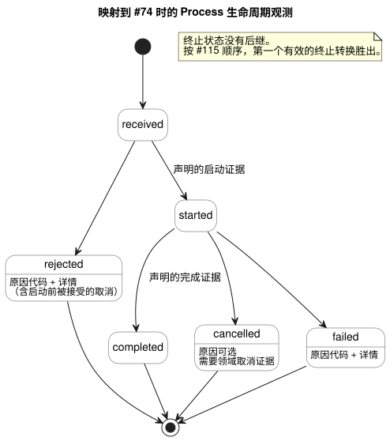

<!-- translation-source: docs/EFFECT-PROCESS-CONTRACT.md -->
[英文原文](EFFECT-PROCESS-CONTRACT.md)

# Effect 与 Process 契约

本契约说明 GhostFlow 应当如何对待超出逻辑核心之外的动作：期望的输出状态、命令、长时间运行的过程、消息以及渲染出的视图。它定义了身份标识、重复处理、请求的生命周期，以及每类结果能够证明和不能证明的内容。

**状态。** 这是一份概念契约，外加一个可执行的、仅限测试内部的模型，对应 [#116](https://github.com/callin2/ghostflow-language/issues/116)，保留以备将来采纳。

- **不存在** 已被接受的、由五种类别组成的 GhostFlow 源代码联合类型。
- 本文档不实现编译器、宿主效果引擎、工作流调度器、传输模式（schema）或 ABI。
- 任何所需的语法都需要单独的提案。
- 输出该分类，以及绑定有类型的请求和结果，各自都需要单独版本化的使用方采纳。

## 权威性与所有权

本契约建立在以下来源之上，并且绝不覆盖它们：

| 来源 | 负责的内容 |
| --- | --- |
| [Reference 2.8](reference/02-types-expressions-state.en.md#28-tick-and-state-snapshot) | 原子的逻辑判定。 |
| [Reference 4.7](reference/04-sensors-constraints-control.en.md#47-requested-safe-applied-confirmed) | requested、safe、applied 和 confirmed 输出证据之间的区分。 |
| [Reference 5.3](reference/05-settings-and-observation.en.md#53-cabinet-view-independent-observation-model) | 描述符、快照、事件和执行结果之间的区分。 |
| [交互流契约](INTERACTION-STREAM-CONTRACT.zh.md)（#74） | 提议的命令观测生命周期。 |
| [宿主排序契约](HOST-EVENT-ORDERING-CONTRACT.zh.md)（#115） | 已关闭的入口批次、提交以及随后效果结果的排序。 |
| [Driver ABI 草案](DRIVER-ABI-V1-DRAFT.zh.md)（#117） | 一种可能的物理边界。它仍是草案，在此既不是实现，也不是前提条件。 |

**程序留在 GhostFlow 中。** Process 的领域阶段、状态、定时器、取消谓词和约束仍然是 *编写的 GhostFlow 规则*。同一个 Rust 核心在多个 tick 中对它们求值。

宿主负责入口、绑定、外部分派和证据导出。它 **不** 运行第二个执行这些阶段的 JSON 程序。生命周期观测报告的是已声明的领域证据。它不能驱动一个取代所编写程序的独立宿主状态机。

陈述本契约并不要求实现任何命令/报警描述符，也不要求任何前端功能。

## 分类与身份标识

下面的五个名称是 *概念类别*。它们不是源代码关键字，也不是记录枚举。

每个身份标识都包括：

- 确切的源代码、模块和制品修订版，以及绑定修订版；
- 运行（run）；
- 其自身的触发实例（occurrence）或尝试位置。

结果记录保留原始身份标识。显示名称和基本值不能在请求与其结果之间建立关联。

| 类别 | 含义与请求身份标识 | 结果与观测边界 |
| --- | --- | --- |
| DesiredState | 在已提交的扫描/修订版上，针对某个已声明逻辑端点的请求目标；重复的相同目标是持续的意图 | requested/safe 快照、每次写入的尝试结果以及单独的反馈；每次扫描都不是一条新的一次性命令 |
| Command | 一个领域动作，带有显式的请求 ID 和规范的有类型请求摘要 | 绑定到 #74 时，有序的 received/start/终止证据；仅有渲染器 ACK 既不代表领域完成，也不代表物理确认 |
| Process | 一个有标识的请求，跨越多个 tick 的编写状态/定时器判定；同一请求始终是关联根 | started/progress/当前状态观测以及终止领域证据；进度不是新请求，也不是新的生命周期状态 |
| Message | 显式的发送请求和摘要、通道/绑定身份标识，以及独立的发送尝试身份标识 | 队列/服务接受、投递或失败证据保留其声明的范围；接受不证明已投递或已读取 |
| Render | 只读投影，由确切的源代码/模式/运行/已完成扫描或事件位置以及投影修订版标识 | 已渲染/不可用/陈旧的呈现结果；不会凭空产生控制权限、命令完成、反馈或提交 |

显式绑定为每个类别选择证据，以及任何到 #74 生命周期的映射。重要的推论：

- 不对 DesiredState 写入或 Render 结果强加通用的生命周期图。
- Message 完成只表示所声明的范围。队列接受契约不能被呈现为已投递消息的契约。
- 重复的为 true 的 Bool 扫描 **不会** 隐式分派 Command、Process 或 Message。
- 不推断默认的边沿检测器、重试、领域许可或投递保证。

## 请求接受、重复与边界

本节适用于 Command 和 Process 请求，以及被显式标识的 Message 请求。

**先记录。** 在产生任何结果之前，保存请求 ID、有类型请求摘要、类别和确切的上下文。

**重复。**

- 相同的 ID、摘要和上下文返回保留的当前状态，或一个显式的重复结果。它绝不会再次启动或再次发送。
- 同一运行内的重新连接，或新的收集流，都不会清除去重信息。

**冲突。** 在现有身份标识下更改负载、类别或绑定，属于 *冲突的新准入*。它会被拒绝，且不改变原始请求的生命周期或摘要。对于已经启动或已经终止的原始请求，这种冲突不是其后继的 `rejected` 事件。

**边界。** 每个 profile 对去重条目、活动过程、取消请求、结果历史、负载和效果尝试都有有限的预算。

- 在启动或分派之前预留容量，包括外部效果将需要的结果证据。
- 容量耗尽时，以声明的原因拒绝新的准入。
- 绝不静默淘汰仍有效或已终止的去重身份标识；否则同一动作可能会启动两次。
- 如果在准入之后丢失了证据，保留显式的间隙或故障，并遵循宿主的故障关闭（fail-closed）策略。绝不编造一条成功的链。

## Process 生命周期与取消

映射到 #74 时，生命周期观测恰好使用以下状态和转换：

```text
received -> rejected
received -> started -> completed | cancelled | failed
```

下面的状态图展示了相同的转换，以及每个转换所需的证据。



**每个转换的规则。**

- `received` 先于任何结果出现。
- 启动和完成需要绑定所声明的确切领域证据。
- 启动之前的失败是 `rejected`。它不会捏造 `started` 记录。
- `rejected` 和 `failed` 需要声明的原因代码和非空的详情。
- `received`、`started` 和 `completed` 禁止携带原因。
- `cancelled` 可以携带声明的原因。
- 终止状态没有后继。
- 当前状态是最后一条有效记录的投影，而不是另一次发生。

**取消。** 取消请求有自己的请求 ID、摘要和目标身份标识。

- 收到取消不证明已经取消、物理上立即关闭（OFF）或已回滚。
- 内部的“取消待处理”事实可以与 `started` 共存。它不会增加新的导出生命周期枚举。
- **启动之前：** 被领域策略接受的取消会产生带原因的 `rejected`。
- **启动之后：** `cancelled` 需要已声明的领域取消证据。
- 被拒绝或无效的取消不会抹去进度，也不会凭空产生终止状态。

**终止结果之间的竞争。** 完成、取消和失败回执都进入 #115 的串行化点。

- 只有针对确切请求和上下文的有效证据才有资格。
- 在完整的历史中，*按该顺序第一个有效的终止转换胜出*。之后的终止声明不能改写它。
- 源代码和领域规则决定哪些证据有资格，以及取消是否被接受。这条排序规则不会编造“取消优先于完成或失败”的通用优先级。
- 同一个输入快照内相互竞争的停止/完成信号，需要编写的规则或显式的绑定仲裁。回执顺序不决定它们的领域结果；它只在证据取得资格之后才起作用。
- 缺少绑定时拒绝准入，而不是猜测结果。
- 历史存在间隙时，将观测到的状态保留为不完整。绝不捏造缺失的启动/终止事件，也绝不基于假定的完整性拒绝一条链。

## 效果失败与重启

**效果失败。** 分派只在逻辑提交成功之后进行。

- 外部失败会保留该提交及其 requested/safe 意图，以及每个部分的或不确定的效果结果。
- 关联的结果只能影响 *将来* 被允许的判定，并且只能通过显式的有类型绑定。
- 宿主/Device 的停机策略仍具有权威性。不存在自动继续、重试或重启。
- 渲染器的寄存器/写入接受与传感器确认仍是彼此独立的证据。
- 除非声明的证据确实能够证明，否则完成取消并不声称物理上已经停机。

**重启。** 实际的重启使用新的运行身份标识。

- 旧的终止记录仍是终止历史。
- 被中断的已启动过程保持不完整/未知，除非存在实际的终止证据。仅凭重启本身不是 `failed` 或 `cancelled` 的证据。
- 任何效果、Message 发送或 Process 都不会根据旧的当前状态自动复活。
- 显式的后续操作需要一个新的、完整的请求身份标识，并遵循新运行的准入规则。
- 来自旧运行、旧源代码或旧绑定的迟到反馈，对当前执行而言是陈旧的。它可以连同其原始身份标识作为历史保留。它不得捏造当前的提交、进度或终止结果。

## 一致性证据与采纳

`tests/effect-process-contract.test.mjs` 是一个虚构的、有界的参考模型。它不是生产者，不是调度器，也不能替代 Rust 的 Process 执行。其中的身份标识、证据和内部取消对象是测试用的记法，不是已批准的序列化格式。显式的夹具（fixture）证据代替编写的领域结果。

| 用例 | 必需的判定准则 |
| --- | --- |
| 类别边界 | 重复的 DesiredState 仍是意图；Command/Process/Message 需要显式请求；Message 接受和 Render 成功既不证明投递，也不证明物理动作 |
| 重复/冲突/边界 | 每个确切身份标识只启动/发送一次；冲突保留原始请求；容量不足时拒绝准入，而不淘汰去重条目 |
| 启动前/后的取消 | 启动前的拒绝带有原因；启动后的待处理状态在没有领域证据时不会变为终止 |
| 终止竞争与失败 | 串行化后的有效完成/取消/失败产生一个不可变的终止状态；无效证据和无效原因不能凭空产生转换 |
| 重启与陈旧证据 | 不复活，不编造终止；需要显式的新身份标识；旧上下文不能改变新运行 |

要采纳本契约，使用方必须规定有类型绑定、证据范围、串行化的回执顺序、有界的保留，以及每个宿主的失败/重启策略。然后必须通过实际的生产者来执行这些判定准则。

这些测试只确立契约行为。它们不确立部署、投递、Driver 或物理层面的一致性。
