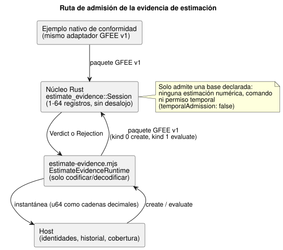

<!-- translation-source: docs/ESTIMATE-EVIDENCE.md -->
[Original en inglés](ESTIMATE-EVIDENCE.md)

# Admisión acotada de evidencia de estimación

Esta API implementa [#398](https://github.com/callin2/ghostflow-language/issues/398),
la base de evidencia de [#385](https://github.com/callin2/ghostflow-language/issues/385).
Permite que un host entregue al núcleo portátil una *base declarada* para una
estimación (por ejemplo, el historial de escrituras enviadas a un actuador) y
reciba un veredicto sobre si esa base es lo bastante completa y fiable como para
ser admitida.

La [Referencia §4.4](reference/04-sensors-constraints-control.es.md#procedencia-y-continuidad-de-los-valores-estimados)
es dueña de la semántica. El núcleo portátil admite una base declarada; **no**
produce ninguna estimación numérica, modelo de movimiento, medición, comando de
salida ni permiso temporal.

Nada más cambia: ni las declaraciones de GhostFlow, ni el estado de Result, ni la
Quality de los sensores, ni la codificación GFB. Una declaración de estimación
visible para el compilador y los ejemplos de duración calibrada siguen siendo el
alcance de #385.

## Contrato público

**Creación de una sesión.**
`ghostflow_core::estimate_evidence::Session::new(reference, basis, capacity)`
establece explícitamente una sesión.

- `capacity` es obligatorio y debe estar entre 1 y 64 registros.
- La retención nunca desaloja un registro.
- Una capacidad no admitida o una incertidumbre mal formada rechazan la creación.
- `reference: None` representa una referencia *ausente*, no la posición cero.

**La referencia.** `Reference` conserva el tiempo monotónico de establecimiento,
la marca de agua (watermark) de secuencia inicial y la incertidumbre.

- `bound: None` significa explícitamente que la cota es desconocida. Una cota
  conocida debe ser finita y no negativa.
- El digest `meaning` de la incertidumbre vincula el significado declarado del modelo/unidad.
- La API no elige unidades ni fabrica una cota por defecto.

**El contexto.** `Context.identities` contiene siete identidades exactas y opacas
de 32 bytes del host, en este orden:

1. Identidad de arranque del host.
2. Registro del modelo y de su revisión.
3. Registro de parámetros/revisión de calibración.
4. Registro de identidad de la referencia en tiempo de ejecución.
5. Registro de la aserción de referencia, incluido quién la estableció y su fuente.
6. Registro de la revisión canónica del programa/fuente escrito por el autor.
7. Registro canónico de la vinculación/revisión de la instalación.

La ejecución (run), la época del tiempo monotónico y la época de la fuente son
`u64` exactos.

- El host proporciona las identidades canónicas propietarias. Los digests no
  autentican aserciones.
- Este documento no define ningún algoritmo hash canónico nuevo.
- Los registros ausentes o no verificados no deben representarse como una referencia válida.
- La persistencia de la calibración no restaura una referencia.

**La base.** Hay dos bases:

| Base | Registros requeridos |
| --- | --- |
| `Basis::Requested` | Registros de solicitud. |
| `AcknowledgedWrites` | Registros de resultados reales de escritura: Acknowledged, WriteFailed o Unknown. |

Notas sobre los registros:

- Un ACK significa solo que el renderizador (renderer) aceptó la escritura. No
  confirma el resultado físico.
- `target` es un valor opaco de bytes/máscara digital, no una magnitud del
  actuador en alguna unidad arbitraria.
- Cada registro conserva su *origen de ejecución* original: las identidades de
  arranque, programa y vinculación, además de las épocas de ejecución, tiempo y fuente.
- El modelo, la calibración y la referencia en tiempo de ejecución no crean recibos de escritura.
- Un recibo anterior puede servir de semilla para una referencia restablecida
  explícitamente solo dentro de ese mismo origen de ejecución, y solo con una
  cobertura declarada completa.
- Un recibo de otra ejecución o de otro arranque no está disponible. Nunca se reetiqueta.

## Evaluación, completitud y frontera transaccional

El diagrama siguiente muestra dónde ocurre la evaluación. El runtime de JavaScript
solo codifica y decodifica paquetes; la sesión de Rust es dueña de los registros
y decide el veredicto.

`evaluate(context, now_ms, history, source_fault)` devuelve un `Verdict`, o un
`Rejection` para una entrada mal formada.

**Cómo es un historial válido.** Un historial ordenado declara las marcas de agua
de secuencia inicial y actual, los tiempos monotónicos observado-desde y
observado-hasta, y si la cobertura es completa. Además:

- Incluye la solicitud/recibo semilla original en el instante de la referencia o
  antes. Observado-desde es igual al tiempo original de esa semilla.
- La secuencia de la semilla sigue a la marca de agua inicial.
- Cada secuencia posterior es contigua, y la secuencia final es igual a la marca de agua actual.
- Observado-hasta debe alcanzar el tiempo de evaluación.
- El host declara la completitud, incluido el tramo posterior a la última
  escritura. La completitud no puede inferirse de las instantáneas retenidas de Device.

**Retención y rechazo.** Todo el prefijo se retiene bajo la capacidad explícita.

- Un recibo en caché exacto y repetido sustenta una evaluación posterior solo con
  una cobertura continua declarada. Su identidad, su tiempo original, su objetivo
  y su resultado no cambian.
- Las siguientes entradas se *rechazan* sin cambiar el estado consolidado:
  identidades reescritas, identidades duplicadas, secuencia o tiempo
  decrecientes, marcas de tiempo futuras, base incorrecta, paquetes mal formados y
  desbordamiento.

**Resultados no disponibles.** Las siguientes entradas bien formadas devuelven
*no disponible* con una causa e invalidan la continuidad:

- huecos;
- cobertura incompleta;
- historial ausente;
- una referencia ausente;
- un contexto modificado;
- escrituras fallidas o inciertas.

Reglas de orden y prioridad:

- El `SensorFault` tipado original sigue siendo un fallo.
- Un fallo proporcionado explícitamente tiene prioridad.
- Un contexto modificado se comprueba antes de la comparación de relojes.
- Un tiempo monotónico que retrocede dentro del mismo contexto produce `ClockBackward`.
- Un historial posterior que parezca válido no restablece una continuidad no
  válida. Para recuperarse, cree explícitamente una nueva sesión/referencia.

**Los fallos siguen visibles.**

- Los registros fallidos e inciertos permanecen retenidos.
- Un fallo posterior que se omita no puede ocultarse detrás de un ACK antiguo en caché.
- Un historial más corto no borra el prefijo retenido.
- La referencia y el último contexto de ejecución informado se exponen por separado.
- La incertidumbre desconocida sigue siendo metadatos. Incluso las bases
  admitidas exponen `temporalAdmission: false`.
- `hold_last`, las ventanas y `true_for` existentes, que solo usan valores medidos, no cambian.

## Transporte nativo/WASM y verificación

**Transporte.**

- `runtimes/wasm/estimate-evidence.mjs` solo codifica y decodifica. Su
  `EstimateEvidenceRuntime` crea, evalúa y libera una sesión propiedad de Rust.
- El adaptador de paquetes binarios GFEE v1 se comparte literalmente con el
  ejemplo nativo de conformidad `estimate_evidence`.
- Los paquetes de creación usan kind 0; los paquetes de evaluación usan kind 1.
- Los encabezados, flags/enums y bytes sobrantes no admitidos se rechazan.
- El paquete de evaluación máximo es de `298 + 64 * 146 = 9642` bytes, derivado del diseño exacto.
- El núcleo retiene como máximo `capacity` registros. El espacio temporal del
  transporte y las instantáneas serializadas también están acotados por el techo admitido.
- Esto no es una aceptación de la pila de tareas de una MCU.

**Enteros.** Los campos del host aceptan cadenas decimales exactas o BigInt para
todo el rango de `u64`. Se permiten Numbers que sean enteros seguros; los Numbers
no seguros se rechazan. Las instantáneas JSON emiten los `u64` como cadenas decimales.

**Verificación.**

- La conformidad nativo/WASM compara instantáneas completas y veredictos, causas,
  cobertura y procedencia de recibos esperados explícitamente, incluida la
  capacidad completa y +1.
- Las regresiones de Rust están en `crates/ghostflow-core/tests/estimate_evidence.rs`.
- `tests/estimate-evidence.test.mjs` se ejecuta en `tools/verify-language.mjs` y
  en la compuerta de cobertura existente.

Estas son pruebas de software de declaración/admisión. No certifican la posición
física ni el historial completo de Device. No existe ningún respaldo (fallback)
de ingesta de sensores.
