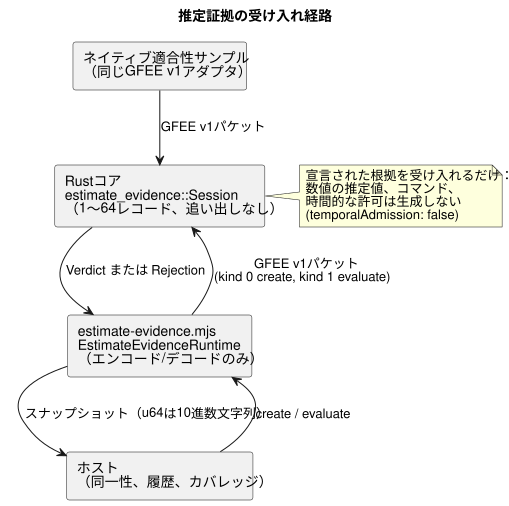

<!-- translation-source: docs/ESTIMATE-EVIDENCE.md -->
[英語の原文](ESTIMATE-EVIDENCE.md)

# 有界な推定証拠の受け入れ

このAPIは、[#385](https://github.com/callin2/ghostflow-language/issues/385)の証拠基盤である[#398](https://github.com/callin2/ghostflow-language/issues/398)を実装します。ホストは、推定のための*宣言された根拠（basis）*（たとえば、アクチュエータに送った書き込みの履歴）をポータブルコアに渡し、その根拠が受け入れられるのに十分なほど完全で信頼できるかどうかの判定を受け取ります。

意味論は[リファレンス §4.4](reference/04-sensors-constraints-control.ja.md)が所有します。ポータブルコアは宣言された根拠を受け入れるだけであり、数値的な推定値、動作モデル、測定値、出力コマンド、時間的な許可は**一切**生成しません。

それ以外は何も変わりません。GhostFlowの宣言、Resultのステータス、センサのQuality、GFBのエンコーディングはいずれも変更されません。コンパイラから見える推定の宣言と、校正済みの継続時間の例は、引き続き#385の範囲です。

## 公開契約

**セッションの作成。**
`ghostflow_core::estimate_evidence::Session::new(reference, basis, capacity)`
は、1つのセッションを明示的に確立します。

- `capacity`は必須であり、1〜64レコードでなければなりません。
- 保持中のレコードが追い出されることは決してありません。
- サポートされていない容量や不正な形式の不確かさは、作成を拒否します。
- `reference: None`は、位置ゼロではなく、参照が*欠落している*ことを表します。

**参照（reference）。** `Reference`は、確立時の単調時間、初期シーケンスのウォーターマーク、不確かさを保持します。

- `bound: None`は、上限が不明であることを明示的に意味します。既知の上限は、有限かつ非負でなければなりません。
- 不確かさの`meaning`ダイジェストは、宣言されたモデル/単位の意味をバインドします。
- APIは単位を選択せず、既定の上限を作り出すこともしません。

**コンテキスト。** `Context.identities`には、正確で不透明な32バイトのホスト同一性が、次の順序で7つ含まれます。

1. ホストのブート同一性。
2. モデルとモデルのリビジョンのレコード。
3. 校正パラメータ/リビジョンのレコード。
4. ランタイムの参照同一性のレコード。
5. 参照のアサーションのレコード（誰がどのソースから確立したかを含む）。
6. 正準な、作成者が記述したプログラム/ソースのリビジョンのレコード。
7. 正準な、設備のバインディング/リビジョンのレコード。

実行（run）、単調時間のエポック、ソースのエポックは、正確な`u64`です。

- ホストが、所有する正準な同一性を提供します。ダイジェストはアサーションを認証しません。
- この文書は、新しい正準ハッシュアルゴリズムを定義しません。
- 欠落しているレコードや検証されていないレコードを、有効な参照として表現してはなりません。
- 校正の永続化によって参照が復元されることはありません。

**根拠（basis）。** 根拠には2種類あります。

| 根拠 | 必要なレコード |
| --- | --- |
| `Basis::Requested` | リクエストのレコード。 |
| `AcknowledgedWrites` | 実際の書き込み結果のレコード：Acknowledged、WriteFailed、またはUnknown。 |

レコードについての注記：

- ACKは、レンダラーが書き込みを受理したことだけを意味します。物理的な結果を確認するものではありません。
- `target`は不透明なバイト/デジタルマスクの値であり、任意の単位によるアクチュエータの量ではありません。
- 各レコードは、元の*実行起点*を保持します。これは、ブート、プログラム、バインディングの各同一性と、実行、時間、ソースの各エポックです。
- モデル、校正、ランタイムの参照が、書き込みのレシートを作り出すことはありません。
- 以前のレシートが、明示的に再確立された参照の種（シード）になれるのは、同じ実行起点の中で、かつ宣言されたカバレッジが完全な場合に限られます。
- 別の実行やブートからのレシートは利用できません。ラベルを付け替えられることは決してありません。

## 評価、完全性、トランザクション境界

次の図は、評価がどこで行われるかを示しています。JavaScriptランタイムはパケットのエンコードとデコードだけを行い、Rustのセッションがレコードを所有して判定を下します。

`evaluate(context, now_ms, history, source_fault)`は`Verdict`を返します。不正な形式の入力に対しては`Rejection`を返します。

**有効な履歴の条件。** 順序付けられた履歴は、初期と現在のシーケンスのウォーターマーク、観測開始と観測終了の単調時間、そしてカバレッジが完全かどうかを宣言します。さらに次の条件があります。

- 参照時刻またはそれ以前の、元のシードとなるリクエスト/レシートを含みます。観測開始時刻は、そのシードの元の時刻と等しくなります。
- シードのシーケンスは、初期ウォーターマークの次に続きます。
- それ以降のシーケンスはすべて連続しており、最後のシーケンスは現在のウォーターマークと等しくなります。
- 観測終了時刻は、評価時刻に達していなければなりません。
- ホストは、最後の書き込み以降の末尾も含めて、完全性を宣言します。保持されたDeviceのスナップショットから完全性を推論することはできません。

**保持と拒否。** プレフィックス全体が、明示的な容量の範囲内で保持されます。

- 繰り返される、正確に同一のキャッシュ済みレシートが後の評価を裏付けるのは、宣言された連続的なカバレッジがある場合だけです。その同一性、元の時刻、ターゲット、結果は変更されません。
- 次の入力は、確定済みの状態を変更せずに*拒否*されます：書き換えられた同一性、重複した同一性、減少するシーケンスや時刻、未来のタイムスタンプ、誤った根拠、不正な形式のパケット、オーバーフロー。

**利用不可の結果。** 次のような形式としては正しい入力は、原因とともに*利用不可（unavailable）*を返し、連続性を無効にします。

- 欠番
- 不完全なカバレッジ
- 履歴の欠落
- 参照の欠落
- 変更されたコンテキスト
- 失敗した書き込みや不確実な書き込み

順序と優先度の規則：

- 元の型付き`SensorFault`は、故障のままです。
- 明示的に与えられた故障が優先されます。
- コンテキストの変更は、クロックの比較より前にチェックされます。
- 同じコンテキスト内で単調時間が逆行すると、`ClockBackward`になります。
- 後から有効に見える履歴が来ても、無効になった連続性はリセットされません。復旧するには、新しいセッション/参照を明示的に作成します。

**失敗は見えるままです。**

- 失敗したレコードや不確実なレコードは保持され続けます。
- 後の失敗が省略されても、古いキャッシュ済みのACKの陰に隠すことはできません。
- 短い履歴が来ても、保持されたプレフィックスは消えません。
- 参照と、最後に報告された実行コンテキストは、別々に公開されます。
- 不明な不確かさはメタデータのままです。受け入れられた根拠であっても、`temporalAdmission: false`を公開します。
- 既存の測定値専用の`hold_last`、ウィンドウ、`true_for`は変更されません。

## ネイティブ/WASMのトランスポートと検証

**トランスポート。**

- `runtimes/wasm/estimate-evidence.mjs`は、エンコードとデコードだけを行います。その`EstimateEvidenceRuntime`は、Rustが所有するセッションを作成、評価、破棄します。
- GFEE v1バイナリパケットのアダプタは、ネイティブの`estimate_evidence`適合性サンプルとそのまま共有されます。
- 作成パケットはkind 0、評価パケットはkind 1を使用します。
- サポートされていないヘッダ、フラグ/列挙値、末尾の余分なバイトは拒否されます。
- 評価パケットの最大サイズは`298 + 64 * 146 = 9642`バイトであり、正確なレイアウトから導出されます。
- コアが保持するレコードは最大`capacity`件です。トランスポートの作業領域とシリアライズされたスナップショットも、サポートされる上限によって制限されます。
- これは、MCUのタスクスタックとしての受け入れを意味するものではありません。

**整数。** ホストのフィールドは、`u64`の全範囲について、正確な10進数文字列またはBigIntを受け付けます。安全な整数の範囲のNumberは許可され、安全でないNumberは拒否されます。JSONスナップショットでは、`u64`を10進数文字列として出力します。

**検証。**

- ネイティブ/WASMの適合性テストでは、完全なスナップショットと、明示的に期待される判定、原因、カバレッジ、レシートの来歴を比較します。これには容量いっぱいの場合と+1の場合も含まれます。
- Rustの回帰テストは`crates/ghostflow-core/tests/estimate_evidence.rs`にあります。
- `tests/estimate-evidence.test.mjs`は、`tools/verify-language.mjs`と既存のカバレッジゲートで実行されます。

これらはソフトウェア上の宣言/受け入れのテストです。物理的な位置や、Deviceの完全な履歴を証明するものではありません。センサ取り込みによるフォールバックは存在しません。
