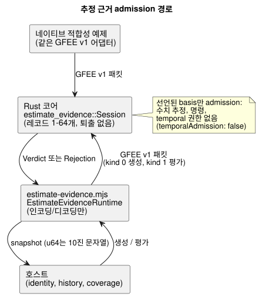

<!-- translation-source: docs/ESTIMATE-EVIDENCE.md -->
[영문 원문](ESTIMATE-EVIDENCE.md)

# 유한한 추정 근거 admission

이 API는 [#385](https://github.com/callin2/ghostflow-language/issues/385)의 근거 기반인
[#398](https://github.com/callin2/ghostflow-language/issues/398)을 구현합니다.
호스트는 이 API로 추정의 *선언된 basis*(예: 액추에이터에 보낸 write의 이력)를 portable
core에 넘기고, 그 basis가 admission될 만큼 완전하고 신뢰할 수 있는지에 대한 판정을
돌려받습니다.

의미는 [Reference §4.4](reference/04-sensors-constraints-control.md#추정값의-출처와-연속성)가
소유합니다. portable core는 선언된 basis를 admission할 뿐이며, 수치 추정값, 움직임 모델,
측정, 출력 명령이나 temporal 사용 권한은 **만들지 않습니다**.

그 밖에는 아무것도 바뀌지 않습니다. GhostFlow 선언, Result 상태, 센서 Quality, GFB
인코딩은 그대로입니다. 컴파일러가 인식하는 추정 선언과 보정된 지속 시간 예제는 계속
#385의 범위로 남습니다.

## 공개 계약

**세션 생성.**
`ghostflow_core::estimate_evidence::Session::new(reference, basis, capacity)`는
하나의 세션을 명시적으로 설정합니다.

- `capacity`는 필수이며 레코드 1–64개여야 합니다.
- 보존 중인 레코드는 절대 퇴출되지 않습니다.
- 지원하지 않는 capacity나 잘못된 uncertainty는 생성을 거부합니다.
- `reference: None`은 위치 0이 아니라 reference의 *부재*를 나타냅니다.

**Reference.** `Reference`는 설정 시점의 단조 시간, 초기 sequence watermark와
uncertainty를 보존합니다.

- `bound: None`은 bound를 알 수 없음을 명시적으로 뜻합니다. 알려진 bound는 유한한 0
  이상의 값이어야 합니다.
- uncertainty의 `meaning` 다이제스트는 선언된 모델/단위 의미를 묶습니다.
- API는 단위를 고르지도, 기본 bound를 만들어 내지도 않습니다.

**Context.** `Context.identities`에는 호스트가 제공하는, 정확하고 불투명한 32바이트
identity 7개가 다음 순서로 들어 있습니다.

1. 호스트 boot identity.
2. 모델과 모델 revision 레코드.
3. 보정 파라미터/revision 레코드.
4. 런타임 reference identity 레코드.
5. 누가 어떤 출처로 설정했는지를 포함한 reference assertion 레코드.
6. 정본 작성 프로그램/소스 revision 레코드.
7. 정본 설치 바인딩/revision 레코드.

run, 단조 시간 epoch와 소스 epoch는 정확한 `u64`입니다.

- 호스트는 소유자가 정한 정본 identity를 제공합니다. 다이제스트는 assertion을 인증하지
  않습니다.
- 이 문서는 새로운 정본 해시 알고리즘을 정의하지 않습니다.
- 없거나 검증되지 않은 레코드를 유효한 reference로 표시해서는 안 됩니다.
- 보정값을 영속 저장해도 reference는 복원되지 않습니다.

**Basis.** basis는 두 가지입니다.

| Basis | 필요한 레코드 |
| --- | --- |
| `Basis::Requested` | 요청 레코드. |
| `AcknowledgedWrites` | 실제 write 결과 레코드: Acknowledged, WriteFailed 또는 Unknown. |

레코드에 관한 참고 사항은 다음과 같습니다.

- ACK는 renderer가 write를 수락했다는 뜻일 뿐입니다. 물리적 결과를 확인하지 않습니다.
- `target`은 불투명한 바이트/디지털 마스크 값이며, 임의 단위의 액추에이터 수치가
  아닙니다.
- 각 레코드는 원래의 *실행 출처*, 즉 boot, 프로그램, 바인딩 identity와 run, 시간, 소스
  epoch를 유지합니다.
- 모델, 보정, 런타임 reference는 write receipt를 만들지 않습니다.
- 이전 receipt는 같은 실행 출처 안에서, 그리고 선언된 coverage가 완전할 때에만, 명시적으로
  다시 설정한 reference의 seed가 될 수 있습니다.
- 다른 run이나 boot의 receipt는 unavailable입니다. 결코 identity를 바꿔 붙이지
  않습니다.

## 평가, 완전성과 트랜잭션 경계

아래 그림은 평가가 어디서 일어나는지 보여 줍니다. JavaScript 런타임은 패킷을 인코딩하고
디코딩할 뿐이며, 레코드를 소유하고 판정을 내리는 것은 Rust 세션입니다.

`evaluate(context, now_ms, history, source_fault)`는 `Verdict`를 반환하고, 잘못된
입력에는 `Rejection`을 반환합니다.

**유효한 이력의 모습.** 순서가 있는 이력은 초기 및 현재 sequence watermark,
observed-from과 observed-through 단조 시간, 그리고 coverage가 완전한지 여부를
선언합니다. 그 밖에도 다음을 만족해야 합니다.

- reference 순간 또는 그 이전의 원래 seed 요청/receipt를 포함합니다. observed-from은 그
  seed의 원래 시간과 같습니다.
- seed의 sequence는 초기 watermark 바로 다음입니다.
- 이후의 모든 sequence는 연속이며, 마지막 sequence는 현재 watermark와 같습니다.
- observed-through는 평가 시간에 도달해야 합니다.
- 마지막 write 이후의 tail을 포함한 완전성은 호스트가 선언합니다. 보존된 Device
  snapshot에서 완전성을 추론할 수는 없습니다.

**보존과 거부.** prefix 전체를 명시적 capacity 안에서 보존합니다.

- 똑같은 cached receipt가 반복되더라도, 연속 coverage가 선언되어 있을 때에만 이후 평가를
  뒷받침합니다. 그 identity, 원래 시간, target과 결과는 바뀌지 않습니다.
- 다음 입력은 확정된 상태를 바꾸지 않고 *거부*됩니다. 다시 쓴 identity, 중복 identity,
  감소하는 sequence나 시간, 미래 타임스탬프, 잘못된 basis, 잘못된 패킷, 오버플로.

**Unavailable 결과.** 다음과 같이 형식상 올바른 입력은 원인과 함께 *unavailable*을
반환하고 연속성을 무효화합니다.

- 공백(gap)
- 불완전한 coverage
- 이력 부재
- reference 부재
- 변경된 context
- 실패했거나 불확실한 write

순서와 우선순위 규칙은 다음과 같습니다.

- 원래의 타입 있는 `SensorFault`는 fault로 남습니다.
- 명시적으로 제공된 fault가 우선합니다.
- context 변경은 시계 비교보다 먼저 검사합니다.
- 같은 context 안에서 단조 시간이 거꾸로 가면 `ClockBackward`가 됩니다.
- 나중에 유효해 보이는 이력이 와도 무효가 된 연속성은 초기화되지 않습니다. 복구하려면
  새 세션/reference를 명시적으로 만들어야 합니다.

**실패는 계속 보입니다.**

- 실패했거나 불확실한 레코드는 계속 보존됩니다.
- 나중의 실패를 생략하여 이전의 cached ACK 뒤에 숨길 수 없습니다.
- 더 짧은 이력이 보존된 prefix를 지우지 않습니다.
- reference와 마지막으로 보고된 실행 context는 따로 공개됩니다.
- 알 수 없는 uncertainty는 metadata로 남습니다. admission된 basis조차
  `temporalAdmission: false`를 공개합니다.
- 기존의 측정값 전용 `hold_last`, window와 `true_for`는 바뀌지 않습니다.

## Native/WASM 전송과 검증

**전송.**

- `runtimes/wasm/estimate-evidence.mjs`는 인코딩과 디코딩만 합니다. 그 안의
  `EstimateEvidenceRuntime`은 Rust가 소유하는 세션을 생성하고, 평가하고, 폐기합니다.
- GFEE v1 바이너리 패킷 어댑터는 네이티브 `estimate_evidence` 적합성 예제와 그대로
  공유됩니다.
- 생성 패킷은 kind 0, 평가 패킷은 kind 1을 사용합니다.
- 지원하지 않는 헤더, flag/enum과 남는 바이트는 거부합니다.
- 최대 평가 패킷은 정확한 레이아웃에서 계산한 `298 + 64 * 146 = 9642`바이트입니다.
- 코어는 최대 `capacity`개의 레코드만 보존합니다. 전송용 scratch 공간과 직렬화된
  snapshot도 지원되는 상한에 따라 제한됩니다.
- 이것은 MCU task-stack 수용 판정이 아닙니다.

**정수.** 호스트 필드는 `u64` 전체 범위에 대해 정확한 10진 문자열이나 BigInt를
받습니다. 안전한 정수 범위의 Number는 허용되고, 안전하지 않은 Number는 거부됩니다. JSON
snapshot은 `u64`를 10진 문자열로 내보냅니다.

**검증.**

- Native/WASM 적합성 검증은 전체 snapshot과 명시적인 예상 판정, 원인, coverage, receipt
  provenance를 비교하며, 최대 capacity와 +1 경우도 포함합니다.
- Rust 회귀 테스트는 `crates/ghostflow-core/tests/estimate_evidence.rs`에 있습니다.
- `tests/estimate-evidence.test.mjs`는 `tools/verify-language.mjs`와 기존 coverage
  gate에서 실행됩니다.

이것들은 소프트웨어 선언/admission 테스트입니다. 물리적 위치나 완전한 Device 이력을
인증하지 않습니다. 센서 수집(sensor-ingestion) fallback은 없습니다.
