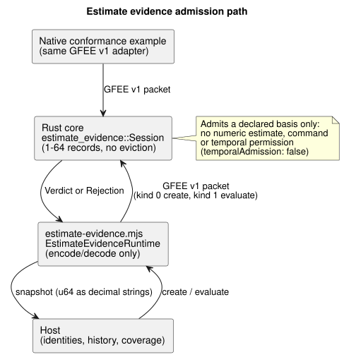

# Bounded estimate evidence admission

This API implements [#398](https://github.com/callin2/ghostflow-language/issues/398),
the evidence foundation of [#385](https://github.com/callin2/ghostflow-language/issues/385).
It lets a host hand the portable core a *declared basis* for an estimate (for
example, the history of writes sent to an actuator) and get back a verdict on
whether that basis is complete and trustworthy enough to be admitted.

[Reference §4.4](reference/04-sensors-constraints-control.en.md#estimated-value-provenance-and-continuity)
owns the semantics. The portable core admits a declared basis; it produces
**no** numerical estimate, movement model, measurement, output command or
temporal permission.

Nothing else changes: no GhostFlow declaration, Result status, sensor Quality
or GFB encoding. A compiler-visible estimate declaration and calibrated-duration
examples remain the scope of #385.

## Public contract

**Creating a session.**
`ghostflow_core::estimate_evidence::Session::new(reference, basis, capacity)`
explicitly establishes one session.

- `capacity` is required and must be 1–64 records.
- Retention never evicts a record.
- An unsupported capacity or malformed uncertainty rejects creation.
- `reference: None` represents a *missing* reference, not position zero.

**The reference.** `Reference` retains the establishment monotonic time, the
initial sequence watermark and the uncertainty.

- `bound: None` explicitly means the bound is unknown. A known bound must be
  finite and nonnegative.
- The uncertainty `meaning` digest binds the declared model/unit meaning.
- The API neither chooses units nor manufactures a default bound.

**The context.** `Context.identities` contains seven exact, opaque 32-byte host
identities, in this order:

1. Host boot identity.
2. Model and model revision record.
3. Calibration parameter/revision record.
4. Runtime reference identity record.
5. Reference assertion record, including who established it and its source.
6. Canonical authored program/source revision record.
7. Canonical installation binding/revision record.

The run, the monotonic time epoch and the source epoch are exact `u64`s.

- The host supplies the owning canonical identities. Digests do not
  authenticate assertions.
- This document defines no new canonical hash algorithm.
- Missing or unverified records must not be represented as a valid reference.
- Calibration persistence does not restore a reference.

**The basis.** There are two bases:

| Basis | Required records |
| --- | --- |
| `Basis::Requested` | Request records. |
| `AcknowledgedWrites` | Actual write-result records: Acknowledged, WriteFailed or Unknown. |

Notes on records:

- An ACK means only that the renderer accepted the write. It does not confirm
  the physical result.
- `target` is an opaque byte/digital-mask value, not an actuator quantity in
  some arbitrary unit.
- Each record keeps its original *execution origin*: the boot, program and
  binding identities, plus the run, time and source epochs.
- Model, calibration and runtime reference do not create write receipts.
- An earlier receipt can seed an explicitly re-established reference only within
  that same execution origin, and only with complete declared coverage.
- A receipt from another run or boot is unavailable. It is never relabeled.

## Evaluation, completeness and transaction boundary

The diagram below shows where evaluation happens. The JavaScript runtime only
encodes and decodes packets; the Rust session owns the records and decides the verdict.

`evaluate(context, now_ms, history, source_fault)` returns a `Verdict`, or a
`Rejection` for malformed input.

**What a valid history looks like.** An ordered history declares the initial and
current sequence watermarks, the observed-from and observed-through monotonic
times, and whether coverage is complete. In addition:

- It includes the original seed request/receipt at or before the reference
  instant. Observed-from equals that seed's original time.
- The seed's sequence follows the initial watermark.
- Every later sequence is contiguous, and the final sequence equals the current watermark.
- Observed-through must reach the evaluation time.
- The host declares completeness, including the tail after the last write.
  Completeness cannot be inferred from retained Device snapshots.

**Retention and rejection.** The entire prefix is retained under the explicit
capacity.

- A repeated, exact cached receipt supports later evaluation only with declared
  continuous coverage. Its identity, original time, target and result stay unchanged.
- The following inputs are *rejected* without changing committed state:
  rewritten identities, duplicate identities, decreasing sequence or time,
  future timestamps, wrong basis, malformed packets and overflow.

**Unavailable results.** The following well-formed inputs return *unavailable*
with a cause and invalidate continuity:

- gaps;
- incomplete coverage;
- absent history;
- a missing reference;
- a changed context;
- failed or uncertain writes.

Ordering and priority rules:

- The original typed `SensorFault` remains a fault.
- An explicitly supplied fault takes priority.
- A changed context is checked before the clock comparison.
- Monotonic time that goes backward within the same context yields `ClockBackward`.
- A later history that looks valid does not reset invalid continuity. To recover,
  create a new session/reference explicitly.

**Failures stay visible.**

- Failed and uncertain records remain retained.
- A later failure that is omitted cannot be hidden behind an old cached ACK.
- A shorter history does not erase the retained prefix.
- The reference and the last reported execution context are exposed separately.
- Unknown uncertainty remains metadata. Even admitted bases expose
  `temporalAdmission: false`.
- Existing measured-only `hold_last`, windows and `true_for` are unchanged.

## Native/WASM transport and verification

**Transport.**

- `runtimes/wasm/estimate-evidence.mjs` only encodes and decodes. Its
  `EstimateEvidenceRuntime` creates, evaluates and disposes a Rust-owned session.
- The GFEE v1 binary packet adapter is shared verbatim with the native
  `estimate_evidence` conformance example.
- Creation packets use kind 0; evaluation packets use kind 1.
- Unsupported headers, flags/enums and trailing bytes are rejected.
- The maximum evaluation packet is `298 + 64 * 146 = 9642` bytes, derived from the exact layout.
- The core retains at most `capacity` records. Transport scratch space and
  serialized snapshots are also bounded by the supported ceiling.
- This is not an MCU task-stack acceptance.

**Integers.** Host fields accept exact decimal strings or BigInt for the full
`u64` range. Safe-integer Numbers are allowed; unsafe Numbers are rejected. JSON
snapshots emit `u64`s as decimal strings.

**Verification.**

- Native/WASM conformance compares complete snapshots and explicit expected
  verdicts, causes, coverage and receipt provenance, including full capacity and +1.
- Rust regressions live in `crates/ghostflow-core/tests/estimate_evidence.rs`.
- `tests/estimate-evidence.test.mjs` runs in `tools/verify-language.mjs` and in
  the existing coverage gate.

These are software declaration/admission tests. They do not certify physical
position or complete Device history. No sensor-ingestion fallback exists.
