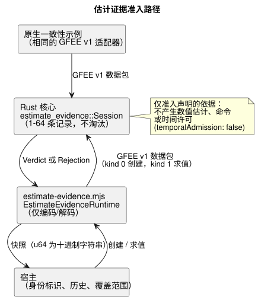

<!-- translation-source: docs/ESTIMATE-EVIDENCE.md -->
[英文原文](ESTIMATE-EVIDENCE.md)

# 有界的估计证据准入

此 API 实现 [#398](https://github.com/callin2/ghostflow-language/issues/398)，即 [#385](https://github.com/callin2/ghostflow-language/issues/385) 的证据基础。它允许宿主把估计的 *已声明依据*（例如，发送给执行器的写入历史）交给可移植核心，并得到一个判定结果：该依据是否足够完整、可信，从而可以被准入。

[Reference §4.4](reference/04-sensors-constraints-control.en.md#estimated-value-provenance-and-continuity)
负责其语义。可移植核心准入一个已声明的依据；它 **不** 产生数值估计、运动模型、测量、输出命令或时间许可。

其他一切均不改变：没有 GhostFlow 声明、Result 状态、传感器 Quality 或 GFB 编码的变化。编译器可见的估计声明以及经过校准的持续时间示例仍属于 #385 的范围。

## 公共契约

**创建会话。**
`ghostflow_core::estimate_evidence::Session::new(reference, basis, capacity)`
显式建立一个会话。

- `capacity` 是必需的，且必须为 1–64 条记录。
- 保留时绝不淘汰记录。
- 不支持的容量或格式错误的不确定度会导致创建被拒绝。
- `reference: None` 表示 *缺失* 的参考，而不是位置零。

**参考。** `Reference` 保留建立时的单调时间、初始序列水位线（watermark）和不确定度。

- `bound: None` 显式表示界限未知。已知的界限必须是有限且非负的。
- 不确定度的 `meaning` 摘要绑定已声明的模型/单位含义。
- 此 API 既不选择单位，也不凭空制造默认界限。

**上下文。** `Context.identities` 包含七个确切的、不透明的 32 字节宿主身份标识，顺序如下：

1. 宿主启动身份标识。
2. 模型与模型修订版记录。
3. 校准参数/修订版记录。
4. 运行时参考身份标识记录。
5. 参考断言记录，包括由谁建立及其来源。
6. 规范的编写程序/源代码修订版记录。
7. 规范的安装绑定/修订版记录。

运行（run）、单调时间 epoch 和来源 epoch 是确切的 `u64`。

- 宿主提供所拥有的规范身份标识。摘要不对断言进行认证。
- 本文档不定义新的规范哈希算法。
- 缺失或未经验证的记录不得被表示为有效的参考。
- 校准的持久化不会恢复参考。

**依据。** 有两种依据：

| 依据 | 必需的记录 |
| --- | --- |
| `Basis::Requested` | 请求记录。 |
| `AcknowledgedWrites` | 实际的写入结果记录：Acknowledged、WriteFailed 或 Unknown。 |

关于记录的说明：

- ACK 只表示渲染器（renderer）接受了写入。它不确认物理结果。
- `target` 是不透明的字节/数字掩码值，而不是以某种任意单位表示的执行器量。
- 每条记录保留其原始的 *执行来源*：启动、程序和绑定身份标识，以及运行、时间和来源 epoch。
- 模型、校准和运行时参考不会产生写入回执。
- 较早的回执只有在同一执行来源内、并且具备完整的已声明覆盖范围时，才能为显式重新建立的参考提供种子。
- 来自其他运行或其他启动的回执不可用。它绝不会被重新标记。

## 求值、完整性与事务边界

下图展示了求值发生的位置。JavaScript 运行时只负责编码和解码数据包；Rust 会话拥有这些记录并决定判定结果。

`evaluate(context, now_ms, history, source_fault)` 返回一个 `Verdict`，或在输入格式错误时返回 `Rejection`。

**有效的历史是什么样的。** 有序的历史会声明初始和当前的序列水位线、观测起止的单调时间（observed-from 与 observed-through），以及覆盖是否完整。此外：

- 它包含位于参考时刻或之前的原始种子请求/回执。observed-from 等于该种子的原始时间。
- 种子的序列紧随初始水位线。
- 之后的每个序列都是连续的，最终序列等于当前水位线。
- observed-through 必须达到求值时间。
- 宿主声明完整性，包括最后一次写入之后的尾部。完整性不能从保留的 Device 快照中推断。

**保留与拒绝。** 整个前缀都在显式容量之内被保留。

- 重复出现的、完全相同的缓存回执，只有在声明了连续覆盖时才支持之后的求值。其身份标识、原始时间、目标和结果保持不变。
- 以下输入会被 *拒绝*，且不改变已提交的状态：被改写的身份标识、重复的身份标识、递减的序列或时间、未来的时间戳、错误的依据、格式错误的数据包以及溢出。

**不可用的结果。** 以下格式正确的输入会返回带原因的 *不可用*（unavailable），并使连续性失效：

- 间隙；
- 不完整的覆盖；
- 缺失的历史；
- 缺失的参考；
- 已改变的上下文；
- 失败或不确定的写入。

顺序与优先级规则：

- 原始的有类型 `SensorFault` 仍然是故障。
- 显式提供的故障优先。
- 已改变的上下文在时钟比较之前检查。
- 在同一上下文内单调时间倒退时，产生 `ClockBackward`。
- 之后看起来有效的历史不会重置已失效的连续性。要恢复，需显式创建新的会话/参考。

**失败保持可见。**

- 失败和不确定的记录仍会被保留。
- 之后被省略的失败不能隐藏在旧的缓存 ACK 之后。
- 更短的历史不会抹去已保留的前缀。
- 参考和最后报告的执行上下文分别对外暴露。
- 未知的不确定度仍是元数据。即使是已准入的依据，也暴露 `temporalAdmission: false`。
- 现有的仅基于测量值的 `hold_last`、窗口和 `true_for` 保持不变。

## 原生/WASM 传输与验证

**传输。**

- `runtimes/wasm/estimate-evidence.mjs` 只负责编码和解码。它的 `EstimateEvidenceRuntime` 创建、求值并释放一个由 Rust 拥有的会话。
- GFEE v1 二进制数据包适配器与原生 `estimate_evidence` 一致性示例逐字共享。
- 创建数据包使用 kind 0；求值数据包使用 kind 1。
- 不支持的头部、标志/枚举以及尾随字节会被拒绝。
- 最大求值数据包为 `298 + 64 * 146 = 9642` 字节，由确切的布局推导得出。
- 核心最多保留 `capacity` 条记录。传输暂存空间和序列化快照同样受支持上限的约束。
- 这并不是对 MCU 任务栈的验收。

**整数。** 宿主字段接受完整 `u64` 范围内的确切十进制字符串或 BigInt。允许安全整数范围内的 Number；不安全的 Number 会被拒绝。JSON 快照将 `u64` 输出为十进制字符串。

**验证。**

- 原生/WASM 一致性测试比较完整的快照，以及显式预期的判定、原因、覆盖范围和回执来源，包括满容量和 +1 的情况。
- Rust 回归测试位于 `crates/ghostflow-core/tests/estimate_evidence.rs`。
- `tests/estimate-evidence.test.mjs` 在 `tools/verify-language.mjs` 以及现有的覆盖率门禁中运行。

这些是软件层面的声明/准入测试。它们不证明物理位置，也不证明 Device 历史是完整的。不存在传感器摄取方面的 fallback（回退）。
