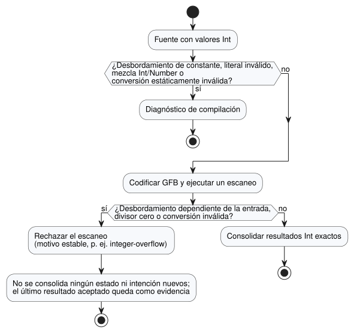

<!-- translation-source: docs/EXACT-INTEGER-CONTRACT.md -->
[Original en inglés](EXACT-INTEGER-CONTRACT.md)

# Propuesta de contrato de enteros exactos

Seguimiento: issue de lenguaje #22 / integración `TASK-85.1` / revisión R14.

Este documento registra el diseño N2–N4 de los enteros exactos y los vectores
de aceptación que lo prueban. `Int` ya está implementado en el parser, el
codificador GFB y la VM portable.

El principio de producto confirmado es sencillo: **los conteos y los totales de
repetición se mantienen exactos dentro de un rango declarado.** Las expresiones
de este documento como "recomendar" o "propuesta" registran cómo se llegó al
diseño. El contrato vigente del código fuente es la Referencia del lenguaje
(consulte
[Tipos, expresiones y estado](reference/02-types-expressions-state.es.md)).

Este documento trata, en orden:

- la intención confirmada y el límite actual de la implementación;
- por qué `Int` es un tipo fijo de 32 bits con signo;
- cómo obtienen su tipo los literales;
- las operaciones con enteros y las conversiones explícitas;
- qué ocurre ante un fallo y qué códigos de motivo estables se usan;
- los vectores de aceptación a cargo de N2, N3 y N4, y la asignación binaria; y
- lo que la revisión R14 todavía puede cambiar.

## Intención confirmada y límite actual

- Los conteos y las mediciones son tipos de valores distintos. Un conteo no se
  vuelve aproximado solo porque provenga de un sensor.
- Los valores enteros y los resultados enteros deben mantenerse exactos dentro
  del rango admitido. La pérdida de precisión, el desbordamiento cíclico
  (wrapping) y la saturación nunca son silenciosos.
- Browser/WASM y ESP32 usan la misma semántica de valores y la misma semántica
  de fallos.
- La implementación actual tiene tres tipos escalares: `Bool`, `Number` (`f64`)
  e `Int` (`i32`). GFB codifica las constantes/valores predeterminados Number
  como `f64` de ocho bytes y las constantes/valores predeterminados Int como
  `i32` con signo de cuatro bytes. La frontera JS/WASM expone ambos tipos
  numéricos como un `number` de JavaScript y valida el rango de Int.
- GFB implementa aritmética Int verificada, división, resto y conversiones
  explícitas. Una división por cero, un desbordamiento, una conversión inválida
  o un resultado Number no finito rechazan el tick antes de que se consoliden el
  estado y las intenciones.
- La fecha/hora, el reloj monotónico y los anchos de identificadores son
  contratos separados. Esta propuesta no debe forzar una marca de tiempo de
  época (epoch) dentro del tipo entero de conteo.

## Recomendación de tipo mínimo

Añadir un único tipo escalar público, `Int`, con una representación fija de 32
bits con signo:

```text
Int = -2_147_483_648 .. 2_147_483_647
```

`Int` significa exactamente este rango en todos los hosts. No es un `int` de
C/Rust cuyo tamaño dependa de la plataforma. Como tiene signo, un solo tipo
cubre conteos, diferencias y desplazamientos; no se necesita un segundo tipo sin
signo. Un dominio no negativo, como un conteo de frutas, se expresa mediante
los límites declarados de configuración/estado, no con otro tipo primitivo.

| Candidato | Beneficio | Costo | Decisión para el perfil mínimo |
| --- | --- | --- | --- |
| Mantener en `f64` los valores con aspecto de entero | sin cambio de formato | la intención del tipo queda oculta; no se garantizan operaciones exactas | rechazar |
| `Int` respaldado por `i32` | ancho nativo en el objetivo de 32 bits, literal/valor predeterminado de cuatro bytes, representable con exactitud por un `number` de JS al convertirlo explícitamente | rango finito; los totales de larga vida necesitan una política declarada de reinicio cíclico/fallo | recomendar |
| `Int` respaldado por `i64` | rango de conteo mucho mayor | carga útil de ocho bytes, aritmética multipalabra en la MCU, y los valores fuera del rango entero exacto de JavaScript necesitan una nueva representación de transporte | posponer hasta que un rango demostrado lo requiera |
| primitivos separados con y sin signo | rango no negativo más amplio | más reglas de tipos mixtos y de conversión | rechazar para el primer perfil |

Añadir una variante `i32` junto a `f64` no hace, por sí solo, que cada ranura de
la pila de la VM sea más pequeña. El diseño de memoria de un enum sigue
determinado por la variante más grande y por la alineación del objetivo. Las
ganancias con las que se puede contar ahora son las operaciones enteras de ancho
nativo y las constantes/valores predeterminados binarios de cuatro bytes. N3
debe medir la compilación real para ESP32 en lugar de afirmar un ahorro de RAM
de toda la VM a partir del ancho de la carga útil.

## Reglas de literales y tipos

- Un numeral decimal entero tiene un valor entero exacto. Cuando no se espera
  ningún tipo numérico, su tipo predeterminado es `Int`.
- Un numeral entero puede elaborarse directamente como literal `Number` cuando
  la declaración o el operando circundante aporta ese tipo esperado. Esto es
  tipado de literales, no una coerción de `Int` a `Number` en tiempo de
  ejecución.
- Un numeral con punto decimal o exponente es `Number`, nunca `Int`.
- La primera implementación no necesita añadir separadores de dígitos. El rango
  se comprueba sobre los dígitos originales, antes de cualquier conversión a
  través de `Number` de JavaScript.
- `-2147483648` se acepta como el literal con signo mínimo. Cualquier magnitud
  positiva o negativa mayor es un error de compilación.
- N2 debe tratar el signo menos inicial opcional como parte de la comprobación
  de límites del literal entero, o implementar una regla explícita equivalente
  para el literal mínimo. No debe rechazar primero el positivo `2147483648` y
  luego intentar reducir el menos unario como `0 - 2147483648`.
- Las variables, entradas, estados, resultados y valores de funciones nunca se
  convierten implícitamente entre `Int` y `Number`. La aritmética mixta y la
  comparación mixta son errores de compilación.

Estas reglas mantienen funcionando umbrales legibles como `temperature < 30`:
el operando izquierdo aporta el tipo esperado `Number`. Al mismo tiempo, un
`let count = 30` sin tipo es un `Int` exacto.

Un literal entero recibe un tipo esperado solo de su contexto tipado inmediato:

- un inicializador declarado de config/state/output o una conexión de salida;
- un parámetro de función con tipo estático;
- el otro operando numérico concreto de una operación aritmética o de una
  comparación; y
- un tipo esperado envolvente compartido por ambas ramas de `if`.

Cuando ninguno de los lados aporta un tipo, los literales enteros toman `Int` por
defecto; un literal decimal hace que la misma expresión numérica sea `Number`.
Un `let` sin tipo toma el tipo de su inicializador, y los usos posteriores no
propagan hacia atrás un tipo diferente. Los contextos en conflicto producen
diagnósticos; el compilador no adivina una sobrecarga.

| Fuente | Tipo | Por qué |
| --- | --- | --- |
| `let count = 30` | `Int` | sin tipo esperado; el literal entero toma `Int` por defecto |
| `let level = 30.0` | `Number` | punto decimal |
| `temperature < 30` (con `temperature: Number`) | `30` es un literal `Number` | el otro operando aporta `Number` |
| `count + 1.5` (con `count: Int`) | error de compilación | mezcla de `Int`/`Number` |

## Operaciones

| Expresión | Resultado | Regla |
| --- | --- | --- |
| `a + b`, `a - b`, `a * b` | `Int` | `i32` exacto verificado; el desbordamiento produce un fallo |
| `-a` | `Int` | verificado; negar el valor mínimo produce un fallo |
| `a div b` | `Int` | el cociente se trunca hacia cero; el divisor cero y el valor mínimo dividido entre `-1` producen un fallo |
| `a % b` | `Int` | el resto tiene el signo del dividendo; el divisor cero produce un fallo |
| `a / b` con dos `Int` | ninguno | error de compilación; elija `div` o convierta explícitamente los operandos a `Number` |
| `== != < <= > >=` | `Bool` | permitido para dos `Int` |
| cualquier mezcla `Int`/`Number` | ninguno | error de compilación hasta que haya una conversión explícita |

Para toda división y resto válidos se cumple `a == (a div b) * b + (a % b)`.
El desbordamiento entero nunca se convierte en `Number`, ni se ajusta
cíclicamente ni se satura.

## Conversiones explícitas

Esta sección fija las operaciones semánticas. Los nombres `div`, `%` y los
nombres de conversión siguientes eran grafías provisionales del código fuente
para la revisión R14. Los ID de los vectores de aceptación nombran las
operaciones semánticas, de modo que N2 sustituye la grafía aprobada antes de
convertirlos en fixtures de código fuente.

| Operación candidata | Contrato |
| --- | --- |
| `number(i)` | `Int` a `Number`; siempre exacta porque todo `i32` es representable con exactitud por `f64` |
| `int_exact(n)` | acepta solo un `Number` entero y dentro del rango; en caso contrario produce un fallo |
| `int_floor(n)` | piso matemático y luego comprobación de rango |
| `int_ceil(n)` | techo matemático y luego comprobación de rango |
| `int_trunc(n)` | truncamiento hacia cero y luego comprobación de rango |
| `int_nearest_even(n)` | entero más cercano con empates hacia el par y luego comprobación de rango |

No existe una conversión genérica con un redondeo predeterminado oculto. Una
conversión inválida de una constante es un error de compilación. Una conversión
inválida que depende de una entrada es un fallo numérico en tiempo de ejecución.

## Semántica de fallos y estado

Los errores se detectan en el punto más temprano que puede verlos, como muestra
el diagrama.



- **Tiempo de compilación.** El desbordamiento de constantes, los literales
  enteros inválidos y las conversiones estáticamente inválidas son diagnósticos
  de compilación.
- **Tiempo de ejecución.** El desbordamiento dependiente de la entrada, la
  división por cero y la conversión inválida rechazan el escaneo actual antes de
  que se consolide cualquier estado o intención nuevos.

Ante un rechazo en tiempo de ejecución, el host entra en su ruta existente de
fallo de ejecución y conserva el último resultado aceptado como evidencia. Esta
regla del lenguaje no afirma por sí sola que un relé físico se haya apagado
(OFF). El manejo de salida segura del renderizador y la confirmación física
siguen siendo evidencias separadas.

Use estos motivos distintos y estables en la frontera del runtime:

- `integer-overflow`
- `integer-division-by-zero`
- `integer-conversion-fractional`
- `integer-conversion-out-of-range`

En el runtime central, una operación rechazada deja sin cambios el número de
tick consolidado, el tiempo lógico, el estado, las intenciones seguras y el
journal. El adaptador de escaneo enmarcado (framed) además descarta las entradas
candidatas rechazadas y no avanza su ID de escaneo aceptado ni su tiempo lógico.

Un consumidor puede reintentar esa identidad solo si la política de su host
permite reutilizarla. El host Browser enmarcado actual retiene (latch) un fallo
de ejecución en el que haya entrado el host y exige una instancia nueva. Su
último resultado aceptado sigue siendo evidencia, mientras que el error actual
informa del rechazo. N3 debe probar tanto la transacción central como el límite
de recuperación del host enmarcado.

## Vectores de aceptación posteriores

La responsabilidad se divide por etapas:

- **N2** se encarga de los diagnósticos de literales, tipos y conversiones.
- **N3** se encarga del comportamiento de las operaciones en tiempo de
  ejecución.
- **N4** se encarga del binario exacto y del intercambio con el host.

Cada ID se mantiene estable aunque R14 cambie una grafía visible.

| ID | Entrada u operación | Resultado esperado | Responsable |
| --- | --- | --- | --- |
| N1-LIT-01 | `0`, `2147483647`, `-2147483648` en contexto `Int` | valores exactos aceptados | N2 |
| N1-LIT-02 | `2147483648`, `-2147483649` | diagnóstico de rango en compilación | N2 |
| N1-LIT-03 | `30` / `30.0` sin tipo | `Int(30)` / `Number(30.0)` | N2 |
| N1-TYPE-01 | `Int + Number`, `Int < Number` | diagnóstico de tipos mixtos en compilación | N2 |
| N1-TYPE-02 | dos operandos `Int` con `/` | diagnóstico de compilación que menciona `div` o la conversión explícita a Number | N2 |
| N1-ADD-01 | entradas en tiempo de ejecución `MAX + 1`, `MIN - 1` | desbordamiento en tiempo de ejecución; sin consolidación | N3 |
| N1-MUL-01 | entradas en tiempo de ejecución `46340 * 46340` / `46341 * 46341` | `2147395600` / desbordamiento sin consolidación | N3 |
| N1-NEG-01 | negar una entrada en tiempo de ejecución que contiene `MIN` | desbordamiento en tiempo de ejecución; sin consolidación | N3 |
| N1-DIV-01 | entradas en tiempo de ejecución para `7 div 3`, `-7 div 3`, `7 div -3`, `-7 div -3` | `2`, `-2`, `-2`, `2` | N3 |
| N1-DIV-02 | entradas en tiempo de ejecución para `1 div 0`, `MIN div -1` | división por cero / desbordamiento; sin consolidación | N3 |
| N1-MOD-01 | entradas en tiempo de ejecución para `7 % 3`, `-7 % 3` | `1`, `-1` | N3 |
| N1-CONV-01 | `number(-2147483648)`, `number(2147483647)` | los `Number` exactos correspondientes | N2/N3 |
| N1-CONV-02 | constantes `int_exact(3.0)` / `int_exact(3.5)` | `3` / diagnóstico fraccionario en compilación | N2 |
| N1-CONV-03 | entradas Number en tiempo de ejecución `3.0` / `3.5` mediante conversión exacta | `3` / fallo de conversión fraccionaria sin consolidación | N3 |
| N1-CONV-04 | floor/ceil/trunc/nearest-even de la entrada en tiempo de ejecución `-2.5` | `-3`, `-2`, `-2`, `-2` | N3 |
| N1-GFB-01 | valores predeterminados de estado mínimo, cero y máximo | la nueva representación entera conserva los bytes exactos en ida y vuelta en nativo y WASM | N4 |
| N1-GFB-02 | un GFB1 antiguo presentado como el nuevo formato con enteros, y viceversa | falla en modo cerrado; nunca reinterpreta `NUMBER_CONST` como `Int` | N4 |
| N1-ABI-01 | entrada y salida `Int` mínima/máxima | intercambio exacto nativo/WASM y valores de traza idénticos | N4 |

La asignación de N4, propuesta inicialmente aquí, ya está implementada y fijada
por pruebas a nivel de bytes:

| Frontera | Contrato con capacidad para enteros |
| --- | --- |
| Envoltura del bytecode | magic `GFB1`, versión de formato `u16` little-endian `2`; la versión `1` permanece inmutable |
| Etiqueta de tipo | `3 = Int` (`1 = Bool`, `2 = Number` sin cambios) |
| Constante/valor predeterminado | `i32` little-endian con signo |
| Opcodes | `23 INT_CONST`, `24 INT_NEG`, `25 INT_ADD`, `26 INT_SUB`, `27 INT_MUL`, `28 INT_DIV`, `29 INT_REM` |
| Opcodes de conversión | `48 INT_TO_NUMBER`, `49 NUMBER_TO_INT_EXACT`, `50 ...FLOOR`, `51 ...CEIL`, `52 ...TRUNC`, `53 ...NEAREST_EVEN`; `30` y `31` son opcodes de salto |
| Manifiesto | `GhostFlow/control-v4`, grafía nominal del tipo `Int` |
| Identidad del runtime | `GhostFlow/runtime-semantics-v1` |
| ABI enmarcada | `GhostFlow/framed-scan-abi-v1`; etiqueta de tipo de entrada/capacidad `3`, cuatro bytes `i32` little-endian |
| Paquete | `GhostFlow/portable-package-v1`; vincula la versión del bytecode, el manifiesto y las identidades de runtime/ABI |
| JSON de traza/resultado | número JSON más el `Int` declarado en el manifiesto; el decodificador exige un valor entero dentro del rango `i32` antes de exponerlo |

El codificador de tramas de Browser elige la etiqueta de tipo `3` a partir del
manifiesto verificado, no de si un número de JavaScript resulta ser entero.
`Number(3.0)` e `Int(3)` son valores distintos. Los cargadores nativos y WASM
rechazan valores desconocidos de formato, tipo u opcode antes de la activación.

N4 debe publicar fixtures exactos de mínimo/cero/máximo y sus valores SHA-256, y
los consumidores nativos y WASM cargan esos mismos bytes. N4 no debe reutilizar
el `NUMBER_CONST f64` de la versión 1 como codificación de enteros. Los paquetes
existentes de la versión 1 permanecen inmutables y se rechazan cuando el host no
admite explícitamente sus identidades declaradas.

Todo `Int` cabe en el rango de enteros seguros de JavaScript. Por eso, los
adaptadores orientados a JSON pueden transportarlo como número JSON, pero solo
con una validación estricta de integralidad y de rango; no se permite ningún
análisis con pérdida. La asignación de etiquetas numéricas es una decisión
técnica de compatibilidad: R14 revisa la grafía del código fuente, no los
valores de los bytes.

## Límite de la revisión R14

La base técnica propuesta para la implementación es:

- un único tipo fijo `Int`/`i32`;
- fallos verificados;
- conversiones explícitas;
- `div` para el cociente entero y `%` para el resto.

R14 solo necesita revisar la grafía orientada a las personas (`Int`, `div`, `%`
y los nombres de conversión), usando ejemplos legibles. No debe reabrir la
distinción ya confirmada entre conteos exactos y mediciones aproximadas.
