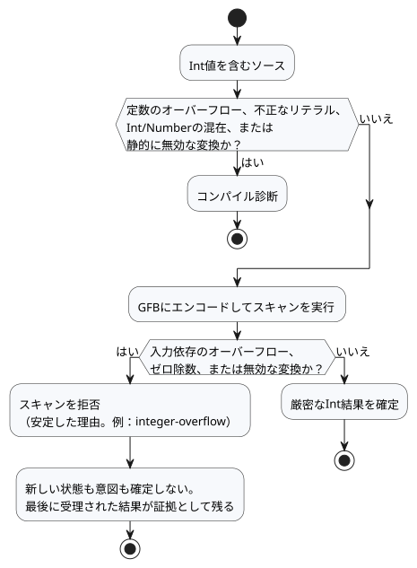

<!-- translation-source: docs/EXACT-INTEGER-CONTRACT.md -->
[英語の原文](EXACT-INTEGER-CONTRACT.md)

# 厳密な整数の契約案

追跡：言語issue #22／統合`TASK-85.1`／レビューR14。

この文書は、厳密な整数（exact integer）に関するN2〜N4の設計と、それを検証する受け入れベクトルを記録します。`Int`は現在、パーサ、GFBエンコーダ、ポータブルVMに実装されています。

確定したプロダクト原則は単純です。**カウントと繰り返し回数の合計は、宣言された範囲内で厳密なまま保たれます。** 以下の「推奨」や「提案」といった表現は、設計がどのような経緯で決まったかを記録したものです。現在のソース契約は言語リファレンスです（[型・式・状態](reference/02-types-expressions-state.ja.md)を参照）。

この文書では、次の内容を順に扱います。

- 確定した意図と現在の実装境界
- `Int`を固定の符号付き32ビット型とする理由
- リテラルの型の決まり方
- 整数演算と明示的な変換
- 故障時に何が起こるか、どの安定した理由コードを使うか
- N2、N3、N4が担当する受け入れベクトルと、バイナリの割り当て
- レビューR14でまだ変更されうる点

## 確定した意図と現在の境界

- カウントと測定値は種類の異なる値です。カウントは、センサから得られたというだけで近似値になるわけではありません。
- 整数値と整数の結果は、サポートされる範囲内で厳密に保たれなければなりません。精度の損失、ラップアラウンド、飽和が暗黙のうちに起こることは決してありません。
- Browser/WASMとESP32は、同じ値のセマンティクスと同じ故障のセマンティクスを使います。
- 現在の実装には、`Bool`、`Number`（`f64`）、`Int`（`i32`）の3つのスカラー型があります。GFBはNumberの定数・既定値を8バイトの`f64`として、Intの定数・既定値を4バイトの符号付き`i32`としてエンコードします。JS/WASM境界では、どちらの数値型もJavaScriptの`number`として公開され、Intの範囲が検証されます。
- GFBは、チェック付きのIntの算術、除算、剰余、明示的な変換を実装しています。ゼロ除算、オーバーフロー、無効な変換、または有限でないNumberの結果は、状態と意図が確定する前にそのtickを拒否します。
- 日付・時刻、単調クロック、識別子の幅は別の契約です。この提案は、エポックのタイムスタンプを整数のカウント型に押し込むことを強制してはなりません。

## 最小限の型の推奨

公開スカラー型を1つ、`Int`として追加します。表現は固定の符号付き32ビットです。

```text
Int = -2_147_483_648 .. 2_147_483_647
```

`Int`はどのホストでも厳密にこの範囲を意味します。プラットフォーム依存サイズのC/Rustの`int`ではありません。符号付きなので、1つの型でカウント、差分、オフセットをすべて扱えます。2つ目の符号なし型は必要ありません。果実の個数のような非負の領域は、別のプリミティブ型ではなく、宣言された設定・状態の範囲で表現します。

| 候補 | 利点 | コスト | 最小プロファイルでの決定 |
| --- | --- | --- | --- |
| 整数に見える値を`f64`のまま保持する | フォーマットの変更が不要 | 型の意図が隠れたままになり、厳密な演算が強制されない | 却下 |
| `i32`を基盤とする`Int` | 32ビットターゲットでのネイティブ幅、4バイトのリテラル・既定値、明示的に変換すればJSの`number`で厳密に表現可能 | 範囲が有限。長期間累積する合計には、宣言されたロールオーバー／故障のポリシーが必要 | 推奨 |
| `i64`を基盤とする`Int` | カウント範囲がはるかに広い | 8バイトのペイロード、MCUでの複数ワード演算、JavaScriptの厳密な整数範囲を超える値には新しい転送表現が必要 | 実際にその範囲が必要と示されるまで延期 |
| 符号付きと符号なしのプリミティブを分ける | 非負の範囲が広くなる | 型の混在と変換のルールが増える | 最初のプロファイルでは却下 |

`f64`の隣に`i32`のバリアントを追加しても、それだけでVMのすべてのスタックスロットが小さくなるわけではありません。enumのレイアウトは、依然として最大のバリアントとターゲットのアラインメントで決まります。現時点で確実に得られる利点は、ネイティブ幅の整数演算と、4バイトのバイナリ定数・既定値です。N3は、ペイロード幅からVM全体のRAM削減を主張するのではなく、実際のESP32ビルドを測定しなければなりません。

## リテラルと型のルール

- 小数点のない10進数の数字は、厳密な整数値を持ちます。数値型が期待されていない場合、既定で`Int`になります。
- 周囲の宣言やオペランドが期待される型として`Number`を与える場合、小数点のない数字は直接`Number`リテラルとして展開されることがあります。これはリテラルの型付けであり、実行時の`Int`から`Number`への型強制ではありません。
- 小数点または指数を含む数字は`Number`であり、`Int`になることはありません。
- 最初の実装では桁区切り文字を追加する必要はありません。範囲は、JavaScriptの`Number`を経由する変換の前に、元の数字列に対してチェックされます。
- `-2147483648`は符号付きの最小リテラルとして受け入れられます。それより大きい正または負の絶対値はコンパイルエラーです。
- N2は、先頭の省略可能なマイナス記号を整数リテラルの境界チェックの一部として扱うか、それと同等の明示的な最小リテラルのルールを実装しなければなりません。正の`2147483648`を先に拒否してから、単項マイナスを`0 - 2147483648`として下げようとしてはなりません。
- 変数、入力、状態、結果、関数の値は、`Int`と`Number`の間で暗黙に変換されることは決してありません。型が混在した算術と比較はコンパイルエラーです。

これらのルールにより、`temperature < 30`のような読みやすいしきい値はそのまま機能します。左オペランドが期待される型`Number`を与えるからです。一方、型注釈のない`let count = 30`は厳密な`Int`になります。

小数点のないリテラルは、直接の型付き文脈からのみ期待される型を受け取ります。

- 宣言されたconfig/state/outputの初期化子、または出力接続
- 静的に型付けされた関数パラメータ
- 算術または比較における、もう一方の具体的な数値オペランド
- `if`の両方の分岐が共有する、外側の期待される型

どちら側も型を与えない場合、小数点のないリテラルは既定で`Int`になります。小数のリテラルがあれば、同じ数値式は`Number`になります。型注釈のない`let`は初期化子から型を受け取り、後の使用箇所から異なる型が逆伝播することはありません。文脈が矛盾する場合は診断が出ます。コンパイラがオーバーロードを推測することはありません。

| ソース | 型 | 理由 |
| --- | --- | --- |
| `let count = 30` | `Int` | 期待される型がなく、小数点のないリテラルは既定で`Int` |
| `let level = 30.0` | `Number` | 小数点がある |
| `temperature < 30`（`temperature: Number`のとき） | `30`は`Number`リテラル | もう一方のオペランドが`Number`を与える |
| `count + 1.5`（`count: Int`のとき） | コンパイルエラー | `Int`と`Number`の混在 |

## 演算

| 式 | 結果 | ルール |
| --- | --- | --- |
| `a + b`、`a - b`、`a * b` | `Int` | チェック付きの厳密な`i32`。オーバーフローは故障 |
| `-a` | `Int` | チェック付き。最小値の符号反転は故障 |
| `a div b` | `Int` | 商はゼロ方向に切り捨て。除数ゼロ、および最小値を`-1`で割る場合は故障 |
| `a % b` | `Int` | 剰余は被除数の符号を持つ。除数ゼロは故障 |
| 2つの`Int`に対する`a / b` | なし | コンパイルエラー。`div`を選ぶか、オペランドを明示的に`Number`へ変換する |
| `== != < <= > >=` | `Bool` | 2つの`Int`に対して使用可能 |
| `Int`と`Number`の任意の混在 | なし | 明示的な変換があるまでコンパイルエラー |

有効なすべての除算と剰余について、`a == (a div b) * b + (a % b)`が成り立ちます。整数のオーバーフローが`Number`に変換されたり、ラップアラウンドしたり、飽和したりすることは決してありません。

## 明示的な変換

この節では、意味的な演算を確定します。`div`、`%`、および以下の変換名は、レビューR14向けの暫定的なソース表記でした。受け入れベクトルのIDは意味的な演算を指しているので、N2はソースのフィクスチャにする前に、承認された表記に置き換えます。

| 候補の演算 | 契約 |
| --- | --- |
| `number(i)` | `Int`から`Number`へ。すべての`i32`は`f64`で厳密に表現できるので、常に厳密 |
| `int_exact(n)` | 範囲内の整数値の`Number`だけを受け付け、それ以外は故障 |
| `int_floor(n)` | 数学的な床関数を適用し、その後に範囲チェック |
| `int_ceil(n)` | 数学的な天井関数を適用し、その後に範囲チェック |
| `int_trunc(n)` | ゼロ方向に切り捨て、その後に範囲チェック |
| `int_nearest_even(n)` | 最も近い整数（同距離なら偶数）に丸め、その後に範囲チェック |

丸め方法の既定値を隠し持つ汎用の変換はありません。定数の無効な変換はコンパイルエラーです。入力に依存する無効な変換は、実行時の数値故障です。

## 故障と状態のセマンティクス

図に示すように、エラーはそれを検出できる最も早い時点で捕捉されます。



- **コンパイル時。** 定数のオーバーフロー、無効な整数リテラル、静的に無効な変換はコンパイル診断です。
- **実行時。** 入力に依存するオーバーフロー、ゼロ除算、無効な変換は、新しい状態や意図が確定する前に現在のスキャンを拒否します。

実行時に拒否されると、ホストは既存の実行故障の経路に入り、最後に受理された結果を証拠として保持します。この言語ルールだけで、物理リレーがOFFになったと主張するわけではありません。レンダラーによる安全出力の処理と物理的な確認は、別の証拠のままです。

実行時の境界では、次の区別された安定した理由を使います。

- `integer-overflow`
- `integer-division-by-zero`
- `integer-conversion-fractional`
- `integer-conversion-out-of-range`

コアランタイムでは、拒否された演算は、確定済みのtick番号、論理時間、状態、安全意図、ジャーナルを変更しません。フレーム化スキャンアダプタも、拒否された候補入力をクリアし、受理済みのスキャンIDや論理時間を進めません。

利用側がその同一性で再試行できるのは、ホストのポリシーが再利用を許可する場合だけです。現在のフレーム化Browserホストは、ホストが入った実行故障をラッチし、新しいインスタンスを必要とします。最後に受理された結果は証拠として残り、現在のエラーが拒否を報告します。N3は、コアのトランザクションとフレーム化ホストの復旧境界の両方をテストしなければなりません。

## 下流の受け入れベクトル

担当は段階ごとに分かれています。

- **N2**は、リテラル、型、変換の診断を担当します。
- **N3**は、実行時の演算の振る舞いを担当します。
- **N4**は、厳密なバイナリとホストとのやり取りを担当します。

各IDは、R14が表面上の表記を変更しても変わりません。

| ID | 入力または演算 | 期待される結果 | 担当 |
| --- | --- | --- | --- |
| N1-LIT-01 | `Int`文脈での`0`、`2147483647`、`-2147483648` | 厳密な値として受け入れ | N2 |
| N1-LIT-02 | `2147483648`、`-2147483649` | コンパイル時の範囲診断 | N2 |
| N1-LIT-03 | 型注釈のない`30`／`30.0` | `Int(30)`／`Number(30.0)` | N2 |
| N1-TYPE-01 | `Int + Number`、`Int < Number` | コンパイル時の型混在診断 | N2 |
| N1-TYPE-02 | 2つの`Int`オペランドに`/` | `div`または明示的なNumber変換を示すコンパイル診断 | N2 |
| N1-ADD-01 | 実行時入力の`MAX + 1`、`MIN - 1` | 実行時オーバーフロー。確定なし | N3 |
| N1-MUL-01 | 実行時入力の`46340 * 46340`／`46341 * 46341` | `2147395600`／オーバーフローで確定なし | N3 |
| N1-NEG-01 | `MIN`を保持する実行時入力の符号反転 | 実行時オーバーフロー。確定なし | N3 |
| N1-DIV-01 | `7 div 3`、`-7 div 3`、`7 div -3`、`-7 div -3`の実行時入力 | `2`、`-2`、`-2`、`2` | N3 |
| N1-DIV-02 | `1 div 0`、`MIN div -1`の実行時入力 | ゼロ除算／オーバーフロー。確定なし | N3 |
| N1-MOD-01 | `7 % 3`、`-7 % 3`の実行時入力 | `1`、`-1` | N3 |
| N1-CONV-01 | `number(-2147483648)`、`number(2147483647)` | 対応する厳密な`Number` | N2/N3 |
| N1-CONV-02 | 定数の`int_exact(3.0)`／`int_exact(3.5)` | `3`／コンパイル時の小数診断 | N2 |
| N1-CONV-03 | 実行時Number入力`3.0`／`3.5`の厳密な変換 | `3`／小数変換の故障で確定なし | N3 |
| N1-CONV-04 | 実行時入力`-2.5`のfloor/ceil/trunc/nearest-even | `-3`、`-2`、`-2`、`-2` | N3 |
| N1-GFB-01 | 最小値、ゼロ、最大値の状態の既定値 | 新しい整数表現がネイティブとWASMで厳密なバイトのまま往復する | N4 |
| N1-GFB-02 | 古いGFB1を新しい整数対応フォーマットとして提示、およびその逆 | フェイルクローズ。`NUMBER_CONST`を`Int`として再解釈することは決してない | N4 |
| N1-ABI-01 | 最小／最大の`Int`入力と出力 | ネイティブ／WASMでの厳密なやり取りと同一のトレース値 | N4 |

ここで最初に提案されたN4の割り当ては、現在実装済みで、バイトレベルのテストで固定されています。

| 境界 | 整数対応の契約 |
| --- | --- |
| バイトコードのエンベロープ | マジック`GFB1`、リトルエンディアン`u16`のフォーマットバージョン`2`。バージョン`1`は不変のまま |
| 型タグ | `3 = Int`（`1 = Bool`、`2 = Number`は変更なし） |
| 定数・既定値 | 符号付きリトルエンディアン`i32` |
| オペコード | `23 INT_CONST`、`24 INT_NEG`、`25 INT_ADD`、`26 INT_SUB`、`27 INT_MUL`、`28 INT_DIV`、`29 INT_REM` |
| 変換オペコード | `48 INT_TO_NUMBER`、`49 NUMBER_TO_INT_EXACT`、`50 ...FLOOR`、`51 ...CEIL`、`52 ...TRUNC`、`53 ...NEAREST_EVEN`。`30`と`31`は分岐オペコード |
| マニフェスト | `GhostFlow/control-v4`、名目上の型表記`Int` |
| ランタイムの同一性 | `GhostFlow/runtime-semantics-v1` |
| フレーム化ABI | `GhostFlow/framed-scan-abi-v1`。入力・ケイパビリティの型タグ`3`、リトルエンディアン`i32`の4バイト |
| パッケージ | `GhostFlow/portable-package-v1`。バイトコードのバージョン、マニフェスト、ランタイム／ABIの同一性を結び付ける |
| トレース／結果のJSON | JSONの数値とマニフェストで宣言された`Int`。デコーダは公開前に整数値かつ`i32`範囲であることを要求する |

Browserのフレームエンコーダは、JavaScriptの数値がたまたま整数値かどうかではなく、検証済みマニフェストから型タグ`3`を選びます。`Number(3.0)`と`Int(3)`は別の値です。ネイティブとWASMのローダーは、未知のフォーマット、型、オペコードの値をアクティベーション前に拒否します。

N4は、厳密な最小値／ゼロ／最大値のフィクスチャとそのSHA-256値を公開しなければならず、ネイティブとWASMの利用側はその同じバイト列を読み込みます。N4は、バージョン1の`NUMBER_CONST f64`を整数のエンコーディングとして再利用してはなりません。既存のバージョン1のパッケージは不変のままであり、ホストがその宣言された同一性を明示的にサポートしていない場合は拒否されます。

すべての`Int`はJavaScriptの安全な整数の範囲に収まります。そのため、JSONを扱うアダプタはそれをJSONの数値として運んでもかまいませんが、整数値かどうかと範囲を厳密に検証する場合に限ります。損失のあるパースは許可されません。数値タグの割り当ては技術的な互換性の決定です。R14がレビューするのはソースの表記であり、バイト値ではありません。

## R14レビューの範囲

実装向けに提案された技術的なベースラインは次のとおりです。

- 固定の`Int`/`i32`型を1つ
- チェック付きの故障
- 明示的な変換
- 整数の商には`div`、剰余には`%`

R14がレビューする必要があるのは、人が読む表記（`Int`、`div`、`%`、変換名）だけであり、読みやすい例を使って行います。厳密なカウントと近似的な測定値の区別はすでに確定しており、R14がそれを蒸し返してはなりません。
