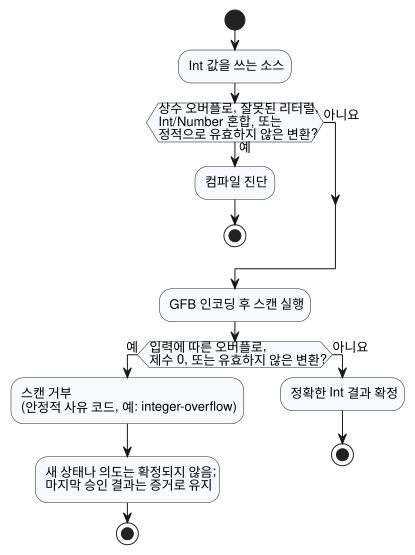

<!-- translation-source: docs/EXACT-INTEGER-CONTRACT.md -->
[영문 원문](EXACT-INTEGER-CONTRACT.md)

# 정확한 정수 계약 제안

추적: language issue #22 / integration `TASK-85.1` / review R14.

이 문서는 정확한 정수에 대한 N2–N4 설계와 이를 검증하는 승인 벡터를 기록합니다.
`Int`는 현재 파서, GFB 인코더, 이식 가능한 VM에 구현되어 있습니다.

확인된 제품 원칙은 간단합니다. **개수와 반복 합계는 선언된 범위 안에서 정확하게
유지됩니다.** 아래의 "권고"나 "제안" 같은 표현은 설계가 어떻게 정해졌는지를 기록한
것입니다. 현재 소스 계약은 Language Reference에 있습니다
([타입, 식, 상태](reference/02-types-expressions-state.md) 참고).

이 문서는 다음 내용을 순서대로 다룹니다.

- 확인된 의도와 현재 구현 경계
- `Int`가 고정 부호 있는 32비트 타입인 이유
- 리터럴의 타입이 정해지는 방식
- 정수 연산과 명시 변환
- fault(고장) 시 일어나는 일과 사용하는 안정적인 사유 코드
- N2, N3, N4가 담당하는 승인 벡터와 바이너리 할당
- review R14에서 아직 바뀔 수 있는 부분

## 확인된 의도와 현재 경계

- 개수와 측정값은 서로 다른 종류의 값입니다. 센서에서 나온 개수라고 해서
  근삿값이 되지는 않습니다.
- 정수 값과 정수 결과는 지원 범위 안에서 정확하게 유지되어야 합니다. 정밀도 손실,
  래핑, 포화는 절대 조용히 일어나지 않습니다.
- Browser/WASM과 ESP32는 같은 값 의미와 같은 fault 의미를 사용합니다.
- 현재 구현에는 `Bool`, `Number`(`f64`), `Int`(`i32`)의 세 가지 스칼라 타입이
  있습니다. GFB는 Number 상수/기본값을 8바이트 `f64`로, Int 상수/기본값을 4바이트
  부호 있는 `i32`로 인코딩합니다. JS/WASM 경계는 두 숫자 타입을 모두 JavaScript
  `number`로 노출하고 Int 범위를 검증합니다.
- GFB는 검사되는 Int 산술, 나눗셈, 나머지, 명시 변환을 구현합니다. 0으로 나누기,
  오버플로, 유효하지 않은 변환, 유한하지 않은 Number 결과는 상태와 의도가 확정되기
  전에 tick을 거부합니다.
- 날짜/시간, 단조 시계, 식별자 폭은 별도의 계약입니다. 이 제안은 epoch 타임스탬프를
  정수 개수 타입에 억지로 넣어서는 안 됩니다.

## 최소 타입 권고

고정 부호 있는 32비트 표현을 사용하는 공개 스칼라 타입 `Int` 하나를 추가합니다.

```text
Int = -2_147_483_648 .. 2_147_483_647
```

`Int`는 모든 호스트에서 정확히 이 범위를 뜻합니다. 플랫폼에 따라 크기가 달라지는
C/Rust `int`가 아닙니다. 부호가 있으므로 하나의 타입으로 개수, 차이, 오프셋을 모두
다룰 수 있으며 두 번째 부호 없는 타입은 필요하지 않습니다. 과일 개수처럼 음수가 없는
도메인은 다른 기본 타입이 아니라 선언된 설정/상태 범위로 표현합니다.

| 후보 | 이점 | 비용 | 최소 프로필 결정 |
| --- | --- | --- | --- |
| 정수처럼 보이는 값을 `f64`에 유지 | 형식 변경 없음 | 타입 의도가 숨겨지고 정확한 연산이 강제되지 않음 | 거부 |
| `i32` 기반 `Int` | 32비트 대상의 네이티브 폭, 4바이트 리터럴/기본값, 명시 변환 시 JS `number`로 정확히 표현 가능 | 유한한 범위; 오래 유지되는 합계에는 선언된 롤오버/fault 정책이 필요 | 권고 |
| `i64` 기반 `Int` | 훨씬 넓은 개수 범위 | 8바이트 페이로드, MCU 다중 워드 산술, JavaScript 정확 정수 범위를 넘는 값에 새 전송 표현이 필요 | 실제로 그 범위가 필요하다는 것이 입증될 때까지 보류 |
| 부호 있는/없는 기본 타입 분리 | 더 넓은 음수 없는 범위 | 혼합 타입 규칙과 변환 규칙 증가 | 첫 프로필에서는 거부 |

`f64` 옆에 `i32` variant를 추가한다고 해서 그것만으로 모든 VM 스택 슬롯이 작아지지는
않습니다. enum 레이아웃은 여전히 가장 큰 variant와 대상 정렬에 따라 정해집니다. 지금
확실히 기대할 수 있는 이점은 네이티브 폭 정수 연산과 4바이트 바이너리 상수/기본값입니다.
N3는 페이로드 폭을 근거로 VM 전체의 RAM 절감을 주장하지 말고 실제 ESP32 빌드를
측정해야 합니다.

## 리터럴과 타입 규칙

- 소수점 없는 십진 정수 표기는 정확한 정수 값을 가집니다. 기대되는 숫자 타입이 없으면
  기본값은 `Int`입니다.
- 주변 선언이나 피연산자가 기대 타입을 제공하면 정수 표기를 곧바로 `Number` 리터럴로
  구체화할 수 있습니다. 이것은 리터럴 타입 결정이며, 런타임에 `Int`를 `Number`로
  강제 변환하는 것이 아닙니다.
- 소수점이나 지수가 있는 숫자는 `Number`이며 절대 `Int`가 아닙니다.
- 첫 구현에서는 자릿수 구분 기호를 추가하지 않아도 됩니다. 범위는 JavaScript
  `Number`로 변환하기 전에 원래 숫자 자릿수로 검사합니다.
- `-2147483648`은 최소 부호 있는 리터럴로 허용됩니다. 이보다 큰 양수 또는 음수 크기는
  컴파일 오류입니다.
- N2는 선택적인 앞쪽 마이너스 기호를 정수 리터럴 경계 검사의 일부로 다루거나, 이와
  동등한 명시적 최소 리터럴 규칙을 구현해야 합니다. 양수 `2147483648`을 먼저 거부한 뒤
  단항 마이너스를 `0 - 2147483648`로 lowering하려고 해서는 안 됩니다.
- 변수, 입력, 상태, 결과, 함수 값은 `Int`와 `Number` 사이에서 절대 암묵적으로 변환되지
  않습니다. 혼합 산술과 혼합 비교는 컴파일 오류입니다.

이 규칙 덕분에 `temperature < 30` 같은 읽기 쉬운 임계값이 그대로 동작합니다. 왼쪽
피연산자가 기대 타입 `Number`를 제공하기 때문입니다. 한편 타입이 없는
`let count = 30`은 정확한 `Int`입니다.

정수 리터럴은 바로 인접한 타입 컨텍스트에서만 기대 타입을 받습니다.

- 선언된 config/state/output 초기값 또는 출력 연결
- 정적으로 타입이 지정된 함수 매개변수
- 산술이나 비교의 다른 쪽 구체적 숫자 피연산자
- 두 `if` 분기가 공유하는 바깥쪽 기대 타입

어느 쪽도 타입을 제공하지 않으면 정수 리터럴은 기본적으로 `Int`입니다. 소수 리터럴이
있으면 같은 숫자 식이 `Number`가 됩니다. 타입이 없는 `let`은 초기값에서 타입을 가져오며,
이후의 사용이 다른 타입을 거꾸로 전파하지 않습니다. 충돌하는 컨텍스트는 진단을 만들며,
컴파일러는 오버로드를 추측하지 않습니다.

| 소스 | 타입 | 이유 |
| --- | --- | --- |
| `let count = 30` | `Int` | 기대 타입이 없으므로 정수 리터럴의 기본값은 `Int` |
| `let level = 30.0` | `Number` | 소수점 |
| `temperature < 30` (`temperature: Number`일 때) | `30`은 `Number` 리터럴 | 다른 피연산자가 `Number`를 제공 |
| `count + 1.5` (`count: Int`일 때) | 컴파일 오류 | `Int`/`Number` 혼합 |

## 연산

| 식 | 결과 | 규칙 |
| --- | --- | --- |
| `a + b`, `a - b`, `a * b` | `Int` | 검사되는 정확한 `i32` 연산; 오버플로는 fault |
| `-a` | `Int` | 검사됨; 최솟값의 부호 반전은 fault |
| `a div b` | `Int` | 몫은 0 방향으로 절삭; 제수 0과 최솟값 나누기 `-1`은 fault |
| `a % b` | `Int` | 나머지는 피제수의 부호를 따름; 제수 0은 fault |
| 두 `Int`의 `a / b` | 없음 | 컴파일 오류; `div`를 쓰거나 피연산자를 `Number`로 명시 변환 |
| `== != < <= > >=` | `Bool` | 두 `Int`에 허용 |
| 모든 `Int`/`Number` 혼합 | 없음 | 명시 변환이 있을 때까지 컴파일 오류 |

모든 유효한 나눗셈과 나머지에서 `a == (a div b) * b + (a % b)`가 성립합니다. 정수
오버플로는 절대 `Number`로 변환되거나 래핑되거나 포화되지 않습니다.

## 명시 변환

이 절은 의미 연산을 고정합니다. `div`, `%`와 아래 변환 이름은 review R14를 위한 임시
소스 표기였습니다. 승인 벡터 ID는 의미 연산을 가리키므로, N2는 이를 소스 픽스처로 바꾸기
전에 승인된 표기로 대체합니다.

| 후보 연산 | 계약 |
| --- | --- |
| `number(i)` | `Int`를 `Number`로; 모든 `i32`는 `f64`로 정확히 표현되므로 항상 정확 |
| `int_exact(n)` | 범위 안의 정수인 `Number`만 허용하고, 그 외에는 fault |
| `int_floor(n)` | 수학적 floor 후 범위 검사 |
| `int_ceil(n)` | 수학적 ceiling 후 범위 검사 |
| `int_trunc(n)` | 0 방향 절삭 후 범위 검사 |
| `int_nearest_even(n)` | 가장 가까운 정수(동률이면 짝수) 후 범위 검사 |

숨은 기본 반올림 방식을 쓰는 일반 변환은 없습니다. 상수의 유효하지 않은 변환은 컴파일
오류입니다. 입력에 따라 달라지는 유효하지 않은 변환은 런타임 숫자 fault입니다.

## fault와 상태 의미

다이어그램처럼, 오류는 그것을 볼 수 있는 가장 이른 시점에 잡힙니다.



- **컴파일 시점.** 상수 오버플로, 유효하지 않은 정수 리터럴, 정적으로 유효하지 않은
  변환은 컴파일 진단입니다.
- **실행 시점.** 입력에 따른 오버플로, 0으로 나누기, 유효하지 않은 변환은 새 상태나
  의도가 확정되기 전에 현재 스캔을 거부합니다.

런타임 거부가 일어나면 호스트는 기존 실행 fault 경로로 들어가고, 마지막으로 승인된
결과를 증거로 보존합니다. 이 언어 규칙만으로 물리 릴레이가 OFF가 되었다고 주장하지는
않습니다. 렌더러의 안전 출력 처리와 물리적 확인은 별도의 증거로 남습니다.

런타임 경계에서는 서로 구별되는 다음의 안정적인 사유 코드를 사용합니다.

- `integer-overflow`
- `integer-division-by-zero`
- `integer-conversion-fractional`
- `integer-conversion-out-of-range`

코어 런타임에서 거부된 연산은 확정된 tick 번호, 논리 시간, 상태, 안전 의도, journal을
바꾸지 않습니다. 프레임 스캔 어댑터는 거부된 후보 입력도 지우며, 승인된 스캔 ID나 논리
시간을 진행시키지 않습니다.

소비자는 호스트 정책이 재사용을 허용할 때에만 같은 식별자로 재시도할 수 있습니다. 현재
framed Browser 호스트는 호스트가 진입한 실행 fault를 래치하고 새 인스턴스를 요구합니다.
마지막으로 승인된 결과는 증거로 남고, 현재 오류는 거부를 보고합니다. N3는 코어
트랜잭션과 framed 호스트 복구 경계를 모두 테스트해야 합니다.

## 후속 승인 벡터

담당은 단계별로 나뉩니다.

- **N2**는 리터럴, 타입, 변환 진단을 담당합니다.
- **N3**는 런타임 연산 동작을 담당합니다.
- **N4**는 정확한 바이너리와 호스트 교환을 담당합니다.

R14에서 겉 표기가 바뀌더라도 각 ID는 그대로 유지됩니다.

| ID | 입력 또는 연산 | 기대 결과 | 담당 |
| --- | --- | --- | --- |
| N1-LIT-01 | `Int` 컨텍스트의 `0`, `2147483647`, `-2147483648` | 정확한 값으로 허용 | N2 |
| N1-LIT-02 | `2147483648`, `-2147483649` | 컴파일 범위 진단 | N2 |
| N1-LIT-03 | 타입 없는 `30` / `30.0` | `Int(30)` / `Number(30.0)` | N2 |
| N1-TYPE-01 | `Int + Number`, `Int < Number` | 컴파일 혼합 타입 진단 | N2 |
| N1-TYPE-02 | 두 `Int` 피연산자에 `/` | `div` 또는 명시적 Number 변환을 안내하는 컴파일 진단 | N2 |
| N1-ADD-01 | 런타임 입력 `MAX + 1`, `MIN - 1` | 런타임 오버플로; 확정 없음 | N3 |
| N1-MUL-01 | 런타임 입력 `46340 * 46340` / `46341 * 46341` | `2147395600` / 확정 없는 오버플로 | N3 |
| N1-NEG-01 | `MIN`을 담은 런타임 입력의 부호 반전 | 런타임 오버플로; 확정 없음 | N3 |
| N1-DIV-01 | `7 div 3`, `-7 div 3`, `7 div -3`, `-7 div -3`의 런타임 입력 | `2`, `-2`, `-2`, `2` | N3 |
| N1-DIV-02 | `1 div 0`, `MIN div -1`의 런타임 입력 | 0으로 나누기 / 오버플로; 확정 없음 | N3 |
| N1-MOD-01 | `7 % 3`, `-7 % 3`의 런타임 입력 | `1`, `-1` | N3 |
| N1-CONV-01 | `number(-2147483648)`, `number(2147483647)` | 정확히 대응하는 `Number` | N2/N3 |
| N1-CONV-02 | 상수 `int_exact(3.0)` / `int_exact(3.5)` | `3` / 컴파일 시점 소수부 진단 | N2 |
| N1-CONV-03 | 정확 변환을 거치는 런타임 Number 입력 `3.0` / `3.5` | `3` / 확정 없는 소수부 변환 fault | N3 |
| N1-CONV-04 | 런타임 입력 `-2.5`의 floor/ceil/trunc/nearest-even | `-3`, `-2`, `-2`, `-2` | N3 |
| N1-GFB-01 | 최솟값, 0, 최댓값 상태 기본값 | 새 정수 표현이 네이티브와 WASM에서 정확한 바이트로 왕복 | N4 |
| N1-GFB-02 | 구형 GFB1을 새 정수 지원 형식으로 제시, 그리고 그 반대 | fail-closed; `NUMBER_CONST`를 절대 `Int`로 재해석하지 않음 | N4 |
| N1-ABI-01 | 최소/최대 `Int` 입력과 출력 | 정확한 네이티브/WASM 교환과 동일한 추적 값 | N4 |

여기서 처음 제안한 N4 할당은 이제 구현되었고 바이트 수준 테스트로 고정되어 있습니다.

| 경계 | 정수 지원 계약 |
| --- | --- |
| 바이트코드 봉투 | magic `GFB1`, 리틀엔디안 `u16` 형식 버전 `2`; 버전 `1`은 변경 불가로 유지 |
| 타입 태그 | `3 = Int` (`1 = Bool`, `2 = Number`는 그대로) |
| 상수/기본값 | 부호 있는 리틀엔디안 `i32` |
| opcode | `23 INT_CONST`, `24 INT_NEG`, `25 INT_ADD`, `26 INT_SUB`, `27 INT_MUL`, `28 INT_DIV`, `29 INT_REM` |
| 변환 opcode | `48 INT_TO_NUMBER`, `49 NUMBER_TO_INT_EXACT`, `50 ...FLOOR`, `51 ...CEIL`, `52 ...TRUNC`, `53 ...NEAREST_EVEN`; `30`과 `31`은 분기 opcode |
| manifest | `GhostFlow/control-v4`, 명목 타입 표기 `Int` |
| 런타임 identity | `GhostFlow/runtime-semantics-v1` |
| 프레임 ABI | `GhostFlow/framed-scan-abi-v1`; 입력/capability 타입 태그 `3`, 리틀엔디안 `i32` 4바이트 |
| 패키지 | `GhostFlow/portable-package-v1`; 바이트코드 버전, manifest, 런타임/ABI identity를 묶음 |
| 추적/결과 JSON | JSON number와 manifest에 선언된 `Int`; 디코더는 노출 전에 정수 `i32` 범위를 요구 |

Browser 프레임 인코더는 JavaScript 숫자가 우연히 정수인지가 아니라, 검증된 manifest를
보고 타입 태그 `3`을 고릅니다. `Number(3.0)`과 `Int(3)`은 서로 다른 값입니다. 네이티브와
WASM 로더는 활성화 전에 알 수 없는 형식, 타입, opcode 값을 거부합니다.

N4는 정확한 최솟값/0/최댓값 픽스처와 그 SHA-256 값을 공개해야 하며, 네이티브와 WASM
소비자는 같은 바이트를 로드합니다. N4는 버전 1의 `NUMBER_CONST f64`를 정수 인코딩으로
재사용해서는 안 됩니다. 기존 버전 1 패키지는 변경 불가로 유지되며, 호스트가 그 선언된
identity를 명시적으로 지원하지 않으면 거부됩니다.

모든 `Int`는 JavaScript 안전 정수 범위 안에 들어갑니다. 따라서 JSON을 다루는 어댑터는
이를 JSON number로 전달할 수 있지만, 반드시 엄격한 정수/범위 검증을 거쳐야 하며 손실이
있는 파싱은 허용되지 않습니다. 숫자 태그 할당은 기술적 호환성 결정입니다. R14는 바이트
값이 아니라 소스 표기를 검토합니다.

## R14 검토 경계

구현을 위해 제안된 기술 기준은 다음과 같습니다.

- 하나의 고정 `Int`/`i32` 타입
- 검사되는 fault
- 명시 변환
- 정수 몫에는 `div`, 나머지에는 `%`

R14는 읽기 쉬운 예제를 사용해 사람이 보는 표기(`Int`, `div`, `%`, 변환 이름)만 검토하면
됩니다. 이미 확인된 정확한 개수와 근삿값 측정의 구분을 다시 논의해서는 안 됩니다.
