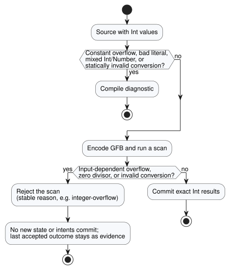

# Exact integer contract proposal

Tracking: language issue #22 / integration `TASK-85.1` / review R14.

This document records the N2–N4 design for exact integers and the acceptance
vectors that test it. `Int` is now implemented by the parser, the GFB encoder
and the portable VM.

The confirmed product principle is simple: **counts and repetition totals stay
exact within a declared range.** Wording below such as "recommend" or
"proposal" records how the design was reached. The current source contract is
the Language Reference (see
[Types, expressions and state](reference/02-types-expressions-state.en.md)).

This document covers, in order:

- the confirmed intent and the current implementation boundary;
- why `Int` is a fixed signed 32-bit type;
- how literals get their type;
- the integer operations and explicit conversions;
- what happens on a fault, and which stable reason codes are used;
- the acceptance vectors owned by N2, N3 and N4, and the binary allocation; and
- what review R14 may still change.

## Confirmed intent and current boundary

- Counts and measurements are different kinds of values. A count does not
  become approximate just because it came from a sensor.
- Integer values and integer results must stay exact within the supported
  range. Precision loss, wrapping and saturation are never silent.
- Browser/WASM and ESP32 use the same value semantics and the same fault
  semantics.
- The current implementation has three scalar types: `Bool`, `Number` (`f64`)
  and `Int` (`i32`). GFB encodes Number constants/defaults as eight-byte `f64`
  and Int constants/defaults as four-byte signed `i32`. The JS/WASM boundary
  exposes both numeric types as a JavaScript `number`, and validates the Int
  range.
- GFB implements checked Int arithmetic, division, remainder and explicit
  conversions. Division by zero, overflow, an invalid conversion or a
  non-finite Number result rejects the tick before state and intents commit.
- Date/time, the monotonic clock and identifier widths are separate contracts.
  This proposal must not force an epoch timestamp into the integer count type.

## Minimum type recommendation

Add one public scalar type, `Int`, with a fixed signed 32-bit representation:

```text
Int = -2_147_483_648 .. 2_147_483_647
```

`Int` means exactly this range on every host. It is not a platform-sized C/Rust
`int`. Because it is signed, one type covers counts, differences and offsets;
no second unsigned type is needed. A non-negative domain, such as a fruit
count, is expressed by the declared configuration/state bounds, not by another
primitive type.

| Candidate | Benefit | Cost | Decision for the minimum profile |
| --- | --- | --- | --- |
| Keep integer-looking values in `f64` | no format change | type intent remains hidden; exact operations are not enforced | reject |
| `Int` backed by `i32` | native width on the 32-bit target, four-byte literal/default, exactly representable by JS `number` when explicitly converted | finite range; long-lived totals need a declared rollover/fault policy | recommend |
| `Int` backed by `i64` | much larger count range | eight-byte payload, multiword MCU arithmetic, and values beyond JavaScript's exact integer range need a new transport representation | defer until a demonstrated range requires it |
| separate signed and unsigned primitives | wider non-negative range | more mixed-type and conversion rules | reject for the first profile |

Adding an `i32` variant beside `f64` does not by itself make every VM stack slot
smaller. Enum layout is still set by the largest variant and by target
alignment. The gains we can count on now are native-width integer operations
and four-byte binary constants/defaults. N3 must measure the actual ESP32 build
instead of claiming a whole-VM RAM saving from payload width.

## Literal and type rules

- A whole decimal numeral has an exact integer value. When no numeric type is
  expected, it defaults to `Int`.
- A whole numeral may be elaborated directly as a `Number` literal when the
  surrounding declaration or operand supplies that expected type. This is
  literal typing, not a runtime `Int` to `Number` coercion.
- A numeral with a decimal point or an exponent is `Number`, never `Int`.
- The first implementation need not add digit separators. The range is checked
  on the original digits, before any conversion through JavaScript `Number`.
- `-2147483648` is accepted as the minimum signed literal. Any larger positive
  or negative magnitude is a compile error.
- N2 must treat the optional leading minus as part of the integer-literal
  boundary check, or implement an equivalent explicit minimum-literal rule. It
  must not first reject positive `2147483648` and then try to lower unary minus
  as `0 - 2147483648`.
- Variables, inputs, state, results and function values never convert implicitly
  between `Int` and `Number`. Mixed arithmetic and mixed comparison are compile
  errors.

These rules keep readable thresholds such as `temperature < 30` working: the
left operand supplies the expected type `Number`. Meanwhile an untyped
`let count = 30` is an exact `Int`.

A whole literal receives an expected type only from its immediate typed context:

- a declared config/state/output initializer or an output connection;
- a statically typed function parameter;
- the other concrete numeric operand of arithmetic or comparison; and
- an enclosing expected type shared by both `if` branches.

When neither side supplies a type, whole literals default to `Int`; a decimal
literal makes the same numeric expression `Number`. An untyped `let` takes its
type from its initializer, and later uses do not back-propagate a different
type. Conflicting contexts produce diagnostics; the compiler does not guess an
overload.

| Source | Type | Why |
| --- | --- | --- |
| `let count = 30` | `Int` | no expected type; whole literal defaults to `Int` |
| `let level = 30.0` | `Number` | decimal point |
| `temperature < 30` (with `temperature: Number`) | `30` is a `Number` literal | the other operand supplies `Number` |
| `count + 1.5` (with `count: Int`) | compile error | mixed `Int`/`Number` |

## Operations

| Expression | Result | Rule |
| --- | --- | --- |
| `a + b`, `a - b`, `a * b` | `Int` | checked exact `i32`; overflow faults |
| `-a` | `Int` | checked; negating the minimum value faults |
| `a div b` | `Int` | quotient truncates toward zero; zero divisor and minimum value divided by `-1` fault |
| `a % b` | `Int` | remainder has the dividend's sign; zero divisor faults |
| `a / b` for two `Int`s | none | compile error; choose `div` or explicitly convert operands to `Number` |
| `== != < <= > >=` | `Bool` | allowed for two `Int`s |
| any `Int`/`Number` mixture | none | compile error until an explicit conversion is present |

For every valid division and remainder, `a == (a div b) * b + (a % b)` holds.
Integer overflow is never converted into `Number`, wrapped or saturated.

## Explicit conversions

This section fixes the semantic operations. The names `div`, `%` and the
conversion names below were provisional source spellings for review R14.
Acceptance-vector IDs name the semantic operations, so N2 substitutes the
approved spelling before turning them into source fixtures.

| Candidate operation | Contract |
| --- | --- |
| `number(i)` | `Int` to `Number`; always exact because every `i32` is exactly representable by `f64` |
| `int_exact(n)` | accepts only an integral in-range `Number`; otherwise faults |
| `int_floor(n)` | mathematical floor, then range check |
| `int_ceil(n)` | mathematical ceiling, then range check |
| `int_trunc(n)` | truncate toward zero, then range check |
| `int_nearest_even(n)` | nearest integer with ties to even, then range check |

There is no generic conversion with a hidden rounding default. An invalid
conversion of a constant is a compile error. An invalid conversion that depends
on input is a runtime numeric fault.

## Fault and state semantics

Errors are caught at the earliest point that can see them, as the diagram shows.



- **Compile time.** Constant overflow, invalid integer literals and statically
  invalid conversions are compile diagnostics.
- **Run time.** Input-dependent overflow, division by zero and invalid
  conversion reject the current scan before any new state or intent commits.

On a runtime rejection the host enters its existing execution-fault path and
keeps the last accepted outcome as evidence. This language rule does not by
itself claim that a physical relay has turned OFF. Renderer safe-output
handling and physical confirmation remain separate evidence.

Use these distinct, stable reasons at the runtime boundary:

- `integer-overflow`
- `integer-division-by-zero`
- `integer-conversion-fractional`
- `integer-conversion-out-of-range`

In the core runtime, a rejected operation leaves the committed tick number,
logical time, state, safe intents and journal unchanged. The framed scan adapter
also clears the rejected candidate inputs and does not advance its accepted
scan ID or logical time.

A consumer may retry that identity only if its host policy allows reuse. The
current framed Browser host latches a host-entered execution fault and requires
a fresh instance. Its last accepted outcome remains evidence, while the current
error reports the rejection. N3 must test both the core transaction and the
framed-host recovery boundary.

## Downstream acceptance vectors

Ownership is split by stage:

- **N2** owns literal, type and conversion diagnostics.
- **N3** owns runtime operation behavior.
- **N4** owns exact binary and host exchange.

Each ID stays stable even if R14 changes a surface spelling.

| ID | Input or operation | Expected result | Owner |
| --- | --- | --- | --- |
| N1-LIT-01 | `0`, `2147483647`, `-2147483648` in `Int` context | accepted exact values | N2 |
| N1-LIT-02 | `2147483648`, `-2147483649` | compile range diagnostic | N2 |
| N1-LIT-03 | untyped `30` / `30.0` | `Int(30)` / `Number(30.0)` | N2 |
| N1-TYPE-01 | `Int + Number`, `Int < Number` | compile mixed-type diagnostic | N2 |
| N1-TYPE-02 | two `Int` operands with `/` | compile diagnostic naming `div` or explicit Number conversion | N2 |
| N1-ADD-01 | runtime inputs `MAX + 1`, `MIN - 1` | runtime overflow; no commit | N3 |
| N1-MUL-01 | runtime inputs `46340 * 46340` / `46341 * 46341` | `2147395600` / overflow with no commit | N3 |
| N1-NEG-01 | negate a runtime input holding `MIN` | runtime overflow; no commit | N3 |
| N1-DIV-01 | runtime inputs for `7 div 3`, `-7 div 3`, `7 div -3`, `-7 div -3` | `2`, `-2`, `-2`, `2` | N3 |
| N1-DIV-02 | runtime inputs for `1 div 0`, `MIN div -1` | division-by-zero / overflow; no commit | N3 |
| N1-MOD-01 | runtime inputs for `7 % 3`, `-7 % 3` | `1`, `-1` | N3 |
| N1-CONV-01 | `number(-2147483648)`, `number(2147483647)` | exact corresponding `Number`s | N2/N3 |
| N1-CONV-02 | constants `int_exact(3.0)` / `int_exact(3.5)` | `3` / compile-time fractional diagnostic | N2 |
| N1-CONV-03 | runtime Number inputs `3.0` / `3.5` through exact conversion | `3` / fractional conversion fault with no commit | N3 |
| N1-CONV-04 | floor/ceil/trunc/nearest-even of runtime input `-2.5` | `-3`, `-2`, `-2`, `-2` | N3 |
| N1-GFB-01 | minimum, zero and maximum state defaults | new integer representation round-trips exact bytes on native and WASM | N4 |
| N1-GFB-02 | old GFB1 presented as the new integer-capable format and vice versa | fail closed; never reinterpret `NUMBER_CONST` as `Int` | N4 |
| N1-ABI-01 | minimum/maximum `Int` input and output | exact native/WASM exchange and identical trace values | N4 |

The N4 allocation, first proposed here, is now implemented and fixed by
byte-level tests:

| Boundary | Integer-capable contract |
| --- | --- |
| Bytecode envelope | magic `GFB1`, little-endian `u16` format version `2`; version `1` remains immutable |
| Type tag | `3 = Int` (`1 = Bool`, `2 = Number` unchanged) |
| Constant/default | signed little-endian `i32` |
| Opcodes | `23 INT_CONST`, `24 INT_NEG`, `25 INT_ADD`, `26 INT_SUB`, `27 INT_MUL`, `28 INT_DIV`, `29 INT_REM` |
| Conversion opcodes | `48 INT_TO_NUMBER`, `49 NUMBER_TO_INT_EXACT`, `50 ...FLOOR`, `51 ...CEIL`, `52 ...TRUNC`, `53 ...NEAREST_EVEN`; `30` and `31` are branch opcodes |
| Manifest | `GhostFlow/control-v4`, nominal type spelling `Int` |
| Runtime identity | `GhostFlow/runtime-semantics-v1` |
| Framed ABI | `GhostFlow/framed-scan-abi-v1`; input/capability type tag `3`, four little-endian `i32` bytes |
| Package | `GhostFlow/portable-package-v1`; binds bytecode version, manifest and runtime/ABI identities |
| Trace/outcome JSON | JSON number plus manifest-declared `Int`; decoder requires integral `i32` range before exposing it |

The Browser frame encoder picks type tag `3` from the verified manifest, not
from whether a JavaScript number happens to be integral. `Number(3.0)` and
`Int(3)` are distinct values. Native and WASM loaders reject unknown format,
type or opcode values before activation.

N4 must publish exact minimum/zero/maximum fixtures and their SHA-256 values,
and the native and WASM consumers load those same bytes. N4 must not reuse the
version-1 `NUMBER_CONST f64` as an integer encoding. Existing version-1 packages
remain immutable, and are rejected when the host does not explicitly support
their declared identities.

Every `Int` fits in the JavaScript safe-integer range. So JSON-facing adapters
may carry it as a JSON number, but only with strict integral and range
validation; no lossy parse is permitted. The numeric tag allocation is a
technical compatibility decision: R14 reviews the source spelling, not the byte
values.

## R14 review boundary

The technical baseline proposed for implementation is:

- one fixed `Int`/`i32` type;
- checked faults;
- explicit conversions;
- `div` for the integer quotient and `%` for the remainder.

R14 needs to review only the human-facing spelling (`Int`, `div`, `%` and the
conversion names), using readable examples. It must not reopen the already
confirmed distinction between exact counts and approximate measurements.
