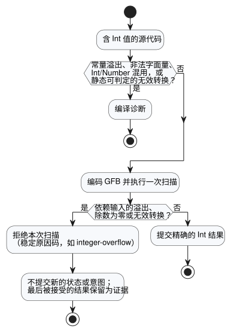

<!-- translation-source: docs/EXACT-INTEGER-CONTRACT.md -->
[英文原文](EXACT-INTEGER-CONTRACT.md)

# 精确整数契约提案

跟踪：语言 issue #22 / 集成 `TASK-85.1` / 评审 R14。

本文档记录精确整数（exact integer）的 N2–N4 设计，以及用于检验该设计的验收向量。`Int` 现已由解析器、GFB 编码器和可移植 VM 实现。

已确认的产品原则很简单：**计数和重复次数总计在声明的范围内保持精确。** 下文中“建议”“提案”等措辞记录的是设计的形成过程。当前的源代码契约以语言参考为准（参见[类型、表达式与状态](reference/02-types-expressions-state.zh.md)）。

本文档依次介绍：

- 已确认的意图和当前的实现边界；
- 为什么 `Int` 是固定的有符号 32 位类型；
- 字面量如何获得类型；
- 整数运算和显式转换；
- 发生故障时会怎样，以及使用哪些稳定的原因码；
- N2、N3 和 N4 各自负责的验收向量，以及二进制编码分配；以及
- 评审 R14 仍可能修改的内容。

## 已确认的意图与当前边界

- 计数与测量值是不同种类的值。计数不会仅仅因为来自传感器就变成近似值。
- 整数值和整数结果必须在支持的范围内保持精确。精度损失、回绕（wrapping）和饱和绝不会静默发生。
- Browser/WASM 与 ESP32 使用相同的值语义和相同的故障语义。
- 当前实现有三种标量类型：`Bool`、`Number`（`f64`）和 `Int`（`i32`）。GFB 将 Number 常量/默认值编码为 8 字节 `f64`，将 Int 常量/默认值编码为 4 字节有符号 `i32`。JS/WASM 边界将这两种数值类型都暴露为 JavaScript `number`，并校验 Int 的范围。
- GFB 实现了带检查的 Int 算术、除法、取余和显式转换。除以零、溢出、无效转换或非有限的 Number 结果会在状态和意图提交之前拒绝该 tick（逻辑决策步）。
- 日期/时间、单调时钟和标识符宽度属于各自独立的契约。本提案不得把 epoch 时间戳硬塞进整数计数类型。

## 最小类型建议

新增一个公开的标量类型 `Int`，采用固定的有符号 32 位表示：

```text
Int = -2_147_483_648 .. 2_147_483_647
```

`Int` 在每个宿主上都恰好表示这个范围。它不是随平台变化宽度的 C/Rust `int`。由于它是有符号的，一个类型即可覆盖计数、差值和偏移量；不需要第二个无符号类型。非负的值域（例如果实数量）通过声明的配置/状态边界来表达，而不是通过另一个基本类型。

| 候选方案 | 收益 | 代价 | 最小 profile 的决定 |
| --- | --- | --- | --- |
| 把看起来像整数的值保留在 `f64` 中 | 无需更改格式 | 类型意图仍被隐藏；精确运算得不到强制保证 | 拒绝 |
| 以 `i32` 实现 `Int` | 在 32 位目标上为原生宽度，字面量/默认值占 4 字节，显式转换时可被 JS `number` 精确表示 | 范围有限；长期累计的总数需要声明回绕/故障策略 | 建议 |
| 以 `i64` 实现 `Int` | 计数范围大得多 | 负载为 8 字节，MCU 上需多字运算，超出 JavaScript 精确整数范围的值需要新的传输表示 | 推迟，直到有实际需求证明需要该范围 |
| 有符号与无符号分别作为基本类型 | 非负范围更宽 | 更多混合类型和转换规则 | 第一个 profile 中拒绝 |

在 `f64` 旁边新增一个 `i32` 变体，本身并不会让每个 VM 栈槽变小。枚举的布局仍由最大的变体和目标平台的对齐方式决定。目前可以确定的收益是原生宽度的整数运算，以及 4 字节的二进制常量/默认值。N3 必须实测 ESP32 的实际构建结果，而不是根据负载宽度声称整个 VM 节省了 RAM。

## 字面量与类型规则

- 整数形式的十进制数字具有精确的整数值。在没有期望数值类型时，它默认为 `Int`。
- 当外围声明或操作数提供了期望类型 `Number` 时，整数形式的数字可以直接被细化（elaborate）为 `Number` 字面量。这是字面量定型，而不是运行时从 `Int` 到 `Number` 的强制转换。
- 带小数点或指数的数字是 `Number`，绝不是 `Int`。
- 首个实现不必支持数字分隔符。范围检查针对原始数字串进行，在任何经过 JavaScript `Number` 的转换之前完成。
- `-2147483648` 作为最小有符号字面量被接受。任何更大的正数或负数绝对值都是编译错误。
- N2 必须把可选的前导负号视为整数字面量边界检查的一部分，或者实现一条等价的显式最小字面量规则。不得先拒绝正数 `2147483648`，再尝试把一元负号降级为 `0 - 2147483648`。
- 变量、输入、状态、结果和函数值绝不会在 `Int` 与 `Number` 之间隐式转换。混合算术和混合比较都是编译错误。

这些规则让 `temperature < 30` 这样易读的阈值继续有效：左操作数提供了期望类型 `Number`。同时，未标注类型的 `let count = 30` 是精确的 `Int`。

整数字面量只能从其直接的类型化上下文中获得期望类型：

- 已声明的 config/state/output 初始化器或输出连接；
- 静态类型化的函数参数；
- 算术或比较中另一个具体的数值操作数；以及
- `if` 两个分支共享的外围期望类型。

当两侧都不提供类型时，整数字面量默认为 `Int`；一个小数字面量会使同一个数值表达式成为 `Number`。未标注类型的 `let` 从其初始化器获得类型，之后的使用不会反向传播出不同的类型。相互冲突的上下文会产生诊断；编译器不会猜测重载。

| 源代码 | 类型 | 原因 |
| --- | --- | --- |
| `let count = 30` | `Int` | 无期望类型；整数字面量默认为 `Int` |
| `let level = 30.0` | `Number` | 带小数点 |
| `temperature < 30`（其中 `temperature: Number`） | `30` 是 `Number` 字面量 | 另一个操作数提供了 `Number` |
| `count + 1.5`（其中 `count: Int`） | 编译错误 | `Int`/`Number` 混用 |

## 运算

| 表达式 | 结果 | 规则 |
| --- | --- | --- |
| `a + b`、`a - b`、`a * b` | `Int` | 带检查的精确 `i32`；溢出即故障 |
| `-a` | `Int` | 带检查；对最小值取负即故障 |
| `a div b` | `Int` | 商向零截断；除数为零以及最小值除以 `-1` 即故障 |
| `a % b` | `Int` | 余数与被除数同号；除数为零即故障 |
| 两个 `Int` 的 `a / b` | 无 | 编译错误；请选择 `div`，或将操作数显式转换为 `Number` |
| `== != < <= > >=` | `Bool` | 两个 `Int` 之间允许 |
| 任何 `Int`/`Number` 混用 | 无 | 在出现显式转换之前均为编译错误 |

对于每一个有效的除法和取余，`a == (a div b) * b + (a % b)` 都成立。整数溢出绝不会被转换为 `Number`、回绕或饱和。

## 显式转换

本节确定语义层面的运算。`div`、`%` 以及下表中的转换名称是提交评审 R14 的暂定源代码拼写。验收向量的 ID 以语义运算命名，因此 N2 在将其转为源代码测试夹具（fixture）之前，会替换为批准后的拼写。

| 候选运算 | 契约 |
| --- | --- |
| `number(i)` | `Int` 到 `Number`；始终精确，因为每个 `i32` 都能被 `f64` 精确表示 |
| `int_exact(n)` | 只接受整数值且在范围内的 `Number`；否则故障 |
| `int_floor(n)` | 数学向下取整，然后进行范围检查 |
| `int_ceil(n)` | 数学向上取整，然后进行范围检查 |
| `int_trunc(n)` | 向零截断，然后进行范围检查 |
| `int_nearest_even(n)` | 取最近整数，平局时取偶数，然后进行范围检查 |

不存在带有隐藏默认舍入方式的通用转换。对常量进行的无效转换是编译错误。依赖输入的无效转换是运行时数值故障。

## 故障与状态语义

如图所示，错误会在最早能够发现它的位置被捕获。



- **编译时。** 常量溢出、无效的整数字面量和静态可判定的无效转换都是编译诊断。
- **运行时。** 依赖输入的溢出、除以零和无效转换会在任何新状态或意图提交之前拒绝当前扫描。

发生运行时拒绝时，宿主进入其现有的执行故障路径，并把最后被接受的结果保留为证据。这条语言规则本身并不声称物理继电器已经断开（OFF）。渲染器的安全输出处理和物理确认仍是各自独立的证据。

在运行时边界上使用以下彼此不同的稳定原因码：

- `integer-overflow`
- `integer-division-by-zero`
- `integer-conversion-fractional`
- `integer-conversion-out-of-range`

在核心运行时中，被拒绝的运算不会改变已提交的 tick 序号、逻辑时间、状态、安全意图和 journal。framed 扫描适配器还会清除被拒绝的候选输入，并且不推进其已接受的扫描 ID 或逻辑时间。

只有当宿主策略允许复用时，使用方才可以用同一身份标识重试。当前的 framed Browser 宿主会锁存由宿主进入的执行故障，并要求使用新的实例。其最后被接受的结果仍作为证据保留，而当前错误会报告这次拒绝。N3 必须同时测试核心事务和 framed 宿主的恢复边界。

## 下游验收向量

职责按阶段划分：

- **N2** 负责字面量、类型和转换诊断。
- **N3** 负责运行时运算行为。
- **N4** 负责精确的二进制格式和宿主数据交换。

即使 R14 修改了表层拼写，每个 ID 也保持不变。

| ID | 输入或运算 | 预期结果 | 负责方 |
| --- | --- | --- | --- |
| N1-LIT-01 | `Int` 上下文中的 `0`、`2147483647`、`-2147483648` | 作为精确值被接受 | N2 |
| N1-LIT-02 | `2147483648`、`-2147483649` | 编译期范围诊断 | N2 |
| N1-LIT-03 | 未标注类型的 `30` / `30.0` | `Int(30)` / `Number(30.0)` | N2 |
| N1-TYPE-01 | `Int + Number`、`Int < Number` | 编译期混合类型诊断 | N2 |
| N1-TYPE-02 | 两个 `Int` 操作数使用 `/` | 编译诊断，提示使用 `div` 或显式转换为 Number | N2 |
| N1-ADD-01 | 运行时输入 `MAX + 1`、`MIN - 1` | 运行时溢出；不提交 | N3 |
| N1-MUL-01 | 运行时输入 `46340 * 46340` / `46341 * 46341` | `2147395600` / 溢出且不提交 | N3 |
| N1-NEG-01 | 对值为 `MIN` 的运行时输入取负 | 运行时溢出；不提交 | N3 |
| N1-DIV-01 | `7 div 3`、`-7 div 3`、`7 div -3`、`-7 div -3` 的运行时输入 | `2`、`-2`、`-2`、`2` | N3 |
| N1-DIV-02 | `1 div 0`、`MIN div -1` 的运行时输入 | 除以零 / 溢出；不提交 | N3 |
| N1-MOD-01 | `7 % 3`、`-7 % 3` 的运行时输入 | `1`、`-1` | N3 |
| N1-CONV-01 | `number(-2147483648)`、`number(2147483647)` | 对应的精确 `Number` | N2/N3 |
| N1-CONV-02 | 常量 `int_exact(3.0)` / `int_exact(3.5)` | `3` / 编译期小数诊断 | N2 |
| N1-CONV-03 | 运行时 Number 输入 `3.0` / `3.5` 经过精确转换 | `3` / 小数转换故障且不提交 | N3 |
| N1-CONV-04 | 对运行时输入 `-2.5` 进行 floor/ceil/trunc/nearest-even | `-3`、`-2`、`-2`、`-2` | N3 |
| N1-GFB-01 | 最小值、零和最大值的状态默认值 | 新的整数表示在原生和 WASM 上往返后字节完全一致 | N4 |
| N1-GFB-02 | 将旧的 GFB1 当作支持整数的新格式呈现，反之亦然 | 失败即关闭（fail closed）；绝不将 `NUMBER_CONST` 重新解释为 `Int` | N4 |
| N1-ABI-01 | 最小/最大 `Int` 输入和输出 | 原生/WASM 精确交换，追踪值完全相同 | N4 |

最初在此提出的 N4 编码分配现已实现，并由字节级测试固定：

| 边界 | 支持整数的契约 |
| --- | --- |
| 字节码封装 | magic `GFB1`，小端 `u16` 格式版本 `2`；版本 `1` 保持不可变 |
| 类型标签 | `3 = Int`（`1 = Bool`、`2 = Number` 不变） |
| 常量/默认值 | 有符号小端 `i32` |
| 操作码 | `23 INT_CONST`、`24 INT_NEG`、`25 INT_ADD`、`26 INT_SUB`、`27 INT_MUL`、`28 INT_DIV`、`29 INT_REM` |
| 转换操作码 | `48 INT_TO_NUMBER`、`49 NUMBER_TO_INT_EXACT`、`50 ...FLOOR`、`51 ...CEIL`、`52 ...TRUNC`、`53 ...NEAREST_EVEN`；`30` 和 `31` 是分支操作码 |
| 清单 | `GhostFlow/control-v4`，名义类型拼写为 `Int` |
| 运行时身份标识 | `GhostFlow/runtime-semantics-v1` |
| Framed ABI | `GhostFlow/framed-scan-abi-v1`；输入/能力类型标签 `3`，4 个小端 `i32` 字节 |
| 包 | `GhostFlow/portable-package-v1`；绑定字节码版本、清单以及运行时/ABI 身份标识 |
| Trace/outcome JSON | JSON 数字加上清单中声明的 `Int`；解码器在暴露该值之前要求其为整数且在 `i32` 范围内 |

Browser 帧编码器根据已验证的清单选择类型标签 `3`，而不是根据某个 JavaScript 数字恰好是否为整数来决定。`Number(3.0)` 与 `Int(3)` 是不同的值。原生和 WASM 加载器在激活之前拒绝未知的格式、类型或操作码值。

N4 必须发布精确的最小值/零/最大值测试夹具及其 SHA-256 值，原生和 WASM 使用方加载的是完全相同的字节。N4 不得把版本 1 的 `NUMBER_CONST f64` 复用为整数编码。现有的版本 1 包保持不可变；当宿主未显式支持其声明的身份标识时，这些包会被拒绝。

每个 `Int` 都在 JavaScript 安全整数范围内。因此面向 JSON 的适配器可以将其作为 JSON 数字传递，但只能在严格的整数和范围校验下进行；不允许任何有损解析。数值标签的分配是一项技术兼容性决定：R14 评审的是源代码拼写，而不是字节值。

## R14 评审边界

提议用于实现的技术基线是：

- 单一的固定 `Int`/`i32` 类型；
- 带检查的故障；
- 显式转换；
- 用 `div` 表示整数商，用 `%` 表示余数。

R14 只需借助易读的示例评审面向人的拼写（`Int`、`div`、`%` 以及转换名称）。它不得重新讨论已经确认的“精确计数与近似测量值”之间的区分。
