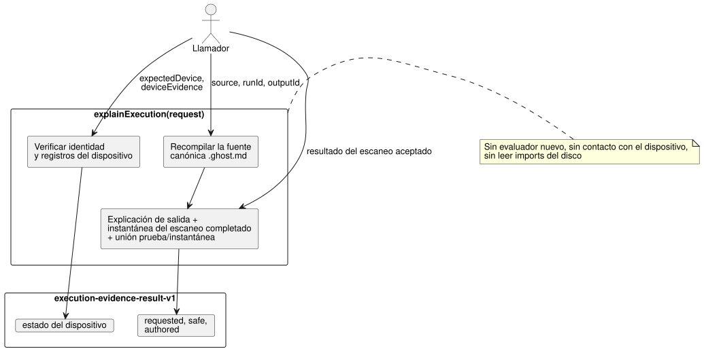

<!-- translation-source: docs/EXECUTION-EVIDENCE.md -->
[Original en inglés](EXECUTION-EVIDENCE.md)

# Explicar una ejecución completada

`tools/execution-evidence.mjs` exporta `explainExecution(request)`. Es una
proyección pura de **un escaneo aceptado que aporta el llamador**: explica por
qué una salida solicitada tuvo su valor y adjunta los informes de dispositivo
que proporcione el llamador, sin ejecutar nada nuevo.

- **API:** `explainExecution(request)`.
- **CLI:** `node tools/ghostwhy.mjs --request request.json --format json`
  devuelve el mismo resultado. La solicitud puede estar en JSON o TOON; la salida
  TOON es la predeterminada.
- **Issues:** este contrato implementa
  [#563](https://github.com/callin2/ghostflow-language/issues/563) sobre el
  contrato compartido
  [#565](https://github.com/callin2/ghostflow-language/issues/565). La
  [versión en coreano](EXECUTION-EVIDENCE.ko.md) tiene el mismo contenido.

Cómo funciona:

- La API recompila la fuente canónica `.ghost.md`, usando sus ID explícitos de
  documento y de revisión.
- Reutiliza la explicación de salida del compilador, la instantánea (snapshot)
  del escaneo completado y la unión exacta prueba/instantánea. Nunca ejecuta un
  evaluador nuevo y nunca se comunica con un dispositivo.
- El resultado del escaneo aceptado sigue proviniendo del llamador. El resultado
  del runtime no tiene un ID de ejecución nativo, por lo que `runId` es una
  afirmación del llamador. Se comprueba su coherencia entre la prueba y la
  instantánea generadas, pero esto **no** autentica al productor del runtime.



El diagrama muestra qué entradas del llamador alimentan cada parte del
resultado; nada llega a un dispositivo ni a un evaluador nuevo.

Límites actuales:

- La explicación existente admite rutas limitadas de salidas solicitadas
  booleanas.
- Los tipos no admitidos y los testigos de instrucción deshabilitados
  permanecen como `unavailable`. Los nodos omitidos permanecen como
  `not-evaluated`.
- Se puede proporcionar una fuente compuesta mediante `sourceClosure`. Sin
  embargo, el productor de explicaciones existente rechaza los artefactos
  compuestos, porque no tiene estrategias de salida que proyectar.
- La API nunca lee imports del disco.

## Solicitud

El objeto de nivel superior tiene exactamente `schema: "GhostFlow/execution-evidence-request-v1"`, `source`, `runId`, `outputId` y `result`. Los campos opcionales son `sourceClosure`, `intentEvidence`, `expectedDevice` y `deviceEvidence`.

| Campo | Contrato |
| --- | --- |
| `source` | `{ text, filename, documentId, revisionId }` para la fuente literaria (literate) canónica completa. `text` tiene como máximo 262,144 caracteres. |
| `sourceClosure` | Arreglo acotado opcional de objetos `{ filename, revision, text }` que se pasa al compilador; sin búsqueda de archivos. |
| `runId` | Época de ejecución pública, sujeta al validador de instantáneas existente. |
| `outputId` | ID exacto de la salida solicitada, por ejemplo `output.pump`. |
| `result` | Un `{ accepted: true, outcome }` aportado por el llamador a partir de un escaneo completado, incluidos su traza y sus testigos de instrucción cuando estén disponibles. Los validadores de explicación/instantánea existentes comprueban el módulo, la fuente, la finalización, la salida y la ruta del testigo. |
| `intentEvidence` | Registro `GhostFlow/intent-evidence-v1` completo opcional, validado y vinculado por el compilador. Sus interpretaciones originales, condiciones, decisiones y comprobaciones externas siguen siendo registros aportados. |
| `expectedDevice` | Obligatorio junto con `deviceEvidence`: `{ deviceId, bootId, installationRef, clockRef, requestId }`. El llamador aporta estos identificadores esperados por separado del paquete de evidencias. |
| `deviceEvidence` | `{ identity, records }` opcional, descrito a continuación. |

**Identidad del dispositivo.**

`deviceEvidence.identity` requiere 13 campos, que se comprueban contra dos
fuentes:

| Campos | Se comprueban contra |
| --- | --- |
| `sourceDocumentId`, `sourceRevisionId`, `sourceSha256`, `bytecodeSha256`, `runId`, `scanId`, `logicalTimeMs`, `outputId` (los ocho primeros) | la fuente compilada y el escaneo aceptado |
| `deviceId`, `bootId`, `installationRef`, `clockRef`, `requestId` (los cinco últimos) | `expectedDevice` |

Todas las etapas del paquete comparten esta identidad de envoltura **tal como la
afirma su productor**. Si algún campo no coincide, el paquete completo permanece
`unlinked` con diagnósticos de identidad, y ninguna etapa aporta una conclusión
sobre el dispositivo.

**Registros del dispositivo.**

`records` es un arreglo de como máximo 128 registros. Cada registro requiere `kind`, `id`, `requestId`, un `at` canónico en milisegundos UTC y un `ref` opaco:

| Tipo | Campos adicionales | Significado |
| --- | --- | --- |
| `driver-request` | `stage: "requested" \| "safe"`, `value` booleano o numérico finito | Debe usar el ID de solicitud de la envoltura para `id` y `requestId`. Su valor debe ser igual al valor real de la salida en la etapa seleccionada. |
| `ack` | `outcome: "accepted" \| "rejected" \| "fault" \| "unknown"` | Un ACK hace referencia al ID exacto de la solicitud del driver. La aceptación es un resultado de comando informado, nunca una confirmación física. |
| `register-readback` | `quality: "ok" \| "fault" \| "unknown"`, y `value` solo para `ok` | Una observación de registro aportada. |
| `physical-feedback` | La misma regla de calidad/valor | Una observación física aportada, que aquí no se verifica de forma independiente. |

Reglas para los registros:

- Cada tipo puede aparecer como máximo una vez por solicitud. Cada etapa
  faltante se enumera por separado.
- Producen diagnósticos: ID distintos en una misma etapa, registros duplicados,
  referencias huérfanas, un ID de solicitud incorrecto, un valor de etapa
  diferente del escaneo aceptado, un valor informado diferente del de la
  solicitud y una marca de tiempo de informe anterior a la solicitud del driver.
- Todos los registros se conservan para su revisión. No hay selección del más
  reciente (latest-wins) ni unión por proximidad de marcas de tiempo.
- Las marcas de tiempo solo se comprueban en cuanto a formato canónico y a una
  secuencia imposible dentro de la referencia de reloj aportada.
- La API **no** verifica la exactitud del reloj, la autoridad del dispositivo,
  las firmas, el transporte ni el efecto físico.

## Resultado

Si tiene éxito, el resultado tiene `schema: "GhostFlow/execution-evidence-result-v1"`
y `outcome: "completed"`. Incluye la identidad exacta del documento fuente, la
revisión y el bytecode, la finalización del escaneo, `requestSha256` y estas
secciones:

- `requested.value`, `requested.proof` y `requested.descriptor`: el valor solicitado real, la prueba acotada de lo evaluado/omitido y los mapeos canónicos de nodo/fuente/ancla. El `supportsResult` de un nodo evaluado describe solo la ruta de la prueba booleana solicitada.
- `safe.value`: la salida segura del mismo escaneo aceptado, comprobada contra el tipo de salida declarado y mantenida separada de la intención solicitada. No afirma que el renderizador la haya aplicado.
- `authored`: las interpretaciones y condiciones originales validadas por el compilador, el alcance de confirmación, las comprobaciones externas y la relación de nodo de autoría de cada condición con esta prueba solicitada. `supports-requested-result` significa que un nodo de autoría vinculado respalda el resultado de la expresión en tiempo de ejecución; **no** demuestra que la interpretación o el requisito sean correctos. `not-evaluated` permanece explícito. Los juicios de adecuación a la intención, cumplimiento y dispositivo permanecen como `not-evaluated`.
- `device`: la envoltura y los registros originales aportados por el llamador, la confianza `not-authenticated` y los diagnósticos. Su estado es `not-supplied`, `unlinked`, `linked-external-report` o `conflicted`. Incluso un paquete vinculado completo sigue siendo un informe externo, no un veredicto de éxito físico ni de cumplimiento.

Fallos y límites:

| Situación | API | CLI |
| --- | --- | --- |
| Entrada mal formada, o una unión compilador/prueba inválida | lanza un error | emite `outcome: "rejected"`, termina con 1 |
| La expansión de la salida supera 524,288 bytes | devuelve `outcome: "incomplete"` con un diagnóstico `output-limit` y sin evidencia parcial | termina con 1 |

Una solicitud completa está limitada a 524,288 bytes UTF-8 serializados,
profundidad 24 y 128 registros de dispositivo. La salida está limitada a 524,288
bytes. Las entradas se copian antes de la compilación, y los resultados no
comparten referencias (alias) con los objetos del llamador.

Ejecute la regresión ficticia ejecutable, que incluye un escaneo WASM local real
y la paridad JSON/TOON, con:

```sh
node --test tests/execution-evidence.test.mjs
```

Los ID de dispositivo y los informes de la prueba son inventados. El escaneo
WASM local solo comprueba el comportamiento del host. No es una instalación de
dispositivo, una observación de hardware ni un resultado de aceptación por parte
de un agricultor.
