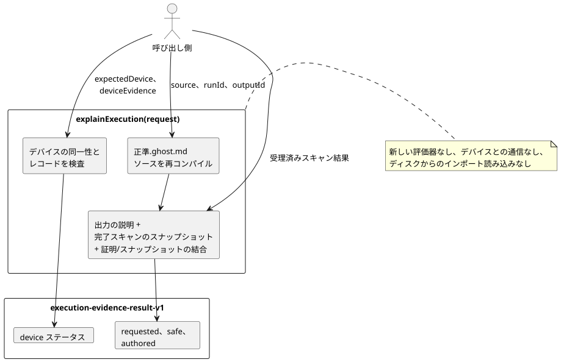

<!-- translation-source: docs/EXECUTION-EVIDENCE.md -->
[英語の原文](EXECUTION-EVIDENCE.md)

# 完了した1回の実行を説明する

`tools/execution-evidence.mjs`は`explainExecution(request)`をエクスポートします。これは、**呼び出し側が渡す受理済みの1回のスキャン**の純粋な射影です。要求された出力がなぜその値になったかを説明し、呼び出し側が提供したデバイスの報告を添付します。新たに何かを実行することはありません。

- **API：** `explainExecution(request)`。
- **CLI：** `node tools/ghostwhy.mjs --request request.json --format json`は同じ結果を返します。リクエストはJSONでもTOONでもかまいません。既定の出力はTOONです。
- **issue：** この契約は、共有の[#565](https://github.com/callin2/ghostflow-language/issues/565)契約の上に[#563](https://github.com/callin2/ghostflow-language/issues/563)を実装したものです。[韓国語版](EXECUTION-EVIDENCE.ko.md)も同じ内容です。

仕組み：

- APIは、明示的な文書IDとリビジョンIDを使って、正準`.ghost.md`ソースを再コンパイルします。
- コンパイラの出力の説明、完了スキャンのスナップショット、および証明とスナップショットの厳密な結合を再利用します。新しい評価器を実行することも、デバイスと通信することも決してありません。
- 受理済みのスキャン結果は、引き続き呼び出し側から渡されます。ランタイムの結果にはネイティブの実行（run）IDがないので、`runId`は呼び出し側の主張です。生成された証明とスナップショットの間で一貫性がチェックされますが、これはランタイムの生成元を認証するものでは**ありません**。



この図は、呼び出し側のどの入力が結果のどの部分に入るかを示しています。デバイスや新しい評価器に届くものはありません。

現在の制限：

- 既存の説明がサポートするのは、限られたBooleanの要求出力の経路です。
- サポートされていない種類と、無効化された命令ウィットネスは`unavailable`のままです。スキップされたノードは`not-evaluated`のままです。
- 合成されたソースは`sourceClosure`で渡せます。ただし、既存の説明の生成器は合成された成果物を拒否します。射影すべき出力戦略を持たないためです。
- APIがディスクからインポートを読み込むことは決してありません。

## リクエスト

トップレベルのオブジェクトは、厳密な`schema: "GhostFlow/execution-evidence-request-v1"`、`source`、`runId`、`outputId`、`result`を持ちます。省略可能なフィールドは`sourceClosure`、`intentEvidence`、`expectedDevice`、`deviceEvidence`です。

| フィールド | 契約 |
| --- | --- |
| `source` | 完全な正準文芸的ソースを表す`{ text, filename, documentId, revisionId }`。`text`は最大262,144文字。 |
| `sourceClosure` | コンパイラに渡される`{ filename, revision, text }`オブジェクトの、上限付きの省略可能な配列。ファイルの検索は行わない。 |
| `runId` | 公開の実行エポック。既存のスナップショット検証器の対象になる。 |
| `outputId` | 要求された出力の厳密なID。例：`output.pump`。 |
| `result` | 完了したスキャンについて呼び出し側が渡す`{ accepted: true, outcome }`を1つ。利用可能であればトレースと命令ウィットネスを含む。既存の説明・スナップショットの検証器が、モジュール、ソース、完了、出力、ウィットネスの経路をチェックする。 |
| `intentEvidence` | 省略可能な完全な`GhostFlow/intent-evidence-v1`レコード。コンパイラが検証して結び付ける。その元の解釈、条件、判断、外部チェックは、渡されたレコードのままである。 |
| `expectedDevice` | `deviceEvidence`と一緒に必須：`{ deviceId, bootId, installationRef, clockRef, requestId }`。呼び出し側は、これらの期待される識別子を証拠バンドルとは別に渡す。 |
| `deviceEvidence` | 省略可能な`{ identity, records }`。以下で説明する。 |

**デバイスの同一性。**

`deviceEvidence.identity`には13個のフィールドが必須で、2つの照合先に対してチェックされます。

| フィールド | 照合先 |
| --- | --- |
| `sourceDocumentId`、`sourceRevisionId`、`sourceSha256`、`bytecodeSha256`、`runId`、`scanId`、`logicalTimeMs`、`outputId`（最初の8個） | コンパイルされたソースと受理済みのスキャン |
| `deviceId`、`bootId`、`installationRef`、`clockRef`、`requestId`（最後の5個） | `expectedDevice` |

バンドル内のすべての段階は、**その生成元が主張するとおりの**このエンベロープの同一性を共有します。いずれかのフィールドが一致しない場合、バンドル全体が同一性の診断付きで`unlinked`のままになり、どの段階もデバイスに関する結論に寄与しません。

**デバイスのレコード。**

`records`は最大128個のレコードの配列です。すべてのレコードに、`kind`、`id`、`requestId`、正準のUTCミリ秒の`at`、不透明な`ref`が必須です。

| 種類 | 追加フィールド | 意味 |
| --- | --- | --- |
| `driver-request` | `stage: "requested" \| "safe"`、Booleanまたは有限の数値の`value` | `id`と`requestId`にはエンベロープのリクエストIDを使わなければならない。その値は、選択された段階の実際の出力値と等しくなければならない。 |
| `ack` | `outcome: "accepted" \| "rejected" \| "fault" \| "unknown"` | ACKは厳密なドライバリクエストIDを参照する。受理は報告されたコマンド結果であり、物理的な確認では決してない。 |
| `register-readback` | `quality: "ok" \| "fault" \| "unknown"`、および`ok`の場合のみ`value` | 渡されたレジスタの観測。 |
| `physical-feedback` | 同じ品質・値のルール | 渡された物理的な観測。ここでは独立に検証されない。 |

レコードのルール：

- 1つのリクエストについて、各種類は最大1回まで出現できます。欠けている段階はそれぞれ個別に列挙されます。
- 次のものは診断を生成します。1つの段階での異なるID、重複レコード、孤立した参照、誤ったリクエストID、受理済みスキャンと異なる段階の値、リクエストと異なる報告値、ドライバリクエストより前の報告タイムスタンプ。
- すべてのレコードはレビューのために保持されます。最新のものを優先する選択も、タイムスタンプの近さによる結合もありません。
- タイムスタンプは、正準の形式であるかと、渡されたクロック参照の中で不可能な順序になっていないかだけがチェックされます。
- APIは、クロックの精度、デバイスの権限、署名、転送、物理的な効果を検証**しません**。

## 結果

成功すると、結果は`schema: "GhostFlow/execution-evidence-result-v1"`と`outcome: "completed"`を持ちます。厳密なソース文書、リビジョン、バイトコードの同一性、スキャンの完了、`requestSha256`、および次のセクションを含みます。

- `requested.value`、`requested.proof`、`requested.descriptor`：実際の要求値、上限付きの評価済み／スキップ済みの証明、および正準のノード・ソース・アンカーの対応付け。評価済みノードの`supportsResult`は、要求されたBooleanの証明経路だけを記述します。
- `safe.value`：同じ受理済みスキャンの安全出力。宣言された出力型に対してチェックされ、要求意図とは別に保持されます。レンダラーによる適用を主張するものではありません。
- `authored`：コンパイラが検証した元の解釈と条件、確認の範囲、外部チェック、および各条件の作成済みノードとこの要求された証明との関係。`supports-requested-result`は、リンクされた作成済みノードがランタイムの式の結果を支持していることを意味します。その解釈や要件が正しいことを証明するものでは**ありません**。`not-evaluated`は明示されたまま残ります。意図との適合、法令・規格への準拠、デバイスに関する判断は`not-evaluated`のままです。
- `device`：呼び出し側が渡した元のエンベロープとレコード、`not-authenticated`の信頼度、および診断。ステータスは`not-supplied`、`unlinked`、`linked-external-report`、`conflicted`のいずれかです。完全にリンクされたバンドルであっても外部の報告にとどまり、物理的な成功や準拠の判定にはなりません。

失敗と制限：

| 状況 | API | CLI |
| --- | --- | --- |
| 不正な形式の入力、またはコンパイラ／証明の結合が無効 | エラーを送出する | `outcome: "rejected"`を出力し、終了コード1 |
| 出力の展開が524,288バイトを超える | `output-limit`診断付きの`outcome: "incomplete"`を返し、部分的な証拠は含めない | 終了コード1 |

完全なリクエストの上限は、シリアライズ後のUTF-8で524,288バイト、深さ24、デバイスレコード128個です。出力の上限は524,288バイトです。入力はコンパイル前にコピーされ、結果が呼び出し側のオブジェクトを参照共有することはありません。

実際のローカルWASMスキャンとJSON/TOONのパリティを含む、実行可能な架空の回帰テストは次のコマンドで実行します。

```sh
node --test tests/execution-evidence.test.mjs
```

テスト内のデバイスIDと報告は架空のものです。ローカルWASMスキャンがチェックするのはホストの振る舞いだけです。デバイスの設置、ハードウェアの観測、農家による受け入れの結果ではありません。
