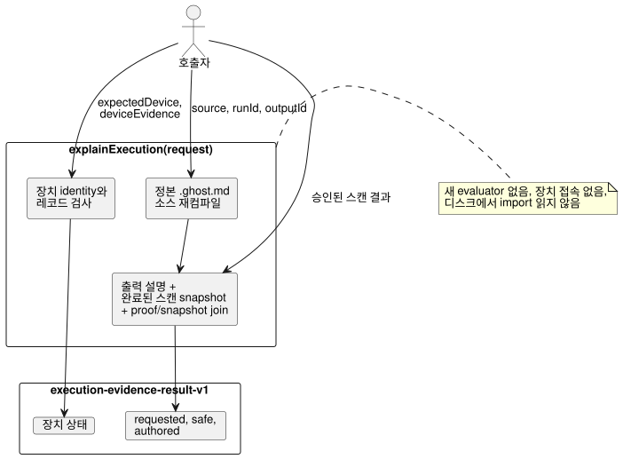

<!-- translation-source: docs/EXECUTION-EVIDENCE.md -->
[영문 원문](EXECUTION-EVIDENCE.md)

# 완료된 실행 하나 설명하기

`tools/execution-evidence.mjs`는 `explainExecution(request)`를 내보냅니다. 이 함수는
**호출자가 제공한 승인된 스캔(accepted scan) 하나**를 순수하게 투영합니다. 요청된 출력이
왜 그 값을 가졌는지 설명하고, 호출자가 제공한 장치 보고를 덧붙이며, 새로운 것은 아무것도
실행하지 않습니다.

- **API:** `explainExecution(request)`.
- **CLI:** `node tools/ghostwhy.mjs --request request.json --format json`이 같은 결과를
  반환합니다. 요청은 JSON 또는 TOON일 수 있으며, 기본 출력 형식은 TOON입니다.
- **이슈:** 이 계약은 공통 [#565](https://github.com/callin2/ghostflow-language/issues/565)
  계약 위에서 [#563](https://github.com/callin2/ghostflow-language/issues/563)을
  구현합니다. [영문판](EXECUTION-EVIDENCE.md)도 같은 내용입니다.

동작 방식은 다음과 같습니다.

- API는 명시적인 document ID와 revision ID를 사용해 정본 `.ghost.md` 소스를 다시
  컴파일합니다.
- 컴파일러의 출력 설명, 완료된 스캔의 snapshot, 정확한 proof/snapshot join을
  재사용합니다. 새 evaluator를 실행하지 않으며 장치에 접속하지도 않습니다.
- 승인된 스캔 결과는 여전히 호출자가 제공합니다. 런타임 결과에는 네이티브 run ID가 없으므로
  `runId`는 호출자의 주장입니다. 생성된 proof와 snapshot 전반에서 일관성은 검사하지만,
  이것이 런타임 producer를 인증하는 것은 **아닙니다**.



이 다이어그램은 어떤 호출자 입력이 결과의 어느 부분으로 들어가는지 보여 줍니다. 장치나 새
evaluator에 닿는 것은 없습니다.

현재 한계는 다음과 같습니다.

- 기존 설명은 제한된 Boolean 요청 출력 경로만 지원합니다.
- 지원하지 않는 종류와 비활성화된 instruction witness는 `unavailable`로 남습니다. 건너뛴
  노드는 `not-evaluated`로 남습니다.
- 합성된 소스는 `sourceClosure`로 제공할 수 있습니다. 그러나 기존 설명 producer는 투영할
  출력 전략이 없기 때문에 합성 결과물을 거부합니다.
- API는 import를 디스크에서 절대 읽지 않습니다.

## 요청

최상위 객체에는 정확한 `schema: "GhostFlow/execution-evidence-request-v1"`, `source`, `runId`, `outputId`, `result`가 있습니다. 선택 필드는 `sourceClosure`, `intentEvidence`, `expectedDevice`, `deviceEvidence`입니다.

| 필드 | 계약 |
| --- | --- |
| `source` | 완전한 정본 문서형 소스의 `{ text, filename, documentId, revisionId }`. `text`는 최대 262,144자입니다. |
| `sourceClosure` | 컴파일러에 전달하는 `{ filename, revision, text }` 객체의 제한된 배열(선택). 파일 조회는 하지 않습니다. |
| `runId` | 공개 실행 epoch이며, 기존 snapshot validator의 검사를 받습니다. |
| `outputId` | 정확한 요청 출력 ID. 예: `output.pump`. |
| `result` | 완료된 스캔 하나에서 호출자가 제공한 `{ accepted: true, outcome }`. 가능하면 trace와 instruction witness를 포함합니다. 기존 설명/snapshot validator가 module, source, 완료, 출력, witness 경로를 검사합니다. |
| `intentEvidence` | 컴파일러가 검증하고 묶는 완전한 `GhostFlow/intent-evidence-v1` 레코드(선택). 원래의 해석, 조건, 결정, 외부 확인은 여전히 제공된 레코드로 남습니다. |
| `expectedDevice` | `deviceEvidence`와 함께 필수: `{ deviceId, bootId, installationRef, clockRef, requestId }`. 호출자는 이 기대 식별자들을 증거 묶음과 별도로 제공합니다. |
| `deviceEvidence` | 아래에서 설명하는 `{ identity, records }`(선택). |

**장치 identity.**

`deviceEvidence.identity`에는 13개 필드가 필요하며, 두 출처와 대조합니다.

| 필드 | 대조 대상 |
| --- | --- |
| `sourceDocumentId`, `sourceRevisionId`, `sourceSha256`, `bytecodeSha256`, `runId`, `scanId`, `logicalTimeMs`, `outputId` (앞의 8개) | 컴파일된 소스와 승인된 스캔 |
| `deviceId`, `bootId`, `installationRef`, `clockRef`, `requestId` (뒤의 5개) | `expectedDevice` |

묶음의 모든 단계는 **각 producer가 주장한 대로** 이 envelope identity를 공유합니다. 필드가
하나라도 일치하지 않으면 전체 묶음이 identity 진단과 함께 `unlinked`로 남고, 어떤 단계도
장치 결론에 기여하지 않습니다.

**장치 레코드.**

`records`는 최대 128개 레코드의 배열입니다. 모든 레코드에는 `kind`, `id`, `requestId`, 정규 UTC 밀리초 `at`, 불투명한 `ref`가 필요합니다.

| 종류 | 추가 필드 | 의미 |
| --- | --- | --- |
| `driver-request` | `stage: "requested" \| "safe"`, Boolean 또는 유한한 숫자 `value` | `id`와 `requestId`에 envelope의 request ID를 사용해야 합니다. 값은 선택한 단계의 실제 출력 값과 같아야 합니다. |
| `ack` | `outcome: "accepted" \| "rejected" \| "fault" \| "unknown"` | ACK는 정확한 driver request ID를 참조합니다. 수락은 보고된 명령 결과일 뿐 절대 물리적 확인이 아닙니다. |
| `register-readback` | `quality: "ok" \| "fault" \| "unknown"`, `ok`일 때만 `value` | 제공된 레지스터 관측입니다. |
| `physical-feedback` | 같은 quality/value 규칙 | 제공된 물리 관측이며, 여기서 독립적으로 검증하지 않습니다. |

레코드 규칙은 다음과 같습니다.

- 한 요청에서 각 종류는 최대 한 번만 나올 수 있습니다. 누락된 단계는 각각 따로 나열합니다.
- 다음 경우에는 진단이 생깁니다. 한 단계에 서로 다른 ID가 있음, 중복 레코드, 대상 없는
  참조, 잘못된 request ID, 승인된 스캔과 다른 단계 값, 요청과 다른 보고 값, driver request보다
  이른 보고 타임스탬프.
- 모든 레코드는 검토를 위해 보존합니다. 최신 항목 우선 선택은 없으며, 타임스탬프 근접성으로
  join하지도 않습니다.
- 타임스탬프는 정규 형식인지, 그리고 제공된 clock reference 안에서 불가능한 순서인지만
  검사합니다.
- API는 시계 정확도, 장치 권한, 서명, 전송, 물리적 효과를 검증하지 **않습니다**.

## 결과

성공하면 결과에 `schema: "GhostFlow/execution-evidence-result-v1"`과
`outcome: "completed"`가 들어갑니다. 정확한 소스 document, revision, 바이트코드 identity,
스캔 완료 정보, `requestSha256`, 그리고 다음 섹션이 포함됩니다.

- `requested.value`, `requested.proof`, `requested.descriptor`: 실제 요청 값, 평가/건너뜀에 대한 제한된 proof, 정본 node/source/anchor 매핑. 평가된 노드의 `supportsResult`는 요청된 Boolean proof 경로만 설명합니다.
- `safe.value`: 같은 승인된 스캔의 안전 출력. 선언된 출력 타입과 대조하며 요청 의도와는 분리해 둡니다. 렌더러가 적용했다고 주장하지 않습니다.
- `authored`: 컴파일러가 검증한 원래의 해석과 조건, 확인 범위, 외부 확인, 그리고 각 조건의 작성 노드와 이 요청 proof의 관계. `supports-requested-result`는 연결된 작성 노드가 런타임 식 결과를 뒷받침한다는 뜻일 뿐, 해석이나 요구 사항이 옳다는 것을 증명하지는 **않습니다**. `not-evaluated`는 명시적으로 남습니다. 의도 부합, 규정 준수, 장치 판단은 `not-evaluated`로 남습니다.
- `device`: 호출자가 제공한 원래 envelope와 레코드, `not-authenticated` 신뢰 상태, 진단. 상태는 `not-supplied`, `unlinked`, `linked-external-report`, `conflicted` 중 하나입니다. 완전하게 연결된 묶음이라도 외부 보고일 뿐이며, 물리적 성공이나 규정 준수 판정이 아닙니다.

실패와 한계:

| 상황 | API | CLI |
| --- | --- | --- |
| 형식이 잘못된 입력, 또는 유효하지 않은 compiler/proof join | 오류를 발생시킴 | `outcome: "rejected"`를 출력하고 종료 코드 1 |
| 출력 확장이 524,288바이트를 넘음 | `output-limit` 진단과 함께 `outcome: "incomplete"`를 반환하며 부분 증거는 없음 | 종료 코드 1 |

완전한 요청은 직렬화된 UTF-8 기준 524,288바이트, 깊이 24, 장치 레코드 128개로 제한됩니다.
출력은 524,288바이트로 제한됩니다. 입력은 컴파일 전에 복사되며, 결과는 호출자 객체와 별칭을
공유하지 않습니다.

실제 로컬 WASM 스캔과 JSON/TOON parity(동등성)를 포함한 실행 가능한 가상 회귀 테스트는 다음으로 실행합니다.

```sh
node --test tests/execution-evidence.test.mjs
```

테스트의 장치 ID와 보고는 지어낸 값입니다. 로컬 WASM 스캔은 호스트 동작만 확인합니다. 이는
Device 설치, 하드웨어 관측, 농가 인수 결과가 아닙니다.
