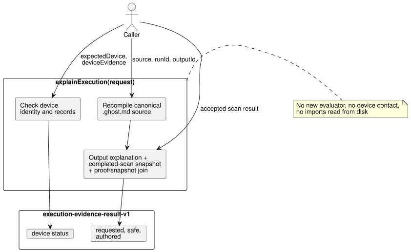

# Explain one completed execution

`tools/execution-evidence.mjs` exports `explainExecution(request)`. It is a pure
projection of **one accepted scan that the caller supplies**: it explains why a
requested output had its value, and attaches any device reports the caller
provides, without running anything new.

- **API:** `explainExecution(request)`.
- **CLI:** `node tools/ghostwhy.mjs --request request.json --format json` returns
  the same result. The request may be JSON or TOON; TOON output is the default.
- **Issues:** this contract implements
  [#563](https://github.com/callin2/ghostflow-language/issues/563) on top of the
  shared [#565](https://github.com/callin2/ghostflow-language/issues/565)
  contract. The [Korean version](EXECUTION-EVIDENCE.ko.md) has the same content.

How it works:

- The API recompiles the canonical `.ghost.md` source, using its explicit
  document and revision IDs.
- It reuses the compiler's output explanation, the completed-scan snapshot, and
  the exact proof/snapshot join. It never runs a new evaluator and never
  contacts a device.
- The accepted scan result still comes from the caller. The runtime outcome has
  no native run ID, so `runId` is a caller assertion. It is checked for
  consistency across the generated proof and snapshot, but this does **not**
  authenticate the runtime producer.



The diagram shows which caller inputs feed which part of the result; nothing
reaches a device or a new evaluator.

Current limits:

- The existing explanation supports limited Boolean requested-output paths.
- Unsupported kinds and disabled instruction witnesses stay `unavailable`.
  Skipped nodes stay `not-evaluated`.
- A composed source may be supplied through `sourceClosure`. However, the
  existing explanation producer rejects composed artifacts, because it has no
  output strategies to project.
- The API never reads imports from disk.

## Request

The top-level object has exact `schema: "GhostFlow/execution-evidence-request-v1"`, `source`, `runId`, `outputId`, and `result`. Optional fields are `sourceClosure`, `intentEvidence`, `expectedDevice`, and `deviceEvidence`.

| Field | Contract |
| --- | --- |
| `source` | `{ text, filename, documentId, revisionId }` for the complete canonical literate source. `text` is at most 262,144 characters. |
| `sourceClosure` | Optional bounded array of `{ filename, revision, text }` objects passed to the compiler; no file lookup. |
| `runId` | Public execution epoch, subject to the existing snapshot validator. |
| `outputId` | Exact requested output ID, for example `output.pump`. |
| `result` | One caller-supplied `{ accepted: true, outcome }` from a completed scan, including its trace and instruction witnesses when available. The existing explanation/snapshot validators check module, source, completion, output and witness path. |
| `intentEvidence` | Optional complete `GhostFlow/intent-evidence-v1` record, validated and bound by the compiler. Its original interpretations, conditions, decisions and external checks remain supplied records. |
| `expectedDevice` | Required with `deviceEvidence`: `{ deviceId, bootId, installationRef, clockRef, requestId }`. The caller supplies these expected identifiers separately from the evidence bundle. |
| `deviceEvidence` | Optional `{ identity, records }`, described below. |

**Device identity.**

`deviceEvidence.identity` requires 13 fields, checked against two sources:

| Fields | Checked against |
| --- | --- |
| `sourceDocumentId`, `sourceRevisionId`, `sourceSha256`, `bytecodeSha256`, `runId`, `scanId`, `logicalTimeMs`, `outputId` (the first eight) | the compiled source and the accepted scan |
| `deviceId`, `bootId`, `installationRef`, `clockRef`, `requestId` (the last five) | `expectedDevice` |

Every stage in the bundle shares this envelope identity **as asserted by its
producer**. If any field mismatches, the complete bundle stays `unlinked` with
identity diagnostics, and no stage contributes a device conclusion.

**Device records.**

`records` is an array of at most 128 records. Every record requires `kind`, `id`, `requestId`, canonical UTC millisecond `at`, and opaque `ref`:

| Kind | Additional fields | Meaning |
| --- | --- | --- |
| `driver-request` | `stage: "requested" \| "safe"`, Boolean or finite numeric `value` | Must use the envelope request ID for `id` and `requestId`. Its value must equal the selected stage's actual output value. |
| `ack` | `outcome: "accepted" \| "rejected" \| "fault" \| "unknown"` | An ACK refers to the exact driver request ID. Acceptance is a reported command outcome, never physical confirmation. |
| `register-readback` | `quality: "ok" \| "fault" \| "unknown"`, and `value` only for `ok` | A supplied register observation. |
| `physical-feedback` | The same quality/value rule | A supplied physical observation, not independently verified here. |

Rules for records:

- Each kind may appear at most once for one request. Each missing stage is
  listed separately.
- These produce diagnostics: distinct IDs at one stage, duplicate records,
  orphan references, a wrong request ID, a stage value different from the
  accepted scan, a reported value different from the request, and a report
  timestamp earlier than the driver request.
- All records are kept for review. There is no latest-wins selection and no
  join by timestamp proximity.
- Timestamps are checked only for canonical format and for an impossible
  sequence within the supplied clock reference.
- The API does **not** verify clock accuracy, device authority, signatures,
  transport or physical effect.

## Result

On success the result has `schema: "GhostFlow/execution-evidence-result-v1"`
and `outcome: "completed"`. It includes the exact source document, revision and
bytecode identity, the scan completion, `requestSha256`, and these sections:

- `requested.value`, `requested.proof`, and `requested.descriptor`: the actual requested value, bounded evaluated/skipped proof, and canonical node/source/anchor mappings. An evaluated node's `supportsResult` describes only the requested Boolean proof path.
- `safe.value`: the same accepted scan's safe output, checked against the declared output type and kept separate from requested intent. It does not assert renderer application.
- `authored`: compiler-validated original interpretations and conditions, confirmation scope, external checks, and each condition's authored-node relation to this requested proof. `supports-requested-result` means a linked authored node supports the runtime expression result; it does **not** prove that the interpretation or requirement is correct. `not-evaluated` remains explicit. Intent-fit, compliance and device judgments remain `not-evaluated`.
- `device`: original caller-supplied envelope and records, `not-authenticated` trust, and diagnostics. Its status is `not-supplied`, `unlinked`, `linked-external-report`, or `conflicted`. Even a complete linked bundle stays an external report, not a physical success or compliance verdict.

Failures and limits:

| Situation | API | CLI |
| --- | --- | --- |
| Malformed input, or an invalid compiler/proof join | raises an error | emits `outcome: "rejected"`, exits 1 |
| Output expansion exceeds 524,288 bytes | returns `outcome: "incomplete"` with an `output-limit` diagnostic and no partial evidence | exits 1 |

A complete request is capped at 524,288 serialized UTF-8 bytes, depth 24, and
128 device records. Output is capped at 524,288 bytes. Inputs are copied before
compilation, and results do not alias caller objects.

Run the executable fictional regression, including a real local WASM scan and JSON/TOON parity, with:

```sh
node --test tests/execution-evidence.test.mjs
```

The device IDs and reports in the test are invented. The local WASM scan checks
host behavior only. It is not a Device installation, a hardware observation, or
a farmer acceptance result.
