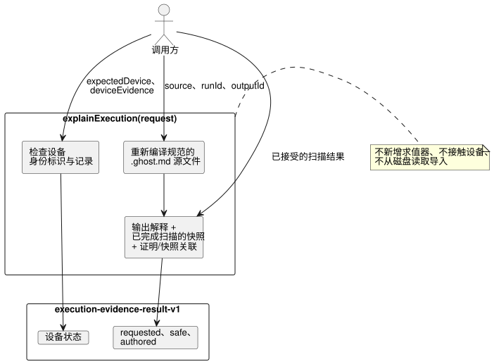

<!-- translation-source: docs/EXECUTION-EVIDENCE.md -->
[英文原文](EXECUTION-EVIDENCE.md)

# 解释一次已完成的执行

`tools/execution-evidence.mjs` 导出 `explainExecution(request)`。它是对**调用方提供的一次已接受扫描**的纯投影：它解释被请求的输出为何取该值，并附上调用方提供的设备报告，而不会运行任何新的东西。

- **API：** `explainExecution(request)`。
- **CLI：** `node tools/ghostwhy.mjs --request request.json --format json` 返回相同的结果。请求可以是 JSON 或 TOON；默认输出为 TOON。
- **Issue：** 本契约在共享的 [#565](https://github.com/callin2/ghostflow-language/issues/565) 契约之上实现了 [#563](https://github.com/callin2/ghostflow-language/issues/563)。[韩文版](EXECUTION-EVIDENCE.ko.md)内容相同。

工作方式：

- API 使用显式的文档 ID 和修订版 ID，重新编译规范的 `.ghost.md` 源文件。
- 它复用编译器的输出解释、已完成扫描的快照，以及精确的证明/快照关联（join）。它绝不运行新的求值器，也绝不接触设备。
- 已接受的扫描结果仍来自调用方。运行时结果中没有原生的运行 ID，因此 `runId` 是调用方的断言。它会在生成的证明与快照之间做一致性检查，但这**并不能**认证运行时的产生方。



该图展示了调用方的哪些输入流向结果的哪个部分；没有任何东西会到达设备或新的求值器。

当前限制：

- 现有的解释只支持有限的 Boolean 请求输出路径。
- 不支持的种类和被禁用的指令见证（witness）保持为 `unavailable`。被跳过的节点保持为 `not-evaluated`。
- 组合的源文件可以通过 `sourceClosure` 提供。但现有的解释生成器会拒绝组合产物，因为它没有可供投影的输出策略。
- API 绝不从磁盘读取导入。

## 请求

顶层对象包含精确的 `schema: "GhostFlow/execution-evidence-request-v1"`、`source`、`runId`、`outputId` 和 `result`。可选字段为 `sourceClosure`、`intentEvidence`、`expectedDevice` 和 `deviceEvidence`。

| 字段 | 契约 |
| --- | --- |
| `source` | 完整规范文学式源文件的 `{ text, filename, documentId, revisionId }`。`text` 最多 262,144 个字符。 |
| `sourceClosure` | 可选的有界数组，元素为传给编译器的 `{ filename, revision, text }` 对象；不进行文件查找。 |
| `runId` | 公开的执行纪元（epoch），受现有快照校验器约束。 |
| `outputId` | 精确的被请求输出 ID，例如 `output.pump`。 |
| `result` | 调用方提供的一个来自已完成扫描的 `{ accepted: true, outcome }`，在可用时包含其追踪和指令见证。现有的解释/快照校验器会检查模块、源文件、完成状态、输出和见证路径。 |
| `intentEvidence` | 可选的完整 `GhostFlow/intent-evidence-v1` 记录，由编译器校验并绑定。其中原始的解读、条件、决定和外部检查仍是调用方提供的记录。 |
| `expectedDevice` | 与 `deviceEvidence` 一起时必填：`{ deviceId, bootId, installationRef, clockRef, requestId }`。调用方在证据包之外单独提供这些预期标识符。 |
| `deviceEvidence` | 可选的 `{ identity, records }`，详见下文。 |

**设备身份标识。**

`deviceEvidence.identity` 需要 13 个字段，并对照两个来源进行检查：

| 字段 | 对照检查 |
| --- | --- |
| `sourceDocumentId`、`sourceRevisionId`、`sourceSha256`、`bytecodeSha256`、`runId`、`scanId`、`logicalTimeMs`、`outputId`（前八个） | 编译后的源文件与已接受的扫描 |
| `deviceId`、`bootId`、`installationRef`、`clockRef`、`requestId`（后五个） | `expectedDevice` |

证据包中的每个阶段都共享这一封装身份标识，**以其产生方的断言为准**。只要有任何字段不匹配，整个证据包就保持为 `unlinked` 并附带身份标识诊断，且没有任何阶段会贡献设备结论。

**设备记录。**

`records` 是最多 128 条记录的数组。每条记录都需要 `kind`、`id`、`requestId`、规范的 UTC 毫秒时间 `at`，以及不透明的 `ref`：

| 种类 | 额外字段 | 含义 |
| --- | --- | --- |
| `driver-request` | `stage: "requested" \| "safe"`，Boolean 或有限数值的 `value` | `id` 和 `requestId` 必须使用封装中的请求 ID。其值必须等于所选阶段的实际输出值。 |
| `ack` | `outcome: "accepted" \| "rejected" \| "fault" \| "unknown"` | ACK 指向确切的驱动程序请求 ID。accepted 是报告的命令结果，绝不是物理确认。 |
| `register-readback` | `quality: "ok" \| "fault" \| "unknown"`，仅在 `ok` 时带 `value` | 提供的寄存器观测。 |
| `physical-feedback` | 相同的质量/值规则 | 提供的物理观测，此处不做独立验证。 |

记录规则：

- 对于同一个请求，每种记录最多出现一次。每个缺失的阶段都单独列出。
- 以下情况会产生诊断：同一阶段出现不同的 ID、重复的记录、孤立的引用、错误的请求 ID、阶段值与已接受扫描不同、报告值与请求不同，以及报告时间戳早于驱动程序请求。
- 所有记录都会保留以供审查。不存在“最新者胜出”的选择，也不按时间戳接近程度进行关联。
- 时间戳只检查规范格式，以及在所提供的时钟引用内是否出现不可能的先后顺序。
- API **不**验证时钟准确性、设备权威性、签名、传输或物理效果。

## 结果

成功时，结果包含 `schema: "GhostFlow/execution-evidence-result-v1"` 和 `outcome: "completed"`。它包括精确的源文档、修订版和字节码身份标识、扫描完成状态、`requestSha256`，以及以下各部分：

- `requested.value`、`requested.proof` 和 `requested.descriptor`：实际的请求值、有界的已求值/已跳过证明，以及规范的节点/源代码/锚点映射。已求值节点的 `supportsResult` 只描述被请求的 Boolean 证明路径。
- `safe.value`：同一次已接受扫描的安全输出，按声明的输出类型检查，并与请求意图分开保存。它不断言渲染器已应用。
- `authored`：经编译器校验的原始解读和条件、确认范围、外部检查，以及每个条件的编写节点与本次请求证明之间的关系。`supports-requested-result` 表示一个已关联的编写节点支持运行时表达式结果；它**并不**证明该解读或要求是正确的。`not-evaluated` 仍会被明确标出。意图契合度、合规性和设备判断保持为 `not-evaluated`。
- `device`：调用方提供的原始封装和记录、`not-authenticated` 信任级别以及诊断。其状态为 `not-supplied`、`unlinked`、`linked-external-report` 或 `conflicted`。即使是完整且已关联的证据包，也仍是外部报告，而不是物理成功或合规的裁定。

失败与限制：

| 情形 | API | CLI |
| --- | --- | --- |
| 输入格式错误，或编译器/证明关联无效 | 抛出错误 | 输出 `outcome: "rejected"`，以退出码 1 退出 |
| 输出展开超过 524,288 字节 | 返回 `outcome: "incomplete"`，附带 `output-limit` 诊断，且不含部分证据 | 以退出码 1 退出 |

完整请求的上限为序列化后 524,288 个 UTF-8 字节、深度 24、128 条设备记录。输出上限为 524,288 字节。输入在编译前会被复制，结果不会与调用方对象共享引用。

运行可执行的虚构回归测试（包含一次真实的本地 WASM 扫描以及 JSON/TOON 一致性检查）：

```sh
node --test tests/execution-evidence.test.mjs
```

测试中的设备 ID 和报告都是虚构的。本地 WASM 扫描只检查宿主行为。它不是设备安装、硬件观测或农户验收结果。
