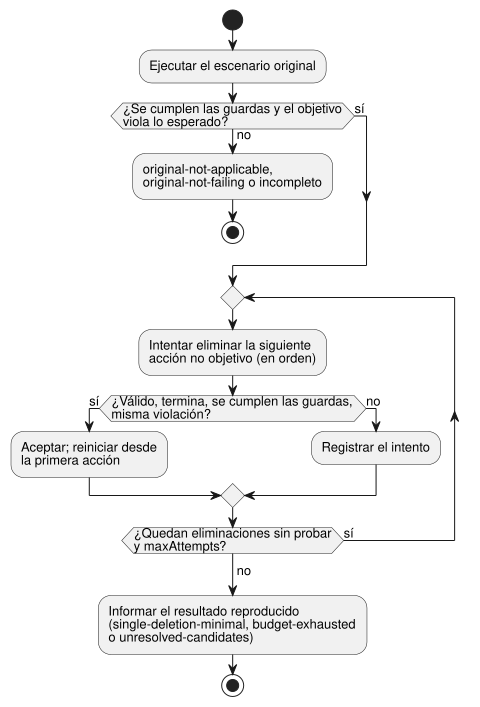

<!-- translation-source: docs/FAILURE-REDUCTION.md -->
[Original en inglés](FAILURE-REDUCTION.md)

# Reducción acotada de fallos

[한국어](FAILURE-REDUCTION.ko.md) · [Contrato de responsabilidad de la intención](INTENT-CONSISTENCY-CONTRACT.es.md) · [#561](https://github.com/callin2/ghostflow-language/issues/561)

`reduceFailure(request)` en `tools/failure-reduction.mjs` reduce un
`GhostFlow/scenario-v1` que falla para un programa canónico `.ghost.md`.
"Reducir" significa que elimina acciones del escenario mientras el mismo fallo
se siga reproduciendo, de modo que una persona pueda revisar un caso más corto.

Lo que aporta el llamador y lo que la herramienta no hace:

- El llamador aporta el valor esperado y la revisión del requisito del que
  proviene.
- La herramienta **no** deriva un oráculo a partir del programa, no infiere la
  intención, no identifica una causa raíz ni opera un dispositivo físico.
- Cada candidato se ejecuta mediante la ruta de escenarios existente de
  `ghostsim` (nativa en Rust o WASM), partiendo del estado inicial canónico del
  programa.

## Solicitud

| Campo | Contrato |
|---|---|
| `format` | `GhostFlow/failure-reduction-request-v1` |
| `program` | `{ filename, source }`, opcionalmente `sourceClosure` y el registro exacto `intentEvidence` de #565. `filename` debe terminar en `.ghost.md`. |
| `scenario` | Un `GhostFlow/scenario-v1` completo con entradas iniciales, perfiles de entorno y acciones ordenadas. Se excluye una `plant` de lazo cerrado, porque eliminar una acción puede alterar las entradas efectivas posteriores. |
| `predicate` | `{ kind: 'equals', observation, expected, at, when? }`. `observation` es `{ field, name }` para `requested`, `safe`, `stateBefore` o `stateAfter`, o `{ field: 'faults' }` para toda la lista de fallos. `at` es `{ actionIndex, logicalTimeMs }` y debe identificar una acción de escaneo original con ese tiempo exacto. El fallo consiste en que el valor real **no sea igual** a `expected` en ese escaneo. El `when` opcional es un arreglo no vacío de como máximo ocho guardas de igualdad `{ observation, expected }` evaluadas en ese mismo escaneo. |
| `requirement` | `{ id, revision, sha256, reference }` externo. Identifica la revisión de la expectativa del llamador. El compilador lo conserva sin obtenerlo ni autenticarlo. |
| `condition` | `{ id, revision, sha256 }` opcional de una condición exacta de #565 en `program.intentEvidence`. Se conserva su alcance de confirmación; la autoridad permanece `not-authenticated`. |
| `maxAttempts` | Entero 1..128. Cuenta cada eliminación de una sola acción considerada, incluidos los candidatos rechazados por la validación del escenario. La ejecución original de confirmación es aparte y no consume este presupuesto. |

Validación y límites:

- Se rechazan los campos desconocidos. También una fuente, un escenario, un
  campo, una identidad de condición, un presupuesto o una identidad de
  acción/tiempo inválidos.
- La solicitud se captura como JSON canónico antes de la primera compilación
  asíncrona, con un límite de 3 MiB. Los bytes del escenario están limitados a
  256 KiB.
- La CLI acepta la misma solicitud en JSON o TOON. No acepta callbacks ni
  instrucciones para ejecutar código externo.

## Búsqueda y resultado

**Cómo funciona la búsqueda.** La métrica es el **número de acciones**. La
acción de escaneo objetivo siempre se conserva; ninguna otra acción está
protegida.



Como muestra el diagrama, el reductor:

1. intenta eliminar una acción a la vez, en el orden original;
2. acepta una eliminación solo cuando el candidato se valida, una nueva ejecución
   del escenario termina, cada guarda `when` aportada es igual a su valor
   esperado y la observación objetivo sigue violando el mismo valor esperado
   fijo;
3. tras una eliminación aceptada, vuelve a recorrer la secuencia más corta desde
   el principio.

Todas las observaciones usan el escaneo objetivo preservado, aunque cambie su ID
de escaneo. El reductor nunca reescribe los tiempos, valores, orden, entorno ni
entradas iniciales de las acciones. Después de cada eliminación recalcula el
nuevo ID de escaneo del objetivo, y el informe asigna cada índice de acción de
escaneo original conservado a su nuevo ID de escaneo.

**Las guardas identifican "el mismo fallo".** El llamador debe indicar cualquier
condición necesaria para identificar el mismo fallo. Ejemplo: para reducir “la
bomba permanece encendida (ON) durante un fallo de sensor Disconnected”, la
fuente puede exponer un booleano que sea verdadero específicamente para
`Disconnected`. Entonces `when` exige que ese booleano sea verdadero, mientras
que el predicado principal espera que la bomba esté apagada (OFF). Una guarda
para *cualquier* fallo de sensor también coincidiría con `NotReady` y, por lo
tanto, expresaría un alcance diferente. La herramienta no infiere ni autentica
estas guardas. El predicado fijo completo, incluidas las guardas, se conserva y
se incluye con su hash en el resultado. Sin `when`, solo se requiere la
violación de la igualdad principal.

**Un resultado reproducido** (`outcome: 'reproduced'`) incluye:

- un `reducedScenario` ejecutable;
- los hashes del escenario original y del reducido;
- los hashes de la fuente, GFB, manifiesto y de la clausura opcional;
- los hashes del runtime y del host seleccionados, y la versión de Node para
  WASM;
- el predicado fijo y su resumen (digest);
- la identidad del requisito y la vinculación de la condición;
- las observaciones original y reducida;
- los intentos y el historial de eliminaciones.

`sourceBinding` indica el nodo del compilador y la ubicación en la fuente
asociados a una observación con nombre. Es una ubicación de violación
observada, no una causa ni una ubicación de reparación. `physicalEffects` es
siempre `false`.

**El estado de la reducción** indica hasta dónde llegó la búsqueda:

| `reductionStatus` | Significado |
| --- | --- |
| `single-deletion-minimal` | Una pasada final exhaustiva no encontró ninguna eliminación de una sola acción que se validara, terminara y mantuviera la misma violación. **No** afirma que sea el escenario más corto a nivel global. El valor observado puede cambiar, siempre que siga violando el mismo predicado fijo. |
| `budget-exhausted` | El límite de candidatos detuvo la búsqueda. |
| `unresolved-candidates` | Un candidato de la pasada final tuvo una observación faltante o un fallo de ejecución, por lo que no se afirma la minimalidad. |

Los candidatos inválidos se registran, pero nunca pueden reproducir el fallo.

**Resultados no reproducidos:**

| Situación | Resultado |
| --- | --- |
| Una guarda no se cumple en la ejecución original | `original-not-applicable`; no se inicia ninguna reducción |
| Las guardas se cumplen, pero la ejecución original termina con el valor principal esperado | `original-not-failing` |
| La ejecución original o alguna observación seleccionada no está disponible | `incomplete`, nunca un fallo reproducido |
| Un hash del runtime o del host cambia durante la reducción | la reducción termina como `incomplete` |
| La salida del resultado supera 1 MiB | explícitamente `incomplete` |

Para candidatos individuales: un candidato con una guarda falsa se rechaza. Una
observación de guarda faltante, o un fallo del runtime/host, es un intento
`unknown`; no puede aceptarse y no puede demostrar la minimalidad.

## Ejemplo ejecutable

Ejecútelo desde la raíz del repositorio con los artefactos existentes del
ejecutor de escenarios instalados:

```js
import { createHash } from 'node:crypto';
import { reduceFailure } from './tools/failure-reduction.mjs';

const source = `\`\`\`ghost
control Timer {
  state active: Bool = true;
  timer age = elapsed(active);
  output expired: Bool;
  output drive: Percent;
  expired <- age >= 10s;
  drive <- 0%;
}
\`\`\`\n`;
const request = {
  format: 'GhostFlow/failure-reduction-request-v1',
  program: { filename: 'timer.ghost.md', source },
  scenario: {
    format: 'GhostFlow/scenario-v1', id: 'timer-failure', initialInputs: [], keyBindings: [],
    actuatorBindings: [{ actuator: 'drive', output: 'drive', type: 'Percent', min: 0, max: 100 }],
    actions: [0, 1000, 5000, 10000, 15000].map(atMs => ({ kind: 'scan', atMs })),
  },
  predicate: { kind: 'equals', observation: { field: 'safe', name: 'expired' },
    expected: false, at: { actionIndex: 4, logicalTimeMs: 15000 } },
  requirement: { id: 'REQ-LIMIT', revision: 'r1',
    sha256: createHash('sha256').update('external requirement revision r1').digest('hex'),
    reference: 'example:requirements/REQ-LIMIT/r1' },
  maxAttempts: 32,
};
const result = await reduceFailure(request);
console.log(result.outcome, result.reductionStatus, result.reducedScenario?.actions);
```


Notas sobre este ejemplo:

- La vinculación del actuador virtual `drive` selecciona el host de escenarios
  WASM existente.
- La referencia del requisito es ficticia.
- Una violación del predicado informada solo significa que esta expectativa
  aportada no coincidió con esta observación virtual ejecutada. No certifica la
  expectativa ni diagnostica el origen de la discrepancia.

Para usar la CLI, guarde la misma solicitud como JSON o TOON y ejecute
`node tools/ghostshrink.mjs --request reduction.json --format json`. La salida
predeterminada es TOON. Un resultado reproducido termina con 0; los resultados
inválidos, original-not-applicable, original-not-failing e incompletos terminan
con 1. El `reducedScenario` devuelto puede serializarse como TOON y reproducirse
con el ejecutor de escenarios existente y el mismo programa compilado.
