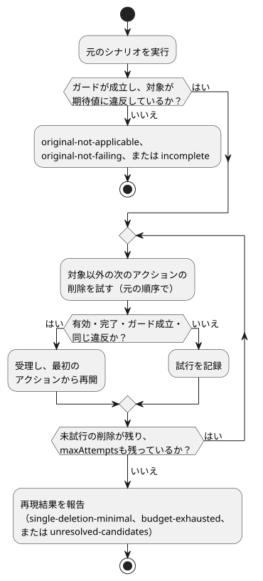

<!-- translation-source: docs/FAILURE-REDUCTION.md -->
[英語の原文](FAILURE-REDUCTION.md)

# 上限付きの失敗縮小

[한국어](FAILURE-REDUCTION.ko.md) · [意図の責任契約](INTENT-CONSISTENCY-CONTRACT.ja.md) · [#561](https://github.com/callin2/ghostflow-language/issues/561)

`tools/failure-reduction.mjs`の`reduceFailure(request)`は、1つの正準`.ghost.md`プログラムについて、失敗する`GhostFlow/scenario-v1`を縮小します。「縮小」とは、同じ失敗が再現し続ける間にシナリオのアクションを取り除くことであり、人がより短いケースをレビューできるようにします。

呼び出し側が渡すもの、およびツールが行わないこと：

- 呼び出し側は、期待値と、その期待値の出どころである要件のリビジョンを渡します。
- ツールは、プログラムからオラクルを導出することも、意図を推論することも、根本原因を特定することも、物理デバイスを操作することも**しません**。
- 各候補は、プログラムの正準の初期状態から始めて、既存の`ghostsim`のRustネイティブまたはWASMのシナリオ経路で実行されます。

## リクエスト

| フィールド | 契約 |
|---|---|
| `format` | `GhostFlow/failure-reduction-request-v1` |
| `program` | `{ filename, source }`。省略可能な`sourceClosure`と、#565の厳密な`intentEvidence`レコードを含めることもできる。`filename`は`.ghost.md`で終わらなければならない。 |
| `scenario` | 初期入力、環境プロファイル、順序付きのアクションを含む完全な`GhostFlow/scenario-v1`。閉ループの`plant`は除外される。アクションを取り除くと後続の有効な入力が変わりうるためである。 |
| `predicate` | `{ kind: 'equals', observation, expected, at, when? }`。`observation`は、`requested`、`safe`、`stateBefore`、`stateAfter`に対する`{ field, name }`、または故障リスト全体に対する`{ field: 'faults' }`。`at`は`{ actionIndex, logicalTimeMs }`であり、ちょうどその時刻を持つ元のスキャンアクションを1つ特定しなければならない。失敗とは、そのスキャンで実際の値が`expected`と**等しくない**ことである。省略可能な`when`は、同じスキャンで評価される`{ observation, expected }`の等価ガードを最大8個含む空でない配列。 |
| `requirement` | 外部の`{ id, revision, sha256, reference }`。呼び出し側の期待のリビジョンを特定する。コンパイラはそれを取得も認証もせずに保持する。 |
| `condition` | `program.intentEvidence`内にある#565の厳密な条件を示す、省略可能な`{ id, revision, sha256 }`。その確認の範囲は保持され、権限は`not-authenticated`のままである。 |
| `maxAttempts` | 整数1..128。シナリオ検証で拒否された候補も含め、検討したすべての単一アクション削除を数える。元の失敗を確認する実行は別であり、この予算を消費しない。 |

検証と制限：

- 未知のフィールドは拒否されます。無効なソース、シナリオ、フィールド、条件の同一性、予算、アクション・時刻の同一性も同様です。
- リクエストは、最初の非同期コンパイルの前に正準JSONとして取り込まれ、上限は3 MiBです。シナリオのバイト数の上限は256 KiBです。
- CLIは同じリクエストをJSONまたはTOONで受け付けます。コールバックや外部コードを実行する指示は受け付けません。

## 探索と結果

**探索の仕組み。** 指標は**アクション数**です。対象のスキャンアクションは常に残り、それ以外のアクションは保護されません。



図に示すように、縮小処理は次のように動きます。

1. 元の順序で、アクションを1つずつ削除してみます。
2. 削除を受理するのは、候補が検証を通り、新しいシナリオ実行が完了し、渡されたすべての`when`ガードが期待値と等しく、かつ対象の観測が同じ固定の期待値に依然として違反している場合だけです。
3. 削除を受理したら、短くなった列を最初から走査し直します。

すべての観測には、スキャンIDが変わっても、保持された対象スキャンを使います。縮小処理が、アクションの時刻、値、順序、環境、初期入力を書き換えることは決してありません。削除のたびに対象の新しいスキャンIDを再計算し、レポートは保持された元のスキャンアクションの各インデックスを新しいスキャンIDに対応付けます。

**ガードが「同じ失敗」を特定します。** 同じ失敗を特定するために必要な条件は、呼び出し側が明示しなければなりません。例：「Disconnectedのセンサ故障中にポンプがONのままになる」を縮小するには、ソースが`Disconnected`のときに限って真になるBooleanを公開します。そのうえで、`when`ではそのBooleanが真であることを要求し、主たる述語ではポンプがOFFであることを期待します。*任意の*センサ故障に対するガードは`NotReady`にも一致するため、異なる範囲を表すことになります。ツールはこれらのガードを推論も認証もしません。ガードを含む固定の述語全体が結果に保持され、ハッシュ化されます。`when`がなければ、主たる等価条件の違反だけが要求されます。

**再現した結果**（`outcome: 'reproduced'`）には次のものが含まれます。

- 実行可能な`reducedScenario`
- 元のシナリオと縮小後のシナリオのハッシュ
- ソース、GFB、マニフェスト、および省略可能なクロージャのハッシュ
- 選択されたランタイムとホストのハッシュ、およびWASMの場合はNodeのバージョン
- 固定の述語とそのダイジェスト
- 要件の同一性と条件の結び付け
- 元の観測と縮小後の観測
- 試行と削除の履歴

`sourceBinding`は、名前付きの観測に関連付けられたコンパイラのノードとソースの位置を示します。これは観測された違反の位置であり、原因や修正箇所ではありません。`physicalEffects`は常に`false`です。

**縮小ステータス**は、探索がどこまで進んだかを示します。

| `reductionStatus` | 意味 |
| --- | --- |
| `single-deletion-minimal` | 網羅的な最終パスで、検証を通り、完了し、同じ違反を保つ単一アクションの削除が見つからなかった。大域的に最短のシナリオであるとは主張**しない**。観測値は変わってもよく、同じ固定の述語に違反していればよい。 |
| `budget-exhausted` | 候補数の上限で探索が止まった。 |
| `unresolved-candidates` | 最終パスの候補に、観測の欠落または実行の失敗があったため、最小性は主張しない。 |

無効な候補は記録されますが、失敗を再現することは決してありません。

**再現しなかった結果：**

| 状況 | 結果 |
| --- | --- |
| 元の実行でガードが成立しない | `original-not-applicable`。縮小は開始しない |
| ガードは成立するが、元の実行が期待どおりの主たる値で完了する | `original-not-failing` |
| 元の実行、または選択された観測のいずれかが利用できない | `incomplete`。再現した失敗には決してならない |
| 縮小中にランタイムまたはホストのハッシュが変わる | 縮小は`incomplete`として終了する |
| 結果の出力が1 MiBを超える | 明示的に`incomplete` |

個々の候補について：ガードが偽の候補は拒否されます。ガードの観測が欠けている場合、またはランタイム／ホストの失敗は、`unknown`の試行になります。それは受理できず、最小性の証明にも使えません。

## 実行可能な例

既存のシナリオランナーの成果物をインストールした状態で、リポジトリのルートから実行します。

```js
import { createHash } from 'node:crypto';
import { reduceFailure } from './tools/failure-reduction.mjs';

const source = `\`\`\`ghost
control Timer {
  state active: Bool = true;
  timer age = elapsed(active);
  output expired: Bool;
  output drive: Percent;
  expired <- age >= 10s;
  drive <- 0%;
}
\`\`\`\n`;
const request = {
  format: 'GhostFlow/failure-reduction-request-v1',
  program: { filename: 'timer.ghost.md', source },
  scenario: {
    format: 'GhostFlow/scenario-v1', id: 'timer-failure', initialInputs: [], keyBindings: [],
    actuatorBindings: [{ actuator: 'drive', output: 'drive', type: 'Percent', min: 0, max: 100 }],
    actions: [0, 1000, 5000, 10000, 15000].map(atMs => ({ kind: 'scan', atMs })),
  },
  predicate: { kind: 'equals', observation: { field: 'safe', name: 'expired' },
    expected: false, at: { actionIndex: 4, logicalTimeMs: 15000 } },
  requirement: { id: 'REQ-LIMIT', revision: 'r1',
    sha256: createHash('sha256').update('external requirement revision r1').digest('hex'),
    reference: 'example:requirements/REQ-LIMIT/r1' },
  maxAttempts: 32,
};
const result = await reduceFailure(request);
console.log(result.outcome, result.reductionStatus, result.reducedScenario?.actions);
```


この例についての注意：

- `drive`仮想アクチュエータのバインディングにより、既存のWASMシナリオホストが選択されます。
- 要件の参照は架空のものです。
- 述語の違反が報告されたということは、渡されたこの期待が、実行されたこの仮想の観測と一致しなかったというだけの意味です。期待そのものを保証したり、食い違いの原因を診断したりするものではありません。

CLIを使うには、同じリクエストをJSONまたはTOONとして保存し、`node tools/ghostshrink.mjs --request reduction.json --format json`を実行します。既定の出力はTOONです。再現した結果は終了コード0で終わり、無効、original-not-applicable、original-not-failing、incompleteの結果は終了コード1で終わります。返された`reducedScenario`はTOONとしてシリアライズでき、既存のシナリオランナーと同じコンパイル済みプログラムでリプレイできます。
