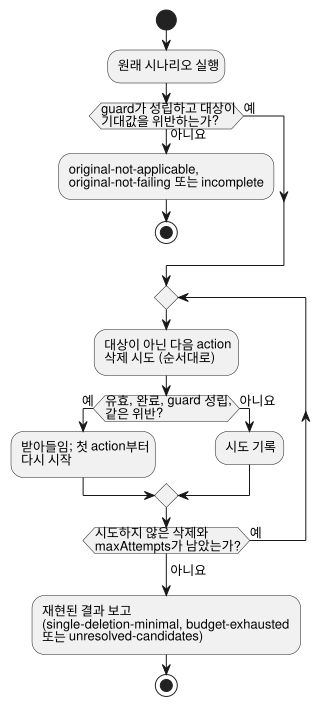

<!-- translation-source: docs/FAILURE-REDUCTION.md -->
[영문 원문](FAILURE-REDUCTION.md)

# 제한된 실패 축소

[English](FAILURE-REDUCTION.md) · [의도 책임 계약](INTENT-CONSISTENCY-CONTRACT.md) · [#561](https://github.com/callin2/ghostflow-language/issues/561)

`tools/failure-reduction.mjs`의 `reduceFailure(request)`는 정본 `.ghost.md` 프로그램 하나에
대해 실패하는 `GhostFlow/scenario-v1`을 축소합니다. "축소"란 같은 실패가 계속 재현되는 동안
시나리오 action을 제거해, 사람이 더 짧은 사례를 검토할 수 있게 한다는 뜻입니다.

호출자가 제공하는 것과 도구가 하지 않는 일은 다음과 같습니다.

- 호출자는 기대값과, 그 기대값이 나온 요구 사항의 revision(판본)을 제공합니다.
- 도구는 프로그램에서 oracle을 도출하거나, 의도를 추론하거나, 근본 원인을 식별하거나,
  물리 장치를 조작하지 **않습니다**.
- 각 후보는 기존 `ghostsim` Rust 네이티브 또는 WASM 시나리오 경로를 거쳐, 프로그램의 정본
  초기 상태에서부터 실행됩니다.

## 요청

| 필드 | 계약 |
|---|---|
| `format` | `GhostFlow/failure-reduction-request-v1` |
| `program` | `{ filename, source }`. 선택적으로 `sourceClosure`와 #565의 정확한 `intentEvidence` 레코드를 포함합니다. `filename`은 `.ghost.md`로 끝나야 합니다. |
| `scenario` | 초기 입력, 환경 프로필, 순서가 있는 action을 담은 완전한 `GhostFlow/scenario-v1`. action을 제거하면 이후의 유효 입력이 바뀔 수 있으므로 폐루프 `plant`는 제외합니다. |
| `predicate` | `{ kind: 'equals', observation, expected, at, when? }`. `observation`은 `requested`, `safe`, `stateBefore`, `stateAfter`에 대한 `{ field, name }`이거나, 전체 fault 목록에 대한 `{ field: 'faults' }`입니다. `at`은 `{ actionIndex, logicalTimeMs }`이며, 정확히 그 시각을 가진 원래 스캔 action 하나를 가리켜야 합니다. 실패란 그 스캔에서 실제 값이 `expected`와 **같지 않은 것**입니다. 선택적 `when`은 같은 스캔에서 평가하는 `{ observation, expected }` 동등성 guard를 최대 8개 담은 비어 있지 않은 배열입니다. |
| `requirement` | 외부 `{ id, revision, sha256, reference }`. 호출자 기대의 revision을 식별합니다. 컴파일러는 이를 가져오거나 인증하지 않고 보존합니다. |
| `condition` | `program.intentEvidence`에 있는 정확한 #565 조건의 `{ id, revision, sha256 }`(선택). 그 확인 범위를 보존하며, 권한은 `not-authenticated`로 남습니다. |
| `maxAttempts` | 정수 1..128. 시나리오 검증에서 거부된 후보를 포함해, 검토한 모든 단일 action 삭제를 셉니다. 원래 실패를 확인하는 실행은 별도이며 이 예산을 쓰지 않습니다. |

검증과 한계:

- 알 수 없는 필드는 거부됩니다. 유효하지 않은 소스, 시나리오, 필드, 조건 identity, 예산,
  action/시각 identity도 거부됩니다.
- 요청은 첫 비동기 컴파일 전에 정규 JSON으로 캡처되며, 한도는 3 MiB입니다. 시나리오 바이트는
  256 KiB로 제한됩니다.
- CLI는 같은 요청을 JSON 또는 TOON으로 받습니다. 콜백이나 외부 코드 실행 지시는 받지 않습니다.

## 탐색과 결과

**탐색 방식.** 지표는 **action 개수**입니다. 대상 스캔 action은 항상 남으며, 그 밖의 action은
보호되지 않습니다.



다이어그램처럼 축소기는 다음과 같이 동작합니다.

1. 원래 순서대로 action을 하나씩 삭제해 봅니다.
2. 후보가 검증을 통과하고, 새 시나리오 실행이 완료되고, 제공된 모든 `when` guard가 기대값과
   같고, 대상 관측이 여전히 같은 고정 기대값을 위반할 때에만 삭제를 받아들입니다.
3. 삭제를 받아들인 뒤에는 더 짧아진 순서를 처음부터 다시 훑습니다.

모든 관측은 보존된 대상 스캔을 사용하며, 그 스캔 ID가 바뀌어도 마찬가지입니다. 축소기는
action의 시각, 값, 순서, 환경, 초기 입력을 절대 다시 쓰지 않습니다. 삭제할 때마다 대상의 새
스캔 ID를 다시 계산하고, 보고서는 남아 있는 각 원래 스캔 action 인덱스를 새 스캔 ID에
대응시킵니다.

**guard가 "같은 실패"를 식별합니다.** 같은 실패를 식별하는 데 필요한 조건은 호출자가 반드시
명시해야 합니다. 예를 들어 "Disconnected 센서 fault 동안 펌프가 ON으로 남는다"를 축소하려면,
소스가 `Disconnected`일 때에만 참인 Boolean을 노출할 수 있습니다. 그러면 `when`은 그 Boolean이
참이기를 요구하고, 주 predicate는 펌프가 OFF이기를 기대합니다. *모든* 센서 fault에 대한
guard는 `NotReady`에도 맞으므로 다른 범위를 표현하게 됩니다. 도구는 이런 guard를 추론하거나
인증하지 않습니다. guard를 포함한 전체 고정 predicate는 결과에 보존되고 해시됩니다. `when`이
없으면 주 동등성 위반만 요구됩니다.

**재현된 결과**(`outcome: 'reproduced'`)에는 다음이 포함됩니다.

- 실행 가능한 `reducedScenario`
- 원래 시나리오와 축소된 시나리오의 해시
- 소스, GFB, manifest, 선택적 closure의 해시
- 선택된 런타임과 호스트의 해시, 그리고 WASM의 경우 Node 버전
- 고정 predicate와 그 digest
- 요구 사항 identity와 조건 바인딩
- 원래 관측과 축소된 관측
- 시도와 삭제 이력

`sourceBinding`은 이름 붙은 관측과 연관된 컴파일러 노드와 소스 위치를 알려 줍니다. 이것은
관측된 위반 위치일 뿐, 원인이나 수정 위치가 아닙니다. `physicalEffects`는 항상 `false`입니다.

**축소 상태**는 탐색이 어디까지 갔는지 알려 줍니다.

| `reductionStatus` | 의미 |
| --- | --- |
| `single-deletion-minimal` | 마지막 전수 패스에서, 검증을 통과하고 완료되며 같은 위반을 유지하는 단일 action 삭제를 찾지 못했습니다. 전역적으로 가장 짧은 시나리오라고 주장하지는 **않습니다**. 같은 고정 predicate를 여전히 위반하는 한, 관측된 값은 바뀔 수 있습니다. |
| `budget-exhausted` | 후보 한도 때문에 탐색이 멈췄습니다. |
| `unresolved-candidates` | 마지막 패스의 후보 중 관측이 없거나 실행이 실패한 것이 있어, 최소성을 주장하지 않습니다. |

유효하지 않은 후보는 기록되지만 실패를 재현할 수는 없습니다.

**재현되지 않은 결과:**

| 상황 | 결과 |
| --- | --- |
| 원래 실행에서 guard가 성립하지 않음 | `original-not-applicable`; 축소를 시작하지 않음 |
| guard는 성립하지만 원래 실행이 기대한 주 값으로 완료됨 | `original-not-failing` |
| 원래 실행이나 선택된 관측을 사용할 수 없음 | `incomplete`; 절대 재현된 실패가 아님 |
| 축소 중 런타임 또는 호스트 해시가 바뀜 | 축소가 `incomplete`로 끝남 |
| 결과 출력이 1 MiB를 넘음 | 명시적으로 `incomplete` |

개별 후보의 경우, guard가 거짓인 후보는 거부됩니다. guard 관측이 없거나 런타임/호스트가
실패하면 그 시도는 `unknown`이며, 받아들여질 수도 없고 최소성을 증명할 수도 없습니다.

## 실행 가능한 예제

기존 시나리오 러너 결과물이 설치된 상태에서 저장소 루트에서 실행합니다.

```js
import { createHash } from 'node:crypto';
import { reduceFailure } from './tools/failure-reduction.mjs';

const source = `\`\`\`ghost
control Timer {
  state active: Bool = true;
  timer age = elapsed(active);
  output expired: Bool;
  output drive: Percent;
  expired <- age >= 10s;
  drive <- 0%;
}
\`\`\`\n`;
const request = {
  format: 'GhostFlow/failure-reduction-request-v1',
  program: { filename: 'timer.ghost.md', source },
  scenario: {
    format: 'GhostFlow/scenario-v1', id: 'timer-failure', initialInputs: [], keyBindings: [],
    actuatorBindings: [{ actuator: 'drive', output: 'drive', type: 'Percent', min: 0, max: 100 }],
    actions: [0, 1000, 5000, 10000, 15000].map(atMs => ({ kind: 'scan', atMs })),
  },
  predicate: { kind: 'equals', observation: { field: 'safe', name: 'expired' },
    expected: false, at: { actionIndex: 4, logicalTimeMs: 15000 } },
  requirement: { id: 'REQ-LIMIT', revision: 'r1',
    sha256: createHash('sha256').update('external requirement revision r1').digest('hex'),
    reference: 'example:requirements/REQ-LIMIT/r1' },
  maxAttempts: 32,
};
const result = await reduceFailure(request);
console.log(result.outcome, result.reductionStatus, result.reducedScenario?.actions);
```


이 예제에 대한 참고 사항:

- `drive` 가상 액추에이터 바인딩이 기존 WASM 시나리오 호스트를 선택합니다.
- 요구 사항 reference는 가상의 값입니다.
- 보고된 predicate 위반은, 제공된 이 기대가 실행된 이 가상 관측과 일치하지 않았다는 뜻일
  뿐입니다. 기대가 옳다고 인증하거나 불일치의 원인을 진단하지는 않습니다.

CLI를 사용하려면 같은 요청을 JSON 또는 TOON으로 저장하고
`node tools/ghostshrink.mjs --request reduction.json --format json`을 실행합니다. 기본 출력은
TOON입니다. 재현된 결과는 종료 코드 0으로, 유효하지 않음, original-not-applicable,
original-not-failing, incomplete 결과는 종료 코드 1로 끝납니다. 반환된 `reducedScenario`는
TOON으로 직렬화해 기존 시나리오 러너와 같은 컴파일된 프로그램으로 재생할 수 있습니다.
