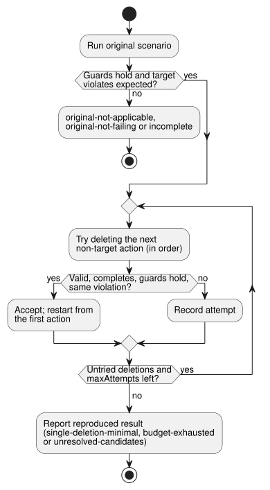

# Bounded failure reduction

[한국어](FAILURE-REDUCTION.ko.md) · [Intent responsibility contract](INTENT-CONSISTENCY-CONTRACT.en.md) · [#561](https://github.com/callin2/ghostflow-language/issues/561)

`reduceFailure(request)` in `tools/failure-reduction.mjs` shrinks a failing
`GhostFlow/scenario-v1` for one canonical `.ghost.md` program. "Shrink" means it
removes scenario actions while the same failure still reproduces, so a person
can review a shorter case.

What the caller supplies, and what the tool does not do:

- The caller supplies the expected value and the revision of the requirement it
  comes from.
- The tool does **not** derive an oracle from the program, infer intent,
  identify a root cause, or operate a physical device.
- Each candidate runs through the existing `ghostsim` Rust native or WASM
  scenario path, starting from the program's canonical initial state.

## Request

| Field | Contract |
|---|---|
| `format` | `GhostFlow/failure-reduction-request-v1` |
| `program` | `{ filename, source }`, optionally `sourceClosure` and the exact #565 `intentEvidence` record. `filename` must end in `.ghost.md`. |
| `scenario` | A complete `GhostFlow/scenario-v1` with initial inputs, environment profiles and ordered actions. A closed-loop `plant` is excluded because removing an action can alter later effective inputs. |
| `predicate` | `{ kind: 'equals', observation, expected, at, when? }`. `observation` is `{ field, name }` for `requested`, `safe`, `stateBefore` or `stateAfter`, or `{ field: 'faults' }` for the whole fault list. `at` is `{ actionIndex, logicalTimeMs }` and must identify one original scan action with that exact time. The failure is the actual value **not equaling** `expected` at that scan. Optional `when` is a nonempty array of at most eight `{ observation, expected }` equality guards evaluated at that same scan. |
| `requirement` | External `{ id, revision, sha256, reference }`. This identifies the caller's expectation revision. The compiler retains it without fetching or authenticating it. |
| `condition` | Optional `{ id, revision, sha256 }` of an exact #565 condition in `program.intentEvidence`. Its confirmation scope is retained; authority stays `not-authenticated`. |
| `maxAttempts` | Integer 1..128. Counts every considered single-action deletion, including candidates rejected by scenario validation. The original confirming run is separate and does not consume this budget. |

Validation and limits:

- Unknown fields are rejected. So are an invalid source, scenario, field,
  condition identity, budget, or action/time identity.
- The request is captured as canonical JSON before the first asynchronous
  compile, with a 3 MiB limit. Scenario bytes are capped at 256 KiB.
- The CLI accepts the same request as JSON or TOON. It does not accept callbacks
  or instructions to execute external code.

## Search and result

**How the search works.** The metric is **action count**. The target scan
action always stays; no other action is protected.



As the diagram shows, the reducer:

1. tries deleting one action at a time, in original order;
2. accepts a deletion only when the candidate validates, a fresh scenario run
   completes, every supplied `when` guard equals its expected value, and the
   target observation still violates the same fixed expected value;
3. after an accepted deletion, restarts scanning the shorter sequence from the
   beginning.

All observations use the preserved target scan, even if its scan ID changes.
The reducer never rewrites action times, values, order, environment or initial
inputs. After each deletion it recalculates the target's new scan ID, and the
report maps each retained original scan action index to its new scan ID.

**Guards identify "the same failure".** The caller must state any condition
needed to identify the same failure. Example: to reduce “pump stays ON during a
Disconnected sensor fault,” the source can expose a Boolean that is true
specifically for `Disconnected`. Then `when` requires that Boolean to be true,
while the main predicate expects the pump to be OFF. A guard for *any* sensor
fault would also match `NotReady`, and so would express a different scope. The
tool does not infer or authenticate these guards. The full fixed predicate,
including guards, is retained and hashed in the result. With no `when`, only
the main equality violation is required.

**A reproduced result** (`outcome: 'reproduced'`) includes:

- a runnable `reducedScenario`;
- original and reduced scenario hashes;
- source, GFB, manifest and optional closure hashes;
- selected runtime and host hashes, and the Node version for WASM;
- the fixed predicate and its digest;
- the requirement identity and condition binding;
- original and reduced observations;
- attempts and deletion history.

`sourceBinding` gives the compiler node and source location associated with a
named observation. It is an observed violation location, not a cause or a
repair location. `physicalEffects` is always `false`.

**Reduction status** says how far the search got:

| `reductionStatus` | Meaning |
| --- | --- |
| `single-deletion-minimal` | An exhaustive final pass found no one-action deletion that validated, completed and kept the same violation. It does **not** claim a globally shortest scenario. The observed value may change, as long as it still violates the same fixed predicate. |
| `budget-exhausted` | The candidate limit stopped the search. |
| `unresolved-candidates` | A final-pass candidate had a missing observation or an execution failure, so minimality is not claimed. |

Invalid candidates are recorded but can never reproduce the failure.

**Non-reproduced outcomes:**

| Situation | Result |
| --- | --- |
| A guard does not hold in the original run | `original-not-applicable`; no reduction starts |
| Guards hold, but the original run completes with the expected main value | `original-not-failing` |
| The original run or any selected observation is unavailable | `incomplete`, never a reproduced failure |
| A runtime or host hash changes during reduction | reduction ends as `incomplete` |
| Result output exceeds 1 MiB | explicitly `incomplete` |

For individual candidates: a candidate with a false guard is rejected. A missing
guard observation, or a runtime/host failure, is an `unknown` attempt; it cannot
be accepted and cannot prove minimality.

## Runnable example

Run from the repository root with the existing scenario runner artifacts installed:

```js
import { createHash } from 'node:crypto';
import { reduceFailure } from './tools/failure-reduction.mjs';

const source = `\`\`\`ghost
control Timer {
  state active: Bool = true;
  timer age = elapsed(active);
  output expired: Bool;
  output drive: Percent;
  expired <- age >= 10s;
  drive <- 0%;
}
\`\`\`\n`;
const request = {
  format: 'GhostFlow/failure-reduction-request-v1',
  program: { filename: 'timer.ghost.md', source },
  scenario: {
    format: 'GhostFlow/scenario-v1', id: 'timer-failure', initialInputs: [], keyBindings: [],
    actuatorBindings: [{ actuator: 'drive', output: 'drive', type: 'Percent', min: 0, max: 100 }],
    actions: [0, 1000, 5000, 10000, 15000].map(atMs => ({ kind: 'scan', atMs })),
  },
  predicate: { kind: 'equals', observation: { field: 'safe', name: 'expired' },
    expected: false, at: { actionIndex: 4, logicalTimeMs: 15000 } },
  requirement: { id: 'REQ-LIMIT', revision: 'r1',
    sha256: createHash('sha256').update('external requirement revision r1').digest('hex'),
    reference: 'example:requirements/REQ-LIMIT/r1' },
  maxAttempts: 32,
};
const result = await reduceFailure(request);
console.log(result.outcome, result.reductionStatus, result.reducedScenario?.actions);
```


Notes on this example:

- The `drive` virtual actuator binding selects the existing WASM scenario host.
- The requirement reference is fictional.
- A reported predicate violation only means that this supplied expectation
  disagreed with this executed virtual observation. It does not certify the
  expectation or diagnose the source of the discrepancy.

To use the CLI, save the same request as JSON or TOON and run
`node tools/ghostshrink.mjs --request reduction.json --format json`. Default
output is TOON. A reproduced result exits 0; invalid, original-not-applicable,
original-not-failing and incomplete results exit 1. The returned
`reducedScenario` can be serialized as TOON and replayed with the existing
scenario runner and the same compiled program.
