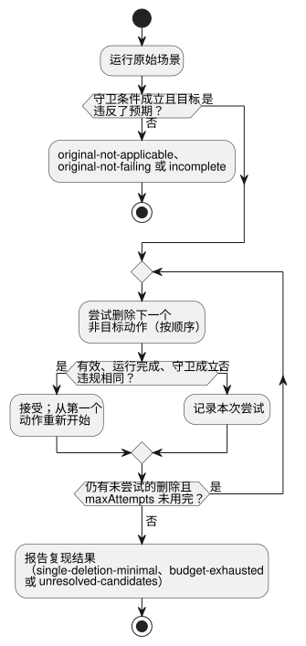

<!-- translation-source: docs/FAILURE-REDUCTION.md -->
[英文原文](FAILURE-REDUCTION.md)

# 有界失败约简

[한국어](FAILURE-REDUCTION.ko.md) · [意图责任契约](INTENT-CONSISTENCY-CONTRACT.zh.md) · [#561](https://github.com/callin2/ghostflow-language/issues/561)

`tools/failure-reduction.mjs` 中的 `reduceFailure(request)` 针对一个规范的 `.ghost.md` 程序，缩减一个失败的 `GhostFlow/scenario-v1`。“缩减”是指在同一失败仍能复现的前提下删除场景动作，从而让人可以审查更短的用例。

调用方提供什么，以及工具不做什么：

- 调用方提供预期值，以及该预期值所依据的需求的修订版。
- 工具**不会**从程序中推导判定基准（oracle）、推断意图、识别根本原因，也不会操作物理设备。
- 每个候选都通过现有的 `ghostsim` Rust 原生或 WASM 场景路径运行，从程序的规范初始状态开始。

## 请求

| 字段 | 契约 |
|---|---|
| `format` | `GhostFlow/failure-reduction-request-v1` |
| `program` | `{ filename, source }`，可选 `sourceClosure` 以及精确的 #565 `intentEvidence` 记录。`filename` 必须以 `.ghost.md` 结尾。 |
| `scenario` | 完整的 `GhostFlow/scenario-v1`，包含初始输入、环境 profile 和有序动作。闭环 `plant` 被排除在外，因为删除一个动作可能会改变之后的有效输入。 |
| `predicate` | `{ kind: 'equals', observation, expected, at, when? }`。对于 `requested`、`safe`、`stateBefore` 或 `stateAfter`，`observation` 为 `{ field, name }`；对于整个故障列表，则为 `{ field: 'faults' }`。`at` 为 `{ actionIndex, logicalTimeMs }`，必须指向一个时间恰好相同的原始扫描动作。失败的含义是：在该扫描时实际值**不等于** `expected`。可选的 `when` 是一个非空数组，最多包含八个 `{ observation, expected }` 相等守卫，在同一次扫描时求值。 |
| `requirement` | 外部的 `{ id, revision, sha256, reference }`。它标识调用方预期所依据的修订版。编译器保留它，但不会获取或认证它。 |
| `condition` | 可选的 `{ id, revision, sha256 }`，指向 `program.intentEvidence` 中一个精确的 #565 条件。其确认范围会被保留；权威性保持为 `not-authenticated`。 |
| `maxAttempts` | 整数 1..128。计入每一次被考虑的单动作删除，包括被场景校验拒绝的候选。最初用于确认失败的运行单独计算，不消耗此预算。 |

校验与限制：

- 未知字段会被拒绝。无效的源文件、场景、字段、条件身份标识、预算或动作/时间身份标识同样会被拒绝。
- 请求会在第一次异步编译之前被捕获为规范 JSON，上限为 3 MiB。场景字节上限为 256 KiB。
- CLI 接受以 JSON 或 TOON 表示的相同请求。它不接受回调，也不接受执行外部代码的指令。

## 搜索与结果

**搜索的工作方式。** 度量指标是**动作数量**。目标扫描动作始终保留；其他动作都不受保护。



如图所示，约简器：

1. 按原始顺序，每次尝试删除一个动作；
2. 只有在候选通过校验、一次全新的场景运行完成、所提供的每个 `when` 守卫都等于其预期值，并且目标观测仍违反同一个固定预期值时，才接受该删除；
3. 接受一次删除后，从头开始重新扫描更短的序列。

所有观测都使用被保留的目标扫描，即使其扫描 ID 发生变化。约简器绝不改写动作时间、值、顺序、环境或初始输入。每次删除后，它都会重新计算目标的新扫描 ID，报告中会把每个保留下来的原始扫描动作索引映射到其新的扫描 ID。

**守卫用于识别“同一个失败”。** 调用方必须声明识别同一个失败所需的任何条件。例如：要约简“在 Disconnected 传感器故障期间泵保持 ON”，源代码可以暴露一个专门在 `Disconnected` 时为 true 的 Boolean。然后 `when` 要求该 Boolean 为 true，而主谓词预期泵为 OFF。针对*任意*传感器故障的守卫也会匹配 `NotReady`，因此表达的是不同的范围。工具不会推断或认证这些守卫。包括守卫在内的完整固定谓词会被保留并在结果中计算哈希。如果没有 `when`，则只要求主相等条件被违反。

**已复现的结果**（`outcome: 'reproduced'`）包括：

- 可运行的 `reducedScenario`；
- 原始场景和约简后场景的哈希；
- 源文件、GFB、清单以及可选闭包的哈希；
- 所选运行时和宿主的哈希，以及 WASM 所用的 Node 版本；
- 固定谓词及其摘要；
- 需求身份标识和条件绑定；
- 原始观测和约简后的观测；
- 尝试记录和删除历史。

`sourceBinding` 给出与某个具名观测相关联的编译器节点和源代码位置。它是观测到违规的位置，而不是原因或修复位置。`physicalEffects` 始终为 `false`。

**约简状态**说明搜索进行到了什么程度：

| `reductionStatus` | 含义 |
| --- | --- |
| `single-deletion-minimal` | 一次穷尽的最终遍历没有找到任何能通过校验、运行完成并保持同一违规的单动作删除。它**并不**声称这是全局最短的场景。观测值可以改变，只要它仍违反同一个固定谓词。 |
| `budget-exhausted` | 候选数量上限终止了搜索。 |
| `unresolved-candidates` | 最终遍历中有候选缺少观测或执行失败，因此不声称最小性。 |

无效候选会被记录，但永远不能复现失败。

**未复现的结果：**

| 情形 | 结果 |
| --- | --- |
| 原始运行中某个守卫不成立 | `original-not-applicable`；不开始约简 |
| 守卫成立，但原始运行完成时主值等于预期值 | `original-not-failing` |
| 原始运行或任一所选观测不可用 | `incomplete`，绝不是已复现的失败 |
| 约简过程中运行时或宿主的哈希发生变化 | 约简以 `incomplete` 结束 |
| 结果输出超过 1 MiB | 明确标记为 `incomplete` |

对于单个候选：守卫为 false 的候选会被拒绝。守卫观测缺失，或运行时/宿主失败，则该尝试为 `unknown`；它不能被接受，也不能证明最小性。

## 可运行示例

在已安装现有场景运行器产物的情况下，从仓库根目录运行：

```js
import { createHash } from 'node:crypto';
import { reduceFailure } from './tools/failure-reduction.mjs';

const source = `\`\`\`ghost
control Timer {
  state active: Bool = true;
  timer age = elapsed(active);
  output expired: Bool;
  output drive: Percent;
  expired <- age >= 10s;
  drive <- 0%;
}
\`\`\`\n`;
const request = {
  format: 'GhostFlow/failure-reduction-request-v1',
  program: { filename: 'timer.ghost.md', source },
  scenario: {
    format: 'GhostFlow/scenario-v1', id: 'timer-failure', initialInputs: [], keyBindings: [],
    actuatorBindings: [{ actuator: 'drive', output: 'drive', type: 'Percent', min: 0, max: 100 }],
    actions: [0, 1000, 5000, 10000, 15000].map(atMs => ({ kind: 'scan', atMs })),
  },
  predicate: { kind: 'equals', observation: { field: 'safe', name: 'expired' },
    expected: false, at: { actionIndex: 4, logicalTimeMs: 15000 } },
  requirement: { id: 'REQ-LIMIT', revision: 'r1',
    sha256: createHash('sha256').update('external requirement revision r1').digest('hex'),
    reference: 'example:requirements/REQ-LIMIT/r1' },
  maxAttempts: 32,
};
const result = await reduceFailure(request);
console.log(result.outcome, result.reductionStatus, result.reducedScenario?.actions);
```


关于此示例的说明：

- `drive` 虚拟执行器绑定会选择现有的 WASM 场景宿主。
- 需求引用是虚构的。
- 报告的谓词违规只意味着所提供的预期与这次执行的虚拟观测不一致。它既不认证该预期，也不诊断差异的来源。

要使用 CLI，请把同一请求保存为 JSON 或 TOON，然后运行 `node tools/ghostshrink.mjs --request reduction.json --format json`。默认输出为 TOON。已复现的结果以退出码 0 退出；无效、original-not-applicable、original-not-failing 和 incomplete 结果以退出码 1 退出。返回的 `reducedScenario` 可以序列化为 TOON，并使用现有场景运行器和同一个编译后的程序进行重放。
