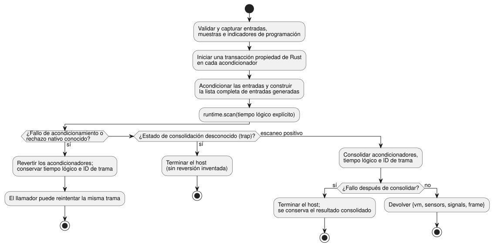

<!-- translation-source: docs/FRAMED-CONTROL-HOST.md -->
[Original en inglés](FRAMED-CONTROL-HOST.md)

# Adopción de ControlRuntime enmarcado (D6)

Diseño principal, 2026-09-11. Trabajo seleccionado: callin2/farm_studio_frontend#69,
TASK-76.6, GF-INT-COMMON-SCAN-DRIVERS.

- **Alcance:** una tarea de adopción entre módulos, dividida en dos unidades de
  implementación: el host del lenguaje y el consumidor Web.
- **Se basa en:** language PR19 / 1b04529 y web PR71 / a6999ad.
- **Fuera de alcance:** dispositivos y E/S física.

Un runtime *enmarcado* (framed) ejecuta cada escaneo como una trama explícita:
el host aporta el conjunto completo de entradas y un tiempo lógico explícito, y
recibe una identidad de trama (`scanId`, `logicalTimeMs`) para el escaneo
aceptado.

## Entrada del host del lenguaje

Añadir `ControlRuntime.instantiateFramed(wasmBytes, artifact, options = {})`.

Usa la misma validación del manifiesto, verificación del resumen (digest) del
bytecode, vinculación de capacidades y los acondicionadores de señal existentes
en Rust que la entrada actual. Versiones de manifiesto aceptadas:

- Se aceptan v1 y v4.
- v2 requiere la activación explícita `acceptSettings`.
- v3 se acepta sin activación explícita.
- La validación actual del host también acepta v7, v8 y v10 bajo sus contratos
  de bytecode específicos de cada funcionalidad. (También se aceptan manifiestos
  de funcionalidades posteriores; `validateManifest` en
  `runtimes/wasm/control-runtime.mjs` es la lista de referencia.)
- No existe la opción `acceptSolar`.

Los `instantiate` e `instantiateSimulation` heredados conservan la forma pública
de su resultado. Ahora todas las entradas usan el mismo límite transaccional
atómico de acondicionadores. Use un constructor/función auxiliar compartido; no
copie el código de acondicionamiento ni añada un segundo evaluador.

Solo la nueva entrada posee `FramedGhostFlowRuntime`. En cada `step`:

1. El host valida y captura el conjunto completo de entradas declaradas,
   muestras e indicadores de programación. Los valores DI primitivos se capturan
   una sola vez, antes del acondicionamiento.
2. Después, los acondicionadores existentes producen las entradas de
   valor+calidad de sensores/señales.

Una DI faltante nunca toma false por defecto. Un indicador de programación
ausente sigue significando "no se aportó ninguna ocurrencia", según el contrato
de host existente; no hace avanzar la programación en tiempo civil.

Construya una lista completa de entradas declaradas y generadas, excluyendo
únicamente `__gf_now_ms`. Despache exactamente una vez mediante `runtime.scan`
con un tiempo lógico explícito, incluso para programas sin temporizadores. En la
ruta enmarcada, no llame a los setters heredados ni a tick, y no recurra a un
artefacto antiguo. Las exportaciones de ABI faltantes producen un diagnóstico de
compilación y permiten la ruta existente de recarga/reintento.

**Identidad de trama.** El host posee una secuencia de tramas privada por
instancia que empieza en cero.

- Increméntela solo después de un escaneo exitoso.
- Aplique el control de agotamiento de enteros seguros antes de cualquier
  mutación de servicios del host.
- Ante errores, conserve el último tiempo y resultado aceptados.

Solo la entrada enmarcada devuelve el `{vm, sensors, signals}` existente más
`frame: {scanId, logicalTimeMs}`. `vm` sigue siendo el TickRecord canónico sin
modificar; su espacio de nombres de tick heredado es distinto del ID de trama.
`lastFrameOutcome` es un getter de solo lectura que devuelve el resultado
consolidado del runtime enmarcado como datos simples nuevos. Es `null` antes del
primer escaneo y `null` en modo heredado, y lanza un rechazo después de la
liberación (disposal). El modo de ejecución y el contador de tramas permanecen
privados.

**Señales y retención.** `signals` contiene las lecturas de los
acondicionadores. Los estados de `debounce` y `hold_last` que pertenecen a la VM
están en `vm.stateAfter`. Para las observaciones de retención, pase los
metadatos de traza de la fuente verificados y `vm` a `observeSourceTrace`;
`heldEvents` proyecta la carga Held calculada por Rust, la identidad de la
muestra original, su antigüedad y el fallo enmascarado. El adaptador y el
observador no ejecutan la expresión de retención ni amplían su TTL.

### Ventanas temporales

La reproducción (replay) temporal a través de ambos adaptadores se especifica en
[TEMPORAL-REPLAY.md](TEMPORAL-REPLAY.es.md).

Tanto `instantiate` como `instantiateFramed` requieren `options.temporal` para
los módulos de ventana GFB4. Aporte una época de ejecución explícita, contratos
de densidad de las raíces físicas y presupuestos de memoria temporal objetivo:

```js
const options = {
  temporal: {
    timeEpoch: 5,
    rootDensity: [{ sourceTag: 1, maxObservations: 3, intervalMs: 1000 }],
    budget: { maxRetainedSamples: 12, maxBytes: 33554432 },
  },
};
const runtime = await ControlRuntime.instantiateFramed(wasmBytes, artifact, options);
```

Reglas para esta opción:

- Son valores ilustrativos, no valores predeterminados de dispositivo.
- Las etiquetas de fuente deben coincidir con las raíces físicas compiladas.
  Las etiquetas de raíz son ascendentes y únicas.
- La densidad es una cota superior de adquisición; `sampleMs` no la establece.
- Los enteros del presupuesto caben en u32; la época y los intervalos son
  enteros seguros exactos.
- Los módulos sin ventanas rechazan esta opción.
- El host captura la opción antes de la inicialización asíncrona, de modo que
  una mutación posterior por parte del llamador no cambia la sesión.
- Una época de tiempo diferente requiere una nueva instancia del runtime. El
  host aporta el `__gf_time_epoch` capturado en cada escaneo.

**Evidencia de ventanas.** El núcleo en Rust calcula las ventanas. Su evidencia
propia es `vm.windowTrace`, con la calidad derivada, las identidades físicas o
agregadas inmediatas y un fallo aguas arriba opcional. No es una entrada de
acondicionador en `signals`.

- Los contribuyentes agregados anidados conservan árboles de prueba propios de
  sus entradas; el observador no los aplana en un promedio diferente.
- El tiempo de observación sigue siendo el tiempo de la medición contribuyente
  más reciente; el tiempo de evaluación es independiente.
- Un escaneo rechazado revierte juntos el historial de ventanas y los
  acondicionadores, de modo que un reintento puede reutilizar la misma identidad
  de muestra.
- `observeSourceTrace(verifiedMetadata, vm)` proyecta esto como `windowEvents`
  vinculados a la declaración de autoría. Los agregados no disponibles informan
  de su propio punto NotReady; un fallo aguas arriba permanece separado.
- El mapa de fuentes registra las fuentes de ventana, las entradas de identidad,
  los relojes y las dependencias de ventanas aguas abajo. Al restaurar un mapa
  de fuentes se comprueban estos vínculos contra la reducción (lowering)
  canónica.

Los adaptadores de bajo nivel exponen `activateTemporal(profile)` con el mismo
perfil. Ambos usan el paquete de activación GFTA acotado y una validación
independiente en Rust. El presupuesto contabiliza el almacenamiento temporal y
las trazas retenidas acotadas. Los búferes JSON, los acondicionadores del host y
las copias que retiene el llamador quedan fuera de ese presupuesto. La
validación del manifiesto comprueba los dominios estructurales y el resumen del
bytecode; la equivalencia de fuente canónica/descriptor nominal requiere la
verificación de la cadena de herramientas/paquete.

**Transacción atómica del paso.** Toda la validación ordinaria de
instantánea/tipo/tiempo ocurre antes de cualquier mutación de los
acondicionadores. El contrato posterior de tick atómico de la Referencia 4.15
reemplaza la limitación original de este diseño que no permitía revertir.



El diagrama muestra los tres finales posibles de un paso:

- **Rechazo conocido: revertir.** Antes del acondicionamiento, el host inicia
  una transacción propiedad de Rust en cada acondicionador de sensor y de señal.
  Si el acondicionamiento, la preparación de entradas generadas o un rechazo
  nativo conocido hacen fallar el paso, todos ellos se revierten. El tiempo
  lógico aceptado y el ID de trama permanecen sin cambios, de modo que el
  llamador puede reintentar.
- **Escaneo positivo: consolidar.** Un escaneo nativo positivo consolida todos
  los acondicionadores, el tiempo lógico y el ID de trama antes de decodificar el
  resultado. Un fallo posterior a ese límite no puede deshacer el estado
  aceptado y termina el host.
- **Estado de consolidación desconocido: terminar.** Un trap cuyo estado de
  consolidación nativo se desconoce también termina el host, sin inventar una
  reversión.

El resultado consolidado de la VM sigue disponible mientras su adaptador siga
siendo legible. Las restricciones globales que producen salidas false son
escaneos exitosos, no fallos del host. La liberación (dispose) libera todos los
acondicionadores propios y el handle enmarcado.

## Consumidor Web

**Fijación y compilación.**

- Fije el commit revisado del host del lenguaje y compile el WASM real
  correspondiente mediante la protección estricta existente de fuente/artefacto.
- Main conserva la responsabilidad de actualizar la fijación hasta que el
  prerrequisito del lenguaje haya superado una revisión independiente.
- `compilePlaygroundSource` usa `instantiateFramed` y asigna un `runEpoch`
  (UUID) nuevo por cada compilación exitosa.
- No edite los checkouts de vista previa de los usuarios.

**Escaneo.** `runPlaygroundScan` acepta exactamente ocho entradas DI booleanas
presentes.

- Rechace longitudes incorrectas, huecos o valores no booleanos antes de llamar
  al host.
- Use una instantánea desacoplada.
- Elimine el respaldo (fallback) que infería entradas false.
- Valide la identidad/tiempo de trama aceptados por el host antes de publicar el
  resultado en la UI.
- RO1..RO8 provienen únicamente del banco `vm.safe` final de ese resultado, cada
  uno como un booleano explícito. Nunca use las salidas solicitadas y nunca trate
  un resultado ausente como false.

**Metadatos de traza.** Mantenga sin cambios la salida canónica de la VM dentro
de ControlRuntime. La observación Web puede adjuntar
`scanFrame: {runEpoch, scanId, logicalTimeMs}` a su traza. Documéntelo como
metadatos del host en la declaración local, no como un TickRecord de Rust
modificado.

- Transpórtelo a través de los registros existentes de historial, comparación y
  reproducción (replay).
- Las comparaciones semánticas deben ignorar la identidad de época de ejecución,
  porque las ejecuciones separadas difieren intencionadamente.
- Si es útil para las comprobaciones en el navegador, exponga la identidad
  aceptada actual mediante atributos de datos de transporte. No se necesita
  texto explicativo adicional ni un diseño nuevo.
- Compilar/restablecer reemplaza la época. Una recompilación rechazada conserva
  la última instancia e identidad buenas. Pausar y avanzar un paso no reemplazan
  una época ni omiten ID de trama.

## Verificación y finalización

| Unidad | Comprobaciones requeridas |
| --- | --- |
| Lenguaje | WASM real compilado; todas las puertas existentes; paridad de entradas completas/generadas de la nueva entrada (temporizador, sensor/señal, programación, restricciones); tramas con y sin temporizadores; progresión segura de la identidad y rechazo; ninguna llamada a exportaciones heredadas; reversión ante rechazo conocido y reintento con el mismo ID; retención (latch) de fallos desconocidos/posteriores a la consolidación y preservación del resultado consolidado; manejo de artefactos antiguos y de la liberación |
| Web | protección de unidad/tipos/compilación/fuente; servidor de navegador estricto sin reutilización; pruebas existentes de lecciones/replay/traza de fuente y velocidad; continuidad de trama/época aceptada; restricciones; compilación/restablecimiento fallidos; rechazo de DI inválidas antes de una llamada al host |

El prerrequisito del lenguaje puede fusionarse después de sus propias puertas
sobre el head exacto. El D6 padre no puede estar Done hasta que Web fije y
ejercite ese artefacto. D9 (paridad de cinta enmarcada nativa) y D7/D8/D11
(integración de dispositivos) siguen siendo tareas separadas.

## Programaciones civiles (issue #366)

Para las programaciones civiles enmarcadas `Daily` y `DailySlots`:

- El host activa el perfil de programación con `{bootEpoch, terminalCapacity}`.
- El proveedor aporta por separado los paquetes de hechos de programación GFSF
  v2/v3, en el momento del escaneo. La activación no produce paquetes, y los
  hechos de programación no son entradas generadas ordinarias.
- `clock.monotonicMs` debe ser exactamente igual a `frame.logicalTimeMs`.

El runtime exporta `gf_frame_activate_schedules` y
`gf_frame_scan_schedules`; el host de JavaScript usa `activateSchedules` y
`dispatchSchedules`. El host debe exigir las exportaciones WASM correspondientes
antes de usar esta ruta.

Rust se encarga de la admisión de ocurrencias y del libro mayor (ledger) de
ocurrencias. Antes de la ejecución, el host valida el conjunto completo de
entradas declaradas y generadas y el paquete de hechos de programación. El host
no debe derivar ni aportar resultados `due`, `ok` o `fault` del runtime.

Una trama rechazada sigue el límite de consolidación existente:

- Un rechazo conocido se revierte y permite un reintento con la misma identidad
  de trama. Por ejemplo, un paquete de hechos de programación inválido se
  rechaza antes de la consolidación de la trama; un reintento válido usa la
  misma identidad de trama.
- Un fallo posterior a la consolidación nativa preserva el resultado de la trama
  consolidada original, y esa trama no puede reintentarse como una trama no
  consolidada.

La cobertura de regresión está en `tests/framed-control-host.test.mjs` y
`crates/ghostflow-core/tests/schedule_module.rs`.

Las programaciones Solar enmarcadas siguen sin ser compatibles.

Regla de prevención: verifique la interfaz pública real del runtime antes de
hacer suposiciones con mocks. La cobertura con mocks por sí sola no establece la
capacidad del runtime.
