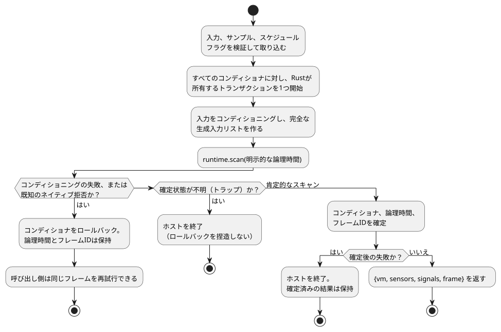

<!-- translation-source: docs/FRAMED-CONTROL-HOST.md -->
[英語の原文](FRAMED-CONTROL-HOST.md)

# フレーム化ControlRuntimeの採用（D6）

メイン設計、2026-09-11。選定された作業：callin2/farm_studio_frontend#69、TASK-76.6、GF-INT-COMMON-SCAN-DRIVERS。

- **範囲：** モジュールをまたぐ1つの採用タスクで、2つの実装単位（言語ホストとWebの利用側）に分かれます。
- **前提：** 言語PR19 / 1b04529とWeb PR71 / a6999ad。
- **範囲外：** デバイスと物理I/O。

*フレーム化*ランタイムは、各スキャンを1つの明示的なフレームとして実行します。ホストは完全な入力セットと明示的な論理時間を渡し、受理されたスキャンについてフレームの同一性（`scanId`、`logicalTimeMs`）を受け取ります。

## 言語ホストのエントリ

`ControlRuntime.instantiateFramed(wasmBytes, artifact, options = {})`を追加します。

これは、現在のエントリと同じマニフェスト検証、バイトコードのダイジェスト検証、ケイパビリティのバインディング、既存のRustの信号コンディショナを使います。受け付けるマニフェストのバージョン：

- v1とv4は受け付けます。
- v2は`acceptSettings`のオプトインが必要です。
- v3はオプトインなしで受け付けます。
- 現在のホスト検証は、機能ごとのバイトコード契約のもとでv7、v8、v10も受け付けます。（後続の機能マニフェストも受け付けます。正式な一覧は`runtimes/wasm/control-runtime.mjs`の`validateManifest`です。）
- `acceptSolar`オプションはありません。

従来の`instantiate`と`instantiateSimulation`は、公開の結果の形を維持します。現在はすべてのエントリが同じアトミックなコンディショナのトランザクション境界を使います。共有のコンストラクタ／ヘルパーを使ってください。コンディショニングのコードをコピーしたり、2つ目の評価器を追加したりしてはなりません。

`FramedGhostFlowRuntime`を所有するのは新しいエントリだけです。各`step`では次のようになります。

1. ホストは、宣言された入力、サンプル、スケジュールフラグを完全に検証して取り込みます。プリミティブなDIの値は、コンディショニングの前に1回だけ取り込まれます。
2. その後、既存のコンディショナがセンサ／信号の値＋品質の入力を生成します。

欠けているDIが既定でfalseになることは決してありません。スケジュールフラグがない場合は、既存のホスト契約どおり「渡された発生がない」ことを意味し、暦時間のスケジューリングを進めることはありません。

`__gf_now_ms`だけを除いた、宣言された入力と生成された入力の完全なリストを1つ作ります。タイマーのないプログラムであっても、明示的な論理時間を指定して`runtime.scan`でちょうど1回ディスパッチします。フレーム化の経路では、従来のセッターやtickを呼び出してはならず、古い成果物にフォールバックしてもなりません。ABIのエクスポートが欠けている場合はコンパイル診断が生成され、既存の再読み込み／再試行の経路を使えます。

**フレームの同一性。** ホストは、インスタンスごとに非公開のフレーム連番を持ち、ゼロから始めます。

- 増やすのは、スキャンが成功した後だけです。
- ホストのサービスを変更する前に、安全な整数の範囲を使い切っていないかを強制的にチェックします。
- エラー時には、最後に受理された時刻と結果を保持します。

フレーム化エントリだけが、既存の`{vm, sensors, signals}`に加えて`frame: {scanId, logicalTimeMs}`を返します。`vm`は変更されていない正準のTickRecordのままです。その従来のtick名前空間はフレームIDとは別物です。`lastFrameOutcome`は読み取り専用のゲッターで、フレーム化ランタイムの新しいプレーンデータの確定済み結果を返します。最初のスキャンの前と従来モードでは`null`であり、破棄後は拒否されます。実行モードとフレームカウンタは非公開のままです。

**信号とホールド。** `signals`にはコンディショナの読み取り値が入ります。VMが所有する`debounce`と`hold_last`の状態は`vm.stateAfter`にあります。ホールドの観測には、検証済みのソーストレースのメタデータと`vm`を`observeSourceTrace`に渡します。`heldEvents`は、Rustが計算したHeldのペイロード、元のサンプルの同一性、その経過時間、マスクされた故障を射影します。アダプタとオブザーバーは、ホールド式を実行することも、そのTTLを延長することもしません。

### 時間ウィンドウ

両方のアダプタを通じた時間的リプレイは、[時間的リプレイ（TEMPORAL-REPLAY）](TEMPORAL-REPLAY.ja.md)で規定されています。

GFB4のウィンドウモジュールでは、`instantiate`と`instantiateFramed`の両方に`options.temporal`が必要です。明示的な実行エポック、物理ルートの密度契約、ターゲットの時間メモリ予算を渡します。

```js
const options = {
  temporal: {
    timeEpoch: 5,
    rootDensity: [{ sourceTag: 1, maxObservations: 3, intervalMs: 1000 }],
    budget: { maxRetainedSamples: 12, maxBytes: 33554432 },
  },
};
const runtime = await ControlRuntime.instantiateFramed(wasmBytes, artifact, options);
```

このオプションのルール：

- これらは説明用の値であり、デバイスの既定値ではありません。
- ソースタグは、コンパイルされた物理ルートと一致しなければなりません。ルートタグは昇順で一意です。
- 密度は取得の上限です。`sampleMs`によって決まるものではありません。
- 予算の整数はu32に収まります。エポックと間隔は厳密な安全な整数です。
- ウィンドウ以外のモジュールはこのオプションを拒否します。
- ホストは非同期の初期化の前にオプションを取り込むので、その後に呼び出し側が変更してもセッションは変わりません。
- 異なる時間エポックには、新しいランタイムインスタンスが必要です。ホストは取り込んだ`__gf_time_epoch`をスキャンのたびに渡します。

**ウィンドウの証拠。** ウィンドウはRustコアが計算します。その所有する証拠は`vm.windowTrace`であり、導出された品質、直接の物理または集約の同一性、省略可能な上流の故障を含みます。これは`signals`内のコンディショナのエントリではありません。

- 入れ子になった集約の寄与要素は、自身の入力について所有する証明ツリーを保持します。オブザーバーがそれらを平坦化して別の平均にすることはありません。
- 観測時刻は、寄与した最新の測定時刻のままです。評価時刻はそれとは別です。
- 拒否されたスキャンは、ウィンドウの履歴とコンディショナを一緒にロールバックするので、再試行では同じサンプルの同一性を再利用できます。
- `observeSourceTrace(verifiedMetadata, vm)`は、これを作成された宣言にリンクされた`windowEvents`として射影します。利用できない集約は自身のNotReadyの発生箇所を報告し、上流の故障は別のまま残ります。
- ソースマップは、ウィンドウのソース、同一性の入力、クロック、下流のウィンドウの依存関係を記録します。ソースマップを復元する際は、これらのリンクを正準の下げ（lowering）と照合します。

低レベルのアダプタは、同じプロファイルを取る`activateTemporal(profile)`を公開します。どちらも上限付きのGFTAアクティベーションパケットと、独立したRustの検証を使います。予算は、時間的なストレージと上限付きの保持トレースを計上します。JSONバッファ、ホストのコンディショナ、呼び出し側が保持するコピーは予算の対象外です。マニフェスト検証は構造的な領域とバイトコードのダイジェストをチェックします。正準ソースと名目ディスクリプタの等価性には、ツールチェーン／パッケージの検証が必要です。

**アトミックなstepトランザクション。** 通常のスナップショット／型／時刻の検証は、すべてコンディショナを変更する前に行われます。後のリファレンス4.15のアトミックなtick契約により、この設計の当初の「ロールバックなし」という制限は置き換えられました。



この図は、1回のstepがとりうる3つの終わり方を示しています。

- **既知の拒否 — ロールバック。** コンディショニングの前に、ホストはすべてのセンサと信号のコンディショナに対して、Rustが所有するトランザクションを1つ開始します。コンディショニング、生成入力の準備、または既知のネイティブ拒否によってstepが失敗すると、それらすべてがロールバックします。受理済みの論理時間とフレームIDは変わらないので、呼び出し側は再試行できます。
- **肯定的なスキャン — 確定。** 肯定的なネイティブスキャンは、結果をデコードする前に、すべてのコンディショナ、論理時間、フレームIDを確定します。その境界より後の失敗は受理済みの状態を元に戻せず、ホストを終了させます。
- **確定状態が不明 — 終了。** ネイティブの確定状態が不明なトラップも、ロールバックを捏造することなくホストを終了させます。

確定したVMの結果は、そのアダプタが読み取り可能である間は利用できます。偽の出力をもたらすグローバル制約は成功したスキャンであり、ホストの故障ではありません。破棄（dispose）は、所有するすべてのコンディショナとフレーム化ハンドルを解放します。

## Webの利用側

**ピン留めとコンパイル。**

- レビュー済みの言語ホストのコミットをピン留めし、既存の厳格なソース／成果物ガードを通して、実際に対応するWASMをビルドします。
- 言語側の前提条件が独立したレビューを通過するまで、ピンの更新の所有権はメインが持ちます。
- `compilePlaygroundSource`は`instantiateFramed`を使い、コンパイルが成功するたびに新しい`runEpoch`（UUID）を割り当てます。
- ユーザーのプレビュー用チェックアウトを編集してはなりません。

**スキャン。** `runPlaygroundScan`は、存在するBooleanのDIエントリをちょうど8個受け付けます。

- 長さの誤り、欠落、Boolean以外の値は、ホストを呼び出す前に拒否します。
- 切り離されたスナップショットを使います。
- 推論によるfalse入力へのフォールバックを削除します。
- UIの結果を公開する前に、ホストが受理したフレームの同一性・時刻を検証します。
- RO1..RO8は、その結果の最終的な`vm.safe`バンクからのみ取得し、それぞれ明示的なBooleanとします。要求出力を使ってはならず、結果がないことをfalseとして扱ってもなりません。

**トレースのメタデータ。** ControlRuntime内の正準のVM出力は変更しません。Webの観測は、そのトレースに`scanFrame: {runEpoch, scanId, logicalTimeMs}`を添付してもかまいません。これは、変更されたRustのTickRecordとしてではなく、ローカル宣言内のホストのメタデータとして文書化します。

- 既存の履歴、比較、リプレイのレコードを通じて引き継ぎます。
- 意味的な比較では、実行エポックの同一性を無視しなければなりません。別々の実行は意図的に異なるためです。
- ブラウザでのチェックに役立つなら、現在の受理済みの同一性を転送用のデータ属性で公開します。追加の説明文や新しいレイアウトは不要です。
- コンパイル／リセットはエポックを置き換えます。再コンパイルが拒否された場合は、最後の正常なインスタンスと同一性を保持します。一時停止と1ステップ実行は、エポックを置き換えることもフレームIDを飛ばすこともありません。

## 検証と完了

| 単位 | 必要なチェック |
| --- | --- |
| 言語 | 実際にビルドしたWASM。既存のすべてのゲート。新しいエントリでの完全な入力・生成入力のパリティ（タイマー、センサ／信号、スケジュール、制約）。タイマーあり・なしのフレーム。安全な同一性の進行と拒否。従来のエクスポートの呼び出しがないこと。既知の拒否のロールバックと同一IDでの再試行。不明／確定後の故障のラッチと確定済み結果の保持。古い成果物と破棄の処理 |
| Web | ユニット／型／ビルド／ソースのガード。再利用しない厳格なブラウザサーバー。既存のレッスン／リプレイ／ソーストレースと速度のテスト。受理済みのフレーム／エポックの連続性。制約。失敗したコンパイル／リセット。ホスト呼び出し前の無効なDIの拒否 |

言語側の前提条件は、それ自体の厳密なheadのゲートを通過した後にマージできます。親のD6は、Webがその成果物をピン留めして実際に使うまでDoneにできません。D9（ネイティブのフレーム化テープのパリティ）とD7/D8/D11（デバイス統合）は別のタスクのままです。

## 暦スケジュール（issue #366）

フレーム化された暦の`Daily`と`DailySlots`スケジュールについて：

- ホストは`{bootEpoch, terminalCapacity}`でスケジュールのプロファイルをアクティベートします。
- プロバイダは、GFSF v2/v3のスケジュール事実パケットを、スキャン時に別途渡します。アクティベーションはパケットを生成せず、スケジュール事実は通常の生成入力のエントリではありません。
- `clock.monotonicMs`は`frame.logicalTimeMs`と厳密に等しくなければなりません。

ランタイムは`gf_frame_activate_schedules`と`gf_frame_scan_schedules`をエクスポートし、JavaScriptのホストは`activateSchedules`と`dispatchSchedules`を使います。ホストは、この経路を使う前に、対応するWASMのエクスポートが存在することを必須としなければなりません。

発生の受け入れ（アドミッション）と発生の台帳はRustが所有します。実行の前に、ホストは宣言された入力と生成された入力の完全なセット、およびスケジュール事実パケットを検証します。ホストが実行時の`due`、`ok`、`fault`の結果を導出したり渡したりしてはなりません。

拒否されたフレームは、既存の確定境界に従います。

- 既知の拒否はロールバックし、同じフレームの同一性での再試行を許可します。たとえば、無効なスケジュール事実パケットはフレームの確定前に拒否され、有効な再試行では同じフレームの同一性を使います。
- ネイティブの確定後の失敗は、元の確定済みのフレーム結果を保持し、そのフレームを未確定のフレームとして再試行することはできません。

回帰テストは`tests/framed-control-host.test.mjs`と`crates/ghostflow-core/tests/schedule_module.rs`にあります。

フレーム化されたSolarスケジュールは引き続きサポートされていません。

再発防止のルール：モックに関する前提を置く前に、実際の公開ランタイムインターフェースを確認してください。モックのカバレッジだけでは、ランタイムのケイパビリティは立証されません。
